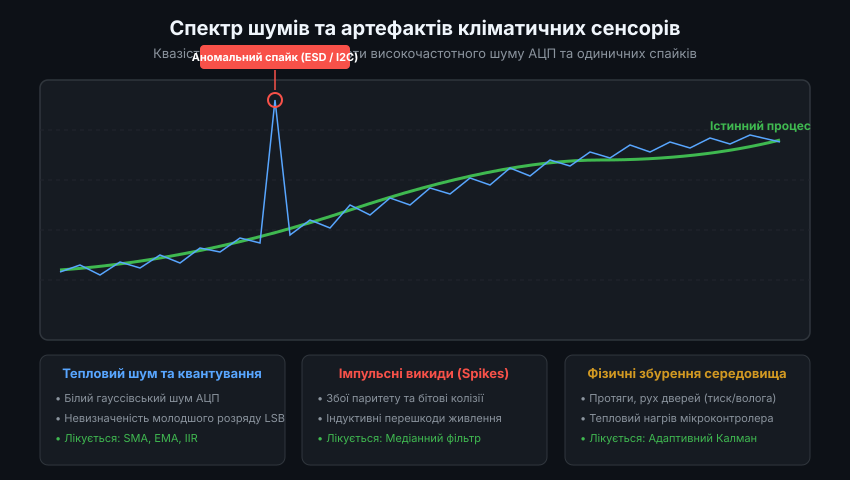
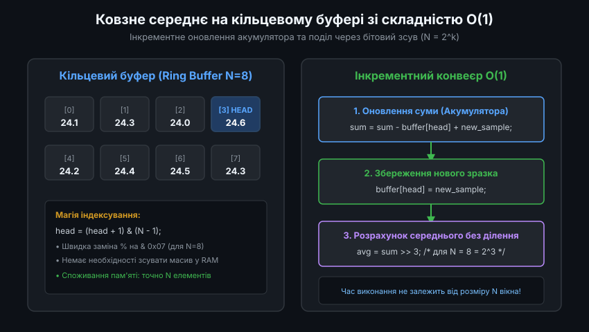
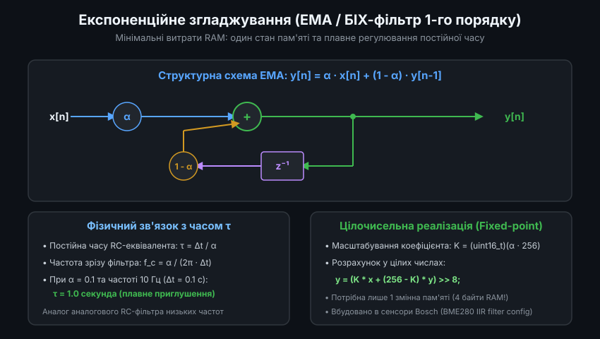
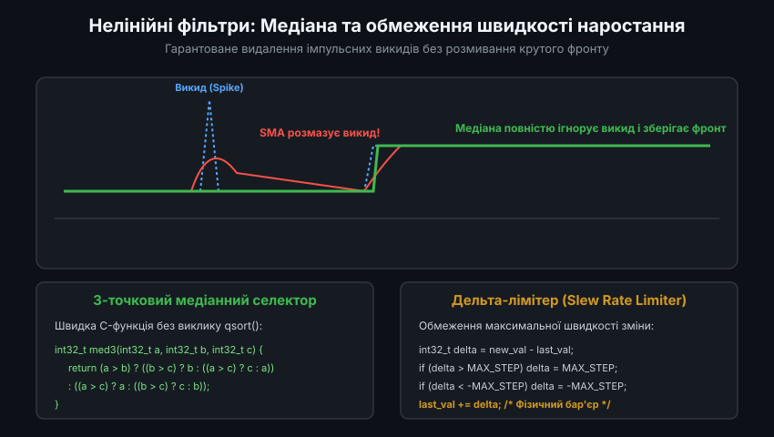
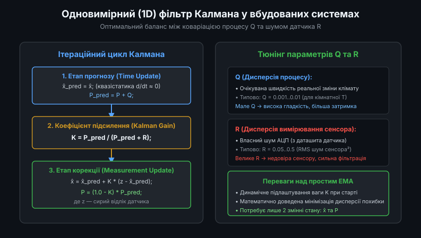

# Цифрова фільтрація кліматичних даних у мікроконтролерах

Первинні сигнали від датчиків температури, відносної вологості та атмосферного тиску в реальних умовах експлуатації неминуче спотворюються шумами різної природи. До них належать власний тепловий шум чутливого елемента, похибки квантування АЦП, високочастотні імпульсні наводки по шинах живлення та інтерфейсах I2C/SPI, а також випадкові фізичні збурення повітряного середовища (протяги, турбулентність, вібрації корпусу). Застосування цифрової фільтрації у вбудованому програмному забезпеченні мікроконтролера дозволяє ефективно очистити дані від шумів, забезпечуючи стабільну роботу контурів клімат-контролю та мінімальні витрати оперативної пам'яті.

---

### 1. Спектр шумів кліматичних сенсорів та класифікація артефактів

Фізичні процеси зміни температури та вологості повітря у приміщеннях або на відкритому просторі є повільними, квазістатичними процесами з постійними часу від кількох секунд до десятків хвилин. Натомість більшість перешкод, що виникають у вимірювальному тракті, лежать у зовсім іншій частотній області.

Усі перешкоди кліматичних вимірювань поділяють на три основні категорії:
- **Високочастотний білий шум та квантування**: випадкові флуктуації молодших розрядів вбудованого АЦП сенсора (зазвичай 1-3 LSB). Цей шум має гауссівський розподіл із нульовим середнім значенням і легко пригнічується лінійними фільтрами низьких частот.
- **Імпульсні викиди (Spikes)**: поодинокі аномальні значення, амплітуда яких у десятки разів перевищує дисперсію нормального сигналу. Вони виникають внаслідок збоїв інтерфейсу зв'язку (помилки бітів на шині I2C через наводки від реле, електростатичні розряди ESD, короткочасні просідання напруги живлення).
- **Динамічні псевдокліматичні збурення**: локальні стрибки вимірюваної величини, спричинені реальними подіями, але такими, що не відображають загальний клімат (наприклад, відкривання дверей кімнати створює різкий перепад тиску на 10-30 Па за 0.5 секунди; видих людини поруч із сенсором викликає миттєвий стрибок вологості).

Коректна стратегія фільтрації повинна видаляти спайки та згладжувати шум АЦП, не спотворюючи реальні фізичні тренди зміни температури та тиску.

---

### 2. Ковзне середнє на кільцевому буфері та оптимізація O(1)

Найпростішим та найбільш інтуїтивним методом лінійної фільтрації є просте ковзне середнє (Simple Moving Average, SMA). Воно розраховує середнє арифметичне останніх N виміряних значень.

Класична наївна реалізація, яка пересуває масив у пам'яті при кожному новому відліку та підсумовує всі N елементів, має обчислювальну складність O(N). Це вкрай неефективно для мікроконтролерів. Натомість у вбудованих системах застосовують кільцевий буфер (Ring Buffer) з інкрементним оновленням акумулятора за час O(1):

1. **Акумулятор суми**: замість підсумовування N елементів заново, мікроконтролер віднімає з поточної суми найстаріше значення з комірки буфера, до якої вказує покажчик `head`, і додає нове виміряне значення.
2. **Запис нового відліку**: нове значення зберігається в позицію `head`.
3. **Інкремент покажчика**: покажчик зміщується по колу: `head = (head + 1) % N`.
4. **Оптимізація степенем двійки**: якщо розмір буфера обрати рівним ступеню двійки (наприклад, N = 8, 16 або 32), важку операцію взяття залишку від ділення замінюють швидкою побітовою маскою `(head + 1) & (N - 1)`, а ділення суми на N — побітовим зсувом вправо `sum >> k` (де N = 2^k).

Головним обмеженням SMA є необхідність виділення масиву в оперативній пам'яті (RAM) під N відліків, а також фіксоване запізнення фази (Phase Lag), пропорційне половині розміру вікна N / 2.

---

### 3. Експоненційне згладжування (EMA / IIR фільтр першого порядку)

Коли обсяг доступної оперативної пам'яті суворо обмежений (наприклад, у низькоспоживаючих сенсорних мікроконтролерах) або коли необхідно динамічно змінювати силу згладжування, найкращим вибором є експоненційне згладжування (Exponential Moving Average, EMA), яке являє собою цифровий БІХ-фільтр (IIR) першого порядку.

Різницеве рівняння фільтра має вигляд:
`y[n] = alpha * x[n] + (1 - alpha) * y[n-1]`

Переваги фільтра EMA перед ковзним середнім:
- **Мінімальне споживання RAM**: фільтр вимагає збереження лише одного значення — попереднього вихідного стану `y[n-1]`. Жодних масивів та кільцевих буферів не потрібно.
- **Еквівалент аналогового RC-фільтра**: коефіцієнт згладжування `alpha` (від 0.0 до 1.0) безпосередньо пов'язаний із фізичною постійною часу `tau` та періодом опитування сенсора `dt`: `alpha = dt / (tau + dt)`. Чим менше `alpha`, тим повільніше і плавніше відгукується фільтр.
- **Цілочисельна арифметика**: фільтр легко реалізується у 16- або 32-бітних цілих числах без використання блоку рухомої коми (FPU):
  `y = (K * x + (256 - K) * y) >> 8`, де коефіцієнт `K = alpha * 256`.

Саме такий тип фільтрації вбудовано безпосередньо в апаратну логіку популярних цифрових сенсорів атмосферного тиску та температури, таких як Bosch BMP280 та BME280 (де коефіцієнт IIR можна налаштовувати в регістрі `config`).

---

### 4. Нелінійні медіанні фільтри та захист від імпульсних викидів

Лінійні фільтри (як SMA, так і EMA) мають суттєвий недолік: вони розраховують середнє арифметичне або зважену суму. Якщо в надхідних даних з'являється одиничний помилковий спайк (наприклад, температура різко підскочила з 22 °C до 85 °C через бітову помилку на шині I2C), лінійний фільтр "розмаже" цю помилку на десятки наступних вимірювань, сформувавши помилковий плавний горб.

Для повного викорінення імпульсних викидів застосовують нелінійну фільтрацію:

- **3-точковий або 5-точковий медіанний фільтр**: зберігає останні непарні N відліків і замість обчислення середнього вибирає центральний елемент варіаційного ряду після сортування. Якщо серед трьох відліків є один спотворений спайк (`[21.5, 85.0, 21.6]`), відсортований ряд набуде вигляду `[21.5, 21.6, 85.0]`, і медіана вибере ідеально достовірне значення `21.6`, повністю ігноруючи аномальний відлік.
- **Дельта-лімітер (Slew Rate Limiter)**: програмний бар'єр максимальної швидкості наростання сигналу. Знаючи теплову інерцію датчика, програміст задає максимальну фізично можливу зміну параметра за один період опитування `MAX_DELTA`. Якщо модуль різниці `abs(x[n] - y[n-1]) > MAX_DELTA`, зміна примусово обмежується цим порогом, що відсікає неможливі фізично стрибки температури чи вологості.

Найкращі результати дає каскадне з'єднання: спочатку 3-точковий медіанний фільтр відсікає комунікаційні викиди, а наступний за ним фільтр EMA згладжує залишковий шум АЦП.

---

### 5. Одновимірний фільтр Калмана для кліматичних вимірювань

Коли вимоги до співвідношення "рівень шуму / швидкість відгуку" є максимальними, оптимальним вибором стає одновимірний (1D) фільтр Калмана. На відміну від фільтрів із фіксованими коефіцієнтами, фільтр Калмана динамічно розраховує коефіцієнт довіри до кожного нового вимірювання на основі статистичних характеристик процесу.

Математична модель 1D фільтра Калмана для кліматичного параметра базується на двох величинах:
1. **Коваріація процесу Q**: характеризує швидкість реальної фізичної зміни параметрів середовища. Мале значення Q означає, що температура об'єкта змінюється дуже повільно і плавно.
2. **Коваріація вимірювання R**: дисперсія власного шуму сенсора (шум квантування та тепловий шум, що береться з технічного паспорта датчика).

Алгоритм виконує дві фази на кожному кроці вимірювання:
- **Прогноз**: оцінка поточного стану переноситься з попереднього кроку, а апріорна коваріація невизначеності збільшується на величину `Q`: `P_pred = P + Q`.
- **Корекція**: обчислюється коефіцієнт підсилення Калмана `K = P_pred / (P_pred + R)`. Нова оцінка формується як зважена комбінація прогнозу та нового вимірювання `z`: `x = x_pred + K * (z - x_pred)`. Одночасно уточнюється невизначеність: `P = (1 - K) * P_pred`.

Фільтр Калмана демонструє виняткову властивість: при холодному старті він призначає великий коефіцієнт `K` і миттєво збігається до істинного значення температури, а після встановлення переходить у режим сильного згладжування з мінімальною дисперсією похибки.
