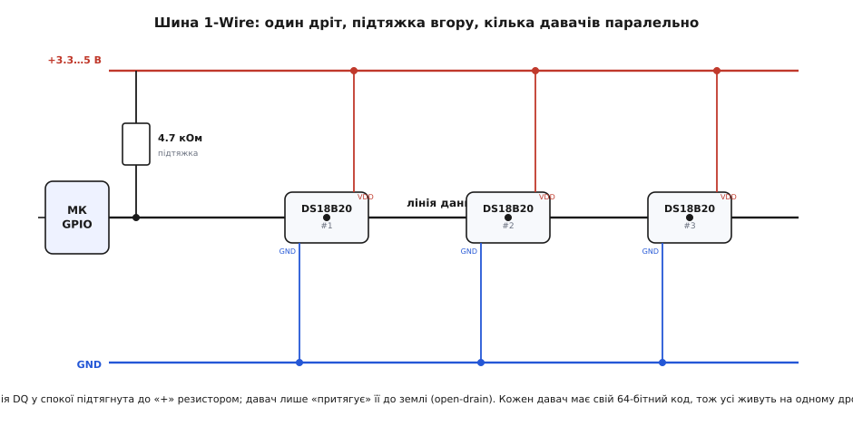
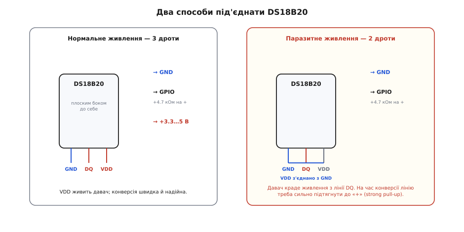

# DS18B20 — цифровий давач температури (1-Wire)

<preknowlist>
- [Рівні логічних сигналів](root:hw-digital/logic-levels-as-ranges) — визначення логічного нуля та одиниці у цифрових колах та сумісність рівнів 3.3 В і 5 В
- [Вихід із відкритим стоком (Open-Drain)](root:hw-digital/open-drain-output) — схемотехніка цифрових ліній із підтягувальним резистором для двонапрямного зв'язку
- [Шина 1-Wire](root:com-devices/one-wire) — послідовний асинхронний протокол обміну даними та живлення по єдиному сигнальному провіднику
- [Контрольна сума CRC](root:com-modulation/crc) — алгоритм циклічного надлишкового кодування для виявлення спотворень під час передачі даних
</preknowlist>

Цифровий сенсор температури **DS18B20** є одним із найпопулярніших напівпровідникових термометрів в електроніці. На відміну від аналогових термісторів, які потребують зовнішнього вимірювання напруги та складної математичної лінеаризації, DS18B20 інтегрує в одному кристалі термочутливий кремнієвий елемент, аналогово-цифровий перетворювач, оперативну пам'ять із контролем цілісності та логіку однопровідного інтерфейсу 1-Wire.

## Призначення та ключові переваги цифрового термометра DS18B20

Головна перевага DS18B20 — видача готового цифрового значення температури безпосередньо в градусах Цельсія без потреби в калібруванні мікроконтролером. Сенсор випускається у стандартному трививідному корпусі TO-92 або у вигляді герметичного зонда з нержавіючої сталі, захищеного від вологи та хімічно агресивних середовищ.

Сенсор забезпечує вимірювання температури в діапазоні від -55 °C до +125 °C із заводською точністю ±0.5 °C у найвідповідальнішому діапазоні від -10 °C до +85 °C. Завдяки передачі даних у цифровому вигляді сенсор стійкий до наведених електромагнітних завад, що дозволяє виносити його на значні відстані (десятки метрів) без втрати точності.

## Внутрішня архітектура, АЦП та пам'ять Scratchpad

В основі вимірювального ядра чипа лежить термочутливий елемент на забороненій зоні кремнію (band-gap), вихідна напруга якого оцифровується інтегрованим сигма-дельта АЦП. Користувач може програмно обирати роздільну здатність вимірювання: 9, 10, 11 або 12 біт, що відповідає кроку квантування від 0.5 °C до 0.0625 °C. Час одного повного перетворення на максимальній 12-бітній роздільності становить до 750 мс, а на 9-бітній — близько 94 мс.

Оцифровані результати записуються у внутрішню 9-байтову оперативну пам'ять — Scratchpad. Перші два байти містять 16-бітне знакове число поточної температури в доповняльному коді. Наступні два байти відведено під пороги апаратної сигналізації тривоги (TH та TL), п'ятий байт визначає конфігурацію роздільності, а дев'ятий байт містить апаратну контрольну суму CRC-8, розраховану за поліномом Далласа для захисту від спотворень на лінії.

## Протокол 1-Wire та схема з відритим колектором (Open-Drain)

Обмін даними з мікроконтролером здійснюється за фірмовим послідовним протоколом 1-Wire. Сигнальна лінія DQ організована за схемою відкритого стоку (open-drain): жоден пристрій на шині ніколи примусово не подає високий рівень напруги.

*Підключення кількох сенсорів до єдиної шини 1-Wire. Лінія DQ утримується високим рівнем через підтягувальний резистор 4.7 кОм.*

У стані спокою лінія підтягується до напруги живлення зовнішнім резистором 4.7 кОм. Для передачі бітів мікроконтролер або сенсор короткочасно притягують лінію до землі (GND). Логічне значення 0 або 1 визначається тривалістю низького стану в часовому слоті. Завдяки цьому шина безконфліктно поєднує логічні рівні 3.3 В та 5 В.

## Схеми підключення: трипровідне та паразитне живлення

Для підключення DS18B20 використовують два варіанти схемотехніки:
1. **Класичне трипровідне підключення:** ніжка GND підключається до землі, VDD — до джерела живлення від 3.0 до 5.5 В, а сигнальний вивід DQ — до цифрового GPIO мікроконтролера та через підтягувальний резистор 4.7 кОм до лінії VDD.
2. **Паразитне живлення (дводротове):** вивід VDD об'єднують із GND на стороні сенсора. Чип отримує енергію безпосередньо з лінії DQ під час її високого рівня, заряджаючи внутрішній накопичувальний конденсатор ємністю близько 800 пФ.

*Схеми підключення DS18B20. При паразитному живленні лінію VDD заземлюють, а енергія накопичується внутрішнім конденсатором.*

При паразитному живленні в момент вимірювання температури (Convert T) сенсор споживає підвищений струм (до 1.5 мА), тому шина вимагає активного транзисторного ключа для жорсткої підтяжки лінії DQ до живлення на час конверсії.

## Робота з шиною в мікроконтролері та адресація кількох сенсорів

Кожен екземпляр DS18B20 має унікальний незмінний 64-бітний серійний номер (ROM), нанесений лазером під час виробництва. Молодший байт коду завжди містить ідентифікатор сімейства `0x28`.

Наявність унікальної адреси дозволяє підключати десятки сенсорів до одного й того ж цифрового виводу мікроконтролера. За алгоритмом бінарного пошуку (Search ROM) мікроконтролер опитує шину, складає таблицю присутніх адрес і звертається до кожного датчика персонально через команду Match ROM (`0x55`). Якщо на шині підключено лише один термометр, адресацію можна спростити командою Skip ROM (`0xCC`).

Завдяки високій точності, адресації та надійності сенсори DS18B20 стали промисловим стандартом у системах опалення, кліматичних установках, теплицях, інкубаторах та моніторингу акумуляторних станцій.
