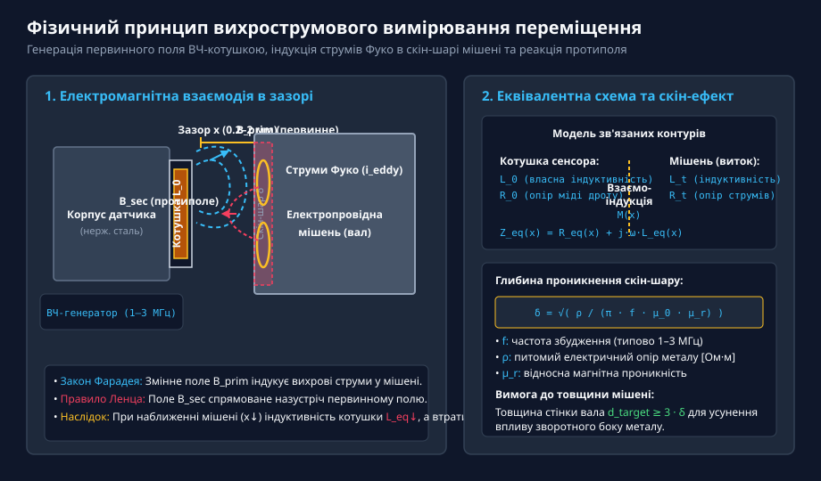
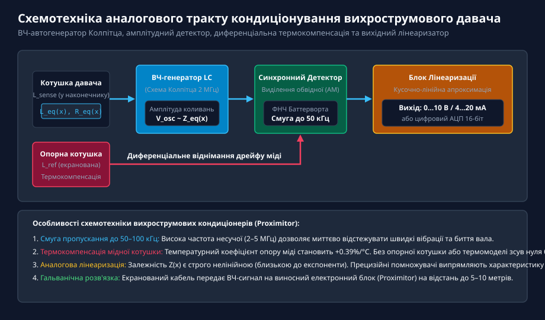
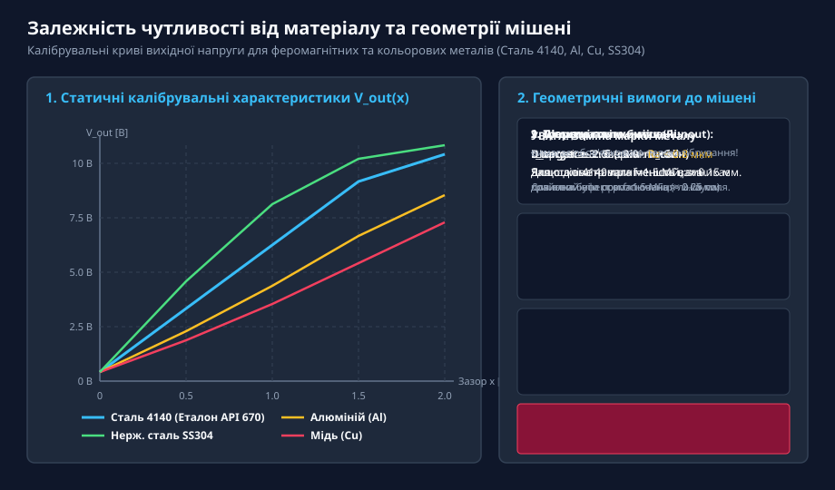
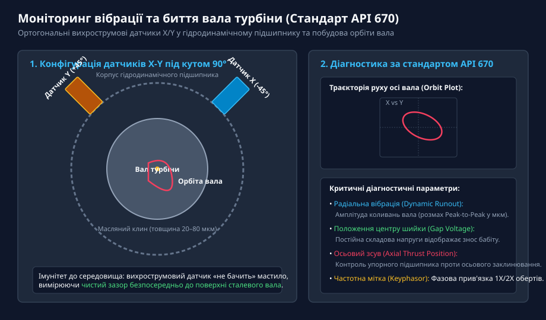
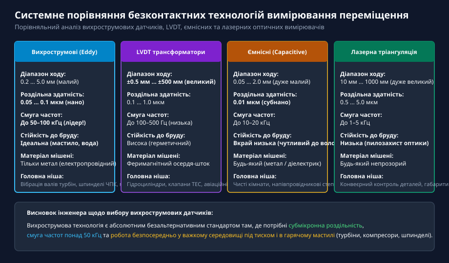

# Вихрострумові давачі переміщення

<preknowlist>
- [Лінійні диференціальні трансформатори LVDT](root:cat-hw-sensors/lvdt-linear-variable-differential-transformers) — електромагнітні індуктивні датчики лінійного переміщення, відмінності в робочих діапазонах та частотних характеристиках
- [Енкодери кутового та лінійного переміщення](root:cat-hw-sensors/optical-and-magnetic-encoders) — принципи оцифрування лінійних переміщень та обмеження оптичних систем у забрудненому промисловому середовищі
</preknowlist>

## Фізичний принцип вихрострумового вимірювання та скін-ефект

У важкому енергетичному машинобудуванні, нафтогазовій промисловості, компресорних станціях та прецизійних металообробних верстатах безаварійна експлуатація масивних роторних агрегатів залежить від безперервного моніторингу зазорів та мікровібрацій валів. Ротори парових та газових турбін масою в десятки тонн обертаються зі швидкістю 3000–12000 об/хв усередині гідродинамічних підшипників ковзання, де масляний зазор становить лише 20–80 мікрометрів. Будь-яке радіальне биття вала, викликане дисбалансом, температурним прогином або руйнуванням масляного клина, може призвести до катастрофічного торкання ротора до статора та аварії світового масштабу.

Використання контактних датчиків у таких вузлах неможливе через колосальну лінійну швидкість ковзання поверхні вала (понад 100 м/с). Оптичні та лазерні датчики стають повністю непрацездатними в закритих корпусах підшипників, де циркулює гаряче турбінне мастило під тиском, утворюючи щільний масляний туман і бризки. Індуктивні [трансформатори LVDT](root:cat-hw-sensors/lvdt-linear-variable-differential-transformers) мають занадто вузьку смугу пропускання (до 100–500 Гц), що не дозволяє фіксувати високочастотні вібраційні гармоніки.

Єдиним стандартизованим промисловим рішенням для безконтактного вимірювання мікропереміщень та вібрацій в агресивному середовищі є вихрострумові давачі переміщення (англ. @@en|eddy-current displacement sensors@@, або @@en|eddy-current proximity probes@@).

Фізичний принцип дії вихрострумового датчика базується на законі електромагнітної індукції Фарадея та виникненні локальних вихрових струмів (струмів Фуко) в електропровідних матеріалах:


*Фізичний принцип вихрострумового вимірювання: високочастотне електромагнітне поле котушки датчика індукує струми Фуко в поверхневому скін-шарі мішені, створюючи зустрічне розмагнічувальне протиполе.*

У наконечнику вимірювального зонда розташована плоска індуктивна котушка L_0L_0L_0, намотана мідним дротом на діелектричному або керамічному каркасі. На котушку подається високочастотний змінний струм збудження (несуча частота L_0fL_0 зазвичай становить від 1 до 3 МГц). Цей струм створює навколо торця зонда первинне високочастотне магнітне поле L_0B_{\text{prim}}L_0, силові лінії якого поширюються у навколишній простір.

Коли в зону дії магнітного поля вноситься електропровідна металева мішень (наприклад, сталева поверхня вала турбіни) на відстані L_0xL_0, змінне магнітне поле пронизує поверхневий шар металу. Згідно з законом електромагнітної індукції, змінний магнітний потік збуджує в металі кругові замкнені вихрові струми — струми Фуко (L_0i_{\text{eddy}}L_0).

Згідно з правилом Ленца, збуджені вихрові струми створюють власне вторинне магнітне поле L_0B_{\text{sec}}L_0, просторовий напрямок якого строго протилежний первинному полю котушки. Взаємодія цих полів призводить до двох фундаментальних наслідків для первинної котушки:
1. **Зменшення еквівалентної індуктивності L_0L_{\text{eq}}(x)L_0:** Зустрічне магнітне поле L_0B_{\text{sec}}L_0 частково розмагнічує котушку, зменшуючи сумарний магнітний потік самоіндукції. Чим ближче мішень підходить до торця датчика (зазор L_0xL_0 зменшується), тим сильнішими стають вихрові струми і тим сильніше падає еквівалентна індуктивність L_0L_{\text{eq}}(x) < L_0L_0.
2. **Зростання активного опору втрат L_0R_{\text{eq}}(x)L_0:** Вихрові струми протікають через внутрішній опір металу мішені, перетворюючи частину енергії поля на джоулеве тепло. Ця потужність втрат еквівалентно відображається в коло первинної котушки, збільшуючи її діючий активний опір L_0R_{\text{eq}}(x) > R_0L_0.

Внаслідок витіснення високочастотного струму до поверхні (скін-ефект, англ. @@en|skin effect@@) вихрові струми концентруються у тонкому приповерхневому шарі мішені. Глибина проникнення струмів (товщина скін-шару L_0\deltaL_0) розраховується за класичним співвідношенням:

```
delta = sqrt( rho / (pi * f * mu_0 * mu_r) )
```

де:
- `delta` — товщина скін-шару, на якій густина струму зменшується в L_0eL_0 разів (приблизно на 63%) [м];
- `rho` — питомий електричний опір металу мішені [Ом·м];
- `f` — частота збудження генератора [Гц];
- `mu_0` — магнітна стала (L_04\pi \times 10^{-7}L_0 Гн/м);
- `mu_r` — відносна магнітна проникність металу мішені (для немагнітних металів L_0\mu_r \approx 1L_0).

При робочій частоті 1.5 МГц глибина скін-шару становить близько 0.05–0.15 мм для вуглецевої сталі і 0.07 мм для алюмінію. З цього випливає критичне інженерне правило: товщина стінки мішені повинна перевищувати щонайменше три глибини скін-шару (L_0d_{\text{target}} \ge 3\deltaL_0), щоб виключити проходження електромагнітної хвилі наскрізь та залежність сигналу від внутрішніх порожнин деталі.

## Схемотехніка аналогового тракту та кондиціонування

Перетворення змін комплексної еквівалентної провідності котушки L_0Z_{\text{eq}}(x) = R_{\text{eq}}(x) + j\omega L_{\text{eq}}(x)L_0 у лінійну вихідну напругу або стандартний струмовий сигнал вимагає високопрецизійного аналогового тракту (у промисловості блок кондиціонування називають проксимітором, англ. @@en|proximitor@@).


*Структурна схема кондиціонера вихрострумового давача: ВЧ-генератор Колпітца, синхронний детектор амплітуди, диференціальна термокомпенсація та блок лінеаризації.*

Аналоговий тракт складається з таких обов'язкових каскадів:

1. **Високочастотний автогенератор (HF Oscillator):** Найчастіше будується за схемою триточкового генератора Колпітца або Франкліна. Котушка зонда L_0L_{\text{sense}}L_0 разом із прецизійними конденсаторами утворює резонансний коливальний LC-контур. При наближенні металу до датчика зміна добротності L_0Q(x)L_0 та індуктивності L_0L(x)L_0 зменшує амплітуду високочастотних автоколивань на контурі.
2. **Амплітудний демодулятор та активний фільтр (Demodulator & Filter):** Каскад виділення обвідної (піковий детектор на прецизійних діодах або синхронний демодулятор) випрямляє мегагерцовий ВЧ-сигнал, виділяючи низькочастотну амплітуду, пропорційну зазору L_0xL_0. Активний фільтр низьких частот Баттерворта 4-го порядку пригнічує залишки несучої частоти, забезпечуючи вихідну смугу пропускання корисного сигналу до 10–50 кГц.
3. **Міст диференціальної термокомпенсації (Temperature Compensation):** Опір мідного дроту котушки має позитивний температурний коефіцієнт L_0+0.39\%/^\circ\text{C}L_0. Якщо датчик нагрівається в гарячому маслі підшипника від +20 °C до +120 °C, його власний опір зростає на 39%, що без компенсації еквівалентно хибному зміщенню виміряного зазору на десятки мікронів. Для усунення температурного дрейфу застосовують другу екрановану котушку L_0L_{\text{ref}}L_0, яка розташована всередині корпусу зонда і не взаємодіє з мішенню. Диференціальне віднімання сигналів L_0L_{\text{sense}}L_0 та L_0L_{\text{ref}}L_0 взаємно знищує синфазний температурний дрейф опору міді.
4. **Блок кусочно-лінійної апроксимації (Linearizer):** Залежність амплітуди від зазору L_0V_{\text{raw}}(x)L_0 має суттєву нелінійність. Аналоговий або цифровий лінеаризатор на базі операційних помножувачів чи таблиць перерахунку (LUT) формує строго лінійну вихідну характеристику з крутизною, стандартизованою промисловим нормативом API 670:
   - Стандартний коефіцієнт чутливості (Scale Factor): **7.87 В/мм** (або 200 мВ/міл у дюймовій системі).
   - Діапазон вихідної напруги: від -2 В до -18 В (або від 0 до +10 В для сучасних систем з однополярним живленням).

## Залежність характеристик від матеріалу та геометрії мішені

Оскільки вихрострумовий датчик реагує на електропровідність L_0\rhoL_0 та магнітну проникність L_0\mu_rL_0 мішені, його калібрувальна крива строго прив'язана до конкретної марки металу:


*Вплив матеріалу мішені на калібрувальну характеристику: порівняння сталі 4140 (промисловий еталон API 670), алюмінію, міді та аустенітної нержавіючої сталі.*

Поведінка металів у високочастотному полі ділиться на дві принципово різні групи:

1. **Феромагнітні метали (конструкційні та леговані сталі):** Мають високу відносну магнітну проникність (L_0\mu_r \gg 1L_0, зазвичай від 100 до 600 для сталі 4140 на високих частотах). Присутність феромагнетика підсилює індуктивність котушки за рахунок магнітного замикання поля, що частково протидіє розмагнічувальному ефекту вихрових струмів. У результаті характеристика має високу крутизну та стабільність. Промисловим стандартом калібрування згідно з API 670 є хромомолібденова сталь марки **AISI 4140** (аналог 40ХФА / 42CrMo4).
2. **Немагнітні кольорові метали (алюміній, мідь, латунь, аустенітні нержавіючі сталі):** У цих матеріалах L_0\mu_r \approx 1L_0, тому феромагнітне підсилення відсутнє, а діє виключно механізм вихрового розмагнічування. Для металів із високою провідністю (мідь, алюміній) вихрові струми дуже потужні, що зменшує чутливість датчика порівняно зі сталлю 4140. Натомість для нержавіючої сталі марки AISI 304 через її низьку електропровідність крутизна суттєво зростає.

Якщо датчик, відкалібрований на заводі під сталь 4140, встановити на ротор з нержавіючої сталі або алюмінію без перекалібрування проксимітора, похибка вимірювання зазору сягне 30–50%!

Геометричні вимоги до робочої зони мішені (Target Geometry):
- **Мінімальний діаметр мішені:** Діаметр контрольованої площадки на валу повинен перевищувати діаметр котушки зонда щонайменше у 2.5–3 рази (L_0D_{\text{target}} \ge 3 \cdot D_{\text{coil}}L_0). Якщо зонд розмістити біля краю буртика вала, шпонкового паза або радіального отвору, виникає крайовий ефект (англ. @@en|edge effect@@) — деформація ліній вихрових струмів, що спотворює вимірювання.
- **Шорсткість та залишкова намагніченість:** Механічна шорсткість поверхні вала повинна бути не гіршою за L_0Ra \le 0.8\text{ мкм}L_0. Крім того, перед монтажем вал обов'язково розмагнічують (залишкова намагніченість не повинна перевищувати 2 Гауси), оскільки залишкові магнітні плями (електричне биття, англ. @@en|electrical runout@@) генерують хибні сигнали вібрації на частоті обертання вала.

## Метрологічні характеристики та вимірювання вібрацій валів

Головна галузь застосування вихрострумових зондів — безперервний віброзахист та діагностика критичного роторного обладнання за міжнародним стандартом **API 670** (American Petroleum Institute).


*Конфігурація вібромоніторингу API 670: встановлення двох ортогональних датчиків X-Y під кутом 90° для відновлення траєкторії динамічної орбіти шийки вала всередині масляного клина.*

Стандартна система вимірювання на базі API 670 передбачає встановлення таких датчиків на кожну опорну шийку турбоагрегату:

1. **Пара радіальних ортогональних зондів X та Y:** Два вихрострумові датчики вкручуються безпосередньо у кришку вкладиша підшипника ковзання під кутом 90° один до одного (зазвичай під кутами L_0\pm 45^\circL_0 відносно вертикальної осі машини). Зонди вимірюють миттєвий динамічний зазор між торцем датчика та поверхнею шийки вала.
2. **Побудова орбіти вала (Shaft Orbit Analysis):** Подаючи змінні складові напруги зондів L_0XL_0 та L_0YL_0 на входи L_0XL_0 і L_0YL_0 осцилографа або цифрового аналізатора спектру, оператор отримує двовимірну фігуру Лісажу — реальну траєкторію прецесії геометричного центру вала всередині підшипника. Форма орбіти дозволяє миттєво діагностувати такі дефекти:
   - *Еліптична орбіта 1X:* статичний або динамічний дисбаланс ротора.
   - *Вісімкоподібна орбіта 2X:* розцентрування (невіосність) муфт або валів.
   - *Внутрішня петля / хаотичне роздування:* масляний вихор (англ. @@en|oil whirl@@ / @@en|oil whip@@) або торкання ротора об вкладиш (англ. @@en|rubbing@@).
3. **Осьовий зсув вала (Axial Thrust Position):** Два дубльовані датчики спрямовані на торець упорного гребеня ротора. Вони відстежують постійну складову осьового положення ротора. Якщо знос бабітового шару упорного підшипника перевищує 0.5–1.0 мм, система негайно зупиняє турбіну аварійним клапаном, запобігаючи зрізанню робочих лопаток об корпус.
4. **Фазова мітка Keyphasor:** Вихрострумовий датчик, спрямований на фрезерований паз або виступ на валу, який формує один прямокутний імпульс за кожен повний оберт (L_01\text{ імпульс/оберт}L_0). Цей сигнал слугує опорною міткою фази для вимірювання точного кута фазового зсуву вектора вібрації при динамічному балансуванні.

Ключовою метрологічною перевагою вихрострумових датчиків у цій сфері є їхня колосальна швидкодія: смуга частот до 50–100 кГц дозволяє відстежувати не лише основну гармоніку обертання (наприклад, 50 Гц при 3000 об/хв), а й вищі зубцеві гармоніки лопаток компресора до 50-го порядку з нанометровою роздільною здатністю (менше 0.05 мкм). При цьому циркулююче синтетичне або мінеральне мастило не створює жодних спотворень сигналу, оскільки діелектричне середовище з L_0\mu_r \approx 1L_0 та нульовою електропровідністю є абсолютно прозорим для радіочастотного магнітного поля.

## Системне порівняння та інженерні критерії вибору

При виборі безконтактного перетворювача лінійного переміщення інженер обирає між чотирма домінуючими технологіями: вихрострумовими датчиками, індуктивними трансформаторами LVDT, ємнісними сенсорами та лазерними оптичними вимірювачами:


*Порівняльний аналіз технологій: вихрострумові датчики забезпечують максимальну смугу частот до 100 кГц та абсолютний імунітет до мастила й бруду.*

Узагальнена матриця інженерного вибору наведена у таблиці:

| Критерій порівняння | Вихрострумові давачі (Eddy Current) | Трансформатори LVDT | Ємнісні давачі (Capacitive) | Лазерна тріангуляція |
| :--- | :--- | :--- | :--- | :--- |
| **Робочий діапазон** | Малий (0.2 ... 5.0 мм) | Великий (±0.5 ... ±500 мм) | Дуже малий (0.05 ... 2.0 мм) | Дуже великий (10 ... 1000 мм) |
| **Роздільна здатність** | Субмікронна (0.05 ... 0.1 мкм) | Мікронна (0.1 ... 1.0 мкм) | Нанометрова (до 0.01 мкм) | Середня (0.5 ... 5.0 мкм) |
| **Смуга пропускання** | **Екстремальна (до 50–100 кГц)** | Низька (100 ... 500 Гц) | Висока (до 10–20 кГц) | Помірна (до 1–5 кГц) |
| **Стійкість до бруду та мастила** | **Абсолютна (працюють у мастилі)** | Висока (герметичний шток) | Вкрай низька (чутливі до вологи) | Низька (запилення лінз) |
| **Матеріал мішені** | Тільки електропровідні метали | Тільки феромагнітний сердечник | Будь-який матеріал (метал/діелектрик) | Будь-яка непрозора поверхня |
| **Чутливість до марки металу** | Висока (потрібне калібрування) | Відсутня (замкнена магнітна система) | Низька | Відсутня |

Інженерні правила вибору:
- **Вибирайте вихрострумовий датчик**, якщо об'єкт вимірювання — металева деталь, що рухається або вібрує з високими швидкостями (до 100 кГц), вимірювальний хід не перевищує кількох міліметрів, а в робочій зоні присутні мастило, охолоджувальні емульсії, вода або високий тиск. Це абсолютний стандарт для турбін, центрифуг, шпинделів верстатів із ЧПК та активних магнітних підшипників.
- **Вибирайте LVDT**, якщо необхідний великий хід вимірювання (десятки або сотні міліметрів) при статичних або повільних переміщеннях (гідроциліндри, парові клапани, шлюзові ворота), де важлива абсолютна надійність без потреби калібрування під сторонній метал.
- **Вибирайте ємнісні датчики**, якщо вимірювання виконуються в чистих кімнатах, вакуумі або нанометрових лабораторних стендах (напівпровідникова літографія, скануюча мікроскопія), де відсутня волога, а мішенню може виступати кремній чи оптичне скло.
- **Вибирайте лазерні тріангулятори**, коли датчик повинен розташовуватися на значній відстані від об'єкта (десятки сантиметрів або метри), наприклад при контролі геометрії гарячого прокату металургійних заводів.
