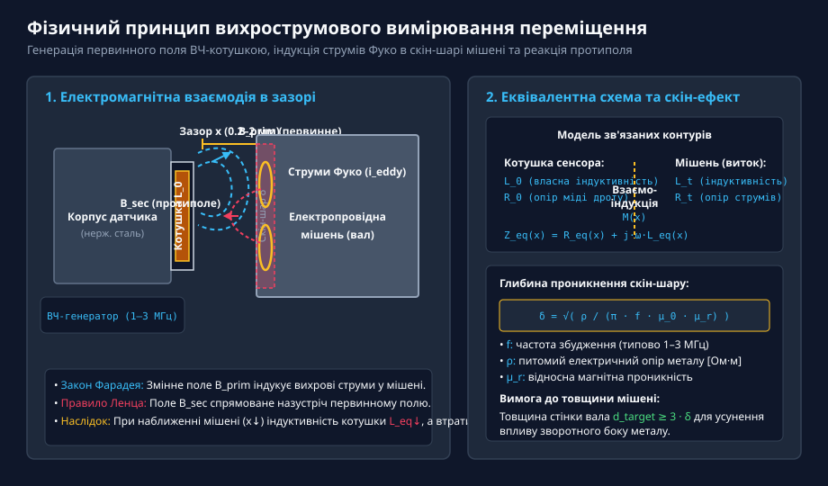
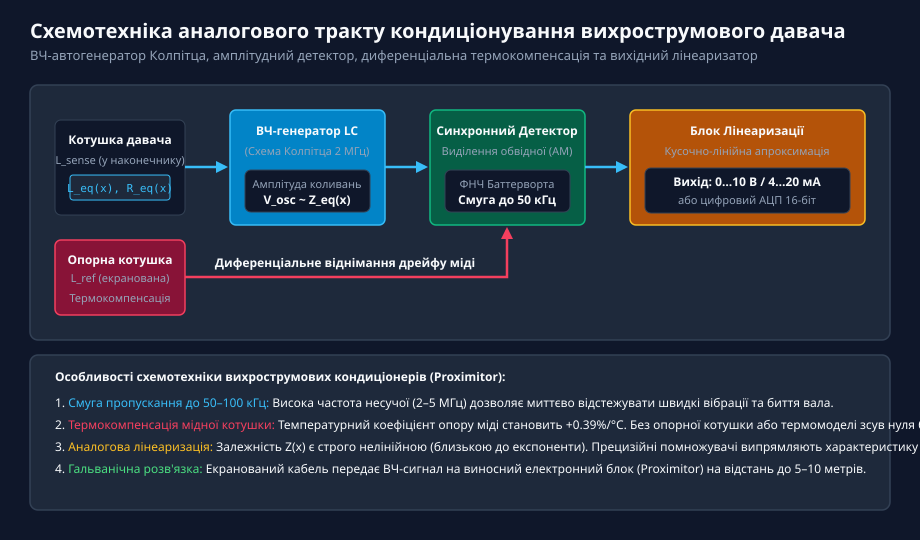
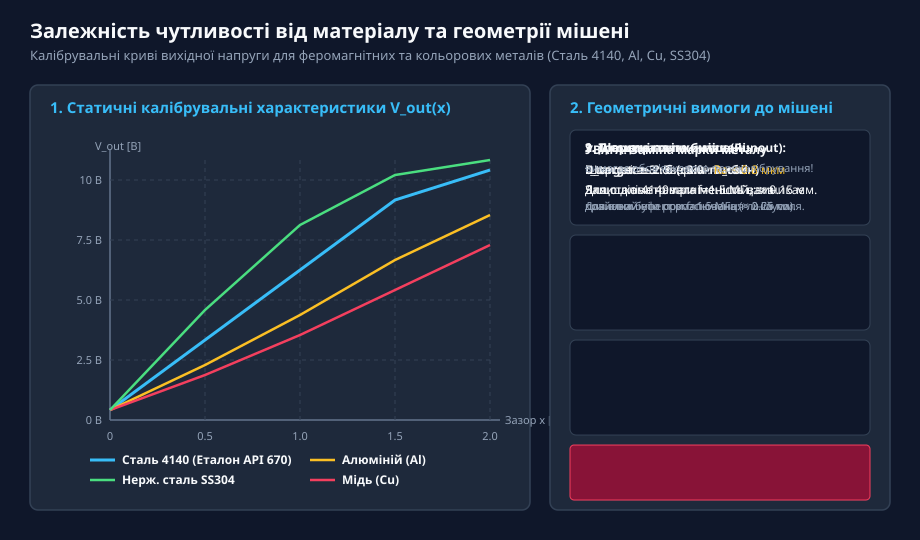
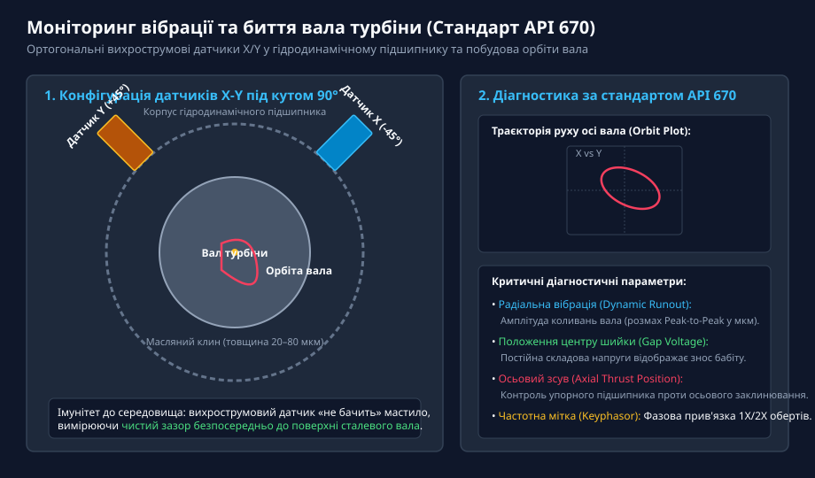
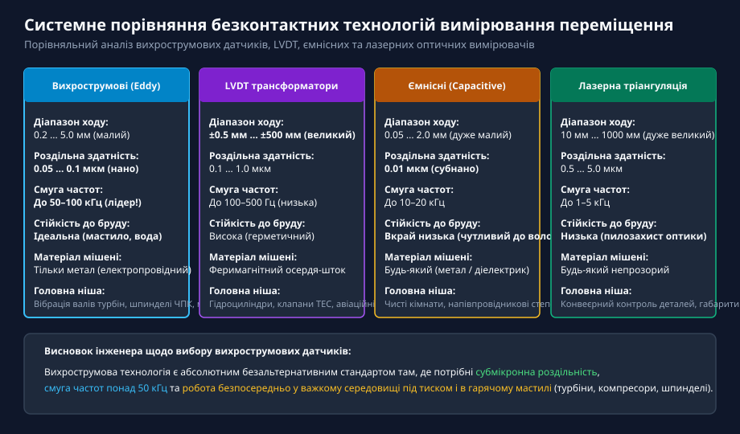

# Вихрострумові давачі переміщення

<preknowlist>
- [Лінійні диференціальні трансформатори LVDT](root:cat-hw-sensors/lvdt-linear-variable-differential-transformers) — загальні принципи електромагнітних датчиків положення та особливості трансформаторних вимірювачів
- [Енкодери кутового та лінійного переміщення](root:cat-hw-sensors/optical-and-magnetic-encoders) — оцифрування лінійних координат та обмеження оптичних каналів в умовах сильного забруднення
</preknowlist>

## Фізичний принцип вихрострумового вимірювання та скін-ефект

У важкому машинобудуванні, турбінах ТЕС та АЕС, потужних насосах та шпинделях верстатів з ЧПК деталі обертаються з колосальними швидкостями в середовищі гарячого мастила. Контактні датчики стираються за лічені години, а оптичні системи сліпнуть від масляного туману. Для безконтактного вимірювання мікропереміщень та вібрацій у таких агресивних умовах застосовують вихрострумові давачі (англ. @@en|eddy-current sensors@@).

Принцип дії вихрострумового датчика ґрунтується на взаємодії високочастотного електромагнітного поля котушки зонда з електропровідною металевою поверхнею (мішенню):

*Принцип вихрострумового вимірювання: високочастотне поле котушки датчика індукує струми Фуко в металевій деталі, формуючи зустрічне протиполе.*

Котушка датчика живиться високочастотним змінним струмом (1–3 МГц), створюючи первинне магнітне поле B_prim. Коли до торця датчика наближається металевий вал на відстань x, змінне поле проникає в метал і збуджує в ньому кругові вихрові струми — струми Фуко.

Згідно з правилом Ленца, струми Фуко створюють зустрічне вторинне поле B_sec, яке розмагнічує котушку. В результаті:
1. Еквівалентна індуктивність котушки зменшується: L_eq(x) менше L_0.
2. Активний опір втрат збільшується: R_eq(x) більше R_0.

Через скін-ефект вихрові струми концентруються у тонкому поверхневому шарі металу товщиною delta (для сталі на частоті 1.5 МГц delta становить близько 0.1 мм). Тому товщина стінки деталі повинна перевищувати 3·delta для стабільності вимірювання.

## Схемотехніка аналогового тракту та кондиціонування

Перетворення зміни комплексного опору котушки у вихідну напругу виконує електронний блок кондиціонування (проксимітор):

*Схема кондиціонера вихрострумового давача: ВЧ-автогенератор, амплітудний демодулятор, диференціальна термокомпенсація та блок лінеаризації.*

Аналоговий тракт містить:
- **ВЧ-генератор (LC Oscillator):** Коливальний контур Колпітца на частоту 1–3 МГц, амплітуда коливань якого падає при наближенні металу.
- **Амплітудний демодулятор:** Випрямляє високочастотний сигнал та виділяє обвідну з частотною смугою до 50–100 кГц.
- **Опорну котушку термокомпенсації:** Мідний дріт має температурний коефіцієнт +0.39%/°C. Диференціальне порівняння з внутрішньою екранованою котушкою L_ref усуває температурний дрейф.
- **Лінеаризатор:** Випрямляє експоненційну криву датчика у лінійний сигнал зі стандартизованим коефіцієнтом 7.87 В/мм (200 мВ/міл за стандартом API 670).

## Залежність характеристик від матеріалу та геометрії мішені

Оскільки датчик реагує на питомий опір rho та магнітну проникність mu_r, його чутливість залежить від марки металу:

*Калібрувальні криві вихрострумового давача: еталон API 670 (сталь 4140) та поведінка кольорових металів.*

- **Феромагнітні сталі (AISI 4140):** Промисловий еталон калібрування. Забезпечують найвищу крутизну сигналу завдяки високій магнітній проникності.
- **Кольорові метали (алюміній, мідь):** Не мають феромагнітного підсилення (mu_r = 1), тому мають менший нахил характеристики.
- **Нержавіюча сталь SS304:** Через низьку провідність має крутішу характеристику, ніж алюміній.

Вимоги до геометрії: діаметр контрольованої ділянки вала повинен бути щонайменше у 2.5–3 рази більшим за діаметр котушки, щоб уникнути крайових спотворень поля.

## Метрологічні характеристики та вимірювання вібрацій валів

Вихрострумові датчики є базовим елементом стандарту **API 670** для захисту турбоагрегатів:

*Конфігурація API 670: встановлення двох ортогональних зондів під кутом 90° для відновлення орбіти вала в масляному шарі.*

Ключові вимірювання:
1. **Радіальна вібрація (Dynamic Runout):** Два взаємно перпендикулярні зонди (X та Y під кутом 90°) вимірюють коливання вала. Траєкторія руху осі (орбіта) виявляє дисбаланс, розцентрування або масляний вихор.
2. **Осьове положення (Axial Thrust):** Відстежує зсув ротора вздовж осі для захисту від зносу упорного підшипника.
3. **Фазова мітка Keyphasor:** Формує 1 імпульс на оберт від мітки на валу для вимірювання фази вібраційного дисбалансу.

Датчики вимірюють положення вала крізь шар мастила (товщина 20–80 мкм), оскільки масло є діелектриком і не впливає на магнітне поле.

## Системне порівняння та інженерні критерії вибору

Порівняння безконтактних технологій лінійного переміщення:

| Критерій | Вихрострумові давачі | Трансформатори LVDT | Ємнісні давачі | Лазерні датчики |
| :--- | :--- | :--- | :--- | :--- |
| **Хід вимірювання** | 0.2 ... 5.0 мм | До ±500 мм | 0.05 ... 2.0 мм | 10 ... 1000 мм |
| **Роздільна здатність** | 0.05 ... 0.1 мкм | 0.1 ... 1.0 мкм | До 0.01 мкм | 0.5 ... 5.0 мкм |
| **Смуга частот** | **До 50–100 кГц** | До 100–500 Гц | До 10–20 кГц | До 1–5 кГц |
| **Стійкість до мастила**| **Абсолютна (100%)** | Висока | Вкрай низька | Низька (запил) |
| **Матеріал мішені** | Тільки метал | Сталевий сердечник | Будь-який матеріал | Непрозорий |

*Системний вибір: вихрострумові датчики не мають конкурентів при вимірюванні високошвидкісних вібрацій у мастилі та під тиском.*

Вибирайте вихрострумові датчики для високочастотного моніторингу вібрацій та биття металевих деталей у маслі, емульсії та під тиском у діапазоні до кількох міліметрів.
