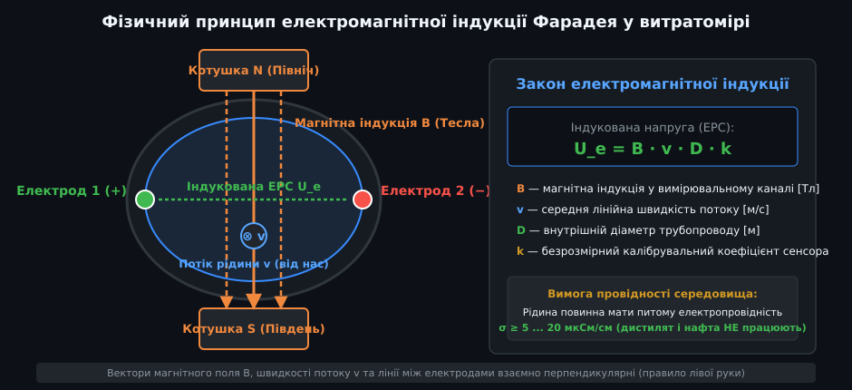
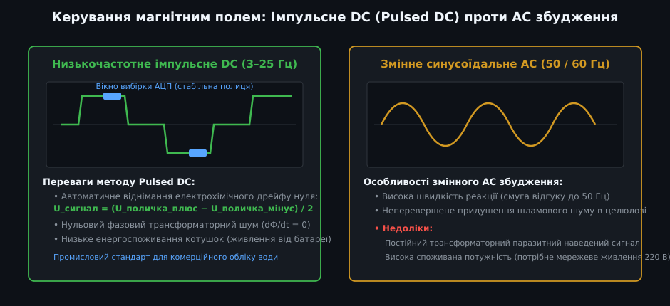
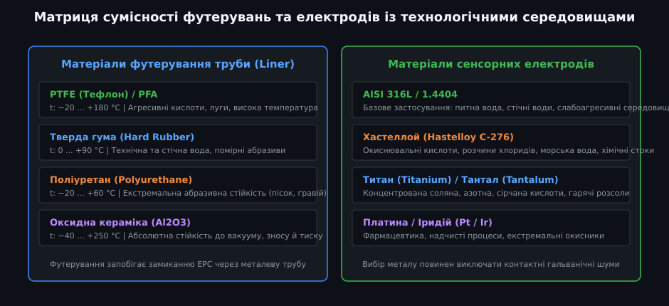
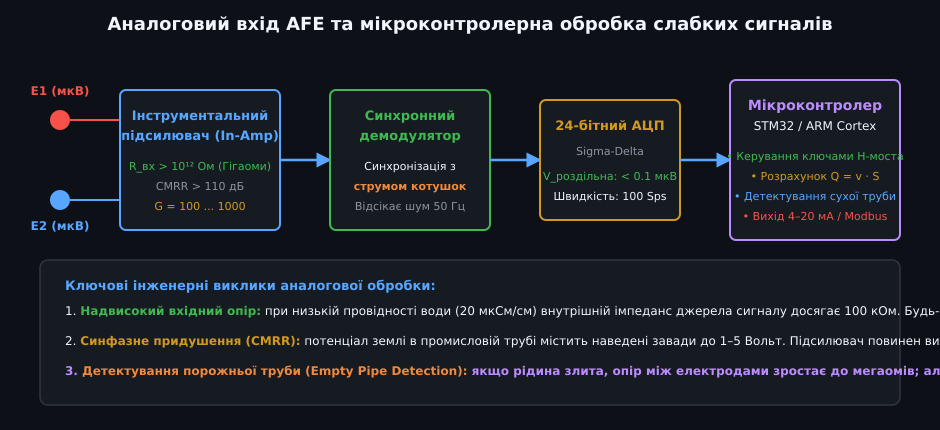
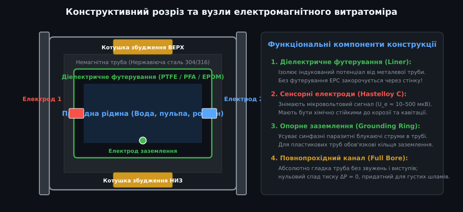

# Поглиблений аналіз електромагнітних витратомірів рідини

Електромагнітні витратоміри (Magmeters) є найбільш точними й надійними приладами комерційного та технологічного обліку електропровідних середовищ у металургії, водопостачанні, хімічній промисловості та енергетиці. У цьому поглибленому посібнику розглядаються основи магнітогідродинаміки та вагової функції Шеркліффа, електродинаміка імпульсного H-моста збудження, електрохімія подвійного електричного шару на поверхні електродів, прецизійний аналоговий тракт синхронної демодуляції та промислова програмна реалізація драйвера на мові C++.

---

## 1. Магнітогідродинамічна теорія та вагова функція Шеркліффа

Електромагнітний витратомір описується фундаментальними законами класичної електродинаміки суцільних рухомих середовищ (магнітної гідродинаміки).



### Рівняння поля та узагальнений закон Ома
Рухома провідна рідина з локальною швидкістю v у магнітному полі B індукує внутрішню напруженість електричного поля E_ind:
  
E_ind = v × B

Сумарна густина струму в рідині j описується законом Ома для рухомих провідників:
  
j = σ · (E + v × B)

де `σ` — питома електрична провідність рідини, а `E = −∇φ` — градієнт електричного потенціалу.

Оскільки в нестисливому сталому потоці накопичення об'ємного електричного заряду відсутнє (∇ · j = 0), підстановка розкриває фундаментальне диференціальне рівняння Пуассона для електричного потенціалу φ:
  
∇²φ = ∇ · (v × B) = B · (∇ × v) − v · (∇ × B)

У випадку однорідного магнітного поля (B = const, ∇ × B = 0) джерелом потенціалу стає вихровий рух рідини `∇ × v` (завихреність потоку).

### Вагова функція Шеркліффа (Weight Vector W)
Джеймс Шеркліфф (J. A. Shercliff) у 1962 році довів, що різниця потенціалів між точковими електродами на стінках круглої труби є об'ємним інтегралом добутку вектора швидкості рідини на просторовий ваговий вектор `W`:
  
U_e = ∫∫∫ [V] (v · W) dV

- Для поперечного перерізу труби радіусом R у декартових координатах (де електроди розташовані в точках (±R, 0)):
  
  W_y(x, y) = (1 / (π · R)) · [ (R² · (R² + x² − y²)) / ((R² + x² − y²)² + 4 · x² · y²) ]

- **Фізичний зміст:** Ваговий коефіцієнт різко зростає в безпосередній близькості до електродів. Якщо потік рідини має асиметричний профіль швидкостей (наприклад, після одиночного або подвійного коліна без прямолінійної ділянки), збурення швидкості біля самого електрода викличе підвищену похибку вимірювання. Саме тому обов'язковим є дотримання прямих ділянок трубопроводу довжиною не менше 5·D до сенсора.

---

## 2. Апаратна схемотехніка драйвера збудження котушок: H-міст

Для створення однорідного магнітного поля застосовують дві зовнішні котушки з індуктивністю L = 50...500 мГн та активним опором R = 15...80 Ом кожна.



### Керування полярністю через H-міст
Сучасні витратоміри використовують чотири польові MOSFET-транзистори, з'єднані за схемою H-моста, керовані мікроконтролером:
1. **Пряма полярність (+B):** Відкриваються діагональні ключі Q1 і Q4. Струм наростає за експонентою:
   
   I(t) = I_max · (1 − e^(−t / τ))
   
   де постійна часу τ = L / R.
2. **Стабільна полиця (Sampling Plateau):** Струм стабілізується лінійним прецизійним джерелом струму (зазвичай 125 мА або 250 мА) з точністю не гірше 0.05%. У цей момент магнітне поле абсолютно постійне:
   
   dB / dt = 0

   Трансформаторна паразитне ЕРС повністю відсутня! Саме в цей інтервал тривалістю 10–20 мс відкривається аналоговий вхід АЦП для зняття відліку U_plus.
3. **Реверсивна полярність (−B):** Ключі Q1, Q4 закриваються, відкриваються Q2, Q3. Напрямок струму і вектора магнітної індукції дзеркально змінюється. АЦП фіксує відлік U_minus.
4. **Обчислення чистого корисного сигналу:**
   
   U_сигнал = (U_plus − U_minus) / 2

   Цей диференційний алгоритм повністю знищує будь-яке постійне або повільно змінне електрохімічне зміщення потенціалів на електродах (DC Offset Rejection).

---

## 3. Електрохімічні контактні явища: подвійний електричний шар

На межі розділу між твердим металом електрода (наприклад, сплавом Hastelloy C-276) та рідким електролітом виникає спонтанний стрибок потенціалу, зумовлений перерозподілом іонів.



### Модель подвійного шару Гельмгольца-Штерна
- Металевий електрод обмінюється іонами з розчином, набуваючи поверхневого заряду.
- До нього притягуються протиіони з рідини, утворюючи компактний щільний шар Гельмгольца товщиною в кілька нанометрів та дифузний шар Гуї-Чепмена.
- Ця структура веде себе як конденсатор колосальної питомої ємності (10–50 мкФ/см²), увімкнений послідовно з вимірювальним ланцюгом.

### Джерела паразитних завад на електродах
1. **Електрохімічний потенціал спокою:** Різниця контактних потенціалів двох навіть ідеально однакових електродів становить від 1 до 50 мВ, що в 1000 разів перевищує корисний сигнал індукції (10–100 мкВ). Низькочастотна комутація поля Pulsed DC повністю усуває цю проблему.
2. **Шламовий шум (Slurry Noise / 1/f noise):** Тверді абразивні частки (пісок, руда, целюлозні волокна) фізично зішкрябують подвійний шар іонів при терті об поверхню електрода, генеруючи потужні випадкові стрибки напруги амплітудою до кількох мілівольтів. Для таких середовищ застосовують високочастотне або змінне AC-збудження.

---

## 4. Аналоговий тракт AFE та синхронне детектування

Рівень сигналу, що знімається з електродів електромагнітного витратоміра, є надзвичайно малим: при швидкості потоку 1 м/с індукована напруга зазвичай становить лише від 50 до 300 мкВ.



### Архітектура прецизійного AFE:
1. **Вхідний каскад:** Інструментальний підсилювач на FET-входах (наприклад, Analog Devices AD8421 або Texas Instruments INA828) з вхідним опором R_in > 1 ТОм (10¹² Ом) та струмом витоку менше 10 пА. Це запобігає падінню сигналу на внутрішньому опорі слабопровідної води (10–100 кОм).
2. **Синхронне детектування (Phase-Sensitive Demodulation):** Аналоговий або цифровий помножувач перемножує вхідний сигнал із меандром керування котушками. Частотні компоненти, не синхронізовані з полем (наприклад, промислові наведення 50 Гц та 100 Гц), перетворюються на змінний струм і повністю зрізаються вихідним фільтром низьких частот із частотою зрізу 1–2 Гц.
3. **24-бітний сигма-дельта АЦП:** Перетворювач (наприклад, ADS1220 або AD7172) із внутрішнім малошумним джерелом опорної напруги забезпечує роздільну здатність нижче 0.05 мкВ на відлік.

---

## 5. Промислова програмна реалізація мовою C++



Нижче наведено виробничий клас C++ для вбудованого контролера витратоміра, що реалізує керування імпульсним збудженням котушок, перевірку наявності порожньої труби та розрахунок об'ємної витрати.

```cpp
/**
 * @file magmeter_core_driver.hpp
 * @brief Обчислювальний драйвер електромагнітного витратоміра (Pulsed DC)
 */

#include <stdint.h>
#include <stdbool.h>
#include <math.h>

class ElectromagneticFlowmeter {
public:
    enum ExcitationState {
        STATE_POS_SETTLE = 0, // Наростання струму котушок (+)
        STATE_POS_SAMPLE = 1, // Зняття вибірки U_plus на стабільній полиці
        STATE_NEG_SETTLE = 2, // Наростання струму котушок (-)
        STATE_NEG_SAMPLE = 3  // Зняття вибірки U_minus
    };

    struct DeviceConfig {
        float pipe_inner_diameter_m;  // Внутрішній діаметр каналу D (м)
        float magnetic_induction_t;   // Індукція поля B (Тесла, зазвичай 0.02 ... 0.05 Тл)
        float k_geometry_factor;      // Калібрувальний коефіцієнт форми сенсора
        float empty_pipe_threshold_v; // Поріг напруги детектування порожньої труби
        float damping_time_constant_s;// Постійна часу фільтра демпфування (секунди)
    };

    ElectromagneticFlowmeter(const DeviceConfig &cfg)
        : config_(cfg), current_state_(STATE_POS_SETTLE),
          u_plus_accum_(0.0f), u_minus_accum_(0.0f),
          filtered_flow_m3_h_(0.0f), is_empty_pipe_(false) {}

    /**
     * @brief Кінцевий автомат керування збудженням (викликається за апаратним таймером 100 Гц)
     * @param raw_adc_volts Напруга з виходу 24-бітного АЦП у вольтах
     * @param out_hbridge_dir Керуючий сигнал для ключів H-моста (true = +, false = -)
     * @param out_flow_updated Прапорець завершення повного циклу вимірювання
     */
    void stepExcitationFSM(float raw_adc_volts, bool &out_hbridge_dir, bool &out_flow_updated) {
        out_flow_updated = false;

        switch (current_state_) {
            case STATE_POS_SETTLE:
                out_hbridge_dir = true; // Увімкнення прямого струму
                // Очікування 15 мс для завершення перехідного процесу L/R
                current_state_ = STATE_POS_SAMPLE;
                break;

            case STATE_POS_SAMPLE:
                out_hbridge_dir = true;
                u_plus_accum_ = raw_adc_volts;
                current_state_ = STATE_NEG_SETTLE;
                break;

            case STATE_NEG_SETTLE:
                out_hbridge_dir = false; // Реверс струму котушок
                current_state_ = STATE_NEG_SAMPLE;
                break;

            case STATE_NEG_SAMPLE:
                out_hbridge_dir = false;
                u_minus_accum_ = raw_adc_volts;
                
                // Повний цикл збудження завершено: обчислюємо витрату
                processFullCycle();
                out_flow_updated = true;
                current_state_ = STATE_POS_SETTLE;
                break;
        }
    }

    /**
     * @brief Отримання поточної розрахованої витрати
     * @param out_flow_m3_h Об'ємна витрата рідини (м³/год)
     * @param out_velocity_m_s Лінійна швидкість потоку (м/с)
     * @return true якщо потік дійсний, false якщо труба порожня
     */
    bool getFlowData(float &out_flow_m3_h, float &out_velocity_m_s) const {
        if (is_empty_pipe_) {
            out_flow_m3_h = 0.0f;
            out_velocity_m_s = 0.0f;
            return false;
        }
        out_flow_m3_h = filtered_flow_m3_h_;
        float area_m2 = (3.14159265f * config_.pipe_inner_diameter_m * config_.pipe_inner_diameter_m) / 4.0f;
        out_velocity_m_s = (filtered_flow_m3_h_ / 3600.0f) / area_m2;
        return true;
    }

    bool isEmptyPipe() const { return is_empty_pipe_; }

private:
    void processFullCycle() {
        // 1. Детектування порожньої труби: якщо електроди у повітрі, синфазний шум злітає
        if (fabsf(u_plus_accum_) > config_.empty_pipe_threshold_v || 
            fabsf(u_minus_accum_) > config_.empty_pipe_threshold_v) {
            is_empty_pipe_ = true;
            filtered_flow_m3_h_ = 0.0f;
            return;
        }
        is_empty_pipe_ = false;

        // 2. Виділення диференційного корисного сигналу індукції
        // U_ind = (U_plus - U_minus) / 2
        float u_induced = (u_plus_accum_ - u_minus_accum_) * 0.5f;

        // 3. Розрахунок лінійної швидкості потоку за законом Фарадея:
        // U_ind = B · v · D · k  ==>  v = U_ind / (B · D · k)
        float denominator = config_.magnetic_induction_t * config_.pipe_inner_diameter_m * config_.k_geometry_factor;
        if (denominator <= 1.0e-6f) return;

        float v_instant_m_s = u_induced / denominator;

        // 4. Обчислення миттєвої об'ємної витрати Q = v · S
        float area_m2 = (3.14159265f * config_.pipe_inner_diameter_m * config_.pipe_inner_diameter_m) / 4.0f;
        float q_instant_m3_s = v_instant_m_s * area_m2;
        float q_instant_m3_h = q_instant_m3_s * 3600.0f;

        // 5. Експоненційне демпфування (цифровий фільтр 1-го порядку)
        // dt = 40 мс (частота циклу 25 Гц)
        float dt = 0.04f;
        float alpha = dt / (config_.damping_time_constant_s + dt);
        filtered_flow_m3_h_ = (alpha * q_instant_m3_h) + ((1.0f - alpha) * filtered_flow_m3_h_);
    }

    DeviceConfig config_;
    ExcitationState current_state_;
    float u_plus_accum_;
    float u_minus_accum_;
    float filtered_flow_m3_h_;
    bool is_empty_pipe_;
};
```

### Інженерні висновки для проектування систем обліку
1. **Катодно-захищені трубопроводи:** При встановленні на сталеві магістралі з активним катодним захистом від іржі напруга зміщення труби відносно ґрунту досягає 1–2 В. Використання ізолюючих прокладок на фланцях і з'єднання електрода заземлення безпосередньо з локальним контуром заземлення є обов'язковим для усунення збоїв.
2. **Вимоги до швидкості потоку:** Для досягнення паспортної похибки ±0.5% робоча швидкість рідини в трубі повинна перебувати в межах від 1.0 до 3.0 м/с. Якщо в існуючій магістралі швидкість нижче 0.2 м/с, діаметр сенсора звужують концентричними переходами на 1–2 типорозміри.
3. **Хімічна сумісність:** Попадання розчинників на футерування з EPDM або сильних кислот на електроди з 316L викликає їхнє швидке розчинення. Опитувальний лист підбору витратоміра завжди повинен містити повний хімічний аналіз розчину та діапазон робочих температур.
