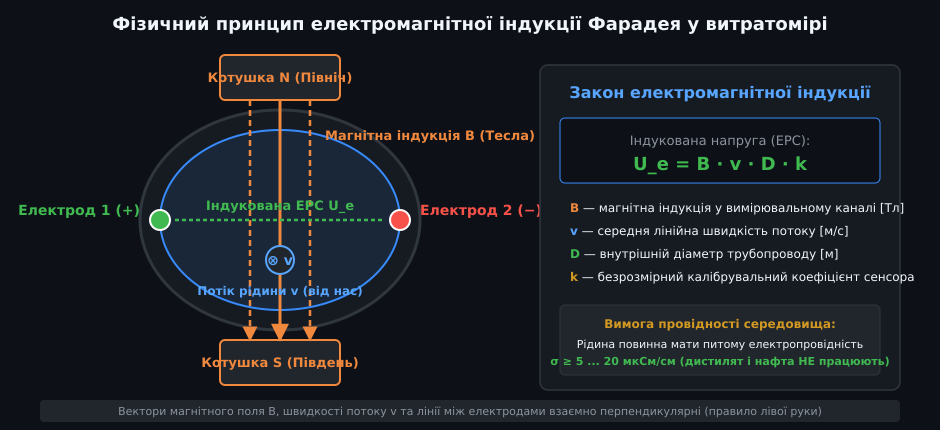
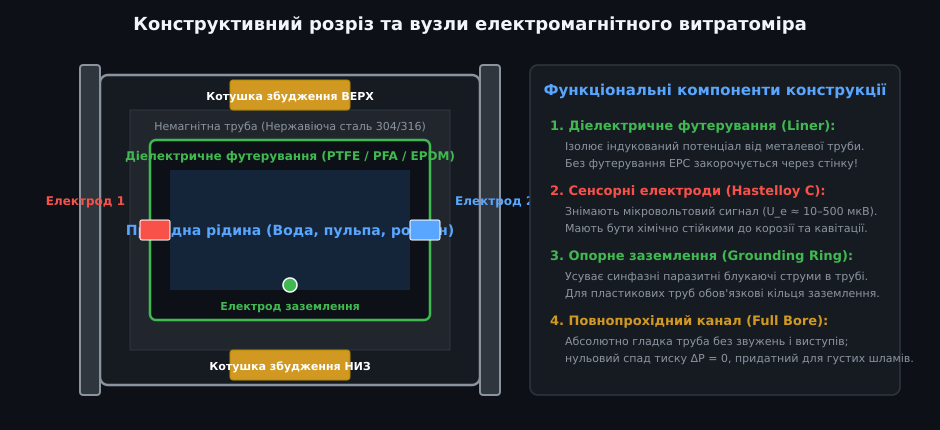
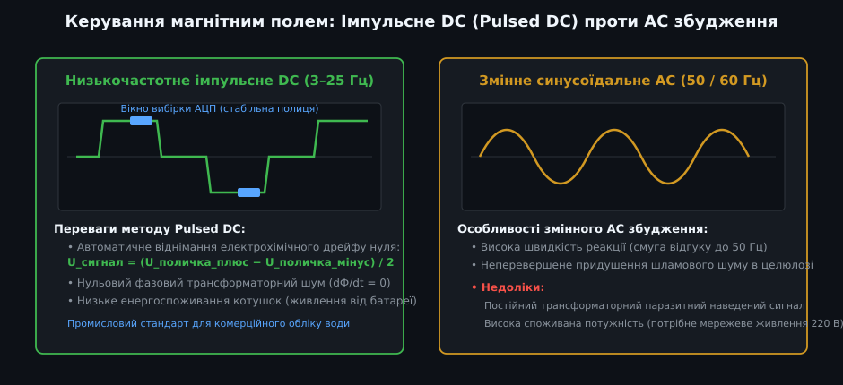
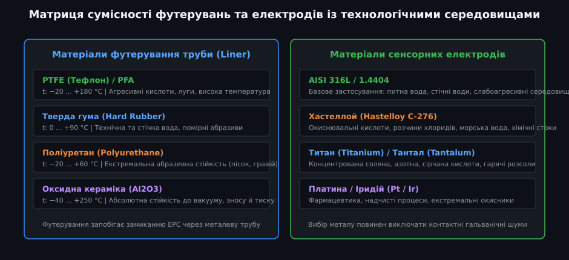
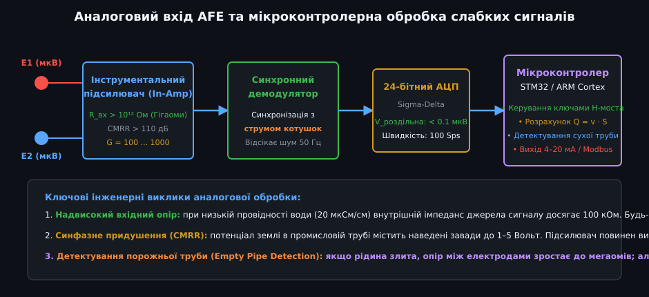

# Електромагнітні витратоміри рідини

Електромагнітні витратоміри (Electromagnetic Flow Meters, або магфлоуметри) — це неперевершені за надійністю промислові прилади для вимірювання витрати електропровідних рідин. Їхня унікальна перевага полягає в абсолютно повнопрохідній конструкції (Full Bore): усередині вимірювальної труби немає жодних звужень, перешкод чи рухомих частин. Завдяки цьому прилад має нульовий гідравлічний опір і не забивається навіть при прокачуванні густих будівельних розчинів, пульпи, гірничих шламів або каналізаційних стоків.

---

## 1. Фізичний принцип дії: закон електромагнітної індукції Фарадея

Робота електромагнітного витратоміра ґрунтується на класичному законі електромагнітної індукції Фарадея: у будь-якому провіднику, що перетинає магнітне поле, наводиться електрорушійна сила (ЕРС):

- **Рідина як провідник, що рухається:** Роль рухомого провідника довжиною `D` (внутрішній діаметр труби) виконує сам потік провідної рідини, що тече зі швидкістю `v`.
- **Зовнішнє магнітне поле B:** Електромагнітні котушки, розміщені зверху та знизу труби, створюють постійне або знакозмінне магнітне поле з індукцією `B`, спрямоване строго перпендикулярно до осі труби.
- **Індукована напруга (ЕРС):** Два металеві електроди, встановлені на протилежних боках труби в горизонтальній площині (перпендикулярно як до магнітного поля, так і до вектора потоку), вловлюють різницю потенціалів:
  
  U_e = B · v · D · k

  де:
  - `U_e` — індукована напруга на електродах (зазвичай від 10 мкВ до кількох мілівольтів);
  - `B` — магнітна індукція у зазорі котушок [Тл];
  - `v` — середня швидкість руху рідини [м/с];
  - `D` — внутрішній діаметр вимірювального каналу [м];
  - `k` — калібрувальний коефіцієнт геометрії сенсора.

- **Лінійний зв'язок з об'ємною витратою Q:** Оскільки площа перерізу `S = π · D² / 4` та індукція `B` незмінні, індукована напруга прямо пропорційна об'ємній витраті:
  
  Q = v · S = (U_e / (B · D · k)) · (π · D² / 4)

- **Критична вимога до провідності:** Рідина обов'язково повинна проводити електричний струм. Мінімальна питома провідність має становити не менше **5...20 мкСм/см**. Дистильована вода, нафтопродукти, бензин, мастила, зріджені гази та діелектричні спирти електромагнітними витратомірами вимірювати неможливо!

---

## 2. Конструкція датчика та призначення ключових вузлів

Електромагнітний витратомір виготовляється у вигляді повнопрохідної трубної вставки з фланцевим або міжфланцевим (Wafer) кріпленням:

1. **Немагнітна металева труба:** Корпус виготовляють із немагнітної аустенітної нержавіючої сталі (AISI 304 або 316), щоб метал труби не екранував і не спотворював лінії магнітної індукції.
2. **Діелектричне футерування (Liner):** Внутрішня поверхня труби герметично покрита шаром діелектрика (тефлон PTFE, жорстка гума, поліуретан). Якщо футерування пошкоджене, індукована в рідині ЕРС миттєво замкнеться накоротко через металеву трубу, і корисний сигнал на електродах зникне.
3. **Електромагнітні котушки:** Розміщені зовні труби в герметичному сталевому кожусі. Вони генерують однорідне магнітне поле в поперечному перерізі каналу.
4. **Вимірювальні електроди:** Два мініатюрні штирі з хімічно стійкого металу (нержавіюча сталь, сплав Hastelloy C-276, титан або платина) виходять у просвіт труби врівень із футеруванням, контактуючи з рідиною.
5. **Електрод або кільце заземлення:** Обов'язковий контакт, який з'єднує корпус рідини з опорною землею підсилювача, нейтралізуючи паразитні блукаючі струми промислової мережі.

---

## 3. Керування магнітним полем: імпульсне DC проти змінного AC

Спосіб живлення електромагнітних котушок визначає метрологічну стабільність і енергоспоживання приладу:

- **Низькочастотне імпульсне постійне поле (Pulsed DC, 3–25 Гц):**
  - Сучасний промисловий стандарт. Струм у котушках періодично перемикається H-мостом: «+поле» -> «пауза» -> «−поле».
  - **Автоматична компенсація дрейфу нуля:** Різниця вимірювань між позитивним і негативним півперіодами повністю віднімає повільний гальванічний дрейф електродів та ЕРС хімічної поляризації.
  - Низьке споживання енергії (від 1 до 5 Вт), що дозволяє створювати повністю автономні витратоміри з живленням від внутрішньої літієвої батареї терміном служби до 5–10 років.
- **Змінне поле мережевої частоти (Continuous AC, 50/60 Гц):**
  - Застосовується в спеціалізованих лічильниках для паперово-целюлозної та гірничої промисловості.
  - Висока частота оновлення (50 Гц) придушує контактний шум від тертя твердих волокон об електроди (шламовий шум). Недоліки: високе енергоспоживання (понад 50 Вт) та сильний трансформаторний наведений шум.

---

## 4. Матриця підбору матеріалів футерування та електродів

### Вибір футерування:
- **PTFE / PFA (Фторопласт / Тефлон):** Робоча температура до +180 °C. Абсолютна стійкість до агресивних концентрованих кислот і лугів. Ідеальний для хімічної та харчової промисловості (CIP-мийка пором).
- **Тверда гума (Hard Rubber / EPDM):** Робоча температура до +90 °C. Оптимальний вибір для водопостачання, водовідведення та слабоабразивних рідин.
- **Поліуретан (Polyurethane):** Неперевершена стійкість до механічного стирання твердими піщинками та камінням (до 60 °C).

### Вибір матеріалу електродів:
- **AISI 316L:** Питна вода, стічні води, нейтральні розчини.
- **Hastelloy C-276:** Морська вода, соляні розсоли, хлоровмісні розчини.
- **Титан / Тантал:** Гарячі концентровані неорганічні кислоти (соляна, азотна, сірчана).
- **Платина-іридій:** Екстремально агресивні окисники, фармакологія.

---

## 5. Аналоговий тракт AFE, виділення мікровольтів та правила монтажу

- **Надвисокий вхідний опір:** Оскільки внутрішній опір рідини між електродами може сягати сотень кілоомів, перший каскад аналогового підсилювача виконують на інструментальних ОП із польовими транзисторами (вхідний опір R_вх > 10¹² Ом).
- **Синфазне придушення (CMRR):** Інструментальний підсилювач повинен мати коефіцієнт придушення синфазної завади CMRR > 100 дБ, щоб виділити корисний сигнал амплітудою 50 мкВ на фоні мережевих шумів амплітудою кілька вольтів.
- **Детектор порожньої труби (Empty Pipe Detection):** Прилад постійно перевіряє імпеданс між вимірювальними електродами та електродом заземлення. Якщо труба спорожніла, опір зростає до десятків мегаомів — прилад негайно блокує лічильник, усуваючи накопичення хибної витрати від наведень.

### Правила інженерного монтажу електромагнітних витратомірів:
1. **Завжди повна труба:** Монтуйте датчик у нижніх точках трубопроводу або на вертикальних висхідних ділянках (потік знизу вгору). Монтаж на спадній ділянці з відкритим зливом суворо заборонено!
2. **Вимоги до прямолінійних ділянок:** Для збереження класу точності ±0.5% потрібна пряма ділянка труби не менше **5 · D** перед витратоміром та не менше **2 · D** після нього.
3. **Обов'язкове заземлення:** На металевих трубах корпус датчика з'єднують мідними шинами з фланцями труби. На пластикових трубах обов'язково встановлюють заземлюючі металеві кільця з обох боків датчика.
