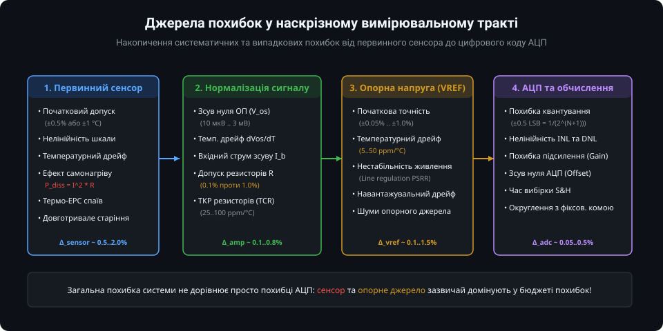
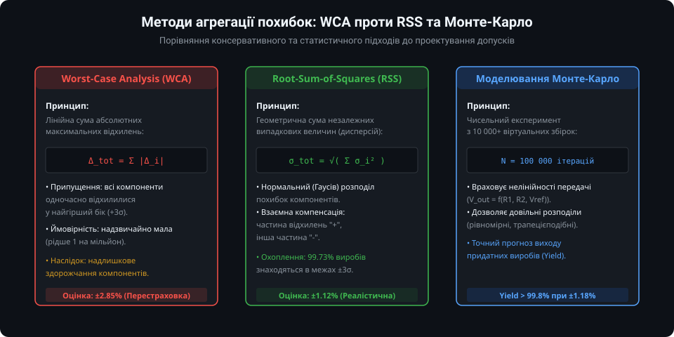
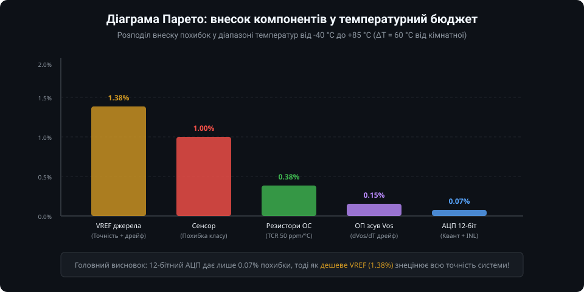
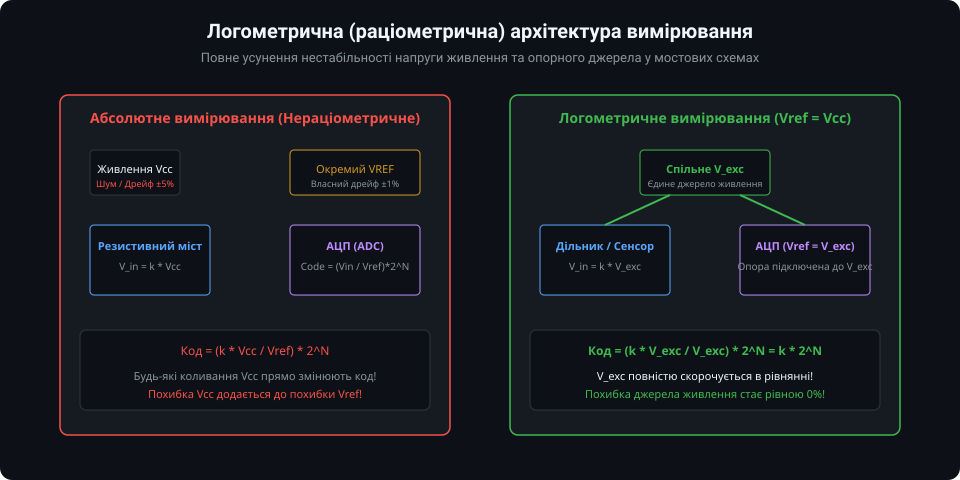

# Бюджет похибок вимірювальних систем: поглиблений інженерний аналіз

Проектування прецизійних вбудованих вимірювальних систем вимагає переходу від інтуїтивних оцінок до суворого математичного моделювання передачі невизначеностей. У цьому розділі розглядаються аналітичний апарат коефіцієнтів чутливості, стохастичні засади методу RSS, розрахунок впливу неідеальностей операційних підсилювачів, статистичне моделювання методом Монте-Карло та алгоритми програмної оптимізації бюджету похибок на мікроконтролері.

---

### 1. Математичний апарат чутливості та лінеаризація Тейлора

Нехай вихідна величина вимірювального тракту `Y` (наприклад, обчислена температура або напруга) є функцією `n` параметрів компонентів `X_1, X_2, ..., X_n`:

`Y = f(X_1, X_2, ..., X_n)`

де `X_i` — номінали резисторів, напруга зсуву ОП, напруга VREF, напруга живлення тощо. 



Якщо відхилення параметрів `Delta_X_i` малі порівняно з їх номінальними значеннями, функцію `f` розкладають у ряд Тейлора в околі робочої точки, нехтуючи членами вищих порядків:

`Delta_Y = sum_{i=1}^{n} ( (df / dX_i) * Delta_X_i )`

де величина `c_i = df / dX_i` називається **абсолютним коефіцієнтом чутливості** функції до параметра `X_i`.

Для порівняння параметрів із різними фізичними розмірностями (Оми, Вольти, Кельвіни) використовують **відносний (логарифмічний) коефіцієнт чутливості**:

`S_{X_i}^{Y} = (df / dX_i) * (X_i / Y) = d(ln Y) / d(ln X_i)`

#### Приклад: чутливість неінвертуючого підсилювача
Для класичного каскаду на операційному підсилювачі коефіцієнт підсилення дорівнює:
`G = 1 + R_2 / R_1`

Обчислимо відносні коефіцієнти чутливості до резисторів:
- `S_{R_2}^{G} = (dG / dR_2) * (R_2 / G) = (1 / R_1) * (R_2 / (1 + R_2 / R_1)) = R_2 / (R_1 + R_2)`
- `S_{R_1}^{G} = (dG / dR_1) * (R_1 / G) = (-R_2 / R_1^2) * (R_1 / (1 + R_2 / R_1)) = -R_2 / (R_1 + R_2)`

*Висновки з аналізу чутливості:*
1. Чутливості до `R_1` та `R_2` мають протилежні знаки. Якщо обидва резистори виготовлені в єдиній збірці (Thin-film resistor network) і мають однаковий позитивний ТКР (наприклад, +25 ppm/°C), їхній температурний вплив взаємно віднімається, забезпечуючи нульовий сумарний дрейф коефіцієнта підсилення!
2. При великих коефіцієнтах підсилення (`R_2 >> R_1`), обидва коефіцієнти чутливості прямують до одиниці: похибка 1% у будь-якому з резисторів викликає похибку майже 1% у вихідному коефіцієнті підсилення.

---

### 2. Стохастична теорія агрегації: RSS та кореляція похибок

При масовому виробництві електронних модулів дійсні значення компонентів є випадковими величинами.



Згідно з теорією ймовірностей, дисперсія лінійної комбінації випадкових величин визначається як:

`Var(Y) = sum_{i=1}^{n} ( c_i^2 * Var(X_i) ) + 2 * sum_{i < j} ( c_i * c_j * Cov(X_i, X_j) )`

де `Cov(X_i, X_j) = rho_{ij} * sigma_i * sigma_j` — коваріація між компонентами `i` та `j`, а `rho_{ij}` — коефіцієнт кореляції.

#### Випадок 1: Повна статистична незалежність (rho = 0)
Якщо компоненти взяті з різних партій і розміщені окремо, коваріації дорівнюють нулю. Тоді сумарне стандартне відхилення визначається формулою **Root-Sum-of-Squares (RSS)**:

`sigma_Y = sqrt( sum_{i=1}^{n} (c_i * sigma_i)^2 )`

Завдяки центральній граничній теоремі розподіл суми великої кількості незалежних похибок (навіть якщо окремі допуски мали рівномірний розподіл) апроксимується нормальним розподілом Гауса. Межа `±3 * sigma_Y` покриває 99.73% усіх виготовлених плат.

#### Випадок 2: Наявність позитивної кореляції (rho > 0)
Якщо всі резистори на платі піддаються нагріванню від сусіднього транзистора стабілізатора, їх температурні дрейфи є позитивно скорельованими (`rho ~ 0.8..1.0`). У такому випадку пряме застосування простої формули RSS без урахування коваріації призведе до заниження сумарної похибки.

---

### 3. Детальний бюджет операційного підсилювача

Операційний підсилювач у тракті нормалізації вносить комплекс взаємопов'язаних систематичних та температурних похибок:


Повна напруга похибки ОП, приведена до входу (RTI — Referred-to-Input), описується рівнянням:

`V_err_RTI = V_os + (dV_os / dT) * Delta_T + (V_cm / CMRR) + (Delta_V_sup / PSRR) + I_offset * R_eq + (dI_offset / dT) * Delta_T * R_eq`

де:
- `V_os` — початкова напруга зсуву при кімнатній температурі (25 °C);
- `dV_os / dT` — температурний коефіцієнт напруги зсуву (від 0.05 мкВ/°C у чопперних ОП Zero-Drift до 5..10 мкВ/°C у загальновживаних ОП);
- `V_cm / CMRR` — похибка синфазного сигналу, де `CMRR = 10^(CMRR_dB / 20)`;
- `Delta_V_sup / PSRR` — похибка нестабільності шини живлення;
- `I_offset * R_eq` — падіння напруги від різниці вхідних струмів на еквівалентному опорі джерела `R_eq = R_1 || R_2`.

#### Числовий приклад розрахунку
Для підсилення сигналу термопари (діапазон 0..20 мВ) з коефіцієнтом підсилення `G = 100`:
- Звичайний ОП LM358: `V_os = 2 мВ`, `dV_os/dT = 7 мкВ/°C`. При перепаді `Delta_T = 50 °C`:
  `V_err = 2000 мкВ + 7 * 50 = 2350 мкВ`.
  Відносна похибка від шкали 20 мВ становить: `2.35 мВ / 20 мВ = 11.75%` (неприпустимо велика похибка!).
- Прецизійний Zero-Drift ОП (наприклад, OPA333): `V_os = 10 мкВ`, `dV_os/dT = 0.05 мкВ/°C`.
  `V_err = 10 мкВ + 0.05 * 50 = 12.5 мкВ`.
  Відносна похибка: `0.0125 мВ / 20 мВ = 0.0625%` (ідеально для прецизійних вимірювань).

---

### 4. Статистичне моделювання методом Монте-Карло

Коли передавальна функція є суттєво нелінійною (наприклад, рівняння Стейнхарта-Харта для NTC або міст Уїтстона з великим розбалансом), лінеаризація Тейлора дає помітну похибку. У таких випадках застосовують числове моделювання методом Монте-Карло.



Скрипт генерує `N = 100 000` вибірок компонентів відповідно до їхніх паспортних законів розподілу:
- Початкові допуски резисторів: симетричний трикутний або усічений нормальний розподіл (±3-сигма відповідає маркуванню 1%);
- ТКР резисторів: рівномірний розподіл у межах `[-TCR_max, +TCR_max]`;
- Напруга VREF: нормальний розподіл навколо номіналу.

Результатом моделювання є побудова гістограми та емпіричної інтегральної функції розподілу ймовірностей (CDF), яка дозволяє точно розрахувати технологічний вихід придатних виробів (Yield) для заданих виробничих специфікацій.

---

### 5. Практична програмна оптимізація бюджету похибок у вбудованому ПЗ

Для нівелювання систематичних складових похибки у мікроконтролері реалізується дворівневе калібрування (Zero & Span Calibration) та програмне підвищення еквівалентної розрядності (Oversampling & Decimation):



Нижче наведено модуль на C для прецизійної обробки вимірювань:

```c
#include <stdint.h>
#include <stdbool.h>

typedef struct {
    float gain_factor;     // Масштабний коефіцієнт (Span)
    float offset_bias;     // Зсув нуля (Zero Offset)
    float vref_actual;     // Фактична напруга опорного джерела (В)
    uint32_t adc_max_code; // Максимальний код АЦП (4095 для 12-біт)
} measurement_calib_t;

/**
 * @brief Ініціалізація структури калібрування з конфігураційного flash
 */
void calib_init(measurement_calib_t *calib, float vref, uint8_t bits) {
    calib->vref_actual = vref;
    calib->adc_max_code = (1UL << bits) - 1UL;
    calib->gain_factor = 1.0f;
    calib->offset_bias = 0.0f;
}

/**
 * @brief Розрахунок калібрувальних коефіцієнтів за двома еталонними точками
 * @param measured_pt1 Сире виміряне значення в першій точці (наприклад, 0.0 В або 0.0 °C)
 * @param ideal_pt1    Ідеальне еталонне значення в першій точці
 * @param measured_pt2 Сире виміряне значення в другій точці (наприклад, 2.5 В або 100.0 °C)
 * @param ideal_pt2    Ідеальне еталонне значення в другій точці
 */
bool calib_two_point_update(measurement_calib_t *calib, 
                            float measured_pt1, float ideal_pt1,
                            float measured_pt2, float ideal_pt2) {
    float delta_m = measured_pt2 - measured_pt1;
    if (delta_m > -1e-6f && delta_m < 1e-6f) {
        return false; // Захист від ділення на нуль
    }
    
    // Gain = (Y2_ideal - Y1_ideal) / (X2_meas - X1_meas)
    calib->gain_factor = (ideal_pt2 - ideal_pt1) / delta_m;
    // Offset = Y1_ideal - Gain * X1_meas
    calib->offset_bias = ideal_pt1 - (calib->gain_factor * measured_pt1);
    return true;
}

/**
 * @brief Програмний оверсемплінг (перевибірка) з проріджуванням (Decimation)
 * @details Дозволяє отримати N додаткових бітів роздільної здатності АЦП
 *          Кількість вибірок: 4^extra_bits, бітовий зсув суми: extra_bits.
 *          Потребує наявності адитивного білого шуму амплітудою >= 1 LSB.
 */
uint32_t adc_oversample_16bit_from_12bit(uint32_t (*read_raw_adc_fn)(void)) {
    // Для отримання 16 біт з 12 біт (extra_bits = 4):
    // Кількість вибірок = 4^4 = 256
    uint32_t accumulator = 0;
    for (uint16_t i = 0; i < 256; i++) {
        accumulator += read_raw_adc_fn();
    }
    // Зсув суми на 4 біти вправо: accumulator >> 4
    return (accumulator >> 4);
}

/**
 * @brief Отримання скоригованого фізичного значення з урахуванням калібрування
 */
float apply_calibrated_reading(const measurement_calib_t *calib, uint32_t raw_code) {
    // Переведення коду в напругу
    float raw_voltage = ((float)raw_code / (float)calib->adc_max_code) * calib->vref_actual;
    // Застосування афінного перетворення калібрування: Y = Gain * X + Offset
    return (calib->gain_factor * raw_voltage) + calib->offset_bias;
}
```

---

### Практичні інженерні правила зведення бюджету похибок

1. **Правило домінуючої ланки:** Знайдіть у тракті компонент із найбільшою похибкою. Зменшення похибки інших компонентів у 10 разів не дасть практично ніякого ефекту, поки не буде оптимізована домінуюча ланка.
2. **Пріоритет логометричності:** Завжди віддавайте перевагу логометричним схемам над абсолютними для датчиків мостового типу, потенціометрів та терморезисторів.
3. **Вибір ОП за дрейфом:** Для сигналів менше 10 мВ (термопари, тензодатчики) використовуйте виключно мікросхеми Zero-Drift з автоматичним компенсаційним перериванням (Chopper-stabilized).
4. **Використання резисторних збірок:** Для завдання коефіцієнта підсилення в інструментальних підсилювачах використовуйте узгоджені тонкоплівкові матриці на одній підкладці з узгодженим коефіцієнтом ТКР менше 2..5 ppm/°C.
