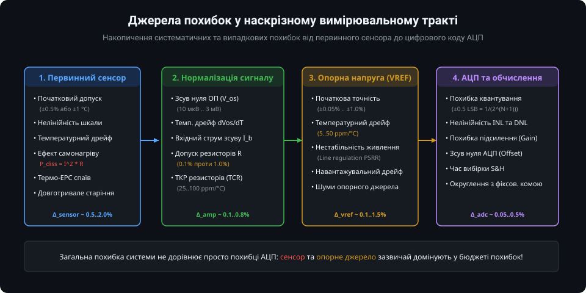
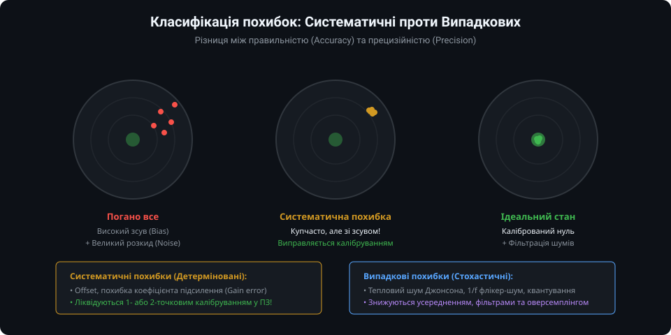
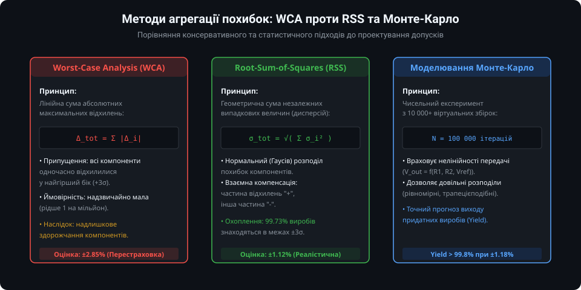
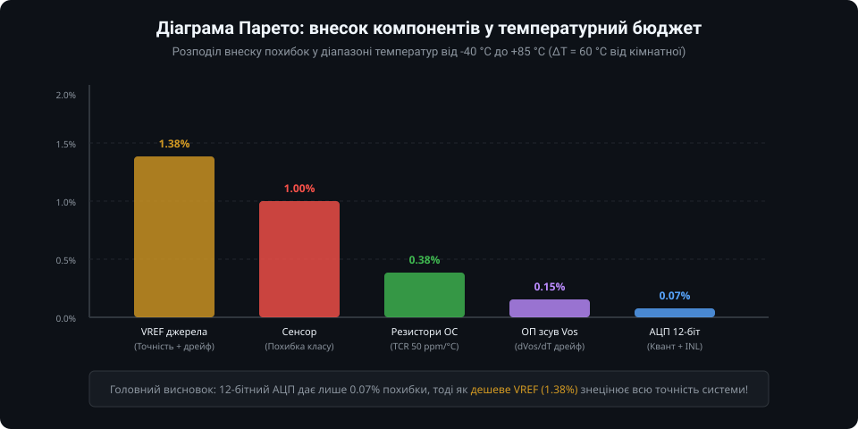
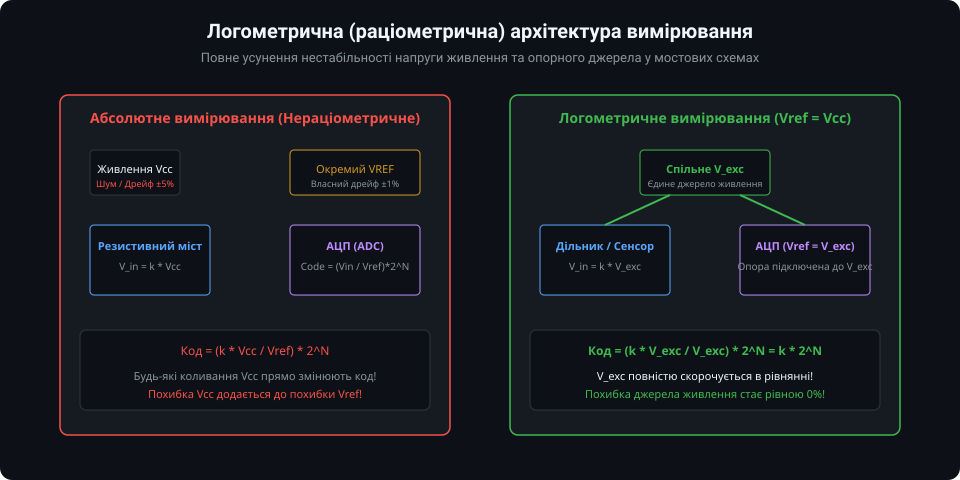

# Бюджет похибок вимірювальних систем

У процесі проектування аналого-цифрових вимірювальних систем інженери часто припускаються помилки, вважаючи, що точність вимірювання визначається виключно розрядністю обраного аналого-цифрового перетворювача (наприклад, 12- чи 16-бітного АЦП). Насправді реальна похибка системи складається з каскаду похибок усіх елементів аналогового тракту: первинного перетворювача (сенсора), ланцюгів нормалізації сигналу, джерела опорної напруги та самого перетворювача.

Розрахунок бюджету похибок (Error Budget Analysis) — це формалізована інженерна методика оцінки внеску кожного компонента схеми в загальну невизначеність кінцевого результату.

---

### 1. Джерела похибок у наскрізному вимірювальному тракті

Типовий вимірювальний канал мікроконтролерного пристрою складається з чотирьох основних функціональних вузлів, кожен з яких вносить власні похибки:

1. **Первинний сенсор:**
   - Початковий заводський допуск (наприклад, допуск опору терморезистора RTD класу B становить ±0.3 °C при 0 °C);
   - Нелінійність функції перетворення (відхилення характеристики від прямої лінії);
   - Ефект паразитного самонагріву вимірювальним струмом (потужність розсіювання `P = I^2 * R`);
   - Паразитна термо-ЕРС (ефект Зеєбека) у місцях контакту різнорідних металів;
   - Довготривале старіння та деградація чутливого елемента.

2. **Ланцюги нормалізації сигналу (операційні підсилювачі та фільтри):**
   - Напруга зсуву нуля ОП (Input Offset Voltage, `V_os`), яка підсилюється разом із корисним сигналом;
   - Температурний дрейф напруги зсуву (`dV_os / dT`);
   - Вхідні струми зсуву (`I_bias`, `I_offset`), що створюють падіння напруги на вихідному опорі джерела;
   - Допуски дискретних резисторів дільників і зворотного зв'язку (0.1%, 1% або 5%);
   - Температурний коефіцієнт опору резисторів (TCR, 25..100 ppm/°C).

3. **Джерело опорної напруги (VREF):**
   - Початкова точність напруги опорного джерела при 25 °C;
   - Температурний коефіцієнт дрейфу VREF (від 5 ppm/°C у прецизійних ІМС до 50..100 ppm/°C у внутрішніх джерелах МК);
   - Нестабільність при зміні напруги живлення (Line Regulation / PSRR) та навантаження (Load Regulation).

4. **Аналого-цифровий перетворювач (АЦП):**
   - Похибка квантування: теоретична фундаментальна невизначеність дискретизації, що дорівнює `±0.5 LSB`;
   - Інтегральна (INL) та диференціальна (DNL) нелінійності;
   - Похибка зсуву нуля (Offset Error) та коефіцієнта передачі (Gain Error);
   - Часові похибки схеми вибірки та зберігання (S&H).

---

### 2. Систематичні проти випадкових похибок

Для правильного складання бюджету похибок усі фактори невизначеності поділяють на дві фундаментальні категорії:

- **Систематичні похибки (детерміновані):** Постійні або закономірно змінювані відхилення. До них належать початковий зсув напруги ОП, початковий допуск резисторів дільника, похибка номіналу VREF. 
  - *Властивість:* Їх неможливо зменшити простим усередненням вимірювань.
  - *Спосіб усунення:* Повне або часткове усунення досягається апаратним чи програмним калібруванням (введення калібрувальних коефіцієнтів зміщення нуля `Zero_Offset` та масштабу `Span_Factor` у ПЗ мікроконтролера).

- **Випадкові похибки (стохастичні):** Флуктуації, спричинені фізичними шумами (тепловий шум Джонсона-Найквіста в резисторах, дробовий шум напівпровідникових переходів, флікер-шум 1/f, завади від цифрових ліній та шум квантування АЦП).
  - *Властивість:* Мають нульове математичне сподівання при симетричному розподілі.
  - *Спосіб усунення:* Ефективно знижуються цифровою фільтрацією, передискретизацією (Oversampling) та накопичувальним усередненням пакетів вимірювань.

---

### 3. Методи агрегації похибок: WCA проти RSS

Коли відомі індивідуальні допуски компонентів, виникає питання: як підсумувати їх для отримання гарантованої сумарної похибки готового приладу?

1. **Аналіз найгіршого випадку (Worst-Case Analysis, WCA):**
   Розраховується як пряма арифметична сума модулів максимальних відхилень усіх складових:
   `Delta_total_WCA = |Delta_1| + |Delta_2| + ... + |Delta_n|`
   - *Перевага:* 100% гарантія, що жоден виготовлений пристрій не вийде за вказані межі за будь-яких умов.
   - *Недолік:* Метод є надмірно песимістичним. Ймовірність того, що всі 10–15 компонентів схеми одночасно матимуть граничні відхилення одного знаку, практично дорівнює нулю. Це змушує інженера обирати надто дорогі прецизійні компоненти.

2. **Корінь із суми квадратів (Root-Sum-of-Squares, RSS):**
   Базується на статистичній незалежності допусків окремих компонентів:
   `sigma_total_RSS = sqrt( sigma_1^2 + sigma_2^2 + ... + sigma_n^2 )`
   - Якщо допуски компонентів подано як межі 3-сигма (довірча ймовірність 99.73%), то розрахована сумарна похибка за методом RSS гарантує, що 99.73% серійних виробів вкладуться у заявлені характеристики.
   - Підхід RSS є світовим стандартом для комерційної та промислової електроніки, дозволяючи знизити собівартість пристрою в рази.

---

### 4. Температурний дрейф та діаграма Парето

У реальних умовах експлуатації в промисловому діапазоні температур (від -40 °C до +85 °C) розкид температури стає головним джерелом додаткової невизначеності.

Діаграма Парето наочно демонструє критичне співвідношення між складовими:
- **Джерело опорної напруги VREF:** Навіть пристойне опорне джерело з дрейфом 50 ppm/°C при перепаді температури на 60 °C дасть похибку `50e-6 * 60 = 0.3%`, що разом із початковим допуском (1%) становить понад 1.3% сумарної похибки.
- **Резистори:** Невідповідність ТКР двох резисторів зворотного зв'язку (наприклад, 50 ppm/°C) генерує додатковий температурний дрейф коефіцієнта підсилення близько 0.3..0.4%.
- **АЦП:** Власний внесок 12-бітного перетворювача становить лише 1 LSB з 4096, тобто приблизно 0.024% (менше 0.1% з урахуванням INL).

*Висновок:* Збільшення розрядності АЦП з 12 до 16 біт без заміни нестабільного джерела VREF або без використання резисторів із низьким ТКР (0.1%, 10..25 ppm/°C) не покращить реальну точність вимірювання!

---

### 5. Схемотехнічні методи зниження похибок: логометрична схема

Найбільш елегантним та економічно ефективним методом усунення домінуючої похибки живлення та VREF є застосування **логометричного (раціометричного) вимірювання**:

- У звичайній схемі джерело збудження сенсора (наприклад, Vcc) та опорна напруга АЦП (VREF) є незалежними. Якщо напруга живлення Vcc "просяде" або зміниться через навантаження, вихідна напруга сенсора зміниться, і АЦП зареєструє помилкове значення.
- У **логометричній схемі** одне й те саме джерело напруги одночасно живить вимірювальний резистивний міст (або терморезисторний дільник) та подається на вивід опорної напруги АЦП (`VREF = V_exc`):

`V_in = k * V_exc`
`ADC_Code = (V_in / VREF) * (2^N - 1) = (k * V_exc / V_exc) * (2^N - 1) = k * (2^N - 1)`

Оскільки величина напруги збудження `V_exc` фігурує як у чисельнику, так і в знаменнику, вона **повністю скорочується**. Нестабільність, шуми та температурний дрейф джерела живлення більше не впливають на результат перетворення, усуваючи одну з найбільших складових бюджету похибок без додаткових витрат.

---

### Підсумки та висновки

Аналіз бюджету похибок дає інженеру об'єктивний інструмент для оптимізації схеми:
1. Застосовуйте логометричне включення для всіх параметричних сенсорів (терморезистори, тензомості, потенціометри).
2. Застосовуйте метод RSS для розрахунку серійних виробів та WCA — для систем безпеки.
3. Не переплачуйте за надлишкову розрядність АЦП, якщо бюджет похибки лімітується дешевими резисторами або нестабільним джерелом VREF.
