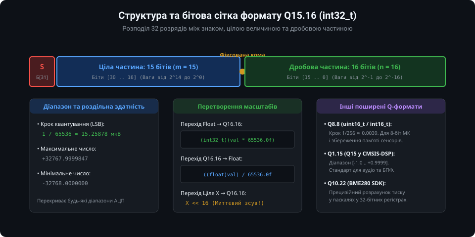
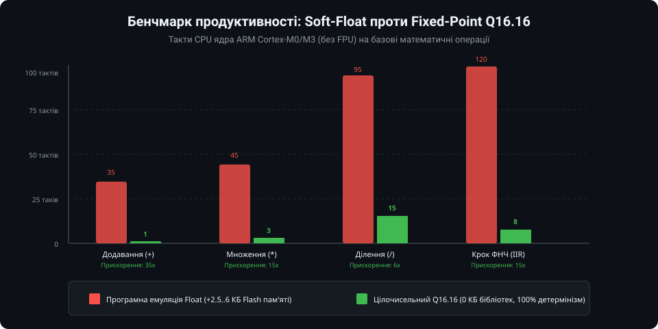
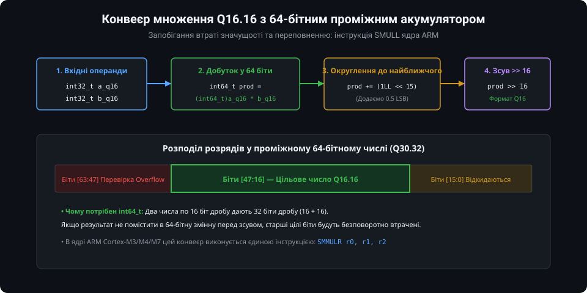
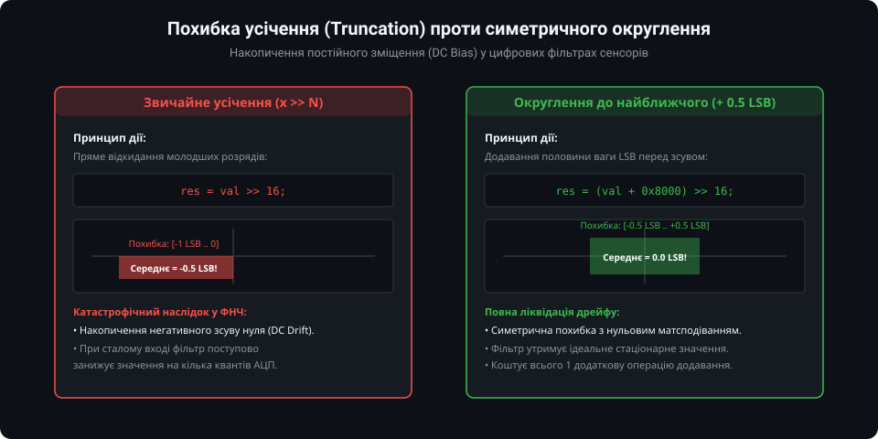

# Арифметика з фіксованою комою для мікроконтролерів: поглиблений інженерний аналіз

У системах цифрової обробки сигналів (DSP), керування електроприводами та швидкісної телеметрії використання програмної емуляції чисел з рухомою комою (Soft-Float) неприпустиме через значні накладні витрати часу виконання та нелінійний джитер. У цьому розділі наведено суворий математичний аналіз шумів квантування у фіксованій комі, асемблерні оптимізації для процесорів архітектури ARM Cortex-M, методи боротьби з паразитними граничними циклами у цифрових фільтрах та повнофункціональну модульну бібліотеку мовою C з операціями насичення.

---

### 1. Теоретичні засади: динамічний діапазон, крок LSB та шум квантування

У довільному форматі із фіксованою комою **SQm.n** (де `S` позначає 1 знаковий біт, `m` — кількість розрядів цілої частини, `n` — кількість розрядів дробової частини, сумарна розрядність `W = 1 + m + n`):



1. **Крок квантування (вага молодшого значущого розряду):**
   `Delta = LSB = 2^(-n)`

2. **Діапазон представлення чисел:**
   `[-2^m, 2^m - 2^(-n)]`

3. **Теоретичне відношення сигнал/шум квантування (SQNR):**
   Припускаючи, що шум квантування `e` має рівномірний розподіл на інтервалі `[-Delta/2, +Delta/2]`, його дисперсія становить:
   `sigma_e^2 = Delta^2 / 12 = 2^(-2n) / 12`
   Для синусоїдального сигналу повної шкали амплітудою `A = 2^m` середня потужність сигналу дорівнює `P_s = (2^m)^2 / 2 = 2^(2m - 1)`.
   Тоді відношення потужності сигналу до шуму квантування визначається класичною формулою:
   `SQNR_dB = 10 * log10( P_s / sigma_e^2 ) = 10 * log10( (3/2) * 2^(2(m+n)) ) ≈ 6.02 * (m + n) + 1.76 dB`

Для популярного формату **Q15.16** (`m=15, n=16`, сумарно `m+n = 31` інформаційний біт):
`SQNR_dB ≈ 6.02 * 31 + 1.76 = 188.38 dB`
Такий рівень шуму квантування знаходиться далеко за межами можливостей навіть найкращих 24-бітних аналого-цифрових перетворювачів, що гарантує відсутність деградації якості корисного сигналу при математичній обробці.

---

### 2. Апаратні оптимізації ядра ARM Cortex-M та CMSIS-DSP

Швидкодія арифметики з фіксованою комою досягає свого піка при використанні спеціалізованих інструкцій мікропроцесорних ядер:



#### 1. Інструкція `SMULL` (Signed Multiply Long)
Доступна на всіх ядрах Cortex-M3, M4, M7 та опціонально на Cortex-M0+:
```assembly
SMULL r2, r3, r0, r1   ; [r3:r2] = r0 * r1 (64-бітний результат)
LSRS  r2, r2, #16      ; Зсув молодшої частини на 16 бітів праворуч
ORR   r0, r2, r3, LSL #16 ; Об'єднання зі старшими розрядами (результат у r0)
```
Виконується за 1 такт на Cortex-M4/M7 або за 3–5 тактів на Cortex-M3.

#### 2. Інструкція `SMMULR` (Signed Most Significant Word Multiply with Round)
Архітектура ARMv7-M (Cortex-M4/M7) містить інструкцію, яка виконує 32x32-бітне множення, додає константу округлення `0x80000000` та повертає старші 32 біти результату за **1 такт**:
```c
// Формат Q31 (дробові числа [-1.0 .. +1.0]):
int32_t res = __SMMULR(a, b);
```

#### 3. Апаратне насичення: інструкція `__SSAT`
У разі виходу за допустимий діапазон ціле число переповнюється і змінює знак на протилежний (wrap-around), що в контурах керування двигунами викликає ударні навантаження або зрив генерації. Інструкція `SSAT` миттєво обмежує значення до верхньої або нижньої межі (Saturation Arithmetic):
```c
// Апаратне обмеження до 16-бітного знакового діапазону [-32768 .. +32767]
int32_t clamped = __SSAT(val, 16);
```

---

### 3. Алгоритми операції ділення у форматі Q16.16

Ділення у фіксованій комі є обчислювально більш складною операцією порівняно з множенням:



При діленні двох чисел `A / B` у форматі Q16.16 результат прямого ділення цілих чисел `(A / B)` повністю втратив би дробову частину (стандартний результат мав би 0 дробових бітів). Щоб результат отримав 16 бітів дробу, ділене `A` необхідно **попередньо зсунути ліворуч на 16 бітів**:

`Result_Q16 = (A << 16) / B`

Оскільки прямий зсув `(A << 16)` для 32-бітного числа викличе переповнення, операцію виконують із попереднім приведенням до 64-бітного знакового типу:

```c
int32_t q16_div(int32_t a, int32_t b) {
    if (b == 0) {
        // Обробка ділення на нуль: повернення насиченого значення зі знаком чисельника
        return (a >= 0) ? 0x7FFFFFFF : -0x7FFFFFFF;
    }
    int64_t temp = ((int64_t)a << 16);
    return (int32_t)(temp / b);
}
```

На ядрах Cortex-M3/M4/M7 апаратна інструкція `SDIV` виконує це за 2–12 тактів CPU. Для ядер Cortex-M0/M0+, де інструкція `SDIV` відсутня, операцію ділення можна замінити множенням на зворотну величину `1/B`, обчислену за 2 ітерації методу Ньютона — Рафсона.

---

### 4. Нелінійні ефекти у цифрових фільтрах: граничні цикли (Limit Cycles)

При реалізації рекурсивних цифрових фільтрів (IIR-фільтрів) у фіксованій комі виникають специфічні нелінійні спотворення, зумовлені квантуванням стану фільтра:



1. **Граничні цикли малої амплітуди (Granularity Limit Cycles):**
   Якщо на вхід фільтра подати нульовий або постійний сигнал, вихід фільтра замість спокою починає генерувати незгасаючі періодичні коливання амплітудою в кілька LSB. Це відбувається через те, що нескінченний спад експоненти обривається на кроці квантування.
2. **Мертва зона (Deadband):**
   При малих значеннях різниці сигналів `(X[n] - Y[n-1])` величина приросту стає меншою за вагу LSB при зсуві праворуч. У результаті фільтр "залипає" на хибному проміжному значенні.

#### Методи інженерного усунення граничних циклів
1. **Збільшення розрядності внутрішнього стану (Accumulator Extension):**
   Якщо вхід і вихід фільтра мають формат Q16.16, внутрішня змінна стану фільтра зберігається у форматі **Q8.24** (24 біти дробу). Приріст ніколи не втрачається, а округлення до Q16.16 виконується лише на виході.
2. **Симетричне округлення з додаванням 0.5 LSB:**
   Заміна оператора `>> N` на макрос `ROUND_DIV(x, N) = ((x) + (1 << ((N)-1))) >> (N)`.
3. **Псевдовипадковий шум (Dithering):**
   Додавання білого шуму з амплітудою ±0.5 LSB руйнує періодичні фазові замикання граничних циклів.

---

### 5. Повнофункціональна виробнича бібліотека fixed-point на C

Нижче наведено самодостатню оптимізовану бібліотеку мовою C з підтримкою базових операцій, функцій насичення, табличного обчислення поліномів та швидкого безбібліотечного форматування рядків.

#### Заголовний файл (`fixed_point.h`)

```c
#ifndef FIXED_POINT_H
#define FIXED_POINT_H

#include <stdint.h>
#include <stdbool.h>

typedef int32_t fixed16_t;

#define F16_FRAC_BITS       16
#define F16_SCALE           (1L << F16_FRAC_BITS)
#define F16_HALF            (1L << (F16_FRAC_BITS - 1))
#define F16_MAX             0x7FFFFFFF
#define F16_MIN             (-0x7FFFFFFF - 1)

#define F16_FROM_INT(x)     ((fixed16_t)((x) << F16_FRAC_BITS))
#define F16_TO_INT(x)       ((int32_t)((x) >> F16_FRAC_BITS))
#define F16_FROM_FLOAT(x)   ((fixed16_t)((x) * 65536.0f + ((x) >= 0.0f ? 0.5f : -0.5f)))
#define F16_TO_FLOAT(x)     (((float)(x)) / 65536.0f)

/* Операції з насиченням (Saturation) */
static inline fixed16_t f16_add_sat(fixed16_t a, fixed16_t b) {
    int64_t res = (int64_t)a + b;
    if (res > F16_MAX) return F16_MAX;
    if (res < F16_MIN) return F16_MIN;
    return (fixed16_t)res;
}

static inline fixed16_t f16_sub_sat(fixed16_t a, fixed16_t b) {
    int64_t res = (int64_t)a - b;
    if (res > F16_MAX) return F16_MAX;
    if (res < F16_MIN) return F16_MIN;
    return (fixed16_t)res;
}

static inline fixed16_t f16_mul_rounded(fixed16_t a, fixed16_t b) {
    int64_t prod = (int64_t)a * b;
    prod += F16_HALF; // Округлення до найближчого (+0.5 LSB)
    return (fixed16_t)(prod >> F16_FRAC_BITS);
}

static inline fixed16_t f16_div(fixed16_t a, fixed16_t b) {
    if (b == 0) return (a >= 0) ? F16_MAX : F16_MIN;
    int64_t temp = ((int64_t)a << F16_FRAC_BITS);
    return (fixed16_t)(temp / b);
}

/* Функції розрахунків сенсорних конвеєрів */
fixed16_t f16_poly_eval(fixed16_t x, const fixed16_t *coeffs, uint8_t order);
fixed16_t f16_sqrt(fixed16_t val);
uint16_t f16_to_str(fixed16_t val, char *buffer, uint8_t decimals);

#endif /* FIXED_POINT_H */
```

#### Файл реалізації (`fixed_point.c`)

```c
#include "fixed_point.h"

/**
 * @brief Обчислення значення полінома за схемою Горнера у форматі Q16.16:
 *        P(x) = c_0 + x * (c_1 + x * (c_2 + ...))
 */
fixed16_t f16_poly_eval(fixed16_t x, const fixed16_t *coeffs, uint8_t order) {
    fixed16_t result = coeffs[order];
    for (int8_t i = (int8_t)order - 1; i >= 0; i--) {
        result = f16_add_sat(f16_mul_rounded(result, x), coeffs[i]);
    }
    return result;
}

/**
 * @brief Цілочисельне обчислення квадратного кореня sqrt(x) методом побітового зсуву
 */
fixed16_t f16_sqrt(fixed16_t val) {
    if (val <= 0) return 0;
    
    // Масштабуємо аргумент для отримання Q16 результату:
    // sqrt(val * 2^16) = sqrt(val) * 2^8, тому множимо під коренем на 2^16
    uint64_t op = (uint64_t)val << F16_FRAC_BITS;
    uint64_t res = 0;
    uint64_t one = 1ULL << 62; // Старший біт 64-бітного слова

    while (one > op) {
        one >>= 2;
    }

    while (one != 0) {
        if (op >= res + one) {
            op -= res + one;
            res = (res >> 1) + one;
        } else {
            res >>= 1;
        }
        one >>= 2;
    }

    return (fixed16_t)res;
}

/**
 * @brief Безпечне перетворення числа Q16.16 у форматний рядок ASCII (без використання sprintf)
 * @param val Вхідне число
 * @param buffer Вказівник на рядок (мін. 16 байт)
 * @param decimals Кількість знаків після коми (від 1 до 4)
 * @return Кількість записаних символів
 */
uint16_t f16_to_str(fixed16_t val, char *buffer, uint8_t decimals) {
    char *ptr = buffer;
    if (val < 0) {
        *ptr++ = '-';
        val = -val;
    }

    int32_t integer_part = val >> F16_FRAC_BITS;
    uint32_t frac_part = val & 0xFFFF;

    // Запис цілої частини (реверсивний буфер)
    char temp[12];
    int idx = 0;
    if (integer_part == 0) {
        temp[idx++] = '0';
    } else {
        while (integer_part > 0) {
            temp[idx++] = (char)('0' + (integer_part % 10));
            integer_part /= 10;
        }
    }
    while (idx > 0) {
        *ptr++ = temp[--idx];
    }

    if (decimals > 0) {
        *ptr++ = '.';
        if (decimals > 4) decimals = 4;
        
        static const uint32_t pow10[5] = {1, 10, 100, 1000, 10000};
        // Масштабування дробу: frac * 10^decimals / 65536
        uint32_t scaled_frac = ((uint64_t)frac_part * pow10[decimals] + 32768) >> 16;
        
        // Вивід із провідними нулями
        for (int8_t d = (int8_t)decimals - 1; d >= 0; d--) {
            uint32_t p = pow10[d];
            uint8_t digit = (uint8_t)(scaled_frac / p);
            *ptr++ = (char)('0' + digit);
            scaled_frac %= p;
        }
    }

    *ptr = '\0';
    return (uint16_t)(ptr - buffer);
}
```

---

### Підсумки та інженерні рекомендації

1. **Завжди використовуйте 64-бітне проміжне множення:** Ніколи не множте числа `int32_t` без попереднього приведення до `int64_t`, інакше старші розряди цілої частини будуть втрачені.
2. **Округлення замість відкидання бітів:** Завжди додавайте половину ваги LSB (`+ 0x8000` для Q16.16) перед зсувом праворуч для виключення негативного дрейфу нуля у фільтрах.
3. **Захист від переповнення:** У критичних вузлах керування приводами обов'язково застосовуйте операції з насиченням (`_sat`), щоб уникнути інверсії знаку при переповненні цілого регістра.
