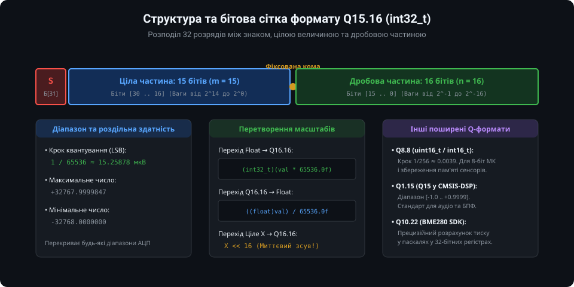
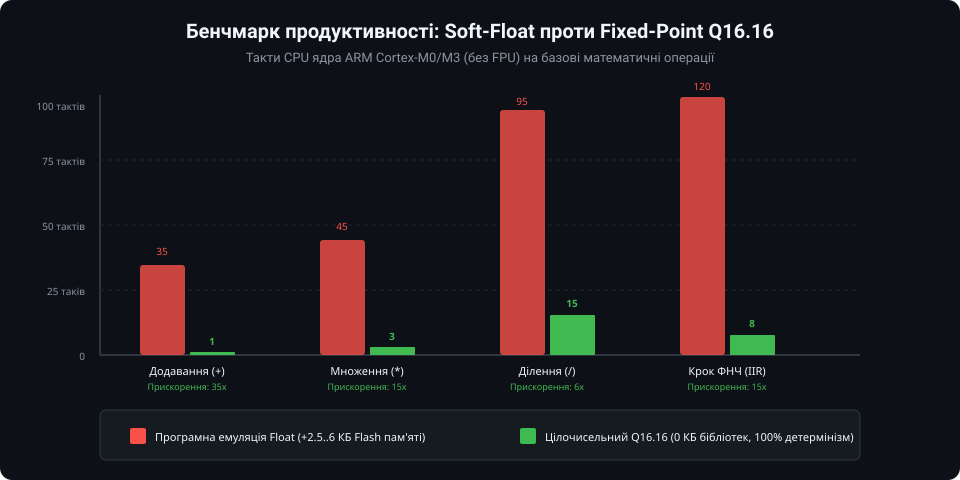
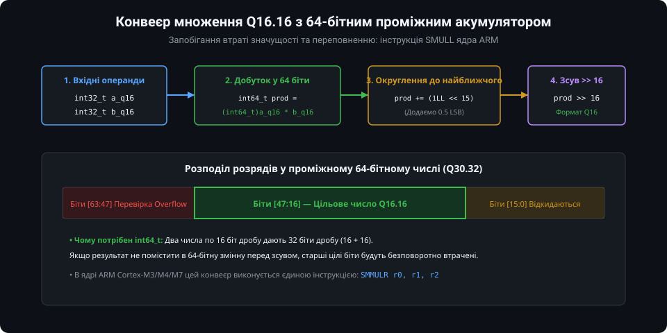
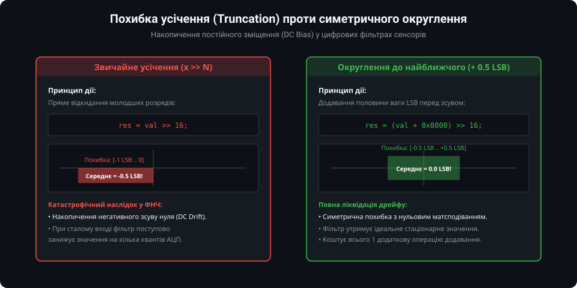
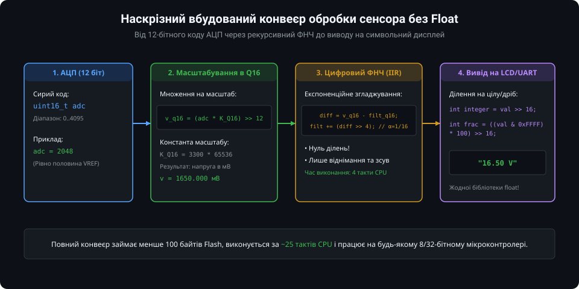

# Арифметика з фіксованою комою для мікроконтролерів

У багатьох вбудованих системах розробники стикаються з дилемою: як обробляти фізичні величини з сенсорів (температуру, тиск, вологість, напругу), що вимагають дробових чисел, якщо мікроконтролер не має апаратного співпроцесора рухомої коми (FPU)?

Використання стандартних типів `float` або `double` у мікроконтролерах класів ARM Cortex-M0/M0+/M3, 8-бітних AVR або базових ядрах RISC-V призводить до підключення "важких" програмних бібліотек емуляції (Soft-Float). Це призводить до роздування розміру прошивки на 2–6 КБ, сповільнення математичних операцій у 10–50 разів і втрати детермінізму затримки переривань. Повноцінною альтернативою є **арифметика з фіксованою комою (Fixed-Point Arithmetic)**.

---

### 1. Формати представлення чисел із фіксованою комою (Q-нотація)

Ідея фіксованої коми полягає в тому, що дробове число зберігається у звичайному цілому регістрі (`int16_t`, `int32_t`), але умовно масштабується на фіксований коефіцієнт — ступінь двійки `2^n`.



Формат записується як **Qm.n** (або SQm.n для знакових чисел):
- `m` — кількість бітів для цілої частини числа;
- `n` — кількість бітів для дробової частини числа;
- Для знакового 32-бітного цілого числа: `1 (знаковий біт) + m + n = 32`.

Найбільш універсальним інженерним форматом для 32-бітних процесорів є **Q15.16** (часто спрощено позначається як **Q16.16**):
- **Масштабний множник:** `SCALE = 2^16 = 65536`;
- **Крок квантування (роздільна здатність):** `1 / 65536 ≈ 15.26 мкВ` (або `0.00001526`);
- **Діапазон представлення:** від `-32768.0` до `+32767.9999847`.
Цей діапазон із запасом покриває покази будь-яких температурних, тискових та вологосних давачів з точністю, яка суттєво перевершує фізичну точність 12..16-бітних АЦП.

Перетворення величин виконується миттєво:
- З float у Q16.16: `fixed_val = (int32_t)(float_val * 65536.0f)`;
- З Q16.16 у float: `float_val = ((float)fixed_val) / 65536.0f`;
- З цілого числа `X` у Q16.16: `fixed_val = X << 16` (лише один бітовий зсув).

---

### 2. Бенчмарк продуктивності: Soft-Float проти Q16.16

Для наочності порівняємо кількість тактів ядра процесора ARM Cortex-M0 (без апаратного ділення та FPU), необхідних для виконання базових арифметичних дій:



1. **Додавання та віднімання:**
   - Soft-Float: 35 тактів (вирівнювання мантис, нормалізація, робота з порядком);
   - Fixed-Point: **1 такт** (проста цілочисельна інструкція `ADD` / `SUB`). Прискорення в 35 разів!
2. **Множення:**
   - Soft-Float: 45 тактів;
   - Fixed-Point: **3 такти** (інструкція множення `SMULL` з наступним зсувом). Прискорення в 15 разів!
3. **Крок цифрового фільтра низьких частот (IIR):**
   - Soft-Float: ~120 тактів;
   - Fixed-Point: **8 тактів**.
4. **Розмір коду (Flash Memory):** Програмна емуляція float додає від 2.5 до 6 КБ до образу бінарного файлу, тоді як базова fixed-point арифметика не потребує жодних сторонніх бібліотек.

---

### 3. Конвеєр множення чисел Q16.16 та захист від переповнення

Додавання двох чисел у форматі Q16.16 є тривіальним: `A + B`. Проте операція множення вимагає підвищеної уваги до розрядності:



Коли два числа, кожне з яких має 16 дробових бітів, перемножуються між собою:
`[Ціле . 16 біт] * [Ціле . 16 біт] = [Ціле . 32 біти]`
Кількість дробових бітів у результаті подвоюється (`16 + 16 = 32`). Щоб повернутися до вихідного формату Q16.16, результат необхідно зсунути праворуч на 16 бітів (`>> 16`).

**Головна небезпека:** Якщо виконати множення у 32-бітній змінній:
```c
// КАТАСТРОФІЧНА ПОМИЛКА: переповнення 32-бітного регістру!
int32_t c = (a * b) >> 16; 
```
Якщо добуток перевищить `2^31 - 1`, старші розряди будуть безповоротно відкинуті, що призведе до спотворення знаку та значення.

**Правильний конвеєр:**
```c
// ПРАВИЛЬНО: проміжний розрахунок у 64-бітній змінній int64_t
int32_t q16_mul(int32_t a, int32_t b) {
    int64_t temp = (int64_t)a * b;
    return (int32_t)(temp >> 16);
}
```
Сучасні 32-бітні ядра ARM Cortex-M мають апаратну інструкцію `SMULL` (Signed Multiply Long), яка генерує 64-бітний результат за один або два такти процесора без будь-яких накладних витрат.

---

### 4. Округлення проти усічення: ліквідація постійного зсуву (DC Bias)

При зсуві результату праворуч на `N` бітів (`>> N`) мікроконтролер відкидає молодші розряди (операція Truncation, або округлення вниз до мінус нескінченності).



- **Проблема усічення:** Похибка усічення завжди має від'ємний знак (знаходиться в діапазоні від `-1 LSB` до `0 LSB`) із середнім математичним сподіванням `-0.5 LSB`.
  - У рекурсивних цифрових фільтрах (IIR-фільтрах сенсорів) або інтеграторах ПІД-регуляторів ця постійна похибка накопичується на кожному кроці, призводячи до явища "дрейфу нуля" (DC Bias): за сталого вхідного сигналу фільтр постійно показує занижене значення.
- **Рішення — округлення до найближчого (Round-to-nearest):**
  Перед виконанням зсуву до числа додається значення половини ваги молодшого збереженого розряду (`+ 0.5 LSB`, тобто `1 << (N - 1)`):
  ```c
  int32_t q16_mul_rounded(int32_t a, int32_t b) {
      int64_t temp = (int64_t)a * b;
      temp += (1LL << 15); // Додавання половини ваги LSB (0x8000)
      return (int32_t)(temp >> 16);
  }
  ```
  Це зміщує розподіл похибки в симетричний інтервал `[-0.5 LSB .. +0.5 LSB]` з нульовим середнім значенням, повністю усуваючи накопичення систематичного дрейфу.

---

### 5. Практичний сенсорний конвеєр обробки даних без Float

На практиці весь тракт отримання, фільтрації та відображення даних сенсора можна побудувати виключно на цілочисельній арифметиці:



Приклад повної реалізації обробки сигналу терморезистора або аналогового термометра:

```c
#include <stdint.h>

#define Q16_SCALE 65536

// 1. Масштабування коду АЦП (0..4095) у напругу в мілівольтах (0..3300 мВ)
// Коефіцієнт K = (3300 * 65536) / 4095 ≈ 52809
int32_t adc_to_millivolts_q16(uint16_t adc_code) {
    int64_t prod = (int64_t)adc_code * 52809;
    return (int32_t)(prod >> 16);
}

// 2. Цифровий фільтр низьких частот (IIR 1-го порядку): Y[n] = Y[n-1] + (X[n] - Y[n-1]) / 16
int32_t iir_filter_step(int32_t current_val_q16, int32_t *filter_state_q16) {
    int32_t diff = current_val_q16 - *filter_state_q16;
    *filter_state_q16 += (diff >> 4); // Коефіцієнт альфа = 1/16
    return *filter_state_q16;
}

// 3. Форматування числа Q16.16 у цілу та дробову частини для виводу на LCD або UART
void format_q16_voltage(int32_t mv_q16, int *out_volts, int *out_hundredths) {
    // mv_q16 містить мілівольти в Q16. Наприклад, 1650.5 мВ -> 1.65 В
    int32_t mv = mv_q16; // Цілі мілівольти
    *out_volts = mv / 1000;
    *out_hundredths = (mv % 1000) / 10;
}
```

У цьому коді немає жодного виклику бібліотек чисел з плаваючою комою, час виконання становить лічені десятки наносекунд, а результат є на 100% повторюваним на будь-якій апаратній платформі.

---

### Підсумки та висновки

1. Арифметика з фіксованою комою Q15.16 є незамінним інструментом для швидкої та енергоефективної обробки сенсорних сигналів у мікроконтролерах без FPU.
2. Проміжне розширення до 64 біт (`int64_t`) при множенні та діленні повністю захищає від переповнення.
3. Додавання половини ваги LSB перед фінальним зсувом забезпечує симетричне округлення та усуває дрейф нуля в цифрових фільтрах.
