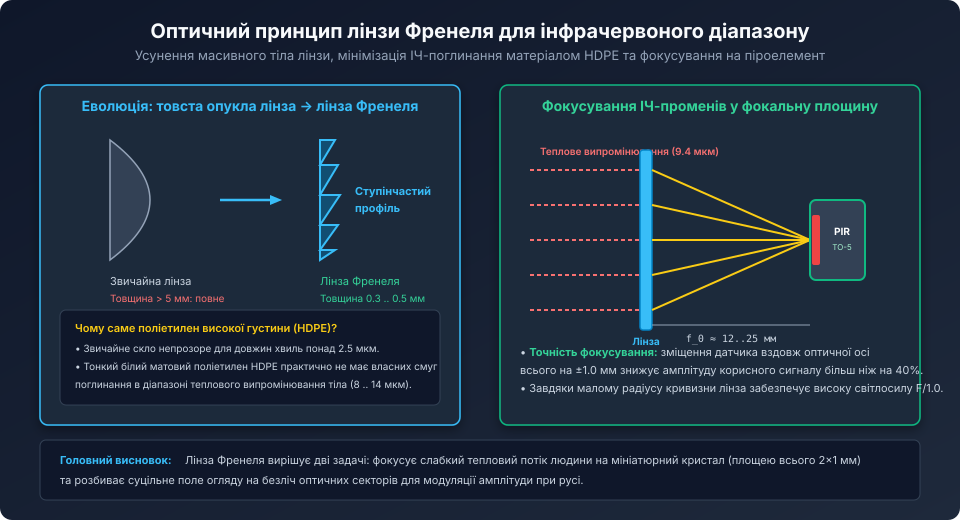
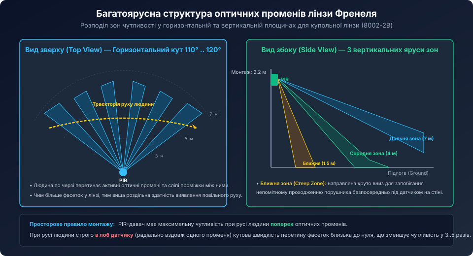
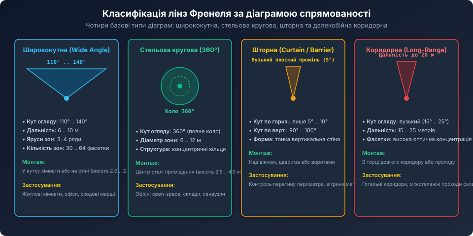

# Поглиблений геометричний та хвильовий аналіз лінз Френеля для інфрачервоних систем

<preknowlist>
- [Оптика лінз Френеля для PIR-давачів](root:cat-hw-sensors/fresnel-lens-pir-optics) — базовий принцип ступінчастого профілю, фасеток та спектральних властивостей HDPE.
- [Огляд пасивних інфрачервоних давачів руху (PIR)](root:cat-hw-sensors/pir-motion-sensors-overview) — просторово-частотна модуляція та характеристики піроелементів.
- [Спеціалізована мікросхема BISS0001](root:cat-hw-sensors/biss0001-asic) — узгодження частоти оптичного сигналу зі смугою пропускання підсилювача.
</preknowlist>

## Оптичні властивості поліетилену HDPE у діапазоні довгих ІЧ-хвиль (LWIR)

Оптична поведінка матеріалу в діапазоні довгохвильового інфрачервоного випромінювання (8..14 мкм) описується комплексним показником заломлення:

```text
n_c = n + i * k
```

де:
- `n` — дійсна частина показника заломлення (для чистого поліетилену високої густини HDPE на довжині хвилі 10.0 мкм `n ≈ 1.535`);
- `k` — уявна частина (показник екстинкції / загасання).



### 1. Френелівські втрати на відбиття (Reflection Loss)
При нормальному падінні ІЧ-променя на границю розділу повітря-поліетилен коефіцієнт відбиття за формулою Френеля становить:

```text
R = ( (n - 1) / (n + 1) )^2
R = ( (1.535 - 1) / (1.535 + 1) )^2 = (0.535 / 2.535)^2 ≈ 0.0445 (4.45% на кожну поверхню)
```

Для плоско-опуклої пластини з двома поверхнями (вхідною та вихідною) сумарні френелівські втрати на відбиття становлять близько **8.7%**.

### 2. Внутрішнє поглинання за законом Бугера-Ламберта-Бера
Потужність променя, що пройшов крізь матеріал товщиною `d`, визначається співвідношенням:

```text
I(d) = I_0 * (1 - R)^2 * exp( -alpha * d )
```

де `alpha = 4 * pi * k / lambda` — лінійний коефіцієнт поглинання.

Для HDPE у вікні прозорості 8..14 мкм коефіцієнт `alpha ≈ 0.4 .. 0.8 мм^-1`.
- При товщині класичної скляної лінзи `d = 6.0 мм` залишкове пропускання прямує до нуля (`exp(-0.6 * 6) ≈ 0.027`, тобто поглинається 97% енергії).
- При товщині лінзи Френеля `d = 0.4 мм` пропускання складає `exp(-0.6 * 0.4) ≈ 0.786` (поглинається лише 21% енергії).

З урахуванням втрат на відбиття (8.7%) сумарний оптичний коефіцієнт пропускання якісної лінзи з HDPE досягає **72% .. 74%**.

## Геометрія мікрорельєфу та кути виходу з прес-форми (Draft Angle)

Кожна окрема борозенка (кільцева зона) лінзи Френеля є призматичною структурою. Для фокусування променя, що падає на відстані `r` від оптичної осі, кут нахилу робочої грані призми `theta_prism` розраховується за законом Снеліуса:

```text
n * sin(theta_prism - beta) = sin(theta_prism)
tan(beta) = r / f_0
```

Для параксіальних променів кут грані наближено описується формулою:

```text
theta_prism(r) ≈ arctan( r / ( (n - 1) * f_0 ) )
```



### Проблема тіньового ефекту (Shadowing) та технологічний кут уклону (Draft Angle)
Неробоча (вертикальна) стінка зубця лінзи Френеля теоретично має бути паралельною оптичній осі. Проте у реальному виробництві методом термопластичного лиття під тиском (Injection Molding) вертикальна стінка заклинювала б у металевій прес-формі.

Тому інженери задають технологічний кут ухилу (Draft Angle) `gamma ≈ 1.5° .. 3.0°`:
- Кут ухилу полегшує виймання деталі з матриці;
- Проте зворотний схил утворює сліпу зону розсіювання, де промені відбиваються убік (паразитне розсіювання);
- Для зменшення цього ефекту крок кілець роблять змінним: у центрі лінзи крок ширший (до 0.5 мм), а до країв звужується до 0.15 мм для підтримки високої локальної числової апертури (Numerical Aperture, `NA ≈ 0.5 .. 0.6`).

## Балансування апертури фасеток для компенсації спаду освітленості

Відповідно до закону зворотних квадратів, густина теплового випромінювання від точкового джерела спадає обернено пропорційно квадрату відстані `1 / d^2`:
- Людина на відстані `d = 7 метрів` створює на лінзі освітленість у `(7 / 1.5)^2 ≈ 21.8 раза` меншу, ніж та сама людина на відстані 1.5 метра!
- Якби всі фасетки мали однакову геометричну площу, сигнал від дальньої зони був би у 22 рази слабшим за сигнал ближньої зони, що призводило б або до насичення підсилювача поблизу, або до відсутності реакції на віддалені рухи.



Для компенсації цього явища матриця фасеток купольної лінзи проектується зі **змінною площею вхідної апертури**:
1. **Фасетки верхнього ярусу (Дальня зона 7 м):** мають найбільшу фізичну площу (до 8×10 мм кожна), збираючи максимум фотонів слабкого віддаленого потоку.
2. **Фасетки середнього ярусу (Середня зона 4 м):** мають середній розмір (близько 5×6 мм).
3. **Фасетки нижнього ярусу (Ближня зона 1.5 м):** мають найменшу площу (близько 2.5×3 мм), запобігаючи перевантаженню аналогового каскаду BISS0001.

Завдяки такому прогресивному масштабуванню площ амплітуда піроелектричного сигналу вирівнюється і становить стабільні 0.5 .. 1.5 В у всьому діапазоні робочих відстаней.

## Математичне моделювання просторового відгуку лінзового масиву

Нижче наведено програмну модель розрахунку відгуку двохелементного PIR-давача на переміщення джерела тепла в 3D просторі `(X, Y, Z)` через купольну лінзу з N фасетками на мові C++:

```cpp
#include <iostream>
#include <vector>
#include <cmath>

struct Point3D {
    double x, y, z;
};

// Параметри однієї оптичної фасетки лінзи Френеля
struct LensFacet {
    double opt_axis_azimuth;   // Азимутальний кут оптичної осі (радіани)
    double opt_axis_elevation; // Кут місця оптичної осі (радіани)
    double aperture_area_mm2;  // Фізична площа лінзи фасетки
    double focal_length_mm;    // Фокусна відстань
};

class PirOpticalModel {
private:
    std::vector<LensFacet> facets;
    double crystal_spacing_mm; // Відстань між центрами двох піропластин (~2 мм)
    double crystal_width_mm;   // Ширина одного кристала (~1 мм)

public:
    PirOpticalModel(double crystal_spacing = 2.0, double crystal_w = 1.0)
        : crystal_spacing_mm(crystal_spacing), crystal_width_mm(crystal_w) {}

    void addFacet(double az_deg, double el_deg, double area, double f = 18.0) {
        LensFacet fct;
        fct.opt_axis_azimuth = az_deg * M_PI / 180.0;
        fct.opt_axis_elevation = el_deg * M_PI / 180.0;
        fct.aperture_area_mm2 = area;
        fct.focal_length_mm = f;
        facets.push_back(fct);
    }

    // Розрахунок різницевого сигналу (Channel A - Channel B) від положення цілі (X, Y, Z)
    double calculateResponse(const Point3D& target) const {
        double dist = std::sqrt(target.x * target.x + target.y * target.y + target.z * target.z);
        if (dist < 0.1) return 0.0;

        // Кути напрямку на людину
        double target_az = std::atan2(target.x, target.y);
        double target_el = std::asin(target.z / dist);

        double total_diff_signal = 0.0;

        for (const auto& facet : facets) {
            // Кутове відхилення від осі поточної фасетки
            double delta_az = target_az - facet.opt_axis_azimuth;
            double delta_el = target_el - facet.opt_axis_elevation;

            // Спрощена діаграма спрямованості окремої фасетки (гаусовий промінь)
            double beam_width_rad = 0.08; // ~4.5 градуси напівширина
            double ang_dev_sq = delta_az * delta_az + delta_el * delta_el;
            if (ang_dev_sq > (beam_width_rad * 3.0) * (beam_width_rad * 3.0)) {
                continue; // Поза полем зору цієї фасетки
            }

            double facet_weight = std::exp(-ang_dev_sq / (2.0 * beam_width_rad * beam_width_rad));

            // Зміщення зображення у фокальній площині вздовж осі X (поперек кристалів)
            double x_focus_offset_mm = facet.focal_length_mm * std::tan(delta_az);

            // Освітленість кристала A (+, центр у +spacing/2) та кристала B (-, центр у -spacing/2)
            double x_a = x_focus_offset_mm - (crystal_spacing_mm / 2.0);
            double x_b = x_focus_offset_mm + (crystal_spacing_mm / 2.0);

            // Інтеграл плями теплового зображення (приблизно гаусів профіль)
            double spot_sigma = 0.8;
            double flux_a = std::exp(-(x_a * x_a) / (2.0 * spot_sigma * spot_sigma));
            double flux_b = std::exp(-(x_b * x_b) / (2.0 * spot_sigma * spot_sigma));

            // Диференціальний струм помножений на площу фасетки та спад 1/d^2
            double intensity = facet.aperture_area_mm2 / (dist * dist);
            double facet_response = intensity * facet_weight * (flux_a - flux_b);

            total_diff_signal += facet_response;
        }

        return total_diff_signal;
    }
};

int main() {
    PirOpticalModel sensor;
    // Створення фасеток горизонтального віяла (-30, -15, 0, +15, +30 градусів)
    sensor.addFacet(-30.0, -10.0, 75.0);
    sensor.addFacet(-15.0, -10.0, 70.0);
    sensor.addFacet(  0.0, -10.0, 65.0);
    sensor.addFacet( 15.0, -10.0, 70.0);
    sensor.addFacet( 30.0, -10.0, 75.0);

    std::cout << "Simulation: human walking at Y=4.0m across X from -3m to +3m:\n";
    for (double x = -3.0; x <= 3.0; x += 0.2) {
        Point3D target = { x, 4.0, 0.0 };
        double signal = sensor.calculateResponse(target);
        std::cout << "X=" << x << " m | Signal=" << signal << "\n";
    }

    return 0;
}
```

Моделювання чітко ілюструє, як геометричне розташування фасеток лінзи Френеля перетворює траєкторію руху людини на послідовність гармонійних знакозмінних імпульсів, забезпечуючи високу селективність, захищеність від теплових завад та надійне детектування у промислових системах безпеки.
