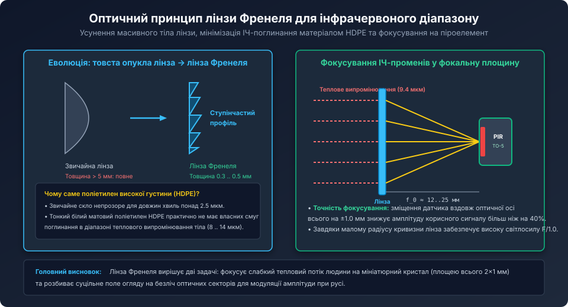
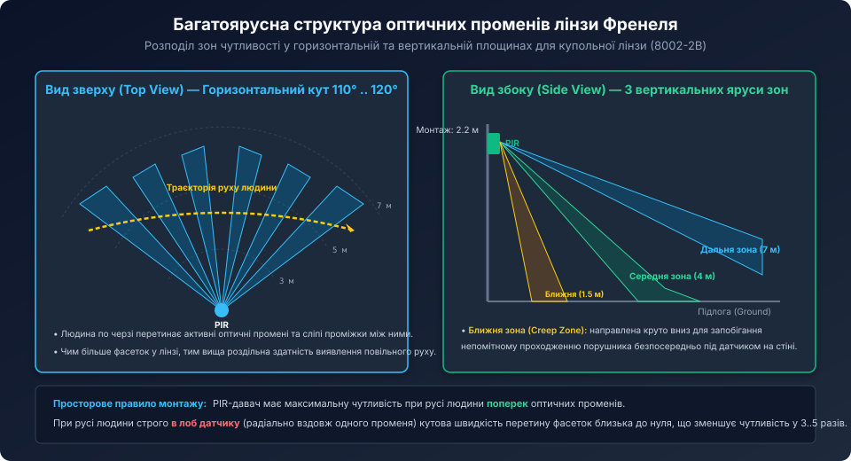
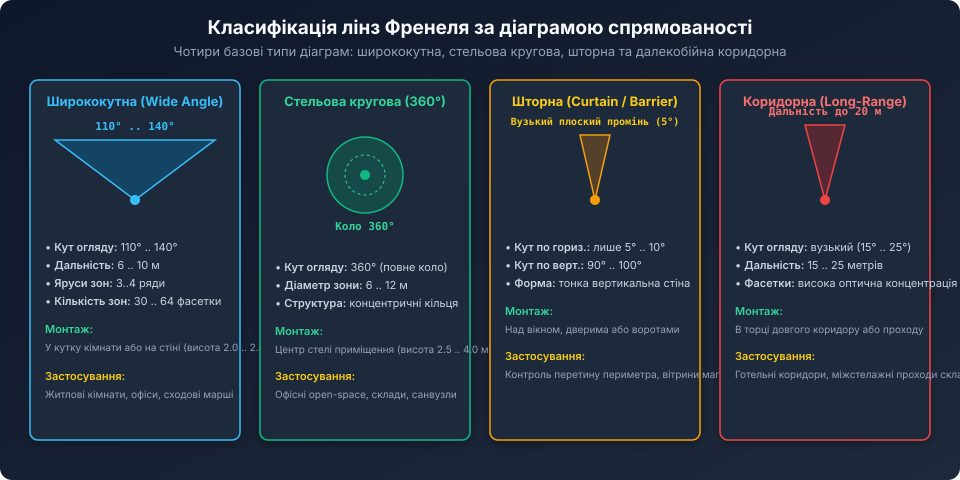

# Оптика лінз Френеля для PIR-давачів

<preknowlist>
- [Огляд пасивних інфрачервоних давачів руху (PIR)](root:cat-hw-sensors/pir-motion-sensors-overview) — принципи роботи диференціального піроелемента та закон зміщення Віна.
- [HC-SR501 — класичний модуль PIR-давача руху](root:cat-hw-sensors/hc-sr501) — практичне підключення та параметри чутливості модуля з лінзою.
- [HC-SR505 — мініатюрний модуль PIR-давача руху](root:cat-hw-sensors/hc-sr505) — особливості компактної купольної оптики.
</preknowlist>

## Оптичний принцип Френеля в далекому ІЧ-діапазоні та вибір матеріалу HDPE

Без оптичної фокусуючої системи пасивний інфрачервоний датчик не здатний надійно виявляти людину далі ніж на 0.5–1 метр. Кристал піроелектрика має мініатюрні розміри (зазвичай пара пластин розміром приблизно 2×1 мм кожна), і тепловий потік від людини, розсіяний у просторі на відстані 5–7 метрів, створює нікчемно малу освітленість чутливої поверхні.

Класична опукла скляна лінза непридатна для розв'язання цього завдання з двох фізичних причин:
1. **Поглинання матеріалу:** оптичне силікатне скло непрозоре для довгохвильового інфрачервоного випромінювання (LWIR, довжина хвилі від 8 до 14 мкм). Шар скла товщиною понад 1 мм повністю затримує теплове світло людського тіла.
2. **Маса та габарити:** лінза з короткою фокусною відстанню та великою апертурою (діаметром 20–30 мм) повинна мати товщину в центрі понад 5–8 мм.



Французький фізик Огюстен Френель запропонував геніальне рішення: заломлення світлового променя відбувається виключно на межі розділу двох середовищ (на криволінійній поверхні входу і виходу), тоді як проміжний внутрішній масив матеріалу є оптично пасивним. 

Якщо розбити неперервний профіль лінзи на концентричні кільцеві зони та «стиснути» їх у тонку пластину, збережеться вихідний кут нахилу кожної поверхневої ділянки. У результаті отримують східчасту **лінзу Френеля (Fresnel Lens)**:
- Товщина стінки знижується до **0.3 .. 0.5 мм**;
- Як оптичний матеріал використовується спеціальний **поліетилен високої густини (HDPE — High-Density Polyethylene)**. У тонкому шарі (до 0.5 мм) HDPE практично не має власних смуг поглинання у вікні прозорості 8..14 мкм, забезпечуючи коефіцієнт пропускання теплового випромінювання на рівні **70% .. 75%**;
- Завдяки гнучкості пластику плоску матрицю лінз можна легко згорнути у сферичний або циліндричний купол для отримання панорамного огляду.

## Багатофасеткова структура (Multi-Facet Lens Array)

Купольний ковпачок стандартного PIR-датчика (наприклад, біла напівсфера модуля HC-SR501 або HC-SR505) не є однією суцільною лінзою. Це складний тривимірний масив (матриця), що складається з десятків мініатюрних окремих лінз Френеля, які називають **фасетками (facets)**.



Кожна окрема фасетка має власну оптичну вісь, нахилену під строго розрахованим кутом, але всі вони мають спільний фокус, узгоджений з просторовим розташуванням піроелектричного кристала всередині корпусу TO-5.

У типовій купольній лінзі (наприклад, типу 8002-2B) фасетки організовано у три вертикальні яруси:
1. **Верхній ярус (дальня зона):** фасетки спрямовані горизонтально або під малим кутом вниз (0° .. -10°). Вони проектують вузькі промені на відстань від 5 до 8 метрів.
2. **Середній ярус (проміжна зона):** фасетки нахилені під кутом -20° .. -30° до горизонту і контролюють простір на відстані 3..5 метрів.
3. **Нижній ярус (зона захисту від підкрадання / Creep Zone):** фасетки спрямовані круто вниз (-45° .. -70°), безпосередньо під датчик, що унеможливлює непомітне проповзання людини під настінним приладом.

У просторі перед датчиком утворюється складна просторова сітка (віяло) з 20–60 окремих чутливих зон (променів), розділених «сліпими» просторами.

## Просторово-частотне кодування руху (Spatial Frequency Encoding)

Навіщо потрібна складна сітка окремих променів замість суцільної зони спостереження?

Як розглянуто у фізиці піроелектриків, кристал формує електричний струм виключно при зміні температури (`I = p * A * dT/dt`). Якби лінза створювала одне суцільне рівномірне поле зору, то при рівномірному русі людини температура кристала залишалася б майже незмінною, і корисний сигнал був би занадто слабким.

Сегментована лінза перетворює **просторове переміщення** об'єкта на **часову модуляцію сигналу**:
1. Коли людина йде крізь кімнату, її теплове зображення почергово потрапляє у фокус однієї фасетки (кристал нагрівається -> позитивний сплеск), виходить у сліпу зону (кристал охолоджується), потім потрапляє у фокус сусідньої фасетки.
2. Частота результуючих коливань електричної напруги прямо залежить від швидкості людини `v`, відстані до датчика `d` та кутового кроку між фасетками `theta_step` (у радіанах):

```text
f_signal = v / (d * theta_step)
```

При швидкості спокійного кроку людини `v = 1.0 м/с`, відстані `d = 5 м` та типовому кутовому інтервалі фасеток `theta_step ≈ 0.1 рад` (близько 6°):

```text
f_signal = 1.0 / (5 * 0.1) = 2.0 Гц
```

Частота 2.0 Гц ідеально потрапляє в смугу максимального коефіцієнта підсилення вхідного аналогового фільтра мікросхеми BISS0001 (смуга пропускання 0.3 .. 3 Гц). Навколишні перешкоди (повільний добовий нагрів стін сонцем з частотою менше 0.001 Гц або мерехтіння ламп розжарювання на 100 Гц) цим фільтром повністю пригнічуються.

## Класифікація лінз Френеля за діаграмою спрямованості



Залежно від геометрії контрольованої зони у промисловості застосовують чотири базові типи лінз:

| Тип лінзи | Горизонтальний кут | Вертикальний кут | Дальність | Типове застосування |
| :--- | :--- | :--- | :--- | :--- |
| **Ширококутна (Wide Angle)** | 110° .. 140° | 90° (3 яруси) | 6 .. 10 м | Кутовий монтаж на стіні в кімнатах, офісах, холах. |
| **Стельова кругова (360° Ceiling)** | 360° (повне коло) | 120° (конус) | Діаметр 6 .. 12 м | Центр стелі над робочими зонами, open-space, склади. |
| **Шторна / бар'єрна (Curtain)** | 5° .. 10° (тонка площина) | 90° .. 100° | 6 .. 10 м | Охорона вікон, дверних прорізів, скляних вітрин та периметра. |
| **Коридорна (Long-Range Corridor)** | 15° .. 25° (вузький промінь) | 20° | 15 .. 25 м | Довгі готельні та складські коридори, стелажні проходи. |

## Вимоги до фокусування, спотворення та догляд за оптикою

Ефективність роботи системи «лінза — піроелемент» критично залежить від точності оптичного юстування:

1. **Фокусна відстань `f_0`:**
   Кожна лінза Френеля розраховується під конкретну фокусну відстань (для більшості модулів `f_0` становить від 12 до 25 мм). Чутлива площадка сенсора TO-5 повинна розташовуватися строго у фокальній площині. Зсув сенсора вздовж оптичної осі навіть на ±1.0 мм розмиває пляму розсіювання, що призводить до падіння амплітуди сигналу на 30–50%.
2. **Орієнтація подвійного піроелемента:**
   Усередині корпусу TO-5 чутливі кристали розташовані горизонтально (лівий та правий). Для максимальної чутливості напрямок найбільш імовірного переміщення людей у приміщенні повинен бути **перпендикулярним** до лінії розділу кристалів (тобто горизонтальним).
3. **Захист від забруднень:**
   Поліетилен HDPE схильний до накопичення електростатичного заряду, притягуючи дрібний побутовий пил. Товстий шар пилу або павутиння поглинає до 60% ІЧ-променів, різко знижуючи дальність виявлення.
4. **Температурний градієнт:**
   Забороняється фарбувати лінзу Френеля звичайними емалями чи лаками, оскільки будь-яка стандартна фарба є непрозорою для хвиль 10 мкм і повністю блокує роботу датчика. Для маскування лінз під колір інтер'єру виробники вводять спеціальні пігменти на стадії плавлення поліетилену під час лиття під тиском.

Розуміння оптичних закономірностей лінз Френеля дозволяє інженеру правильно обирати кути нахилу датчиків, формувати зони виявлення потрібної конфігурації та повністю виключати мертві зони на об'єктах автоматизації.
