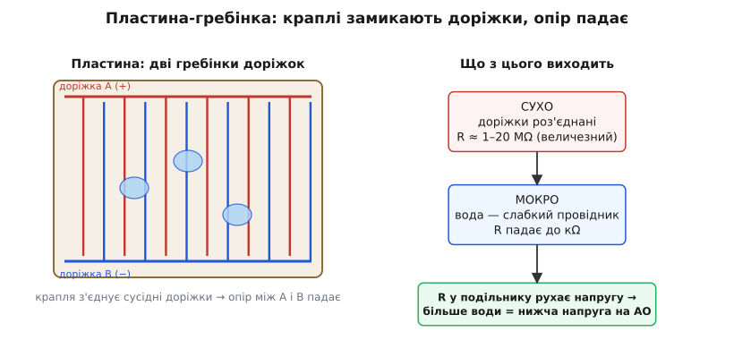
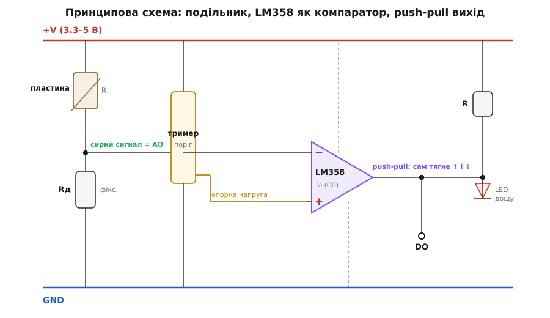
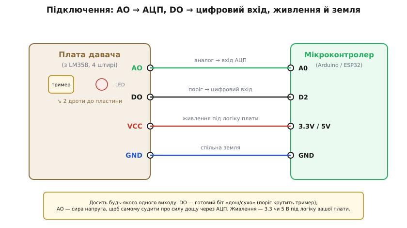
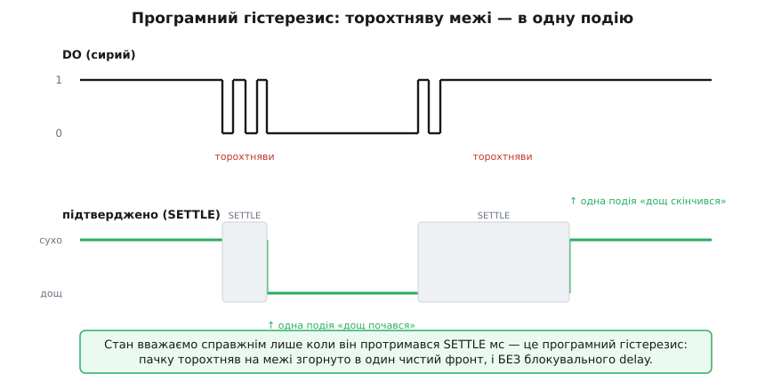
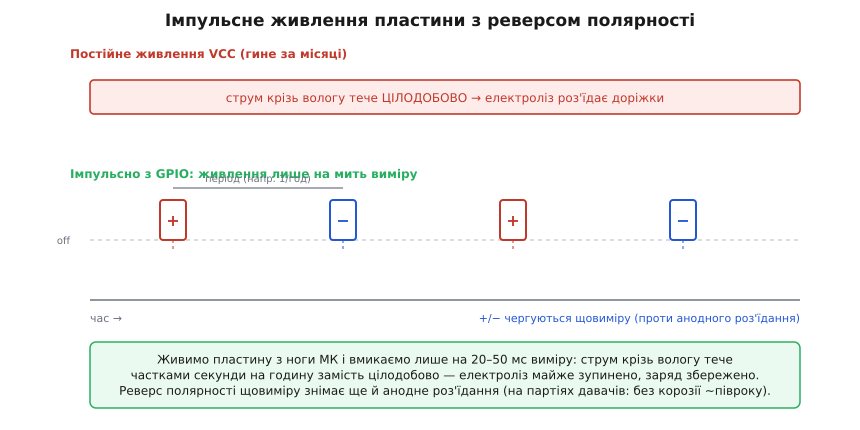

# Funduino — давач дощу з компаратором на базі LM358

Модуль давача дощу (Funduino Rain Sensor) — це популярний компонент для виявлення атмосферних опадів, роси або крапель конденсату в проектах метеостанцій, автоматизованих теплиць та розумного будинку (наприклад, для автоматичного закривання мансардних вікон або прибирання навісу).

---

## 1. Принцип дії та будова контактної пластини

Конструктивно комплект складається з двох окремих блоків: зовнішньої чутливої пластини та електронної плати обробки сигналу.



- **Пластина-гребінка:** Чутливий майданчик виготовлено з фольгованого гетинаксу або склотекстоліту з двома взаємопроникними гребінчастими доріжками, розділеними вузьким зазором у частки міліметра.
- **Вода як змінний опір:** Суха пластина має практично нескінченний опір між електродами (десятки мегаомів). Коли на поверхню падають перші краплі дощу, вони розтікаються й замикають сусідні доріжки, утворюючи струмопровідні містки. Опір між клемами різко падає до десятків або сотень кілоомів.
- **Якісний індикатор:** Сенсор є пороговим сигналізатором наявності вологи, а не точним плювіометром (дощоміром). Він фіксує сам факт змочування поверхні, проте не вимірює точну кількість міліметрів опадів за годину.

---

## 2. Апаратна плата на мікросхемі LM358

На відміну від багатьох інших аматорських датчиків, де встановлено спеціалізований компаратор LM393, у класичному модулі Funduino застосовано здвоєний операційний підсилювач **LM358**.



- **Режим компаратора:** Половинка мікросхеми LM358 працює без негативного зворотного зв'язку. Вона порівнює аналогову напругу з подільника пластини з опорною напругою, яку виставляє користувач підстроювальним резистором (тримером).
- **Двотактний вихід (Push-Pull):** Оскільки LM358 є операційним підсилювачем, її вихід активно формує як високий рівень (близько VCC − 1.5 В), так і низький (близько 0 В). Зовнішній резистор підтяжки (pull-up) для лінії `DO` не потрібен.
- **Відсутність апаратного гістерезису:** Схема не має зворотного зв'язку для формування зони спокою. Через це при повільному висиханні або падінні дрібних крапель цифровий вихід `DO` схильний до високочастотного брязкоту («торохтіння») біля точки перемикання, що вимагає програмного дебаунсу.

---

## 3. Схема підключення та інтерфейсні виводи

Електронна плата має чотири стандартні штирі з боку мікроконтролера та два гвинтові або штирові контакти для підключення самої пластини:



| Вивід | Призначення | Опис сигналу | Підключення до MCU |
| :--- | :--- | :--- | :--- |
| **VCC** | Живлення схеми | Напруга від 3.3 В до 5.0 В постійного струму | До цифрового піна GPIO (імпульсний режим) або VCC |
| **GND** | Спільна земля | Загальний мінус схеми (0 В) | До загального виводу GND |
| **DO** | Цифровий вихід | Активний рівень: «1» — сухо, «0» — зафіксовано дощ | До цифрового входу GPIO |
| **AO** | Аналоговий вихід | Сира напруга з подільника: менше число — більше води | До входу АЦП (ADC / A0) |

> ⚠️ **Полярність пластини:** Пластина під'єднується до роз'єму модуля двома дротами без дотримання полярності — це симетричний двополюсник змінного опору.

---

## 4. Програмна фільтрація, захист від торохтняви та калібрування

Через відсутність апаратного гістерезису вихід `DO` під час дрібного дощу видає пачку коротких імпульсів. У прошивці застосовують неблокуючий програмний гістерезис на основі таймера `millis()`:



```cpp
/**
 * @file funduino_rain_basic.ino
 * @brief Приклад роботи з давачем дощу Funduino без блокуючих затримок
 */

const int PIN_RAIN_DO = 2;    // Цифровий вихід давача дощу
const int PIN_RAIN_AO = A0;   // Аналоговий вихід напруги
const int PIN_LED_ALERT = 13; // Вбудований світлодіод тривоги

// Вікно стабілізації стану (400 мс для відсікання торохтняви)
const unsigned long SETTLE_WINDOW_MS = 400;

bool is_raining = false;
int last_pin_state = HIGH;
unsigned long state_changed_timestamp = 0;

void setup() {
  Serial.begin(115200);
  pinMode(PIN_RAIN_DO, INPUT);
  pinMode(PIN_LED_ALERT, OUTPUT);
  digitalWrite(PIN_LED_ALERT, LOW);
}

void loop() {
  int current_pin_state = digitalRead(PIN_RAIN_DO);

  // Скидання таймера при будь-якому коливанні сигналу на вході
  if (current_pin_state != last_pin_state) {
    state_changed_timestamp = millis();
    last_pin_state = current_pin_state;
  }

  // Прийняття нового стану лише тоді, коли рівень стабільний понад 400 мс
  if ((millis() - state_changed_timestamp) > SETTLE_WINDOW_MS) {
    bool detected = (current_pin_state == LOW); // LOW означає наявність води
    
    if (detected != is_raining) {
      is_raining = detected;
      digitalWrite(PIN_LED_ALERT, is_raining ? HIGH : LOW);
      
      int raw_analog = analogRead(PIN_RAIN_AO);
      if (is_raining) {
        Serial.print(F("[МЕТЕО] Почався дощ! Рівень зволоження (АЦП): "));
        Serial.println(raw_analog);
      } else {
        Serial.println(F("[МЕТЕО] Дощ припинився, поверхня висихає."));
      }
    }
  }
}
```

---

## 5. Електрохімічна корозія пластини та імпульсне живлення



1. **Проблема електролізу:** Постійна присутність напруги на змоченій пластині викликає розклад води та міграцію іонів міді з анода. За 2–3 місяці безперервного живлення надворі відкрита мідь покривається зеленою патиною та повністю руйнується.
2. **Імпульсне живлення (Duty Cycling):** Живлення `VCC` слід подавати з цифрового виводу мікроконтролера або ключа на польовому транзисторі лише на 10–20 мілісекунд у момент зняття показів (наприклад, один раз на 10–30 секунд). Решту часу пластина знеструмлена, що подовжує її ресурс на роки.
3. **Кут встановлення пластини:** Пластину слід розміщувати під кутом 15–30 градусів до горизонту. Це забезпечує стікання зайвої води та швидке природне просихання після закінчення опадів.
4. **Хибні спрацювання на бруд та росу:** Осілий пил, добрива або вранішня роса можуть викликати замикання доріжок. Необхідно періодично промивати пластину спиртом чи дистильованою водою та калібрувати поріг тримера.
