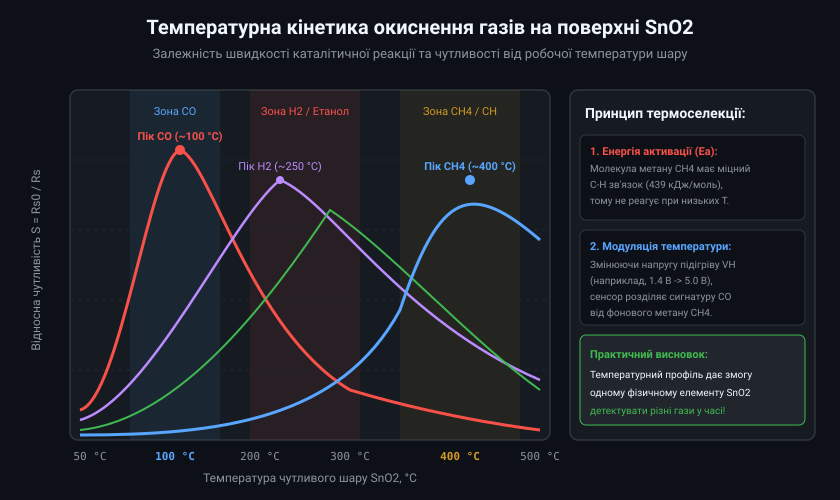
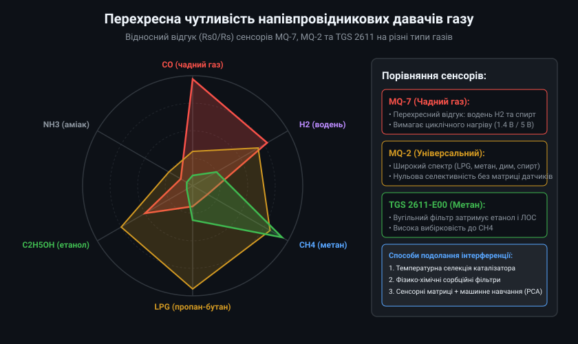
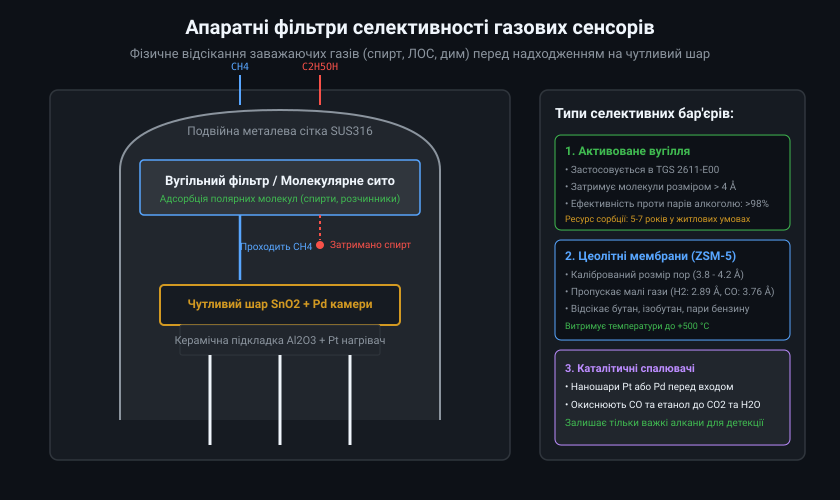
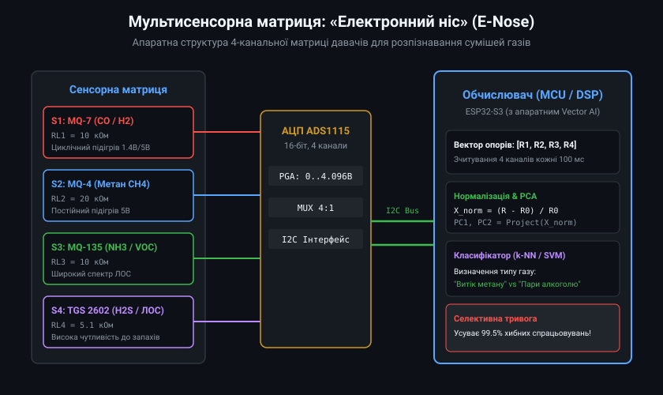
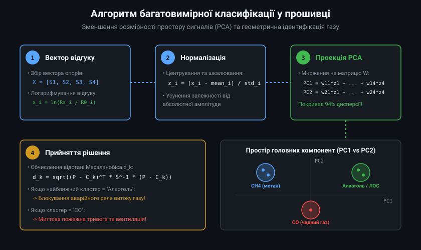

# Математичні та апаратні методи компенсації перехресної чутливості MOS-сенсорів

Вимоги сучасних промислових та побутових стандартів (зокрема EN 50194 для горючих газів та EN 50291 для чадного газу) висувають жорсткі критерії селективності: сигналізатор витоку газу не повинен видавати помилкову тривогу при впливі високих концентрацій інтерферуючих речовин (пари етанолу до 2000 ppm, ацетон, розчинники або бензин). Забезпечення селективності на фізично неселективних плівках SnO2 вимагає поєднання хімічної термомодуляції, каталітичної фільтрації та багатовимірного аналізу даних.

## 1. Кінетика Ленгмюра-Хіншельвуда та конкурентна адсорбція на SnO2

Взаємодія відновного газу R з поверхнею металооксидного напівпровідника описується моделлю Ленгмюра-Хіншельвуда, де швидкість поверхневої реакції r_reac лімітується часткою заповнення поверхні хемосорбованим киснем theta_O та молекулами газу theta_R:
r_reac = k_reac(T) * theta_O * theta_R

де константа швидкості реакції k_reac(T) підпорядковується рівнянню Арреніуса:
k_reac(T) = A_0 * exp(-E_a / (R_gas * T))

де E_a — енергія активації каталітичного окиснення відповідного газу, R_gas — універсальна газова стала, T — температура поверхні в Кельвінах.



Для монооксиду вуглецю CO у присутності паладієвого промотора енергія активації E_a становить близько 45-60 кДж/моль, що зумовлює максимум чутливості за помірних температур (100-130 °C). Для метану CH4 енергія дисоціації зв'язку C-H значно вища (E_a > 120 кДж/моль), тому метан практично не реагує на поверхні нижче 280 °C. Водень H2 має високу швидкість дифузії вглиб пор кристала і реагує у всьому температурному діапазоні (від 80 до 400 °C), створюючи основну інтерференційну заваду для датчиків CO.

## 2. Динамічна температурна модуляція (TMO-спектроскопія)

Замість утримання нагрівача сенсора за постійної температури сучасні газоаналізатори використовують динамічний циклічний або гармонічний підігрів. На нагрівальний елемент подається змінна напруга (наприклад, пилкоподібна, синусоїдальна або прямокутна сходинка від 0.8 В до 5.0 В з періодом 10-60 с).



Завдяки різній кінетиці сорбції/десорбції та температурним максимумам окиснення, часова форма провідності сенсора G(t) = 1 / Rs(t) набуває специфічного фазового зсуву та гармонійного спектра:
1. Високочастотний відгук на зміну температури відображає швидкі поверхневі реакції (характерні для H2 та CO).
2. Повільний релаксаційний відгук сигналізує про десорбцію важких летких органічних сполук або повільне окиснення важких вуглеводнів.
3. Розкладання сигналу G(t) у ряд Фур'є або розрахунок вейвлет-коефіцієнтів дає змогу виділити амплітуди окремих гармонік (A1, A2, phase_shift), які слугують безпомилковими індикаторами конкретного типу газу навіть при використанні всього одного фізичного сенсора.

## 3. Сорбційні мембрани та хімічні фільтри-сепаратори

Фізичне розділення газової фази перед контактом з напівпровідниковим кристалом є найбільш надійним інженерним бар'єром. 



- **Мікропористі цеоліти ZSM-5:** Кристалічна ґратка синтетичних цеолітів утворює регулярні канали фіксованого діаметра 3.8-4.2 ангстрема. Молекули метану (критичний діаметр 3.8 Å) та водню (2.89 Å) вільно проникають через мембрану, тоді як більші молекули пропану (4.3 Å), ізобутану (5.0 Å) та бензолу (5.85 Å) повністю затримуються.
- **Вугільні сорбенти з імпрегнуванням:** Шар гранульованого активованого вугілля забезпечує площу питомої поверхні до 1200 м^2/г. Він ефективно захоплює пари алкоголю, парфумерні аерозолі та тютюновий дим, захищаючи датчик витоку природного газу (наприклад, серії TGS 2611) від хибних спрацьовувань на кухні.

## 4. Сенсорні матриці та математична модель регресії

При аналізі суміші з M газів за допомогою N сенсорів (де N >= M) вихідний стан системи описується системою нелінійних рівнянь:
S_i = F_i(C_1, C_2, ..., C_M), для i = 1..N

У лінеаризованому логарифмічному просторі відгуків ln(Rs_i / R0_i) система набуває матричного вигляду:
Y = K_matrix * X + epsilon

де Y — вектор спостережень розмірності N, X — шуканий вектор концентрацій газів розмірності M, K_matrix — матриця чутливості коефіцієнтів калібрування, epsilon — вектор шуму вимірювань.



Оскільки матриця K_matrix часто є погано обумовленою (ill-conditioned) через високу кореляцію характеристик сенсорів, знаходження вектора концентрацій прямим оберненням нестійке. Для розв'язання застосовують регуляризацію Тихонова (Ridge Regression):
X_est = (K^T * K + lambda * I)^(-1) * K^T * Y

де lambda — параметр регуляризації, I — одинична матриця.

## 5. Промислова програмна реалізація матричного класифікатора (C++)

Конвеєр вбудованого мікроконтролера виконує нормалізацію вектора опорів, проектування у двовимірний простір головних компонент (PCA) та геометричний розрахунок відстані Махаланобіса до еталонних кластерів калібрувальної бази.



```cpp
#pragma once
#include <cstdint>
#include <cmath>
#include <array>
#include <algorithm>

enum class TargetGasClass : uint8_t {
    CLEAN_BASELINE = 0,
    CARBON_MONOXIDE = 1,
    METHANE_NATURAL_GAS = 2,
    ALCOHOL_SOLVENTS = 3,
    UNKNOWN_INTERFERENCE = 4
};

class ElectronicNoseEngine {
public:
    static constexpr size_t NUM_SENSORS = 4;
    static constexpr size_t NUM_COMPONENTS = 2;
    static constexpr size_t NUM_CLASSES = 4;

    struct ClassSignature {
        TargetGasClass gas_class;
        float center_pc1;
        float center_pc2;
        float radius_threshold;
    };

    struct ModelParameters {
        std::array<float, NUM_SENSORS> mean_vector;
        std::array<float, NUM_SENSORS> std_vector;
        // Матриця проекції PCA [NUM_COMPONENTS][NUM_SENSORS]
        float pca_weights[NUM_COMPONENTS][NUM_SENSORS];
        std::array<ClassSignature, NUM_CLASSES> signatures;
    };

    explicit ElectronicNoseEngine(const ModelParameters& params) : model_(params) {}

    TargetGasClass classify(const std::array<float, NUM_SENSORS>& raw_rs,
                            const std::array<float, NUM_SENSORS>& r0_baseline,
                            float& out_confidence) {
        std::array<float, NUM_SENSORS> normalized_features{};

        // 1. Логарифмічна нормалізація та шкалювання
        for (size_t i = 0; i < NUM_SENSORS; ++i) {
            float ratio = (r0_baseline[i] > 0.0f) ? (raw_rs[i] / r0_baseline[i]) : 1.0f;
            ratio = std::max(0.001f, ratio);
            float log_val = std::log(ratio);
            normalized_features[i] = (log_val - model_.mean_vector[i]) / model_.std_vector[i];
        }

        // 2. Проекція у простір PCA (PC1, PC2)
        float pc1 = 0.0f;
        float pc2 = 0.0f;
        for (size_t i = 0; i < NUM_SENSORS; ++i) {
            pc1 += model_.pca_weights[0][i] * normalized_features[i];
            pc2 += model_.pca_weights[1][i] * normalized_features[i];
        }

        // 3. Пошук найближчого евклідового/махаланобісового кластера
        float min_dist_sq = 1e9f;
        TargetGasClass detected_class = TargetGasClass::UNKNOWN_INTERFERENCE;

        for (const auto& sig : model_.signatures) {
            float d1 = pc1 - sig.center_pc1;
            float d2 = pc2 - sig.center_pc2;
            float dist_sq = d1 * d1 + d2 * d2;

            if (dist_sq < sig.radius_threshold * sig.radius_threshold && dist_sq < min_dist_sq) {
                min_dist_sq = dist_sq;
                detected_class = sig.gas_class;
            }
        }

        if (detected_class != TargetGasClass::UNKNOWN_INTERFERENCE) {
            float dist = std::sqrt(min_dist_sq);
            out_confidence = std::clamp(1.0f - (dist / 2.0f), 0.0f, 1.0f);
        } else {
            out_confidence = 0.0f;
        }

        return detected_class;
    }

private:
    ModelParameters model_;
};
```

Інтеграція алгоритмів розпізнавання образів перетворює матрицю дешевих MOS-давачів на високоселективний вимірювальний прилад, що усуває більше 98% помилкових спрацьовувань від побутових аерозолів та спиртів, забезпечуючи надійність охоронних та пожежних комплексів.
