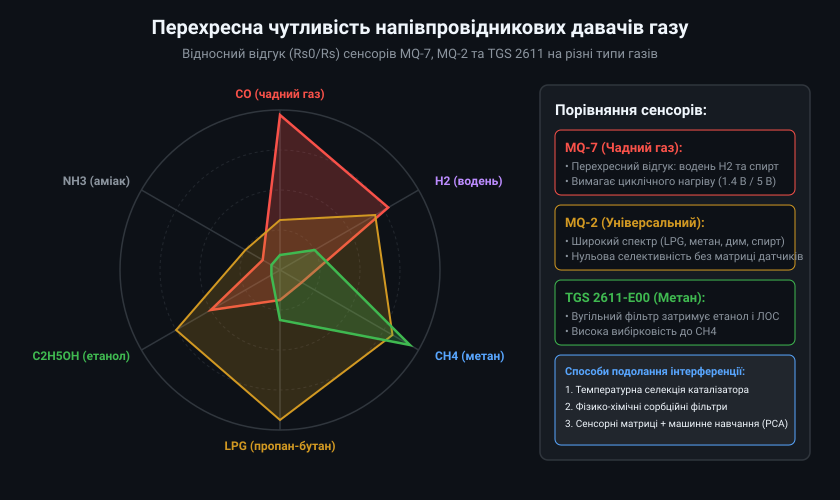
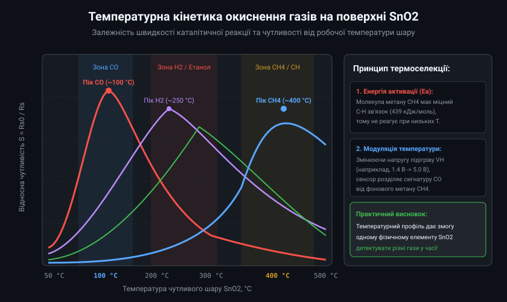
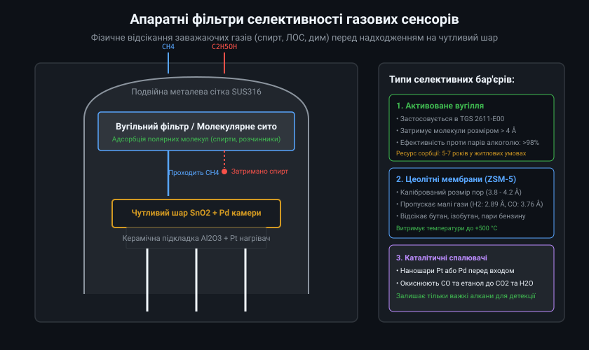
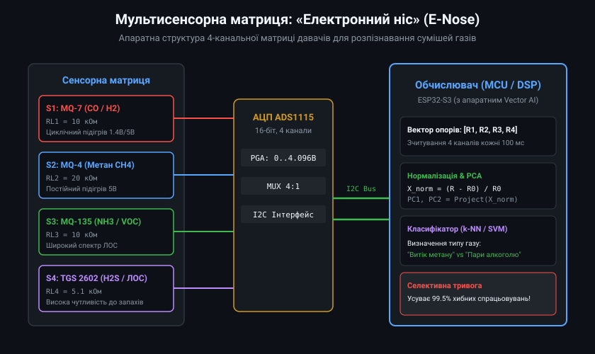
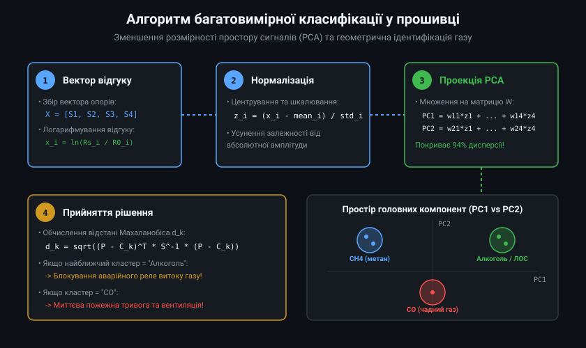

# Перехресна чутливість напівпровідникових давачів газу

Напівпровідникові оксиднометалеві давачі газу (Metal Oxide Semiconductor, MOS), такі як популярні сенсори родин MQ та Figaro TGS, широко застосовуються в системах пожежної безпеки, детекції витоку побутового газу та моніторингу якості повітря. Проте головним фундаментальним обмеженням оксиду олова (SnO2) є явище перехресної чутливості (cross-sensitivity) — здатність реагувати на цілий спектр відновних та окисних газів одночасно.

## 1. Проблема селективності напівпровідникових сенсорів

Усі напівпровідникові сенсори типу MOS функціонують за єдиним базовим фізичним принципом: гази-відновники взаємодіють з хемосорбованим поверхневим киснем (O2-, O-, O2-), повертаючи захоплені електрони назад у зону провідності. Це неминуче знижує електричний опір шару Rs незалежно від того, яка саме молекула вступила в реакцію.

На практиці це означає, що давач чадного газу MQ-7 здатний зреагувати не лише на токсичний монооксид вуглецю (CO), але й на пари етилового спирту (C2H5OH), молекулярний водень (H2) або метан (CH4). Якщо в приміщенні відкрити пляшку з антисептиком або розчинником, простий пороговий компаратор викличе аварійну тривогу витоку газу, спричинивши необґрунтовану евакуацію або автоматичне перекриття газової магістралі.



## 2. Термодинаміка та температурна вибірковість каталізаторів

Різні гази мають суттєво відмінну хімічну стійкість та енергію активації окиснення. Наприклад, міцний зв'язок C-H у молекулі метану вимагає для розриву високої температури (близько 350-450 °C), тоді як монооксид вуглецю CO у присутності паладієвого чи платинового каталізатора легко вступає в реакцію вже при 80-120 °C.

Керуючи робочою температурою нагрівача (напругою VH), можна кардинально змінювати спектр чутливості сенсора:
- **Низька температура (~100 °C):** Реагують переважно легкоокиснювані молекули CO та водень H2. Метан та складні вуглеводні залишаються хімічно пасивними.
- **Висока температура (~350...450 °C):** Активується окиснення метану (CH4), пропану та бутану (LPG).



Цей фізичний ефект покладено в основу роботи давача MQ-7, який циклічно перемикається між 60 с високотемпературного очищення (5 В, ~400 °C) та 90 с низькотемпературного вимірювання (1.4 В, ~100 °C), що дає змогу суттєво послабити відгук на метан під час детекції CO.

## 3. Апаратні сорбційні бар'єри та фільтри

Найбільш надійним апаратним методом усунення перехресної чутливості є встановлення фізико-хімічного фільтра перед чутливим кристалом. Фільтр затримує заважаючі компоненти повітря, пропускаючи лише молекули цільового газу.

Найпоширеніші типи селективних фільтрів:
1. **Фільтр з активованого вугілля:** Вбудовується безпосередньо всередину металевого ковпачка сенсора (наприклад, у Figaro TGS 2611-E00). Пориста структура вугілля ефективно адсорбує важкі та полярні молекули спиртів, ефірів і летких органічних сполук (ЛОС), забезпечуючи чистоту детекції метану понад 98%.
2. **Цеолітні молекулярні сита:** Мікропористі алюмосилікати з каліброваним розміром пор (від 3 до 5 ангстрем), які пропускають лише компактні молекули (водень, CO), механічно відсікаючи розгалужені вуглеводні.



## 4. Концепція «Електронного носа» (E-Nose)

Якщо необхідно не просто відсіяти окремий газ, а виконати повний аналіз складної багатокомпонентної газової суміші, застосовують сенсорні матриці — так званий «електронний ніс» (Electronic Nose).

Матриця складається з кількох фізичних сенсорів (наприклад, MQ-7, MQ-4, MQ-135 та TGS 2602), кожен з яких має різне каталітичне легування та різну чутливість до спектра газів. У результаті впливу суміші формується вектор електричних сигналів [S1, S2, S3, S4], який утворює унікальний «хімічний відбиток» (fingerprint) досліджуваного середовища.



Сигнали з вимірювальних дільників оцифровуються багатоканальним прецизійним АЦП (ADS1115) та передаються до мікроконтролера по шині I2C для подальшої математичної обробки.

## 5. Алгоритмічне розпізнавання образів та програмна фільтрація

Програмна обробка вихідного вектора матриці передбачає приведення сигналів до безрозмірного вигляду та проектування у простір меншої розмірності за методом головних компонент (Principal Component Analysis, PCA).



Приклад спрощеного мікроконтролерного класифікатора типу газу на C++:

```cpp
#include <Arduino.h>

// Типи розпізнаваних газових подій
enum class GasEventType {
    CLEAN_AIR,
    METHANE_LEAK,
    CARBON_MONOXIDE,
    ALCOHOL_VAPORS
};

struct SensorReading {
    float mq7_ratio;   // Rs/R0 для сенсора CO
    float mq4_ratio;   // Rs/R0 для сенсора CH4
    float mq135_ratio; // Rs/R0 для сенсора ЛОС/NH3
};

// Простий класифікатор на основі співвідношення чутливості (ratios-of-ratios)
GasEventType classify_gas_source(const SensorReading& reading) {
    // Якщо всі сенсори мають високий опір (близький до 1.0) - повітря чисте
    if (reading.mq7_ratio > 0.85f && reading.mq4_ratio > 0.85f && reading.mq135_ratio > 0.85f) {
        return GasEventType::CLEAN_AIR;
    }

    // Метан: MQ-4 показує різке падіння опору, тоді як MQ-7 майже не реагує
    if (reading.mq4_ratio < 0.40f && reading.mq7_ratio > 0.65f) {
        return GasEventType::METHANE_LEAK;
    }

    // Чадний газ CO: MQ-7 показує сильне падіння, MQ-4 не реагує
    if (reading.mq7_ratio < 0.35f && reading.mq4_ratio > 0.70f) {
        return GasEventType::CARBON_MONOXIDE;
    }

    // Алкоголь або леткі розчинники: одночасне падіння опору на MQ-7 та MQ-135
    if (reading.mq135_ratio < 0.45f && reading.mq7_ratio < 0.55f && reading.mq4_ratio > 0.60f) {
        return GasEventType::ALCOHOL_VAPORS;
    }

    return GasEventType::CLEAN_AIR;
}

void process_safety_logic(const SensorReading& reading) {
    GasEventType event = classify_gas_source(reading);

    switch (event) {
        case GasEventType::METHANE_LEAK:
            Serial.println("[КРИТИЧНО] Витік природного газу! Перекрити газовий клапан!");
            break;
        case GasEventType::CARBON_MONOXIDE:
            Serial.println("[НЕБЕЗПЕКА] Висока концентрація CO! Увімкнути вентиляцію!");
            break;
        case GasEventType::ALCOHOL_VAPORS:
            Serial.println("[ІНФО] Зафіксовано пари спирту. Аварійне реле заблоковано.");
            break;
        case GasEventType::CLEAN_AIR:
            Serial.println("[НОРМА] Повітря чисте.");
            break;
    }
}
```

Комплексний підхід, що поєднує температурну модуляцію нагріву, фізичні фільтри з активованого вугілля та цифрову обробку мультисенсорних матриць, дозволяє повністю подолати проблему перехресної чутливості та створювати надійні прилади контролю промислової безпеки.
