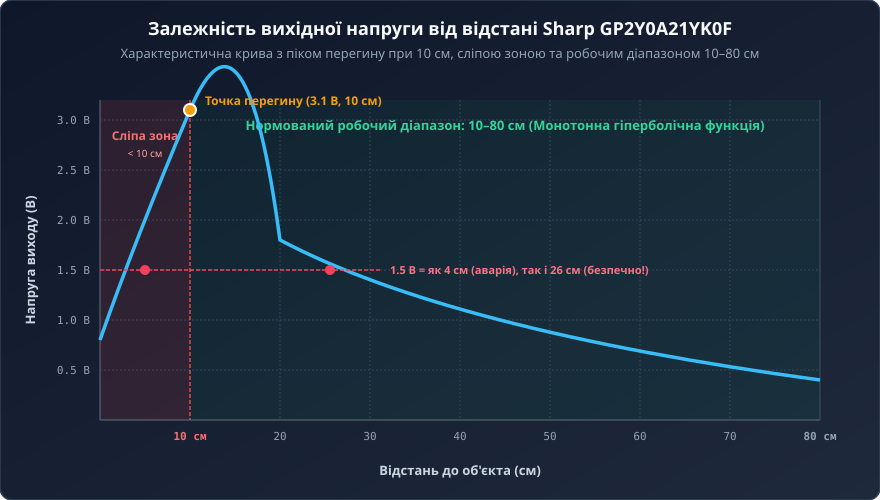
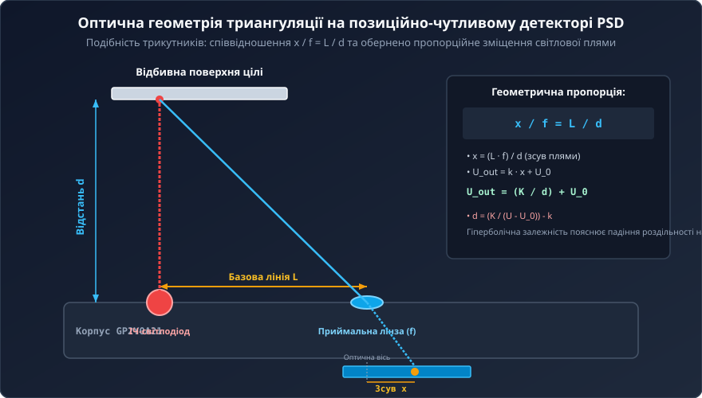
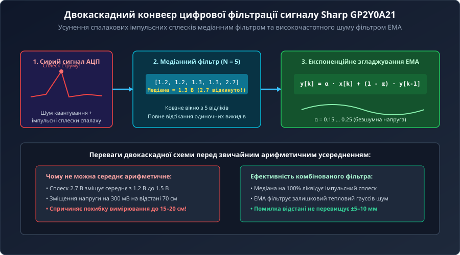
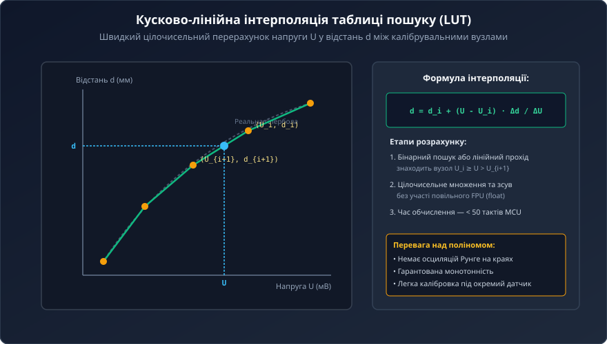
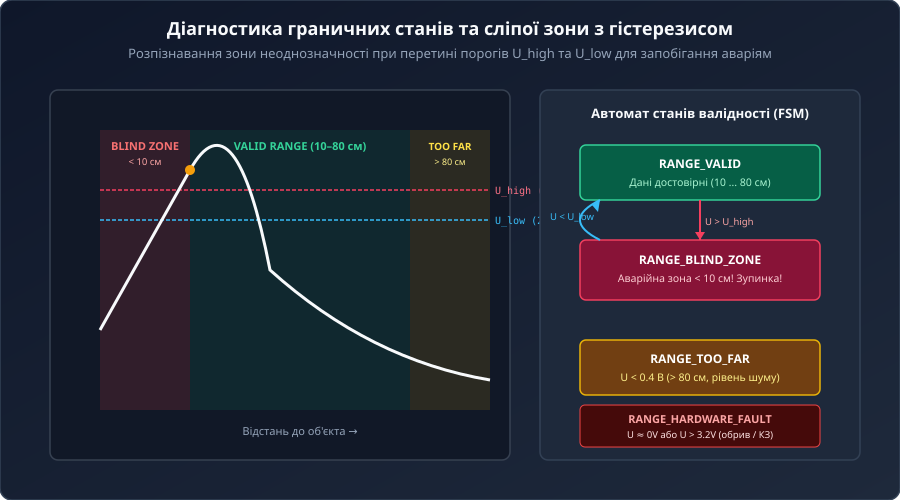
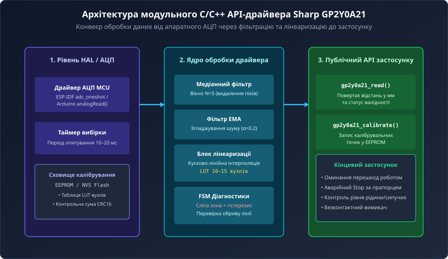

# Програмний API та тригонометричний перерахунок напруги Sharp GP2Y0A21YK0F

<preknowlist>
- [Sharp GP2Y0A21YK0F](root:cat-hw-sensors/sharp-gp2y0a21) — призначення модуля, електричні характеристики живлення та загальні принципи зчитування аналогового сигналу напруги.
- [Оптичні далекоміри: триангуляційні, ToF та амплітудні](root:cat-hw-sensors/optical-distance-sensors-overview) — фізичні принципи оптичної триангуляції та відмінності вимірювання відстані за кутом відбиття променя порівняно з часом прольоту фотонів.
</preknowlist>

## Нелінійність вихідної напруги та завади оцифрування

Підключення аналогового оптичного далекоміра @@en|Sharp GP2Y0A21YK0F@@ до аналогово-цифрового перетворювача (від англійського *analog-to-digital converter* — аналогово-цифровий перетворювач, @@en|ADC@@) мікроконтролера здається простим завданням лише на перший погляд. Достатньо подати аналоговий сигнал із виходу сенсора на аналоговий вхід мікроконтролера та виконати зчитування напруги. Проте на відміну від лінійних давачів, де вихідна напруга прямо пропорційна вимірюваній величині, аналоговий інфрачервоний (від латинського *infra* — нижче та англійського *red* — червоний, @@en|infrared@@) далекомір демонструє складну нелінійну залежність напруги від відстані. Якщо розробник спробує застосувати стандартну лінійну пропорцію для обчислення відстані, робототехнічна система зіткнеться з катастрофічними похибками: зміна відстані на 1 см поблизу сенсора викликає стрибок напруги у сотні мілівольт, тоді як така сама зміна на далекій межі робочого діапазону створює ледь помітну зміну сигналу в кілька мілівольт.

Припустимо, мікроконтролер використовує стандартний 10-розрядний @@en|ADC@@ з опорною напругою 3.3 В, де один крок квантування становить приблизно 3.22 мВ. На відстані 12 см зміна відстані на 1 см змінює напругу на 200 мВ, що відповідає понад 60 відлікам @@en|ADC@@, забезпечуючи високу точність. На відстані ж 75 см зміна відстані на той самий 1 см викликає зміну напруги всього на 3–4 мВ, що співмірне з одним кроком квантування @@en|ADC@@ та амплітудою власних шумів аналогового тракту. Це означає, що на далеких відстанях дискретність вимірювання фізично обмежена нелінійністю характеристики.

Крім нелінійності характеристичної кривої, процес оцифрування аналогового сигналу ускладнюється фізичними особливостями роботи внутрішнього електронного блоку далекоміра. Модуль @@en|Sharp GP2Y0A21YK0F@@ не випромінює інфрачервоний промінь безперервно. Для зменшення середнього енергоспоживання та усунення впливу фонового фотометричного засвічення приміщення сенсор працює в імпульсному режимі. Внутрішній генератор циклічно запускає випромінювальний світлодіод короткими спалахами з періодом близько 38–48 мс. У момент спалаху струм споживання модуля короткочасно зростає до 30–50 мА порівняно з базовим рівнем у 15–20 мА.

Ці періодичні спалахи струму викликають локальні просідання напруги живлення на шині Vcc, якщо поруч із контактами сенсора відсутні розв'язувальні конденсатори. Водночас аналогова схема виходу далекоміра під час кожного внутрішнього циклу оцифрування генерує високочастотні імпульсні завади (сплески напруги). Якщо @@en|ADC@@ мікроконтролера виконує випадкове одиничне зчитування в момент такого сплеску, зчитане значення може відрізнятися від реального рівня на 0.3–0.5 В. Для надійної роботи обладнання електричне узгодження та вимоги до живлення детально розглянуто у [апаратному довіднику підключення](root:cat-hw-sensors/gp2y0a21-sw-api/api-gp2y0a21-hardware-interface.md).

Критичною апаратною особливістю далекоміра є наявність точки перегину на характеристиці перетворення, яка формує зону неоднозначності.

*Залежність вихідної напруги від відстані: пікове значення досягається на межі 10 см, після чого крива спадає як у бік більших відстаней, так і у сліпій зоні від 0 до 10 см.*

Як видно з графіку залежності вихідної напруги від відстані, максимальна напруга близько 2.8–3.1 В досягається на відстані 10 см від оптичного центру. У нормованому робочому діапазоні від 10 до 80 см вихідна напруга монотонно спадає від 3.1 В до приблизно 0.4 В. Однак на відстанях менше 10 см (у сліпій зоні, від англійського *blind zone* — «сліпа» зона або зона неоднозначності, @@en|blind zone@@) вихідна напруга також спадає. Наприклад, на відстані 4 см вихідний сигнал становить приблизно 1.5 В — точно стільки ж, скільки сенсор видає на відстані 24 см.

Ця двозначність створює серйозну пастку для алгоритмів управління мобільних роботів:
1. Якщо перешкода наближається до робота ближче за 10 см, вихідна напруга починає падати. 2. Програма, що очікує монотонного спаду напруги зі зростанням відстані, інтерпретує значення 1.5 В як наявність вільного простору на відстані 24 см. 3. Робот замість аварійного зупинення починає прискорюватися прямо в перешкоду.

Для виявлення виходу за робочий діапазон (від англійського *out of range* — вихід за межі діапазону, @@en|out-of-range@@) програмний модуль мусить аналізувати граничні значення напруги та враховувати динаміку зміни сигналу. На відстанях понад 80 см вихідна напруга опускається нижче 0.4 В, наближаючись до рівня власних шумів @@en|ADC@@. Об'єкти далі за 80 см або поверхні з дуже низьким коефіцієнтом відбиття генерують сигнал, який програма повинна маркувати як недостовірний.

Для компенсації фізичних обмежень сліпої зони в мобільної робототехніці застосовують конструктивне заглиблення давача всередину корпусу на 10 см або поєднують його з іншими типами сенсорів, наприклад з [ультразвуковим далекоміром HC-SR04](root:cat-hw-sensors/hc-sr04) або [лазерним сенсором VL53L0X](root:cat-hw-sensors/vl53l0x).

Коротко кажучи, як розкрито в [історії розвитку PSD-сенсорів](root:cat-hw-sensors/gp2y0a21-sw-api/hist-gp2y0a21-psd-rangefinders.md), компанія Sharp першою масово впровадила інтегровану оптику з позиційно-чутливим детектором для побудови компактних аналогових далекомірів, звільнивши розробників від побудови складних дискретних підсилювачів.

Таким чином, первинний аналоговий сигнал від модуля @@en|Sharp GP2Y0A21YK0F@@ категорично не можна передавати безпосередньо у формули лінеаризації. Необхідно побудувати двостадійний конвеєр обробки даних: на першому етапі цифрові фільтри усувають імпульсні сплески струму та високочастотний шум оцифрування @@en|ADC@@, а на другому етапі математична модель або таблиця пошуку виконує перерахунок очищеної напруги у фізичну відстань із перевіркою коректності робочого діапазону.

## Тригонометрична модель оптичної триангуляції фотодетектора

Зрозумівши причини нелінійності вихідної напруги, перейдемо до аналізу геометричних принципів, які лежать в основі формування сигналу в аналоговому інфрачервоному далекомірі. Робота модуля @@en|Sharp GP2Y0A21YK0F@@ базується на оптичній триангуляції (від латинського *triangulum* — трикутник, триангуляція, @@en|triangulation@@). На відміну від амплітудних давачів, які оцінюють відстань за інтенсивністю відбитого світла й сильно залежать від кольору та текстури поверхні, триангуляційний далекомір вимірює кут відбиття променя.

Конструктивно далекомір складається з двох основних оптичних вузлів: випромінювального світлодіода з фокусувальною лінзою та приймальної лінзи, позаду якої розташовано напівпровідниковий фотодетектор @@en|Position Sensitive Detector@@ (від англійського *position sensitive detector* — позиційно-чутливий детектор, @@en|PSD@@). Оптичні осі випромінювача та приймача рознесені на фіксовану відстань, яку називають базовою лінією (від англійського *baseline* — базова лінія, @@en|baseline@@).

*Схема оптичної триангуляції: зміщення світлової плями x на фотодетекторі PSD зворотно пропорційне відстані d до відбивної поверхні.*

Геометричний принцип формування сигналу можна вивести через подібність трикутників:
1. Випромінювальний світлодіод формує вузький інфрачервоний промінь, спрямований перпендикулярно до базової лінії модуля. 2. Промінь відбивається від поверхні об'єкта, розташованого на відстані `d`, і потрапляє у приймальну лінзу з фокусною відстанню `f`. 3. Приймальна лінза фокусує відбите світло у вигляді точкової плями на поверхні фотодетектора @@en|PSD@@. 4. Оскільки базова лінія між осями лінз дорівнює `L`, зміщення плями світла `x` на поверхні фотодетектора відносно оптичної осі приймача утворює трикутник, подібний до зовнішнього трикутника між далекоміром та об'єктом.

Записавши співвідношення подібних трикутників, отримуємо вираз для зміщення світлової плями:

x / f = L / d
= (L · f) / d            [множення обох частин на f]

де `x` — фізичне зміщення плями світла на фотодетекторі @@en|PSD@@ (в міліметрах);
`L` — довжина базової лінії між оптичними осями випромінювача та приймача (фіксована константа конструкції);
`f` — фокусна відстань приймальної лінзи (фіксована константа оптичної системи);
`d` — фізична відстань від базової лінії далекоміра до відбивної поверхні.

З отриманого рівняння чітко видно, що зміщення плями `x` зворотно пропорційне відстані `d`.

Напівпровідниковий чип @@en|PSD@@ являє собою неперервну фотодіодну пластину з двома крайовими електродами. Коли пляма світла падає на поверхню чипа у точці `x`, згенерований фотострум ділиться між двома електродами у пропорції струмів `I_1` та `I_2`, яка визначається опором напівпровідникового шару від точки падіння до кожного контактного виводу. Внутрішня аналогова інтегральна схема далекоміра обчислює відносну різницю струмів `(I_1 - I_2) / (I_1 + I_2)`. Оскільки сумарна інтенсивність відбитого світла ділиться в знаменнику, вихідний сигнал чипа не залежить від абсолютної яскравості відбитого світла чи кольору поверхні об'єкта.

Аналогова схема формує вихідну напругу `U_out`, яка прямо пропорційна позиційному зміщенню плями `x`:

U_out = k_psd · x + U_0

Підставивши вираз для зміщення плями `x = (L · f) / d` у формулу напруги, отримуємо залежність вихідної напруги від відстані:

U_out = k_psd · ((L · f) / d) + U_0
= (K / d) + U_0          [об'єднання констант K = k_psd · L · f]

Враховуючи конструктивне зміщення `k` (конструктивна відстань від оптичного центру лінз до передньої грані корпусу та нульової позначки відліку), узагальнена математична модель перетворення набуває гіперболічного вигляду:

U_out = K / (d + k) + U_0

Виконаємо зворотне алгебраїчне перетворення, щоб виразити фізичну відстань `d` через зчитану аналогову напругу `U_out`:

U_out - U_0 = K / (d + k)
d + k = K / (U_out - U_0)    [ділення константи K на різницю напруг]
d = (K / (U_out - U_0)) - k  [віднімання конструктивного зміщення k]

Аналітична формула `d = (K / (U_out - U_0)) - k` розкриває математичну природу гіперболічної залежності: відстань `d` зворотно пропорційна різниці між поточною напругою та базовим зміщенням `U_0`. Більш детально математичні виведення та модифікації формул подано у [геометричному описі триангуляції](root:cat-hw-sensors/gp2y0a21-sw-api/math-psd-triangulation-geometry.md).

Тепер стає зрозумілою фізична причина виникнення точки перегину та зони неоднозначності на відстанях менше 10 см. У разі надмірного наближення об'єкта до далекоміра (`d < 10 cm`) кут відбиття променя стає настільки великим, що фокусована пляма світла зміщується за край активної чутливої зони чипа @@en|PSD@@ або частково перекривається внутрішніми апертурними діафрагмами лінзи. Крім того, на близькій відстані відбуваються розфокусування зображення світлодіода та вихід променя за межі поля зору приймача. У результаті сумарна інтенсивність світла на фотодетекторі падає, а співвідношення струмів зменшується, викликаючи спад вихідної напруги `U_out` замість подальшого зростання.

Слід підкреслити фундаментальну відмінність триангуляційних далекомірів від сучасних лазерних давачів прямого вимірювання часу прольоту фотонів (від англійського *Time-of-Flight*, @@en|ToF@@). Наприклад, [лазерний ToF-далекомір VL53L1X](root:cat-hw-sensors/vl53l1x-tof-sensor) або модуль [далекомір TOF10120](root:cat-hw-sensors/tof10120) вимірюють безпосередньо час повернення світлового імпульсу, тому їхній вихідний сигнал лінійний по відношенню до відстані у всьому діапазоні. Триангуляційний модуль @@en|Sharp GP2Y0A21YK0F@@ вимірює кут, через що його роздільна здатність є найвищою на близьких відстанях (10–20 см) і природно знижується при наближенні до верхньої межі у 80 см.

Таким чином, тригонометрична модель визнача визначити аналітичну основу для програмного перерахунку напруги у відстань. Однак застосовувати формулу `d = (K / (U_out - U_0)) - k` можна виключно в межах робочого діапазону від 10 до 80 см, де функція є строго монотонною, а первинна напруга попередньо очищена від імпульсних завад.

## Виявлення завад та цифрова фільтрація сигналу

Побудова математичної моделі перетворення напруги у відстань втрачає сенс, якщо на вхід розрахункового алгоритму подаються спотворені дані. Практична робота з аналоговим далекоміром @@en|Sharp GP2Y0A21YK0F@@ показує, що зчитані за допомогою аналогово-цифрового перетворювача (@@en|ADC@@) значення напруги містять суттєвий рівень шуму. Якщо передати таке сире значення безпосередньо у гіперболічну формулу перерахунку, нелінійність знаменника перетворить навіть незначне коливання напруги на хаотичні стрибки виміряної відстані амплітудою в кілька сантиметрів.

Фізична природа завад у сигналі далекоміра має два фундаментально різних джерела, кожне з яких вимагає власного алгоритму придушення:
1. **Імпульсні сплески напруги (викиди):** виникають унаслідок внутрішньої оптико-електронної схеми модуля. Внутрішній генератор далекоміра циклічно запускає випромінювальний світлодіод короткими спалахами з періодом близько 38–48 мс. У момент спалаху струм споживання модуля імпульсно зростає до 30–50 мА. Якщо лінія живлення Vcc має помітний індуктивний або омічний опір, ці спалахи створюють локальні просідання напруги та генерують у вихідному аналоговому сигналі імпульсні сплески амплітудою до 0.3–0.5 В. 2. **Високочастотний гауссів шум:** обумовлений тепловими шумами напівпровідникового чипа @@en|PSD@@, наводками на аналогову лінію зв'язку та шумами квантування самого @@en|ADC@@ мікроконтролера.

Для вирішення цієї проблеми застосовують двостадійний цифровий фільтр, у якому перша стадія усуває імпульсні викиди, а друга — згладжує високочастотний шум.

Першим рубежем обробки сигналу є медіанний фільтр (від англійського *median filter* — медіанний фільтр, @@en|median filter@@). Стандартне арифметичне усереднення (середнє арифметичне) абсолютно непридатне для боротьби з імпульсними завадами. Якщо серед 5 послідовних відліків @@en|ADC@@ 4 відліки мають значення 1.2 В, а 1 відлік через сплеск струму становить 2.7 В, середнє значення дорівнюватиме 1.5 В. Це створює хибне зміщення вихідного сигналу на 300 мВ, що на дальніх відстанях призводить до похибки вимірювання у понад 15 см.

Медіанний фільтр працює за принципом ковзного вікна розміром N відліків (де N — непарне число, зазвичай N = 5 або N = 7). Алгоритм збирає N останніх вимірювань, сортує їх за зростанням та обирає елемент, розташований точно посередині впорядкованого масиву. Оскільки імпульсний сплеск займає лише 1 відлік, після сортування він опиняється на самому краю масиву (як максимальне або мінімальне значення) і повністю відкидається. 

Обчислювальна складність сортування для малих масивів (N = 5) є мінімальною. Використання спрощеного алгоритму сортування вставками або мережі сортування дозволяє знайти медіану всього за 7–9 операцій порівняння, що виконується за лічені мікросекунди навіть на 8-розрядних мікроконтролерах.

Після видалення імпульсних сплесків очищений масив даних надходить на другу стадію — експоненційне згладжування (від англійського *exponential moving average*, @@en|exponential moving average@@, @@en|EMA@@). Фільтр @@en|EMA@@ являє собою цифровий рекурсивний фільтр першого порядку (фільтр нижніх частот), який згладжує залишковий шум @@en|ADC@@ без потреби зберігати громіздкі масиви історичних даних у оперативній пам'яті.

Математичне рівняння експоненційного фільтра описується виразом:

y[k] = α · x[k] + (1 - α) · y[k-1]
= y[k-1] + α · (x[k] - y[k-1])    [розкриття дужок та групування]

де x[k] — поточне значення напруги після медіанного фільтра;
y[k] — вихідне згладжене значення напруги на кроці k;
y[k-1] — попереднє збережене значення згладженої напруги;
α — коефіцієнт згладжування (0 < α ≤ 1), який визначає баланс між плавністю фільтрації та швидкістю реакції на зміну відстані.

Якщо α = 1, фільтр відсутній, і вихід миттєво відстежує вхід. При α = 0.1–0.2 фільтр забезпечує глибоке придушення високочастотного шуму, але додає невеличку затримку (інерційність) при швидкому переміщенні об'єкта.

Для мікроконтролерів без апаратного блоку обчислень із плаваючою крапкою обчислення з дробовим коефіцієнтом α можна оптимізувати за допомогою цілочисельної арифметики з фіксованою крапкою. Представивши α у вигляді дробу A / 256 (де A — ціле число від 1 до 256), формула перетворюється на швидкі бітові зсуви:

y[k] = (A · x[k] + (256 - A) · y[k-1]) >> 8

Послідовну взаємодію двох фільтрів у загальному конвеєрі обробки сигналу показано на структурній схемі.

*Структурна схема конвеєра цифрової обробки сигналу: послідовне очищення первинного аналогового сигналу від сплесків струму медіанним фільтром та високочастотних шумиків фільтром EMA.*

Детальний вибір коефіцієнтів згладжування та частотний аналіз придушення шумів розглянуто у [математичному аналізі лінеаризації](root:cat-hw-sensors/gp2y0a21-sw-api/math-gp2y0a21-linearization-and-filtering.md). Електричне узгодження лінії живлення сенсора та вибір розв'язувальних конденсаторів для мінімізації апаратних сплесків наведено в [апаратному довіднику живлення](root:cat-hw-sensors/gp2y0a21-sw-api/api-gp2y0a21-hardware-interface.md).

Нижче наведено практичну реалізацію конвеєра цифрової фільтрації мовами C та C++ для реальних мікроконтролерних платформ.

:::tabs
@tab C (ESP-IDF)
:::code gp2y0a21-sw-api-d/c/esp-idf/signal-filter-init.c
@tab C++ (Arduino)
:::code gp2y0a21-sw-api-d/cpp/arduino/distancefilter.cpp
:::

Завдяки двостадійній фільтрації вихідні дані @@en|ADC@@ звільняються від випадкових імпульсних завад та високочастотних коливань. Очищене значення напруги стає стабільним і повністю готовим для математичного перерахунку у фізичну відстань.

## Методи лінеаризації характеристичної кривої перетворення

Маючи в розпорядженні очищене від шумів значення напруги, розробник мусить розв'язати головне обчислювальне завдання — перетворити аналогову напругу U (або виміряний відлік @@en|ADC@@) у фізичну відстань d в сантиметрах. Оскільки залежність між напругою та відстанню сенсора @@en|Sharp GP2Y0A21YK0F@@ є строго нелінійною, стандартні пропорційні формули тут не працюють.

На практиці застосовують три основні математичні методи лінеаризації, кожен із яких має власний компроміс між точністю, обсягом використовуваної пам'яті та вимогами до обчислювальних ресурсів мікроконтролера.

### 1. Аналітичний підхід: Степенна та гіперболічна формули

Аналітичний підхід спирається безпосередньо на тригонометричну модель оптичної триангуляції. Фізична відстань d обчислюється за формулою зі зворотним зсувом напруги:

d = (K / (U - U_0)) - k

або спрощеною степенною апроксимацією:

d = A · U^B

де U — зчитана напруга у вольтах;
K, U_0, k або A, B — емпіричні коефіцієнти калібрування (для типового далекоміра GP2Y0A21YK0F A ≈ 27.28, B ≈ -1.20).

Головною перевагою аналітичного методу є його математична неперервність та висока точність опису кривої в усьому робочому діапазоні від 10 до 80 см. Для обчислення формули потрібно зберігати лише 2–3 дробові константи в пам'яті програм.

Однак цей метод має суттєвий недолік: він вимагає виконання операції ділення числа з плаваючою крапкою або обчислення дробового степеня (powf). У мікроконтролерах без апаратного блоку обчислень із плаваючою крапкою (від англійського *floating-point unit*, @@en|floating-point unit@@, @@en|FPU@@), таких як 8-розрядні AVR (ATmega328P) або 32-розрядні ARM Cortex-M0, програмне емулювання ділення плаваючої крапки займає від сотень до тисяч тактів процесора. Крім того, якщо напруга U наближається до базового зміщення U_0 (на великих відстанях), різниця в знаменнику U - U_0 стає близькою до нуля, що спричиняє обчислювальну нестабільність та різкий сплеск похибки.

### 2. Поліноміальна регресія

Поліноміальна регресія (від англійського *polynomial regression* — поліноміальна регресія, @@en|polynomial regression@@) замінює дробово-раціональну функцію поліномом 3-го або 4-го ступеня:

d = c_4 · U^4 + c_3 · U^3 + c_2 · U^2 + c_1 · U + c_0

Для мінімізації кількості операцій множення обчислення полінома здійснюють за схемою Горнера (від німецького *Horner-Schema*, схема Горнера):

d = (((c_4 · U + c_3) · U + c_2) · U + c_1) · U + c_0

Перевага поліноміального методу полягає у відсутності операції ділення: обчислення складається виключно з послідовних операцій множення та додавання.

Головною небезпекою поліноміальної апроксимації є так званий осциляційний ефект на межах діапазону (феномен Рунге). Поліном високого ступеня ідеально описує ділянку від 12 до 70 см, але на краях робочого діапазону (U < 0.4 V або U > 2.8 V) поліноміальна крива починає різко відхилятися вбік нескінченності. Якщо на вхід алгоритму потрапить значення напруги поза калібрувальними точками, поліном видасть абсолютно аномальне значення відстані.

### 3. Таблиці пошуку (LUT) із кусково-лінійною інтерполяцією

Найбільш універсальним та обчислювально ефективним підходом для вбудованих систем є використання таблиць пошуку (від англійського *Lookup Table*, @@en|Lookup Table@@, @@en|LUT@@) у поєднанні з кусково-лінійною інтерполяцією (від англійського *piecewise linear interpolation*, @@en|piecewise linear interpolation@@).

Суть методу полягає у розбитті суцільної нелінійної характеристичної кривої на серію коротких лінійних відрізків між опорними вузлами калібрування (U_i, d_i). 

*Графічна модель кусково-лінійної інтерполяції за таблицею пошуку LUT: нелінійна характеристична крива апроксимується відрізками прямих між калібрувальними вузлами.*

Для обчислення відстані за зчитаною напругою U алгоритм виконує два послідовних кроки:
1. **Пошук інтервалу:** визначаються два сусідніх опорних вузли i та i+1, між якими лежить поточне значення напруги (U_i ≥ U > U_{i+1}). 2. **Лінійна інтерполяція:** відстань d обчислюється як пропорційне зміщення всередині знайденого інтервалу за формулою:

d = d_i + (U - U_i) · ((d_{i+1} - d_i) / (U_{i+1} - U_i))

Головна перевага табличного методу — можливість повністю відмовитися від обчислень із плаваючою крапкою. Зберігаючи опорні значення напруги в мілівольтах (цілі числа uint16_t), а відстань — у десятих частках міліметра, усі обчислення виконуються через цілочисельне множення та зсуви. Це забезпечує детермінований час виконання алгоритму (буквально кілька десятків тактів процесора) на будь-якому мікроконтролері.

Критерії вибору методу лінеаризації залежно від архітектури мікроконтролера та наявності апаратного блоку @@en|FPU@@ зведено в таблицю:

| Метод лінеаризації | Вимоги до обчислень | Використання RAM/Flash | Точність | Оптимальна архітектура MCU |
| :--- | :--- | :--- | :--- | :--- |
| **Степенна / Гіперболічна формула** | Високі (FPU, ділення float, powf) | Мінімальне (2–3 float константи) | Висока на всьому діапазоні | STM32F4/F7, ESP32, SAMD51 (MCU з FPU) |
| **Поліноміальна регресія** | Середні (множення float, схема Горнера) | Низьке (4–5 float коефіцієнтів) | Середня (похибки на межах) | STM32F0/F1, Cortex-M3 (без FPU) |
| **Таблиця пошуку (LUT) з інтерполяцією** | Дуже низькі (цілочисельна арифметика) | Середнє (масив з 10–15 вузлів) | Висока (визначається крок вузлів) | AVR ATmega, PIC, Cortex-M0/M0+ |

Незалежно від обраного методу лінеаризації, перед виконанням обчислень обов'язково здійснюється виявлення виходу за робочий діапазон (@@en|out-of-range@@) та обробка сліпої зони (@@en|blind zone@@):
- Якщо напруга U > U_max (понад 2.8–3.0 В), об'єкт перебуває у сліпій зоні на відстані менше 10 см. Програма повинна повернути прапорець помилки RANGE_BLIND_ZONE. - Якщо напруга U < U_min (нижче 0.4 В), об'єкт перебуває далі 80 см або має занадто малий коефіцієнт відбиття. Повертається прапорець RANGE_TOO_FAR.

Детальну методологію побудови калібрувального стенда для зняття опорних точок @@en|LUT@@ висвітлено у [програмному стенді калібрування](root:cat-hw-sensors/gp2y0a21-sw-api/proj-gp2y0a21-calibration-bench.md), а готова архітектура реалізована у [виробничому C/C++ драйвері](root:cat-hw-sensors/gp2y0a21-sw-api/proj-gp2y0a21-api-driver.md). Опис публічних функцій та структур даних наведено в [довіднику програмного інтерфейсу](root:cat-hw-sensors/gp2y0a21-sw-api/api-gp2y0a21-software-interface.md) (від англійського *Application Programming Interface*, @@en|Application Programming Interface@@, @@en|API@@).

Нижче наведено практичну реалізацію кусково-лінійної інтерполяції за таблицею @@en|LUT@@ із перевіркою коректності діапазону для мов C та C++.

:::tabs
@tab C (ESP-IDF)
:::code gp2y0a21-sw-api-d/c/esp-idf/gp2y0a21-calculate-distance-lut.c
@tab C++ (Arduino)
:::code gp2y0a21-sw-api-d/cpp/arduino/rangestatus.cpp
:::

Завдяки грамотному вибору методу лінеаризації розробник може досягти максимальної швидкодії системи вимірювання відстані, зберігши високу точність та гарантувавши стійкість мікроконтролерного API-драйвера до крайових режимів роботи сенсора.

## Діагностика невалідності даних та граничних станів

Побудова навіть найточнішого математичного алгоритму лінеаризації втрачає сенс, якщо програмне забезпечення сприймає будь-яке число на виході аналогово-цифрового перетворювача (@@en|ADC@@) як достовірну відстань. У реальних умовах експлуатації мобільний робот або пристрій автоматизації неминуче стикається з ситуаціями, коли об'єкти виходять за межі паспортного робочого діапазону оптичного далекоміра @@en|Sharp GP2Y0A21YK0F@@ (від 10 до 80 см). Без надійної системи виявлення невалідності даних таких граничних станів (від англійського *out-of-range* — вихід за межі діапазону, @@en|out-of-range@@) керуючий контролер отримуватиме хибні значення відстані, що призведе до аварійних зіткнень або помилкових рішень.

Головна небезпека оптичної триангуляції в далекомірах Sharp полягає у фізичному існуванні так званої зони неоднозначності або сліпої зони (від англійського *blind zone* — сліпа зона, @@en|blind zone@@) на відстанях менше 10 см. Математично та фізично ця зона формується внаслідок особливості побудови оптичної системи з напівпровідниковим позиційно-чутливим детектором (@@en|Position Sensitive Detector@@, @@en|PSD@@).

При наближенні об'єкта від 80 см до 10 см відбита світлова пляма переміщується вздовж кристала @@en|PSD@@, а вихідна напруга модуля монотонно зростає від ~0.4 В до максимального пікового значення близько 3.1 В на відстані 10 см. Ця точка є математичною точкою перегину характеристики перетворення. Якщо об'єкт продовжує наближатися далі (від 10 см до 2 см), геометрія відбитого променя змінюється настільки сильно, що світлова пляма починає частково або повністю виходити за межі робочої зони фотоприймача чи перекриватися внутрішніми корпусними діафрагмами. Внаслідок цього вихідний струм @@en|PSD@@ падає, і вихідна напруга сенсора починає стрімко знижуватися — з 3.1 В на відстані 10 см до 1.5 В на 4 см і 0.9 В на 2 см.

У результаті виникає двозначність: одна й та сама вихідна напруга 1.5 В відповідає як абсолютно безпечній відстані 30 см у робочому діапазоні, так і критично близькій відстані 4 см у сліпій зоні. Якщо програма просто застосує формулу лінеаризації до напруги 1.5 В, вона вирахує відстань 30 см і робототехнічна платформа продовжить рух уперед, врізавшись у перешкоду. На відміну від далекомірів Sharp, [лазерний ToF-далекомір VL53L0X](root:cat-hw-sensors/vl53l0x) позбавлений цієї проблеми за рахунок прямого вимірювання часу прольоту фотонів, проте для аналогового ІЧ-сенсора така діагностика є життєво необхідною.

Другим граничним станом є вихід за дальню межу робочого діапазону (понад 80 см). На великих відстанях інтенсивність відбитого інфрачервоного випромінювання падає пропорційно квадрату відстані, а кут триангуляції змінюється настільки мало, що вихідна напруга знижується нижче 0.4 В. На цьому рівні аналоговий сигнал зливається з власним шумовим порогом (від англійського *noise floor* — шумовий поріг, @@en|noise floor@@) схеми та завадами @@en|ADC@@. Обчислення відстані за зашумленою напругою 0.35 В за допомогою степенної формули дасть значення понад 120 см із похибкою в десятки сантиметрів. Крім того, значення напруги поблизу 0.0 В або шини живлення Vcc (понад 3.2 В) свідчать про апаратні аварії — обрив лінії сигнального проводу, коротке замикання або насичення @@en|ADC@@.

Для надійної ідентифікації зони неоднозначності та граничних станів застосовують алгоритм часового відстеження стану з програмним гістерезисом (від грецького *ὑστέρησις* — запізнення, відставання, @@en|hysteresis@@). Оскільки об'єкт не може миттєво телепортуватися з 40 см на 4 см, не пройшовши точку 10 см, алгоритм відстежує тренд зміни напруги.

При наближенні об'єкта вихідна напруга зростає. Коли згладжена напруга перетинає верхній діагностичний поріг `U_high` (близько 2.85–2.90 В), алгоритм встановлює прапорець потенційного входження в сліпу зону. Якщо після цього напруга починає падати, але об'єкт рухається в тому ж напрямку, система фіксує перебування в зоні @@en|blind zone@@, а не повернення на віддалену дистанцію. Вихід із цього стану відбувається лише тоді, коли напруга падає нижче нижнього порогу `U_low` (наприклад, 2.65 В) при зворотному віддаленні об'єкта.

Розподіл робочих зон, точки перегину характеристичної кривої та порогів гістерезису представлено на графічній схемі.

*Діаграма характеристичної кривої з виділеними зонами невалідності: точка перегину при 10 см створює зональну неоднозначність, яка розпізнається алгоритмом гістерезису.*

Детальний аналіз математичної моделі оптичної зони неоднозначності можна знайти у матеріалі про [геометричну триангуляцію PSD](root:cat-hw-sensors/gp2y0a21-sw-api/math-psd-triangulation-geometry.md). Електричні схеми підключення та захисту сигнальної лінії наведено у розділі про [апаратний довідник підключення](root:cat-hw-sensors/gp2y0a21-sw-api/api-gp2y0a21-hardware-interface.md). Порівняльну характеристику робочих діапазонів різних типів датчиків подано у публікації про [базовий огляд далекомірів](root:cat-hw-sensors/optical-distance-sensors-overview).

За результатами діагностики програмний модуль формує чіткі перелічувані статуси валідності даних, що дозволяє алгоритмам вищого рівня робототехнічної системи коректно реагувати на ситуацію.

Нижче наведено практичну реалізацію модуля діагностики граничних станів із гістерезисом мовами C та C++.

:::tabs
@tab C (ESP-IDF)
:::code gp2y0a21-sw-api-d/c/esp-idf/gp2y0a21-diag-init.c
@tab C++ (Arduino)
:::code gp2y0a21-sw-api-d/cpp/arduino/sensorrangestatus.cpp
:::

## Багатоточкове калібрування та побудова API драйвера

Наявність якісних алгоритмів фільтрації та діагностики створює міцну основу для побудови надійного програмного інтерфейсу (від англійського *Application Programming Interface*, @@en|Application Programming Interface@@, @@en|API@@). Однак під час серійного застосування далекомірів @@en|Sharp GP2Y0A21YK0F@@ розробник стикається з розбіжністю виміряних значень між різними екземплярами одного й того самого пристрою. Вихідна напруга двох окремих сенсорів при однаковій відстані до об'єкта може відрізнятися на 100–200 мВ, що створює систематичну похибку обчислення відстані до 15–20%.

Фізичні причини такого технологічного розкиду параметрів криються в декількох факторах:
1. **Механічні допуски оптичного блоку:** незначне відхилення фокусної відстані литих пластикових лінз, а також допуски кутового монтажу світлодіода та фотоприймача на внутрішній рамці модуля. 2. **Напівпровідниковий розкид:** відмінність ефективної випромінювальної потужності ІЧ-світлодіода та варіація питомого опору фоторезистивної пластини @@en|PSD@@-чипа. 3. **Нестабільність напруги живлення:** внутрішній аналоговий підсилювач модуля не є повністю відносним (ratiometric). Зміна живлення Vcc на 5% (наприклад, з 5.0 В до 4.75 В) викликає зсув всієї характеристики перетворення напруги на 100–150 мВ.

Для усунення цих системних похибок застосовують методику багатоточкового калібрування. Процедура проводиться на спеціалізованому калібрувальному стенді, де далекомір закріплюється навпроти білої калібрувальної мішені.

Процес калібрування складається з таких кроків:
1. Мішень послідовно встановлюється на N фіксованих відстаней `d_1, d_2, ..., d_N` (наприклад, 100, 150, 200, 300, 400, 500, 600, 700, 800 мм). 2. На кожній відстані програма зчитує 100–200 відліків @@en|ADC@@, застосовує медіанний та експоненційний фільтри і розраховує математичне сподівання стабільної напруги `U_i`. 3. Отриманий масив опорних точок `(U_i, d_i)` використовується для обчислення уточнених коефіцієнтів степенної формули `d = A · U^B` методом найменших квадратів (від англійського *Least Squares Method* — метод найменших квадратів, @@en|Least Squares Method@@) або формує індивідуальну таблицю пошуку (від англійського *Lookup Table*, @@en|Lookup Table@@, @@en|LUT@@).

Обчислені індивідуальні коефіцієнти необхідно зберегти у неенергозалежній пам'яті мікроконтролера (від англійського *Electrically Erasable Programmable Read-Only Memory*, @@en|EEPROM@@) або у спеціальній структурі розділу неенергозалежного сховища (від англійського *Non-Volatile Storage*, @@en|NVS@@) у Flash-пам'яті. При кожному запуску системи драйвер зчитує ці дані, перевіряє їх цілісність за допомогою контрольної суми (CRC16) і застосовує їх для точного обчислення відстані.

Архітектура промислового C/C++ API-драйвера об'єднує всі стадії обробки сигналу в детермінований обчислювальний конвеєр. Структура драйвера передбачає повне відділення апаратно-залежного шару зчитування @@en|ADC@@ від математичної обробки даних, що робить його сумісним із будь-якими архітектурами мікроконтролерів (AVR, ARM Cortex-M, ESP32, RISC-V).

Повний цикл обробки даних та взаємодію між модулями драйвера показано на схемі архітектури.

*Структурна схема виробничого API-драйвера: передача даних від ADC через фільтрацію та лінеаризацію до неенергозалежного сховища EEPROM/Flash.*

Методологію побудови калібрувального обладнання детально висвітлено у матеріалі про [стенд багатоточкового калібрування](root:cat-hw-sensors/gp2y0a21-sw-api/proj-gp2y0a21-calibration-bench.md). Приклади практичної інтеграції C/C++ коду в реальні проєкти можна знайти у публікації про [виробничий C/C++ драйвер](root:cat-hw-sensors/gp2y0a21-sw-api/proj-gp2y0a21-api-driver.md). Опис усіх викликів та конфігурацій драйвера міститься у розділі про [довідник програмного інтерфейсу](root:cat-hw-sensors/gp2y0a21-sw-api/api-gp2y0a21-software-interface.md), математичні методи обробки наведено у [математичному описі лінеаризації](root:cat-hw-sensors/gp2y0a21-sw-api/math-gp2y0a21-linearization-and-filtering.md), а історичні передумови вдосконалення сенсорів Sharp розглянуто у матеріалі про [історію розвитку далекомірів](root:cat-hw-sensors/gp2y0a21-sw-api/hist-gp2y0a21-psd-rangefinders.md).

Нижче наведено повну реалізацію виробничого API-драйвера мовами C та C++ з підтримкою багатоточкового калібрування, завантаження коефіцієнтів та повної обробки даних.

:::tabs
@tab C (ESP-IDF)
:::code gp2y0a21-sw-api-d/c/esp-idf/calculate-crc16.c
@tab C++ (Arduino)
:::code gp2y0a21-sw-api-d/cpp/arduino/sharpgp2y0a21driver.cpp
:::