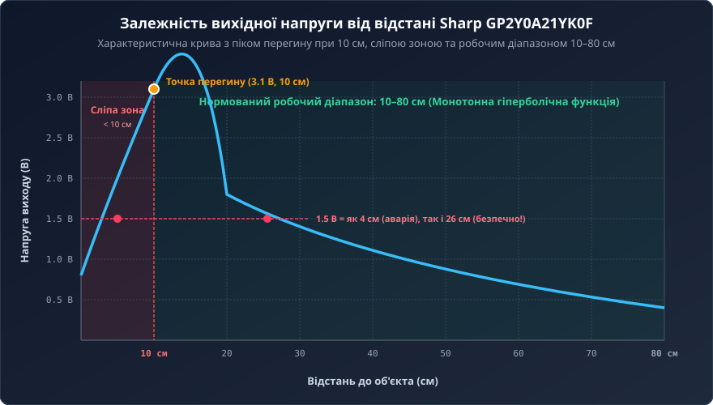
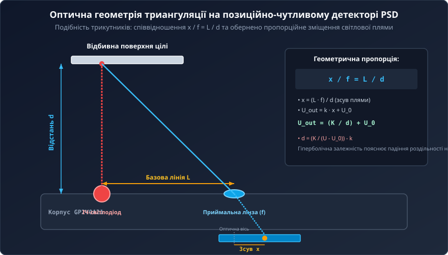
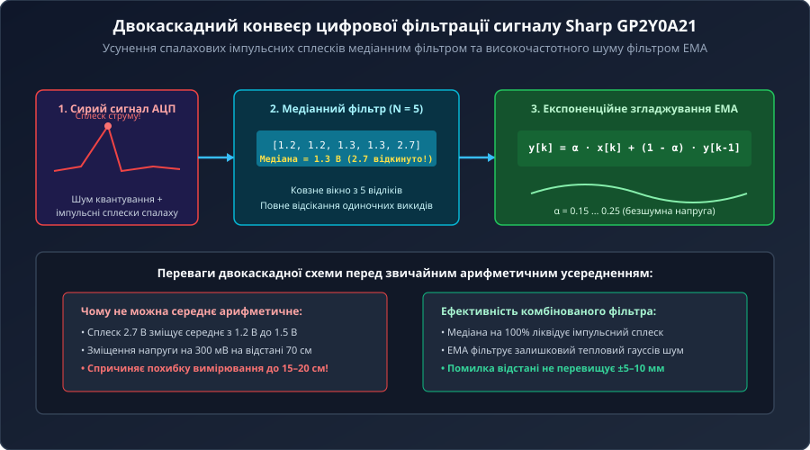
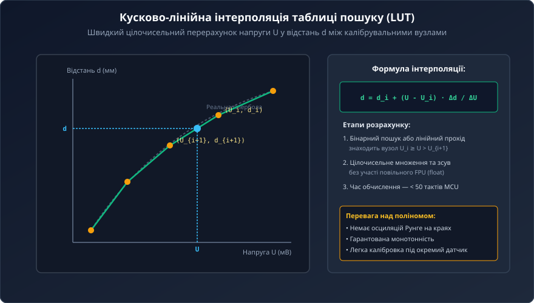
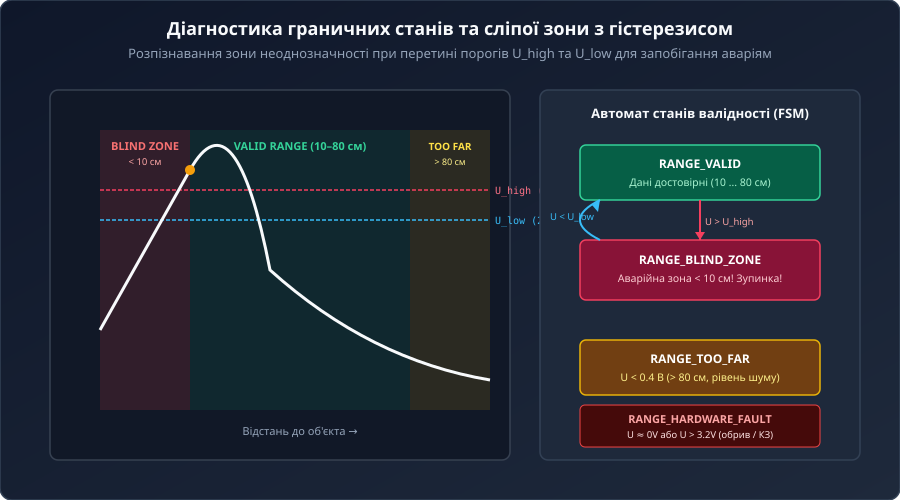
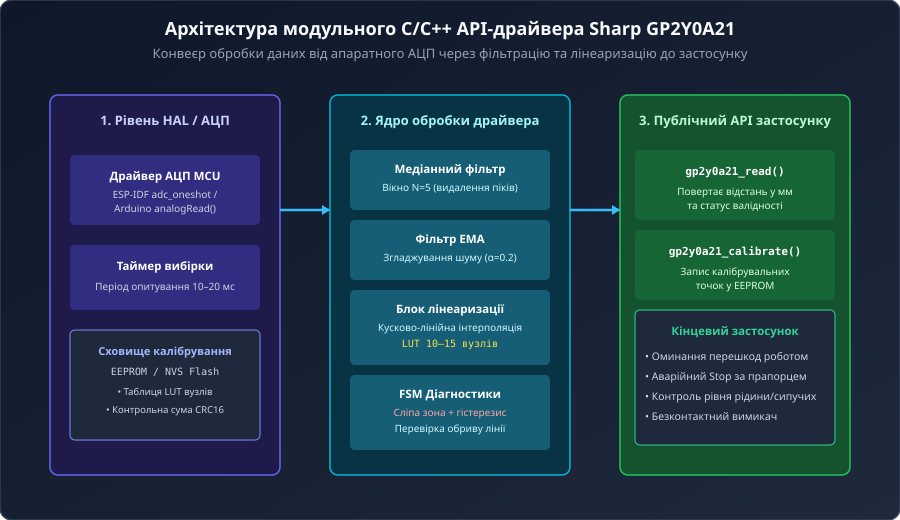

# Програмний API та тригонометричний перерахунок напруги Sharp GP2Y0A21YK0F

Аналоговий інфрачервоний далекомір Sharp GP2Y0A21YK0F широко застосовується в робототехніці для виявлення перешкод на дистанціях від 10 до 80 см. Проте безпосереднє оцифрування його вихідного сигналу мікроконтролером зіштовхується зі значними труднощами через сувору гіперболічну нелінійність характеристики, спалахові імпульсні струми та небезпечну сліпу зону на близьких дистанціях.

## 1. Нелінійність аналогового виходу та явище зони неоднозначності

На відміну від лінійних давачів, залежність вихідної напруги Sharp GP2Y0A21YK0F від відстані не є лінійною. На відстані 10 см сенсор видає пікову напругу близько 3.1 В, після чого зі збільшенням дистанції сигнал монотонно спадає до 0.4 В на відстані 80 см.



На великих відстанях (70–80 см) зміна відстані на 1 см змінює напругу лише на 3–4 мВ, що співмірно з кроком квантування 10-бітного АЦП та шумами аналогового тракту.

Найнебезпечнішим явищем є сліпа зона (Blind Zone) при відстані менше 10 см: напруга сенсора починає падати замість зростання. В результаті виникає двозначність: сигнал 1.5 В відповідає як безпечній дистанції 26 см, так і критично близькій аварійній відстані 4 см. Без алгоритмічного розпізнавання робот сприйме наближення до стіни як вільний простір.

## 2. Тригонометрична модель оптичної триангуляції на PSD

Датчик базується на методі оптичної геометричної триангуляції. Інфрачервоний світлодіод випромінює пучок, який відбивається від об'єкта та через лінзу з фокусною відстанню `f` потрапляє на позиційно-чутливий напівпровідниковий детектор (PSD).



З подібності трикутників випливає фундаментальне геометричне співвідношення:
```
x / f = L / d
```
де `x` — зміщення світлової плями на PSD, `L` — базова лінія між лінзами, `d` — дистанція до об'єкта.

Оскільки фотострум PSD перетворюється внутрішньою схемою у вихідну напругу `U_out = k * x + U_0`, отримуємо гіперболічну залежність:
```
U_out = (K / d) + U_0
```
Або у зворотному вигляді для знаходження дистанції:
```
d = (K / (U_out - U_0)) - k
```
де `K`, `U_0`, `k` — калібрувальні оптико-електричні константи.

## 3. Двокаскадна цифрова фільтрація: придушення викидів та шуму

Під час кожного внутрішнього циклу вимірювання (кожні 38–48 мс) інфрачервоний світлодіод генерує спалах зі струмом споживання до 50 мА. Якщо лінія живлення має паразитний імпеданс, це спричиняє імпульсні сплески напруги виходу амплітудою до 0.3–0.5 В.



Для очищення сигналу застосовують двокаскадний фільтр:
1. **Медіанний фільтр (N = 5):** збирає 5 останніх відліків АЦП та вибирає медіанний елемент після сортування. Одиночні імпульсні сплески повністю відкидаються, запобігаючи помилкам усереднення.
2. **Експоненційне згладжування (EMA):** рекурсивний фільтр нижніх частот першого порядку пригнічує високочастотний тепловий шум АЦП:
   ```
   y[k] = α * x[k] + (1 - α) * y[k-1]
   ```
   Для мікроконтролерів без апаратного FPU застосовують цілочисельну оптимізацію зі зсувом на 8 біт: `(A * x + (256 - A) * y) >> 8`.

## 4. Методи лінеаризації: аналітичний розрахунок та таблиця LUT

Для обчислення фізичної відстані з очищеної напруги використовують три підходи:



1. **Аналітична формула:** степенна апроксимація `d = A * U^B` (де A ≈ 27.28, B ≈ -1.2) або гіпербола `d = (K / (U - U_0)) - k`. Забезпечує високу точність, але потребує операцій ділення float або `powf()`.
2. **Поліноміальна регресія:** поліном 3–4 ступеня за схемою Горнера. Виключає ділення, але схильний до осциляцій Рунге на краях діапазону.
3. **Таблиця пошуку (LUT) з кусково-лінійною інтерполяцією:** найефективніший метод для вбудованих систем. Зберігає 10–15 калібрувальних точок `(U_i, d_i)` у цілих числах:
   ```
   d = d_i + (U - U_i) * (d_{i+1} - d_i) / (U_{i+1} - U_i)
   ```
   Обчислення виконується за лічені десятки тактів процесора без FPU.

## 5. Архітектура драйвера, діагностика граничних станів та FSM валідності

Для надійної інтеграції датчика в керуючу систему драйвер повинен не лише обчислювати відстань, а й діагностувати граничні стани та апаратні несправності.



Для запобігання аваріям у сліпій зоні реалізовано автомат станів (FSM) із програмним гістерезисом:
- Якщо напруга зростає і перевищує верхній поріг `U_high` (2.9 В), встановлюється прапорець входження в небезпечну зону. Наступний спад напруги розпізнається як `RANGE_BLIND_ZONE`, а не віддалення.
- Якщо напруга падає нижче 0.4 В, повертається статус `RANGE_TOO_FAR` (> 80 см).
- Напруги близько 0 В або більше 3.2 В маркуються як `RANGE_HARDWARE_FAULT` (обрив або коротке замикання).



Модульна архітектура драйвера розділена на апаратно-залежний шар АЦП, обчислювальне ядро фільтрації та лінеаризації з неенергозалежним сховищем калібрувальних коефіцієнтів (EEPROM/Flash з контрольною сумою CRC16) та публічний API для робототехнічного застосунку.
