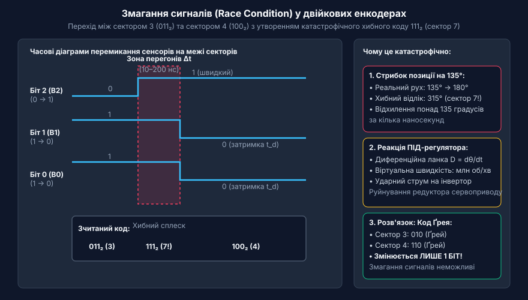
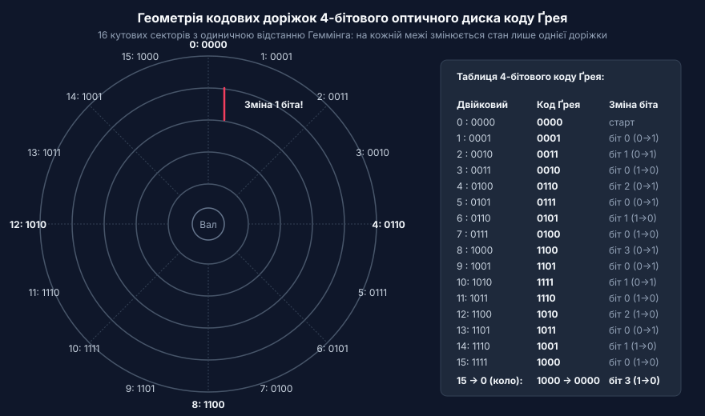
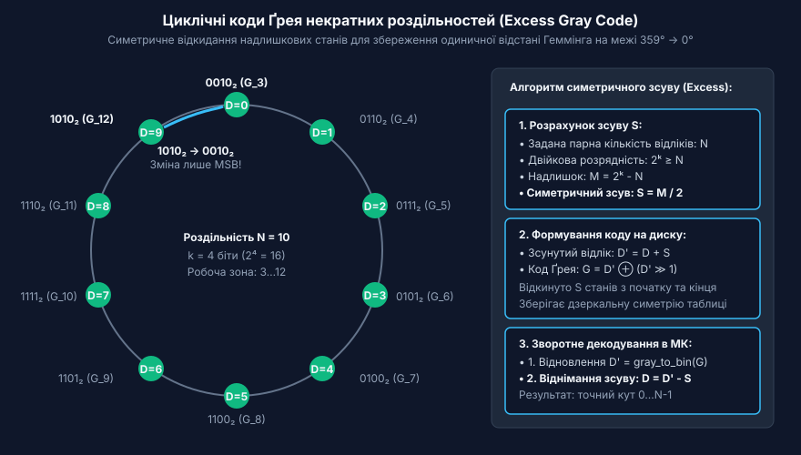
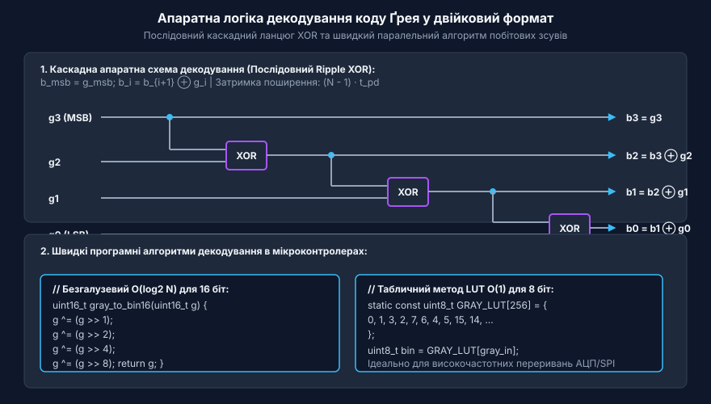
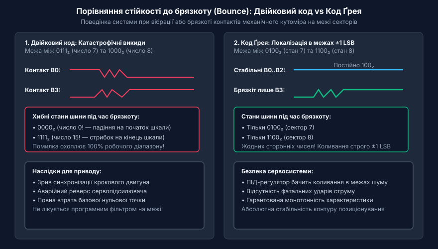

# Код Ґрея в енкодерах та цифрових кутомірах

<preknowlist>
- [Енкодери кутового та лінійного переміщення](root:cat-hw-sensors/optical-and-magnetic-encoders) — Принципи побудови кодових доріжок абсолютних енкодерів та різницю між інкрементальними й абсолютними вимірюваннями.
- [Цифрові послідовні інтерфейси енкодерів SSI та BiSS-C](root:cat-hw-sensors/ssi-bissc-digital-interfaces) — Способи передачі багаторозрядних цифрових даних від абсолютного кутоміра через послідовні синхронні канали.
</preknowlist>

## Змагання сигналів у двійкових енкодерах

У системі цифрового вимірювання кутового положення вала найпростішим і найочевиднішим рішенням здається пряме двійкове кодування кодового диска (@@en|direct binary code@@). Фізична будова такого пристрою, як абсолютний кутовий датчик у роді [оптичних та магнітних енкодерів](root:cat-hw-sensors/optical-and-magnetic-encoders), базується на скляному або пластиковому диску, закріпленому на обертовому валу. Поверхня диска розбита на концентричні колові доріжки (@@en|concentric tracks@@), кількість яких дорівнює розрядності вимірювача. Упродовж кожної доріжки чергуються прозорі ділянки, що пропускають світло від інфрачервоного випромінювача, та непрозорі сектори, які його перекривають. На протилежному боці диска навпроти кожної доріжки встановлено матрицю фотоприймачів (@@en|photodiode array@@) — фотодіодів або фототранзисторів. Зчитувальна електроніка формує логічну одиницю `1` при освітленні сенсора та логічний нуль `0` при його затіненні. Найменша внутрішня доріжка відповідає старшому розряду (@@en|most significant bit@@, MSB) двійкового числа, а найзовнішня — молодшому розряду (@@en|least significant bit@@, LSB).

У разі використання прямого двійкового коду кожна кодова комбінація сектора відповідає звичайному двійковому числу. Для 3-розрядного диска із вісьмома кутовими секторами сектор 0 описується як `000₂`, сектор 1 як `001₂`, сектор 2 як `010₂`, сектор 3 як `011₂`, сектор 4 як `100₂`, і так далі до сектора 7 (`111₂`). На папері або в математичній моделі перехід вала з сектора 3 у сектор 4 виглядає як миттєва та синхронна зміна станів трьох розрядів: біт 0 змінюється з `1` на `0`, біт 1 змінюється з `1` на `0`, а біт 2 змінюється з `0` на `1`. Proteus чи ідеальний симулятор мікроконтролера виконує такий стрибок абсолютно безпомилково. Однак у реальному фізичному пристрої ця ідеальна синхронність розпадається через неусувні апаратні допуски та фізичні обмеження матеріального світу.

Фізична реальність механічного виготовлення та оптоелектроніки унеможливлює одночасне перемикання кількох дискретних каналів з точністю до пікосекунд. Перехід кількох розрядів поспіль завжди розтягнутий у часі через сукупність чотирьох критичних факторів:
1. Механічні допуски виготовлення диска (@@en|mechanical tolerance@@): радіальні межі секторів на різних доріжках ніколи не збігаються з субмікронною точністю через розкид фотолітографічного травлення та еліптичність посадку диска на вал. 2. Апертура світлового променя та дифракція (@@en|beam aperture width@@): промінь світла має скінченну ширину плями, тому перехід від прозорої ділянки до непрозорої відбувається не миттєво, а через проміжну зону напівтіні. 3. Розкид порогів спрацьовування компараторів (@@en|switching threshold jitter@@): індивідуальні фотодіоди мають різну чутливість, а логічні елементи — різний рівень порогової напруги спрацьовування та температурний дрейф. 4. Асинхронність затримок поширення сигналу в електроніці (@@en|propagation delay skew@@): підсилювачі, тригери та шинні формувачі мають нес однакові затримки включення та виключення в різних паралельних каналах.

У результаті на межі кутових секторів виникає часовий зсув (@@en|skew delay@@) тривалістю від десятків наносекунд до кількох мікросекунд, під час якого вихідні сигнали сенсорів входять у режим асинхронних перегонів (@@en|race condition@@, з англ. *race condition* — стан змагання сигналів, коли підсумковий результат залежить від того, який із сигналів змінить стан першим). Оскільки фотоприймачі перемикаються не одночасно, паралельна цифрова шина на коротку мить відображає хаотичні проміжні комбінації, які взагалі не відповідають жодному з двох сусідніх секторів.

Розглянемо докладніше перехід між сектором 3 (`011₂`) та сектором 4 (`100₂`). Якщо сенсор старшого біта 2 спрацює трохи швидше та відкриється (змінить стан з `0` на `1`) до того, як сенсори бітів 0 та 1 встигнуть закритися (змінити стан з `1` на `0`), на шині виникне хибний проміжний код (@@en|spurious intermediate code@@) `111₂`. Значення `111₂` відповідає сектору 7, який розташований у зовсім іншій чверті кодового диска та відповідає куту близько 315° замість дійсного кута 180°. Якщо мікроконтролер виконає зчитування портів саме в цей мікросекундний інтервал перегонів сигналів, вимірювальна система зафіксує катастрофічний сплеск позиціонування (@@en|catastrophic angle spike@@) понад 135°.


*Часові діаграми асинхронного перемикання бітів оптичного диска при переході 011 -> 100, що викликають появу хибного проміжного коду 111.*

Залежно від того, який саме із трьох фотоприймачів виявиться найшвидшим чи найповільнішим, комбінація на виході може набувати будь-яких проміжних значень:
- Якщо першим вимкнеться біт 0, код стане `010₂` (сектор 2). - Якщо першим вимкнеться біт 1, код стане `001₂` (сектор 1). - Якщо біт 2 увімкнеться, а біт 1 вимкнеться раніше за біт 0, виникне послідовність `011₂ → 001₂ → 101₂ → 100₂` (політна зміна через сектор 5).

У високоточних енкодерах розрядністю 12 або 16 бітів масштаби цієї проблеми стають критичними. Наприклад, при переході 12-бітового двійкового диска зі стану 2047 (`011111111111₂`) у стан 2048 (`100000000000₂`) відбуваються одночасна інверсія всіх 12 бітів! Будь-яка асинхронність фронтів спричиняє появу довільних проміжних кодових слів у діапазоні від `000000000000₂` (0°) до `111111111111₂` (359.9°).

У замкнених системах автоматичного керування та [датчиках кутового положення сервоприводів](root:cat-hw-sensors/servo-feedback-potentiometers-and-magnetic-encoders) такі цифрові сплески спричиняють катастрофічні наслідки. Диференціювальна ланка ПІД-регулятора сприймає мгновене зміщення кута на 180° за мікросекунду як гігантську віртуальну швидкість обертання вала (мільйони обертів на хвилину). Своєю чергою регулятор видає максимально можливий ударний імпульс струму на силовий інвертор двигуна, викликаючи механічний удар, руйнування редуктора або вихід силових транзисторів у режим захисту від перевантаження.

Проблема змагання сигналів не вирішується ані програмним затримуванням (дибаунсом), ані простими RC-фільтрами нижніх частот. Якщо вал приводу зупиниться або повільно дрейфуватиме безпосередньо на фізичній межі між сектором 3 та сектором 4, оптоелектронні сенсори безперервно перебуватимуть у проміжному стані. Шум та вібрація механіки спричинятимуть безперервний джиттер (@@en|vibration jitter@@), і шина постійно видаватиме випадкові хибні коди.

Отже, виникає фундаментальна математична та конструктивна вимога до кодування абсолютної позиції: кодові слова будь-якої пари сусідніх кутових секторів повинні відрізнятися між собою станом РОЗРЯДУ ЛИШЕ ОДНОГО БІТА (@@en|single-bit transition@@). Якщо під час переходу через межу секторів змінюється тільки один біт, то незалежно від затримок, ширини апертури чи джитреру сенсорів, змагання сигналів принципово стає неможливим. Навіть під час невизначеності на межі вихідний код може набувати лише одного з двох дійсних сусідніх значень — попереднього або наступного, повністю виключаючи появу аномальних проміжних викидів.

## Принцип однобітового переходу та код Ґрея

Щоб повністю ліквідувати проблему змагань сигналів на кодовому диску, необхідно перейти від прямого двійкового коду до системи числення, яка має властивість мінімальної кодової відстані між сусідніми елементами послідовності. Математичною мірою відмінності двох двійкових слів однакової довжини є відстань Геммінга (@@en|Hamming distance@@, з англ. *Hamming distance* — на честь американського математика та криптографа Річарда Геммінга). Відстань Геммінга `d_H(A, B)` визначається як кількість бітових позицій, у яких значення двох слів `A` та `B` відрізняються.

У звичайній двійковій системі числення відстань Геммінга між сусідніми числами коливається від 1 до розрядності коду `N`. Наприклад, для 3-бітових двійкових чисел `d_H(010₂, 011₂) = 1`, але `d_H(011₂, 100₂) = 3`. Код, у якому відстань Геммінга між будь-якими двома послідовними кодовими словами суворо дорівнює одиниці:

```
d_H(C_i, C_{i+1}) = 1
```

називається кодом з одиничною відстанню Геммінга (@@en|unit-distance code@@). Крім того, для циркулярних кутових вимірювачів код повинен бути замкненим або циклічним (@@en|cyclic code@@). Це означає, що відстань Геммінга між останнім сектором кодового диска (`2ⁿ - 1`) та найпершим сектором (`0`) також повинна дорівнювати одиниці:

```
d_H(C_{2ⁿ-1}, C₀) = 1
```

Найвідомішим та найпоширенішим представником класу циклічних кодів з одиничною відстанню Геммінга є рефлексивний (дзеркальний) двійковий код, відомий як код Ґрея (@@en|Gray code@@, з англ. *Gray code* — на честь дослідника лабораторій Bell Labs Френка Ґрея).

Історичні передумови винайдення коду Ґрея пов'язані з розвитком ранніх електромеханічних обчислювачів та імпульсно-кодової модуляції. У 1947 році Френк Ґрей подав патентну заявку на цифровий кодер для електронно-променевих трубок (PCM-кодерів), де аналоговий сигнал квантувався за рівнем і перетворювався на цифровий код. При випереженні електронного променя через межі квантування виникали важкі імпульсні завади через неодночасне перемикання кодових сіток. Ґрей запропонував рефлексивний метод побудови коду, детальніше про який можна прочитати в описі [винайдення коду Ґрея](root:cat-hw-sensors/gray-code/hist-gray-code-origins.md). Завдяки відсутності змагань сигналів код Ґрея миттєво став стандартом для механічних комутаторів, шафтових кутомірів та сучасних оптичних сенсорів.

Математичний алгоритм побудови рефлексивного коду Ґрея довільної розрядності заснований на рекурсивному дзеркальному відображенні (@@en|mirror construction algorithm@@). Будівництво розгортається крок за кроком:

1. Для 1-бітового коду послідовність складається з двох слів:
   - `0`
   - `1`

2. Для побудови (N+1)-бітового коду беруть послідовність для N бітів, записують її у прямому порядку, а нижче під нею — у зворотному (дзеркальному) порядку:
   - `0`
   - `1`
   --- (лінія рефлексії)
   - `1`
   - `0`

3. До першої половини слів зліва приписують префікс `0`, а до дзеркальної другої половини — префікс `1`. Отримуємо 2-бітовий код Ґрея:
   - `00`
   - `01`
   - `11`
   - `10`

4. Повторюємо дзеркальне відображення для 3-бітового коду:
   - Прямий блок (з префіксом `0`): `000`, `001`, `011`, `010`. - Дзеркальний блок (з префіксом `1`): `110`, `111`, `101`, `100`.

Зведемо отримані кодові слова 3-бітового коду Ґрея у таблицю відповідності кутовим секторам диска:

```
Сектор 0 : 000
Сектор 1 : 001
Сектор 2 : 011
Сектор 3 : 010
Сектор 4 : 110
Сектор 5 : 111
Сектор 6 : 101
Сектор 7 : 100
```

Проаналізуємо структуру отриманої послідовності. При переході від сектора 3 (`010`) до сектора 4 (`110`) змінюється СТРОГО ОДИН БІТ — біт 2 (з `0` на `1`), тоді як біт 1 залишається в стані `1`, а біт 0 — у стані `0`. При переході від останнього сектора 7 (`100`) до першого сектора 0 (`000`) також змінюється лише біт 2 (з `1` на `0`). Отже, умова одиничної відстані Геммінга та умова циклічності виконуються на всьому кодовому колі.

Алгебраїчний зв'язок між двійковим кодом та кодом Ґрея визначається порозрядними операціями побітового виключного АБО (@@en|bitwise XOR@@). Перетворення двійкового числа `B` у код Ґрея `G` у загальному вигляді описується формулою:

```
G = B XOR (B >> 1)
```

де `>> 1` означає логічний зсув двійкового числа праворуч на один розряд. На побітовому рівні кожен `i`-тий біт коду Ґрея обчислюється як виключне АБО між поточним та сусіднім старшим бітом двійкового числа:

```
g_i = b_i XOR b_{i+1}
```

Зворотне перетворення з коду Ґрея у двійковий формат здійснюється послідовним каскадним підсумовуванням за модулем 2, починаючи зі старшого розряду. Докладніше математичні доведення та алгоритмічні властивості наведено в матеріалі про [математичних властивостях рефлексивних кодів](root:cat-hw-sensors/gray-code/math-gray-code-math.md).

Геометрично на поверхні оптичного диска кодові доріжки 4-бітового коду Ґрея утворюють особливий дзеркальний малюнок. На відміну від двійкового диска, де радіальні лінії перетинів багатьох доріжок збігаються, у диску Ґрея на будь-якому радіальному промені, що ділить два сусідніх кутових сектори, границя між прозорим та непрозорим сектором проходить ЛИШЕ ПО ОДНІЙ ДОРІЖЦІ.


*Геометрія кодових доріжок оптичного диска 4-бітового коду Ґрея з однобітовими переходами між усіма 16 кутовими секторами.*

Завдяки такій геометричній та логічній організації код Ґрея демонструє виняткову відмовостійкість при роботі у реальних фізичних умовах:
- Якщо фотоприймач перехідного біта знаходиться рівно на оптичній межі між сектором 3 (`010`) та сектором 4 (`110`), його вихідний рівень через шум або вібрацію може довільно коливатися між `0` та `1`. - Якщо мікроконтролер зчитає `0`, підсумковий код буде `010` (сектор 3). - Якщо мікроконтролер зчитає `1`, підсумковий код буде `110` (сектор 4). - Будь-які проміжні коди на кшталт `000`, `111` або `100` є фізично неможливими, оскільки світлочутливі елементи бітів 0 та 1 знаходяться глибоко всередині своїх однорідних непрозорих і прозорих зон і випромінюють стабільні сигнали `0` та `1`.

Невизначеність зчитування на межі секторів суворо обмежена величиною ±1 молодшого розряду (@@en|LSB position uncertainty@@). Повністю усуваються аномальні викиди, стрибки кута та збої обчислення швидкості. Саме тому код Ґрея є невід'ємним стандартом побудови растра в [абсолютних кутових енкодерах](root:cat-hw-sensors/optical-and-magnetic-encoders), інтегрованих мікросхемах типу [магнітний енкодер AS5048](root:cat-hw-sensors/as5048-magnetic-encoder), а також передається через цифрові [інтерфейси SSI та BiSS-C](root:cat-hw-sensors/ssi-bissc-digital-interfaces).

## Циклічні коди Ґрея некратних роздільностей

У реальних вимірювальних системах кутове положення вала часто потрібно подавати не в абстрактних ступенях двійки (таких як 256, 512 або 1024 відліки), а в загальноприйнятих десяткових або геодезичних одиницях. Наприклад, абсолютний кутомір повинен мати роздільність 360 позицій для прямого відліку градусів, 1000 позицій для метричних контролерів позиціонування або 3600 імпульсів на оберт. При спробі застосувати класичний рефлексивний код Ґрея (від англ. @@en|reflected Gray code@@) для таких некратних роздільностей виникає математична перешкода.

Класичний код Ґрея будується для повного двійкового циклу з 2ⁿ станів, де перехід від останнього числа 2ⁿ - 1 назад до 0 гарантовано має відстань Геммінга (від англ. @@en|Hamming distance@@) рівну одиниці. Якщо ж узяти 9-розрядний диск (2⁹ = 512 станів) і просто відсікти його на 360-й комбінації (відкинувши стани від 360 до 511), то при переході від коду 359 до коду 0 одинична відстань Геммінга порушується. Останній код 359 і перший код 0 відрізняються одразу в кількох розрядах.

Під час переходу оптичного диска через межу 359° → 0° кілька фотодатчиків перемикаються одночасно. Через неминучий механічний і оптичний технологічний розкид датчики спрацьовують асинхронно, створюючи змагання сигналів (від англ. @@en|race conditions@@). У результаті на виході виникають хибні проміжні коди (від англ. @@en|spurious codes@@), і контролер на частки мікросекунди зчитує хаотичне кутове положення (наприклад, 311° або 128°). Це повністю знищує перевагу, яку дає @@en|Gray code@@ в [абсолютних оптичних енкодерах](root:cat-hw-sensors/optical-and-magnetic-encoders).

Щоб зберегти властивість циклічності (від англ. @@en|cyclic code@@), коли між будь-якими двома сусідніми секторами, включно з межею оберту, змінюється лише один біт, використовують метод симетричного урізання з надлишком. В основі цього методу лежить внутрішня дзеркальна симетрія (від англ. @@en|mirror symmetry@@) рефлексивного коду Ґрея відносно центральної осі кодової таблиці.

Якщо потрібна парна роздільність N (наприклад, N = 360 або N = 1000), ми обираємо найменшу двійкову розрядність k таку, що 2ᵏ ≥ N. Загальна кількість надлишкових, невикористовуваних комбінацій становить M = 2ᵏ - N. Оскільки N і 2ᵏ парні, число M завжди є парним. Замість відсікання всіх M станів з одного кінця таблиці, ми ділимо їх навпіл і симетрично відкидаємо S = M / 2 станів з початку та S станів із кінця стандартної таблиці коду Ґрея.

Отриманий кодовий набір називається кодом Ґрея з надлишком (від англ. @@en|excess Gray code@@ або @@en|Gray-excess@@, від лат. *excedere* — виходити за межі).

Математичний розрахунок зсуву та формування кодових комбінацій виконується за такими кроками.

Нехай:
`N` — задана парна роздільність енкодера (кількість секторів на оберт);
`k` — розрядність кодового диска (найменше ціле, для якого 2ᵏ ≥ N);
`S` — симетричний зсув (кількість відкинутих станів з кожного краю);
`D` — натуральний кутовий відлік від 0 до N - 1;
`D'` — зсунутий відлік у базовій 2ᵏ-матриці;
`G` — рефлексивний код Ґрея для зсунутого відліку.

Обчислення зсуву та підготовка коду Ґрея:

S = (2ᵏ - N) ÷ 2          [обчислення симетричного зсуву відкиданих станів]
D' = D + S                 [зсув натурального кутового відліку в центральну зону]
G = D' ⊕ (D' ≫ 1)          [обчислення рефлексивного коду Ґрея для зсунутого значення]

Завдяки цьому зсуву перший кутовий сектор D = 0 відповідає комбінації коду Ґрея з індексом S, а останній сектор D = N - 1 відповідає індексу 2ᵏ - S - 1. Через дзеркальну симетрію коду Ґрея відносно центральної позначки 2ᵏ⁻¹, кодові слова в точках S та 2ᵏ - S - 1 відрізняються лише в одному старшому розряді. Таким чином, перехід від N - 1 назад до 0 зберігає відстань Геммінга рівною одиниці.

Розглянемо числовий приклад для кругового кутоміра на N = 10 секторів. Розрядність диска становить k = 4 біти (оскільки 2⁴ = 16 ≥ 10). Кількість відкиданих станів становить M = 16 - 10 = 6. Симетричний зсув дорівнює S = 6 / 2 = 3.

Відповідно, з повної 16-позиційної таблиці відкидаються перші 3 стани (індекси 0, 1, 2) та останні 3 стани (індекси 13, 14, 15). Робочий діапазон охоплює індекси від 3 до 12:

* Для D = 0: D' = 3, код Ґрея `0010₂`. * Для D = 1: D' = 4, код Ґрея `0110₂`. * Для D = 8: D' = 11, код Ґрея `1110₂`. * Для D = 9: D' = 12, код Ґрея `1010₂`.

Перевіримо замикання кола при переході від D = 9 до D = 0: код змінюється з `1010₂` на `0010₂`. Ці дві комбінації відрізняються лише в одному старшому розряді (найстарший біт змінюється з 1 на 0). Одиничний перехід повністю збережено, а небезпеку хибних проміжних станів усунено.


*Симетричний зсув кодових комбінацій зберігає одиничну відстань Геммінга при переході через нульову позначку для роздільності в 10 секторів.*

Історичні передумови виникнення коду пов'язані з тим, що [винайдення коду Ґрея](root:cat-hw-sensors/gray-code/hist-gray-code-origins.md) Френком Ґреєм у лабораторіях Bell Labs мало на меті усунення помилок декодування при імпульсно-кодовій модуляції у вакуумних та електронно-променевих трубках. Згодом ця ж математична ідея виявилася вирішальною для електромеханічних та оптичних датчиків кута. Для глибокого розуміння алгебраїчних теорем рекомендуємо також переглянути [алгебраїчні властивості рефлексивних кодів](root:cat-hw-sensors/gray-code/math-gray-code-math.md).

При опитуванні таких енкодерів через [цифровими послідовними інтерфейсами](root:cat-hw-sensors/ssi-bissc-digital-interfaces) мікроконтролер спочатку відновлює з коду Ґрея зсунуте двійкове число D', а потім віднімає з нього константу зсуву S, отримуючи точний кутовий відлік D.

## Апаратне та програмне декодування коду

Після того як оптичні фотосенсори або магнітні чутливі елементи зчитали стан кодових доріжок диска, мікроконтролер отримує цифрове значення у форматі @@en|Gray code@@. Проте для математичних обчислень у контурах керування — розрахунку кутової швидкості, координатного зсуву або регулювання сервоприводу — потрібні звичайні позиційні двійкові числа (від англ. @@en|binary code@@). Перетворення має здійснюватися з мінімальною затримкою поширення (від англ. @@en|propagation delay@@), щоб не створювати фазового запізнення в системі автоматичного керування.

Математично перетворення двійкового числа в код Ґрея та зворотне декодування базуються на операції виключного «АБО» (від англ. @@en|exclusive OR@@, @@en|XOR@@, від лат. *excludere* — виключати).

Для перетворення n-розрядного двійкового числа B = bₙ₋₁...b₀ у код Ґрея G = gₙ₋₁...g₀ кожен біт gᵢ обчислюється як сума за модулем два двох сусідніх двійкових бітів:

gₙ₋₁ = bₙ₋₁                [старший розряд залишається незмінним]
gᵢ = bᵢ₊₁ ⊕ bᵢ            [додавання за модулем 2 для всіх i від 0 до n-2]

У програмному коді це відповідає одній побітовій операції зі зсувом:

G = B ⊕ (B ≫ 1)           [побітовий зсув двійкового числа вправо на 1 біт та XOR з вихідним числом]

Зворотне декодування коду Ґрея G у двійковий формат B вимагає послідовного накопичення XOR-суми, починаючи від старшого розряду (від англ. @@en|Most Significant Bit@@, @@en|MSB@@) до молодшого розряду (від англ. @@en|Least Significant Bit@@, @@en|LSB@@):

bₙ₋₁ = gₙ₋₁                [старший двійковий розряд дорівнює старшому розряду коду Ґрея]
bᵢ = bᵢ₊₁ ⊕ gᵢ            [рекурсивне обчислення кожного наступного молодшого розряду]

Альтернативно, кожен двійковий біт bᵢ можна виразити як кумулятивну суму за модулем два всіх розрядів коду Ґрея від поточного позиційного індексу i до найстаршого розряду n - 1:

bᵢ = gₙ₋₁ ⊕ gₙ₋₂ ⊕ ... ⊕ gᵢ [кумулятивна сума за модулем 2 від MSB до поточного біта]

В апаратній логіці (на ПЛІС або дискретних логічних вентилях) послідовне декодування реалізується каскадним ланцюжком елементів XOR. Головним обмеженням такої послідовної схеми є затримка розповсюдження: сигнал повинен пройти через n - 1 послідовних вентилів від MSB до LSB. Для прискорення обчислень використовують паралельні деревоподібні структури додавання, які зменшують кількість послідовних рівнів логіки з n - 1 до log₂ n.


*Каскадне послідовне додавання за модулем два обчислює двійкові розряди від старшого до молодшого, а паралельна логіка зменшує затримку розповсюдження сигналу.*

У мікроконтролерах (від англ. @@en|microcontroller@@) програмне декодування здійснюється одним із трьох основних методів залежно від вимог до швидкодії та обсягу пам'яті:

1. **Послідовний цикл (ітеративний метод)** — обчислює біти по черзі у циклі `while` або `for`. Метод універсальний для довільної розрядності, але вимагає кількості ітерацій, пропорційної числу бітів. 2. **Паралельне логарифмічне декодування (безгалузевий алгоритм)** — використовує серію побітових зсувів на степені двійки (1, 2, 4, 8, 16) та операцій XOR. Для 32-розрядного числа декодування виконується всього за 5 фіксованих кроків без циклів і розгалужень, що забезпечує детермінований час виконання. 3. **Табличне декодування (LUT)** — зберігає попередньо обчислені двійкові значення в масиві констант (від англ. @@en|lookup table@@, @@en|LUT@@). Забезпечує миттєвий відгук O(1), що є ідеальним для 8-бітових або 10-бітових енкодерів у високочастотних перериваннях.

Нижче наведено практичну реалізацію алгоритмів декодування для мікроконтролерів.

:::tabs
@tab C / ESP-IDF
:::code gray-code-d/c/esp-idf/binary-to-gray.c
@tab C++ / Arduino
:::code gray-code-d/cpp/arduino/graycodeconverter.cpp
:::

Докладніші алгоритмічні варіанти та оптимізації під 8-бітові й 32-бітові архітектури мікроконтролерів представлено в [програмному API декодування](root:cat-hw-sensors/gray-code/api-gray-code-software.md).

Схематехнічні особливості підключення дискретних ліній енкодера до входів мікроконтролера, використання тригерів Шмітта та підтягуючих резисторів висвітлені в [залізним інтерфейсом енкодера](root:cat-hw-sensors/gray-code/api-absolute-encoder-hardware.md).

Практичний приклад створення прошивки для опитування паралельного та послідовного кутоміра наведений у [проєкті зчитування кутоміра](root:cat-hw-sensors/gray-code/proj-gray-encoder-reader.md).

Для порівняння з інтегральними напівпровідниковими рішеннями, де декодування та обробка сигналів виконуються на одному кристалі, зверніться до статті про [магнітному енкодері AS5048](root:cat-hw-sensors/as5048-magnetic-encoder).

Фізичні альтернативи цифровим кодовим дискам, які використовують не дискретне оптичне кодування, а безнеперервну зміну електромагнітного поля, детально описані в [обертових трансформаторних кутомірах](root:cat-hw-sensors/synchro-and-resolver-transducers).

## Надійність зчитування в реальних системах

У математичній теорії @@en|Gray code@@ гарантує ідеальну впорядкованість: при переході між сусідніми кутовими секторами змінюється лише один розряд, що зводить відстань Геммінга (@@en|Hamming distance@@) до одиниці. Проте реальний промисловий кутомір існує не в абстрактному просторі чисел, а працює в жорстких фізичних умовах з механічними вібраціями, температурними розширеннями матеріалів, технологічними похибками виготовлення оптичних доріжок та сильними електромагнітними завадами від працюючих електродвигунів. Коли фізичні сигнали зчитування потрапляють у реальні електричні кола, фундаментальна властивість одиничного переходу стикається з апаратною неідеальністю датчиків та ліній зв'язку.

У механічних контактних енкодерах найпершою фізичною перешкодою стає деренчання контактів (від англ. @@en|contact bounce@@). Під час обертання вала пружна металева щітка рухається по струмопровідних ламелях кодового диска. На межі розмикання чи замикання секторів мікроскопічна шорсткість поверхні та вібрація спричиняють багаторазове швидке розмикання й замикання кола протягом кількох мілісекунд. Замість одного чистого перепаду напруги електронна схема бачить серію високочастотних імпульсів. Якщо б кодовий диск використовував звичайний двійковий код, дребезг на межі секторів 0111 (число 7) та 1000 (число 8) призвів би до появу хибних проміжних станів на кшталт 0000 або 1111, що означало б помилкові стрибки показань на інший край вимірювального діапазону. Застосування @@en|Gray code@@ повністю змінює поведінку системи при дребеззі: оскільки на межі змінюється стан лише одного розряду, дребезг контактної щітки створює високочастотне перемикання тільки цього єдиного біта. Мікроконтролер бачить швидку зміну значень виключно між двома сусідніми секторами (наприклад, між 0100 та 0101). Позиціонування не втрачає катастрофічної точності й не робить хибних викликів у віддалені зони.


*При дребеззі контакту звичайний двійковий код викликає помилкові проміжні стани, тоді як код Ґрея обмежує коливання двома сусідніми секторами.*

В [оптичних і магнітних енкодерах](root:cat-hw-sensors/optical-and-magnetic-encoders) механічний контакт відсутній, але виникають оптичні та просторові неідеальності. Узори фотомасок оптичного диска виготовляються з прецизійною точністю, проте фотоприймачі різних доріжок мають власні технологічні допуски позиціонування, варіації порогів спрацьовування та нерівномірну швидкість наростання фотоструму. Через це момент оптичного перемикання молодшого розряду може кутово випереджати або запізнюватися відносно старшого розряду. Завдяки властивості одиничної відстані Геммінга в @@en|Gray code@@ оптична розкалібровка не здатна згенерувати аномальний код: вона лише незначно зміщує реальну геометричну межу між кутовими секторами на величину кутового зсуву фотоприймача. Кутомір зберігає монотонність відліків, не утворюючи хаотичних сплесків.

Наступним бар'єром надійності є передача багаторозрядного коду від енкодера до приймача. У разі паралельного підключення, де кожен розряд коду передається окремим дротом, виникає різниця часових затримок поширення сигналу (від англ. @@en|propagation delay@@) в окремих жилах кабелю через розрізнену паразитичну ємність та індуктивність проводів. Якщо обчислювальний модуль зчитує стан паралельного порту безпосередньо в момент перехідного процесу, різниця у швидкості фронтів може призвести до тимчасового зчитування старого стану одного біта й нового стану іншого. Щоб усунути цей ефект, застосовують апаратне фільтрування сигналів та стробування (від англ. @@en|strobe signal@@ — імпульс дозволу зчитування). Приймальний модуль фіксує стан кодових ліній лише в момент надходження імпульсу стробування, коли всі перехідні електричні процеси в кабелі вже завершилися. Докладні рекомендації щодо схемотехнічного підключення дискретних ліній, використання підтягуючих резисторів, тригерів Шмітта та комутації містить довідник [апаратне фільтрування дискретних ліній](root:cat-hw-sensors/gray-code/api-absolute-encoder-hardware.md).

У промисловості для передачі даних від кутомірів високої роздільності відмовляються від паралельних джгутів на користь послідовних ліній. Передача @@en|Gray code@@ здійснюється через [цифрові послідовні інтерфейси](root:cat-hw-sensors/ssi-bissc-digital-interfaces), такі як протоколи @@en|SSI@@ (від англ. @@en|Synchronous Serial Interface@@) або @@en|BiSS-C@@. У цих інтерфейсах енкодер оцифровує положення диска, перетворює його в послідовний потік бітів і передає за допомогою диференціальних ліній стандарту @@en|RS-422@@ синхронно з тактовим сигналом, який ґенерує мікроконтролер.

Незважаючи на високу захищеність диференціальних ліній, у жорстких промислових умовах потужні електромагнітні завади від частотних перетворювачів можуть спотворити окремий біт у послідовній пачці даних. Тут важливо чітко розуміти межу математичних можливостей @@en|Gray code@@. Код Ґрея розроблений виключно для усунення змагань сигналів (від англ. @@en|race condition@@) під час природної зміни кодових комбінацій на межах секторів. Він є вимірювальним кодом із мінімальною відстажністю, але НЕ МІСТИТЬ надлишкових контрольних розрядів для виявлення або виправлення спотворень у каналі зв'язку. Якщо імпульсна завада інвертує один біт у переданому кодовому слові Ґрея, отримане кодове слово залишається коректним значенням коду Ґрея, але відповідає абсолютно іншому кутовому сектору диска.

Для захисту від подібних збоїв у реальних системах застосовують комбінацію програмних та протокольних методів:

1. **Програмна перевірка на допустимий кутовий крок:** Оскільки механічний вал володіє інерцією і не може миттєво здійснити нескінченно прискорений поворот, за один період опитування (наприклад, 100 мікросекунд) кут не повинен змінюватися більше ніж на максимально можливе значення N. Якщо зчитаний @@en|Gray code@@ після декодування показує стрибок позиції, що перевищує фізичну динаміку механізму, алгоритм маркує таке значення як недопустиме та ігнорує його, зберігаючи попередній валідний стан. 2. **Аналіз недопустимих комбінацій для урізаних кодів:** У кутомірах із некратними роздільностями, де застосовується код Ґрея з надлишком, існує зарезервований діапазон кодових слів, які ніколи не повинні виникати на робочій частині диска. Поява такого коду в реєстрі мікроконтролера однозначно сигналізує про апаратну несправність або збій зчитування. 3. **Використання протокольних бітів перевірки парності та CRC:** Сучасні вимірювальні системи, такі як [магнітний енкодер кута](root:cat-hw-sensors/as5048-magnetic-encoder), пакують послідовне кодове слово Ґрея разом із додатковим бітом контролю парності (від англ. @@en|parity check@@) або вичерпною циклічною контрольною сумою (від англ. @@en|CRC@@, @@en|Cyclic Redundancy Check@@).

Детальний опис алгоритмів перевірки цілісності та програмні функції перетворення містить [програмний API декодування](root:cat-hw-sensors/gray-code/api-gray-code-software.md), а повний практичний приклад побудови прошивки мікроконтролера для роботи з реальними енкодерами наведено у матеріалі [проєкт зчитування енкодера](root:cat-hw-sensors/gray-code/proj-gray-encoder-reader.md).

Завдяки поєднанню фізичних властивостей коду Ґрея на сенсорному диску з апаратним стробуванням та протокольним контролем помилок досягається абсолютна надійність визначення кутового положення навіть у найнесприятливіших промислових умовах.