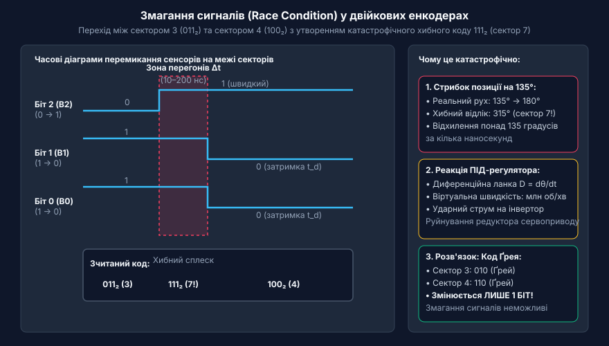
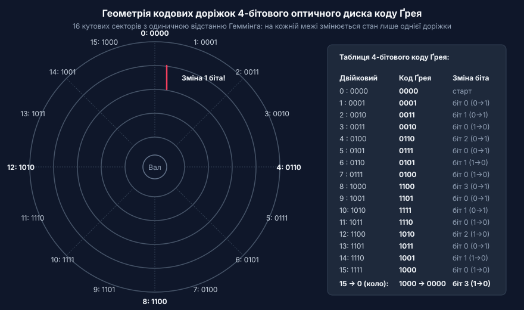
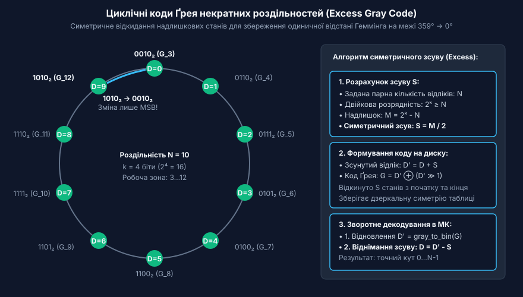
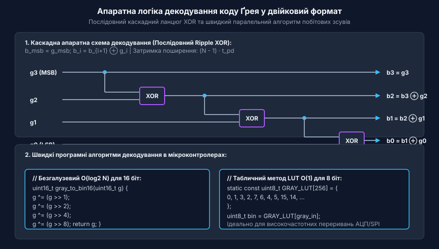
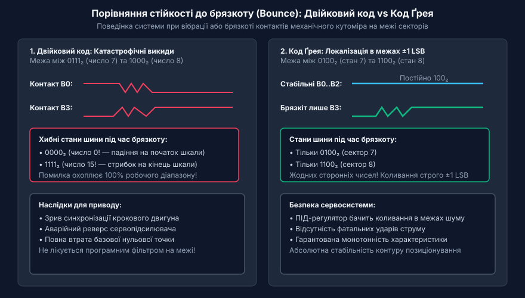

# Код Ґрея в енкодерах та цифрових кутомірах

<preknowlist>
- [Енкодери кутового та лінійного переміщення](root:cat-hw-sensors/optical-and-magnetic-encoders) — Принципи побудови кодових доріжок абсолютних енкодерів та різницю між інкрементальними й абсолютними вимірюваннями.
- [Цифрові послідовні інтерфейси енкодерів SSI та BiSS-C](root:cat-hw-sensors/ssi-bissc-digital-interfaces) — Способи передачі багаторозрядних цифрових даних від абсолютного кутоміра через послідовні синхронні канали.
</preknowlist>

## Проблема змагання сигналів у двійкових кутомірах

В абсолютних оптичних та магнітних [енкодерах кутового положення](root:cat-hw-sensors/optical-and-magnetic-encoders) положення вала кодується у вигляді концентричних кодових доріжок на диску. У разі використання прямого позиційного двійкового коду кожній кутовій позиції відповідає двійкове число `000₂`, `001₂`, `010₂` тощо. Проте застосування звичайного двійкового коду в реальних механічних системах призводить до катастрофічних метрологічних збоїв через ефект змагання сигналів (@@en|race conditions@@).

У реальному енкодері перемикання кількох сенсорів ніколи не відбувається строго одночасно через:
- Механічні допуски травлення фотомаски та радіальне биття вала;
- Скінченну ширину оптичного світлового променя;
- Розкид порогів спрацьовування компараторів та фотодіодів;
- Різницю затримок поширення сигналу в кабельних лініях.


*Формування катастрофічного хибного коду 111₂ (сектор 7) при переході між сектором 3 (011₂) та сектором 4 (100₂) через асинхронні перегони сигналів.*

Якщо, наприклад, при переході з сектора 3 (`011₂`) у сектор 4 (`100₂`) старший біт `B2` увімкнеться на кілька десятків наносекунд раніше, ніж вимкнуться біти `B1` та `B0`, на цифровій шині енкодера виникне короткочасний хибний код `111₂` (сектор 7). Система керування зафіксує стрибок кута на 135° у протилежний бік!

Диференційна ланка ПІД-регулятора сервоприводу сприймає такий наносекундний стрибок як гігантську швидкість обертання вала, формуючи максимальний ударний імпульс струму на силовий інвертор. Це призводить до механічних ударів, зрізання зубів редуктора та аварійного відключення приводу.

## Принцип однобітового переходу та рефлексивний код Ґрея

Для повного усунення змагань сигналів застосовують коди з одиничною відстанню Геммінга (@@en|unit-distance code@@), в яких будь-які два сусідні кодові слова відрізняються станом ЛИШЕ ОДНОГО БІТА:

```
d_H(C_i, C_{i+1}) = 1
```

Найвідомішим представником цього класу є рефлексивний код Ґрея (@@en|reflected Gray code@@), розроблений інженером Френком Ґреєм. Він будується за алгоритмом дзеркального відображення: на кожному кроці попередня таблиця копіюється дзеркально вниз, після чого до верхньої половини дописується префікс `0`, а до нижньої — `1`.


*Геометрія кодового диска 4-бітового коду Ґрея: на кожній кутовій межі між 16 секторами змінюється стан лише однієї доріжки.*

Властивості коду Ґрея забезпечують абсолютну надійність зчитування:
- На будь-якому радіальному стику двох секторів межа розділу проходить лише по одній-єдиній доріжці;
- При переході між секторами 3 (`010`) та 4 (`110`) змінюється лише біт 2;
- Якщо сенсор зависне рівно на фізичній межі через вібрацію чи шум, вихідний код коливатиметься строго між двома дійсними суміжними значеннями (`010` або `110`). Невизначеність обмежена похибкою `±1 LSB`, а поява сторонніх хибних кодів фізично виключена.

## Циклічні коди Ґрея некратних роздільностей (Excess Gray Code)

Класичний код Ґрея є замкненим (циклічним) лише для степенів двійки (2ⁿ = 16, 256, 1024, 4096 відліків), де перехід від `2ⁿ - 1` назад до `0` також змінює лише один біт.

Проте на практиці часто потрібні кутоміри з десятковою або градусною шкалою: наприклад, `N = 360` відліків (1 відлік = 1°) або `N = 1000` відліків. Якщо взяти 9-розрядний диск (512 станів) і просто відкинути коди після 360, то при переході з 359° на 0° одинична відстань Геммінга порушиться: код 359 і код 0 відрізнятимуться одразу в кількох розрядах, повертаючи проблему змагання сигналів.


*Симетричне вилучення надлишкових станів (Excess Gray) забезпечує збереження одиничної відстані Геммінга при замиканні кола 359° → 0°.*

Для розв'язання цієї проблеми застосовують симетричне урізання з надлишком (Excess Gray Code):
1. Обирають розрядність `k` так, щоб `2ᵏ ≥ N` (для N = 360 обирають k = 9, 2⁹ = 512).
2. Обчислюють надлишок неробочих станів `M = 2ᵏ - N` (512 - 360 = 152).
3. Відкидають неробочі стани симетрично: порівну з початку та з кінця базової таблиці Ґрея на величину зсуву:
   ```
   S = (2ᵏ - N) / 2
   ```
4. На диск наносять коди для зсунутих значень `D' = D + S`.

Завдяки дзеркальній симетрії коду Ґрея відносно середини таблиці, коди в точках `S` та `2ᵏ - S - 1` відрізняються лише в одному старшому розряді. Це повністю зберігає одиничний перехід через нуль.

## Апаратне та програмне перетворення коду Ґрея

Для виконання розрахунків положення та швидкості у мікроконтролері зчитаний код Ґрея необхідно перетворити назад у звичайний двійковий формат.

Пряме перетворення двійкового числа `B` у код Ґрея `G`:
```
G = B ⊕ (B ≫ 1)
```

Зворотне перетворення коду Ґрея `G` у двійкове число `B` вимагає послідовного додавання за модулем 2, починаючи від старшого розряду:
```
b_msb = g_msb
b_i = b_{i+1} ⊕ g_i
```


*Каскадний послідовний ланцюг елементів XOR та швидкі програмні методи декодування в мікроконтролерах.*

У мікроконтролерах програмне декодування здійснюється двома основними способами:
1. **Безгалузевий логарифмічний алгоритм O(log₂ N)**: використовує паралельні зсуви на степені двійки (1, 2, 4, 8) та операції XOR. Для 16-бітного енкодера перетворення виконується всього за 4 такти процесора без циклів і затримок.
2. **Табличний метод (LUT) O(1)**: використовує таблицю констант у пам'яті програм, забезпечуючи миттєвий відгук у високочастотних перериваннях для 8–10-бітних датчиків.

## Завадостійкість та захист від брязкоту контактів

У механічних контактних енкодерах (наприклад, селекторах приладових панелей) виникає явище брязкоту контактів (contact bounce): пружна щітка на межі секторів багаторазово замикає й розмикає коло протягом 1–5 мс.


*Код Ґрея локалізує коливання брязкоту контактів у межах двох сусідніх секторів, повністю виключаючи стрибки на всю шкалу.*

- **У звичайному двійковому коді**: брязкіт на межі 7 (`0111₂`) та 8 (`1000₂`) генерує хибні коди `0000₂` (0) або `1111₂` (15), спричиняючи викиди на всю шкалу енкодера.
- **У коді Ґрея**: змінюється стан лише одного контакту. Брязкіт викликає перемикання тільки цього біта, і система бачить коливання виключно між сусідніми значеннями `0100₂` та `1100₂` (похибка строго `±1 LSB`).

У високошвидкісних цифрових системах передача коду Ґрея здійснюється через [диференційні послідовні інтерфейси SSI та BiSS-C](root:cat-hw-sensors/ssi-bissc-digital-interfaces) по лініях RS-422, що забезпечує імунітет до електромагнітних завад силових перетворювачів.

Нижче наведено практичну реалізацію C-функцій перетворення для вбудованих систем:

```c
#include <stdint.h>

// Швидке перетворення двійкового числа в код Ґрея
uint16_t binary_to_gray(uint16_t binary) {
    return binary ^ (binary >> 1);
}

// Швидке безгалузеве декодування 16-бітного коду Ґрея в двійковий формат O(log2 N)
uint16_t gray_to_binary16(uint16_t gray) {
    gray ^= (gray >> 1);
    gray ^= (gray >> 2);
    gray ^= (gray >> 4);
    gray ^= (gray >> 8);
    return gray;
}

// Декодування урізаного коду Ґрея з надлишком (Excess Gray Code)
// total_resolution: кількість відліків на оберт (наприклад, 360)
// bit_depth: кількість бітів матриці (наприклад, 9 для 512 станів)
uint16_t excess_gray_decode(uint16_t gray, uint16_t total_resolution, uint8_t bit_depth) {
    uint16_t full_span = (uint16_t)(1 << bit_depth);
    uint16_t offset_s = (full_span - total_resolution) / 2;

    // 1. Декодування базового коду Ґрея
    uint16_t shifted_binary = gray_to_binary16(gray);

    // 2. Віднімання симетричного зсуву S
    if (shifted_binary >= offset_s) {
        return shifted_binary - offset_s;
    }
    return 0; // Захист від некоректного коду
}
```

Використання коду Ґрея у поєднанні з алгоритмами надлишкового урізання та безгалузевим декодуванням гарантує відсутність хибних викидів положення та високу стійкість цифрових кутомірів.
