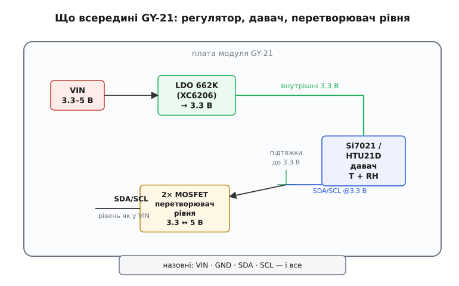
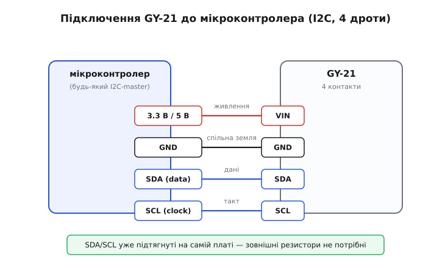

# GY-21 (Si7021 / HTU21D) — температура і вологість

<preknowlist>
- [Шина I2C](root:com-devices/i2c-bus) — принципи адресації, лінії SDA/SCL, синхронізація та формати пакетного обміну
- [GY-серія брейкаут-модулів](root:cat-hw-sensors/gy-series) — схемотехніка плат адаптації SMD-мікросхем під стандартний штирьовий крок 2.54 мм
- [Відносна вологість повітря](root:ph-thermodynamics/relative-humidity) — фізичне поняття відносної вологості RH та взаємозв'язок із температурою точки роси
- [Контроль цілісності даних CRC-8](root:com-modulation/crc) — алгоритм поліноміальної перевірки пакетів для захисту від шумів на шині I2C
</preknowlist>

Брейкаут-модуль **GY-21** є компактним цифровим сенсором температури та відносної вологості повітря. Завдяки заводському калібруванню, інтегрованій схемотехніці узгодження рівнів напруги та підтримці стандартної шини I2C цей модуль широко застосовується в метеостанціях, автоматиці клімат-контролю та інкубаторах.

## Призначення та фізичні принципи модуля GY-21

Модуль GY-21 призначений для високоточного моніторингу параметрів навколишнього середовища:
- **Відносна вологість:** вимірюється в діапазоні від 0 % до 100 % RH із типовою похибкою ±2 % RH у робочому вікні 5–95 %.
- **Температура:** діапазон вимірювання становить від -40 °C до +125 °C із точністю ±0.3…0.4 °C у зоні кімнатних температур.

Вимірювальне ядро чипа поєднує два спеціалізовані первинні перетворювачі: ємнісний сенсор на базі полімерної діелектричної плівки, яка змінює ємність при поглинанні молекул водяної пари, та інтегрований напівпровідниковий термометр band-gap. Внутрішній сигнальний контролер оцифровує обидва сигнали за допомогою сигма-дельта АЦП та автоматично компенсує температурну залежність вологості за табличними коефіцієнтами пам'яті ROM.

## Схемотехніка модуля, стабілізатор 662K та перетворювач рівнів I2C

Сам чутливий сенсор виготовлений у крихітному корпусі DFN і живиться від напруги не вище 3.6 В. Для забезпечення сумісності з популярними 5-вольтовими мікроконтролерами (Arduino Uno/Nano) на платі GY-21 реалізовано повний апаратний вузол узгодження:
1. **Лінійний стабілізатор 662K (XC6206):** перетворює вхідну напругу VIN (3.3–5.5 В) на стабільні 3.3 В для живлення сенсора.
2. **Двонапрямний перетворювач рівнів I2C:** виконаний на парі польових N-канальних MOSFET-транзисторів та підтягувальних резисторах для ліній SDA і SCL.


*Схема брейкаут-модуля GY-21: вхідна напруга VIN стабілізується до 3.3 В, а шина I2C узгоджується польовими транзисторами.*

Завдяки цьому модуль можна безпосередньо підключати як до 3.3 В плат (ESP32, STM32, RP2040), так і до класичних 5 В систем без використання зовнішніх резисторів чи плат перетворення логічних рівнів.

## Сумісність сенсорів Si7021 та HTU21D

На платах із маркуванням GY-21 виробники встановлюють один із двох взаємозамінних чипів:
- **Si7021** (Silicon Labs);
- **HTU21D** (Measurement Specialties / TE Connectivity).

Обидва сенсори спроєктовані за єдиним галузевим стандартом, успадкованим від Sensirion SHT21. Вони мають однаковий апаратний адрес на шині I2C (`0x40`), ідентичні коди команд керування та однакові розрахункові формули переведення сирих відліків у фізичні одиниці.

Головна практична відмінність полягає в динаміці відгуку на зміну вологості: HTU21D реагує на різкі перепади вологості за 3–5 секунд, тоді як Si7021 має вищу стабільність при тривалій роботі, але час його повної реакції може досягати 15–30 секунд.

## Протокол обміну I2C, команди та розрахунок величин

Для взаємодії з модулем використовують чотири стандартні контакти: VIN, GND, SDA та SCL.


*Підключення модуля GY-21 чотирма провідниками до шини I2C. Підтягувальні резистори вже встановлені на платі.*

Типовий цикл зчитування даних без утримання шини (No Hold Master) складається з наступних кроків:
1. Відправка одного байта команди: `0xF5` (вимірювання вологості) або `0xF3` (вимірювання температури).
2. Очікування завершення конверсії (до 12 мс для вологості 12 біт та до 11 мс для температури 14 біт).
3. Зчитування трьох послідовних байтів: старший байт даних (MSB), молодший байт (LSB) та контрольна сума (CRC-8).
4. Очищення двох службових молодших бітів значення маскою `raw &= 0xFFFC`.
5. Розрахунок фізичних параметрів за лінійними формулами:
```c
float temperature = (175.72f * raw_temp / 65536.0f) - 46.85f;
float humidity = (125.0f * raw_hum / 65536.0f) - 6.0f;
```

Якщо розрахункова контрольна сума за поліномом x^8 + x^5 + x^4 + 1 не збігається з третім байтом пакета, результат вимірювання відкидається як пошкоджений завадою.

## Практичне застосування, самонагрів та захист від конденсату

Під час монтажу та експлуатації GY-21 слід враховувати фізику напівпровідникових гігрометрів:
- **Запобігання самопрогріву:** надто часте опитування датчика (частіше 1 разу на секунду) викликає нагрівання кремнієвої підкладки струмом вимірювальних кіл, що призводить до завищення температури та заниження відносної вологості. Оптимальний інтервал між опитуваннями становить 2–5 секунд.
- **Вбудований нагрівач:** обидва чипи містять внутрішній нагрівальний елемент, який активується записом у бітовий регістр User Register. Нагрівач використовується для примусового випаровування конденсату після перебування датчика в умовах 100 % вологості.
- **Захист мембрани:** білу захисну тефлонову мембрану на корпусі датчика заборонено торкати пальцями, змивати розчинниками або заливати флюсом під час паяння, оскільки це призводить до необоротного забруднення чутливого шару.
