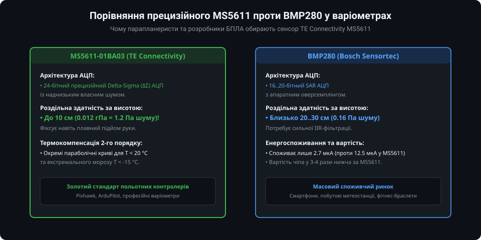
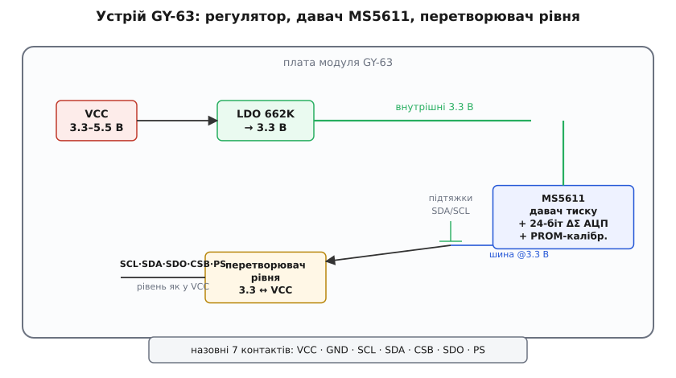
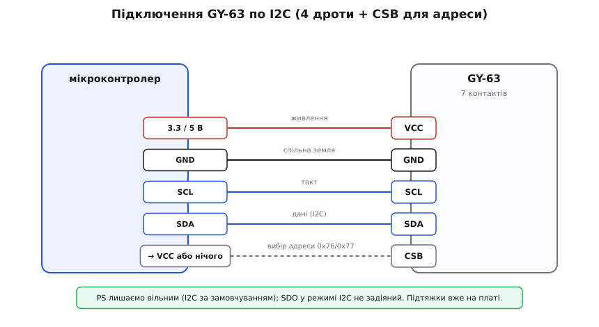
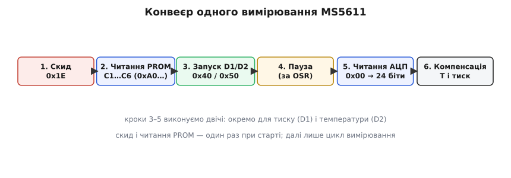
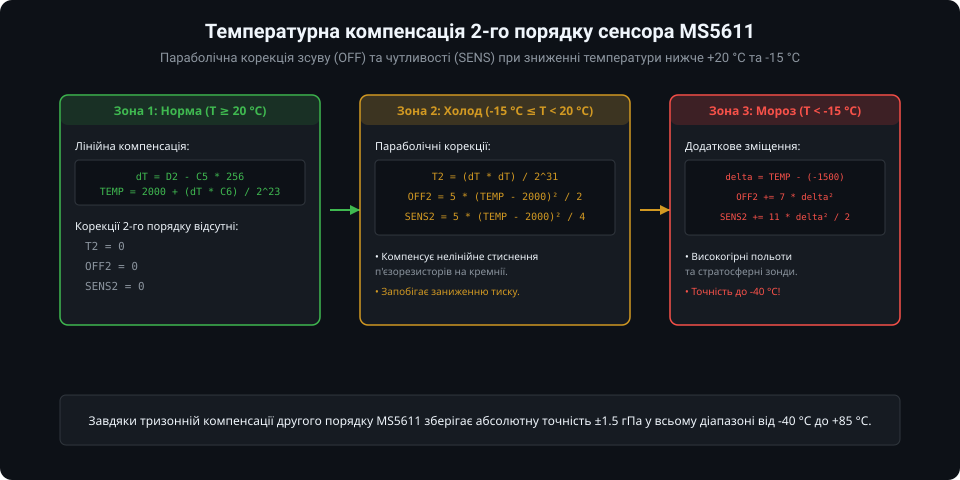

# GY-63 — прецизійний барометр MS5611

Модуль **GY-63** побудований на основі прецизійного цифрового барометричного датчика **MS5611-01BA03** від швейцарської компанії MEAS Switzerland (нині TE Connectivity). У світі спортивної авіації, парапланеризму та професійних польотних контролерів (Pixhawk, ArduPilot) MS5611 вважається еталонним висотоміром і варіометром завдяки рекордно низькому рівню шумів та надвисокій чутливості до вертикальної швидкості.

---

### 1. Особливості сенсора MS5611 та будова модуля GY-63

Головною відмінністю MS5611 від споживчих барометрів (таких як BMP180 або BMP280) є вимірювальна архітектура:



- **24-бітний прецизійний Delta-Sigma (ΔΣ) АЦП:** Сенсор містить внутрішній 24-розрядний аналого-цифровий перетворювач, що забезпечує рівень шуму тиску всього **0.012 гПа (1.2 Па)** у режимі максимальної передискретизації (OSR = 4096).
- **Субметрова роздільна здатність:** Сенсор надійно реєструє зміну тиску при вертикальному переміщенні всього на **10 сантиметрів**, що дозволяє будувати високочутливі звукові варіометри для парапланів (фіксація термічних висхідних потоків повітря).
- **Схемотехніка плати GY-63:** Модуль містить лінійний стабілізатор напруги 3.3 В та захисні компоненти, що дозволяє живити плату як від 3.3 В, так і від 5 В систем (Arduino, ESP32, STM32).



---

### 2. Схема підключення: I2C та SPI

Модуль GY-63 є універсальним і підтримує два фізичні інтерфейси:



- **Інтерфейс I2C (за замовчуванням):**
  - Вивід `PS` (Protocol Select) підтягнутий до VCC (3.3 В);
  - Лінія `SDA` — дані I2C, лінія `SCL` — тактовий сигнал;
  - Адресація за виводом `CSB`: якщо `CSB` з'єднаний із GND, адреса на шині становить **`0x77`**; якщо `CSB` підтягнутий до 3.3 В — адреса **`0x76`**.
- **Інтерфейс SPI:**
  - Вивід `PS` підключається до GND (0 В), переводячи сенсор у 4-провідний режим SPI (до 20 МГц);
  - Вивід `CSB` використовується як лінія вибору чіпа (Chip Select), `SDI` — MOSI, `SDO` — MISO, `SCL` — SCK.

---

### 3. Протокол роботи: PROM, команди конверсії та читання

Сенсор MS5611 не має звичної карти регістрів конфігурації. Управління здійснюється простими однобайтними командами:



1. **Команда скидання (Reset, 0x1E):** Обов'язково надсилається під час увімкнення живлення для перезавантаження внутрішніх регістрів.
2. **Зчитування калібрувальної пам'яті (PROM, 0xA0..0xAE):** Зчитуються 8 слів по 16 біт (коефіцієнти `C1..C6`, зарезервовані дані та 4-бітний код контрольної суми CRC-4).
3. **Запуск перетворення тиску D1 (0x40..0x48):** Команда обирає коефіцієнт передискретизації OSR від 256 (0.6 мс) до 4096 (9.04 мс).
4. **Запуск перетворення температури D2 (0x50..0x58):** Аналогічно запускає 24-бітне перетворення сигналу вбудованого термометра.
5. **Читання 24-бітного АЦП (0x00):** Зчитування 3 байтів результату (D1 або D2).

---

### 4. Термокомпенсація першого та другого порядку

Кремнієвий п'єзорезистивний міст сенсора зазнає нелінійних деформацій під впливом низьких температур. Для збереження точності виробник впровадив дворівневу математичну компенсацію:



1. **Перший порядок (T >= 20 °C):**
   - Розраховується різниця температури `dT = D2 - C5 * 2^8`;
   - Розраховується базова температура: `TEMP = 2000 + (dT * C6) / 2^23` (у сотих долях °C);
   - Обчислюються лінійний зсув нуля `OFF` та чутливість `SENS` за коефіцієнтами C1–C4.
2. **Другий порядок (T < 20 °C та T < -15 °C):**
   - Якщо температура опускається нижче кімнатної (+20 °C), вмикаються параболічні поправки `T2`, `OFF2` та `SENS2`, пропорційні квадрату відхилення `(TEMP - 2000)^2`;
   - При сильному морозі (`T < -15 °C`) додаються поправки третьої зони `(TEMP - (-1500))^2`.
Це гарантує, що висотомір на безпілотнику чи параплані не "впаде" на десятки метрів при вході в холодну хмару або під час зимового польоту.

---

### 5. Приклад роботи мовою C++ (Arduino)

Для роботи з GY-63 найзручніше використовувати оптимізовану бібліотеку `MS5611` від Rob Tillaart:

```cpp
#include <Wire.h>
#include <MS5611.h>

// Створення екземпляра сенсора з адресою 0x77 (CSB до GND)
MS5611 ms5611(0x77);

void setup() {
  Serial.begin(115200);
  Wire.begin();

  // Ініціалізація та перевірка зв'язку
  if (!ms5611.begin()) {
    Serial.println("Помилка: MS5611 не знайдено на шині I2C!");
    while (1) { delay(100); }
  }

  // Встановлення максимальної точності (OSR = 4096)
  ms5611.setOversampling(OSR_ULTRA_HIGH);
  Serial.println("MS5611 успішно ініціалізовано в режимі OSR_ULTRA_HIGH.");
}

void loop() {
  // Виконання повного циклу вимірювання (температура + тиск + компенсація)
  int result = ms5611.read();

  if (result == MS5611_READ_OK) {
    float temp_c = ms5611.getTemperature();
    float pressure_mbar = ms5611.getPressure(); // Тиск у мілібарах (гПа)

    // Розрахунок висоти за формулою ICAO при P0 = 1013.25 гПа
    float altitude_m = 44330.0f * (1.0f - pow(pressure_mbar / 1013.25f, 0.1902949f));

    Serial.print("T: ");
    Serial.print(temp_c, 2);
    Serial.print(" °C | Тиск: ");
    Serial.print(pressure_mbar, 2);
    Serial.print(" гПа | Висота: ");
    Serial.print(altitude_m, 2);
    Serial.println(" м");
  } else {
    Serial.println("Помилка читання з датчика MS5611!");
  }

  delay(200);
}
```

---

### Підсумки та висновки

1. Сенсор MS5611 забезпечує еталонну для компактних MEMS-датчиків чутливість 1.2 Па (10 см висоти) завдяки малошумному 24-бітному ΔΣ АЦП.
2. Модуль GY-63 універсальний за інтерфейсами (I2C/SPI) та живленням (3.3 В / 5 В).
3. Повна математична модель термокомпенсації другого порядку зберігає високу метрологічну стабільність при різких перепадах температури в польоті.
