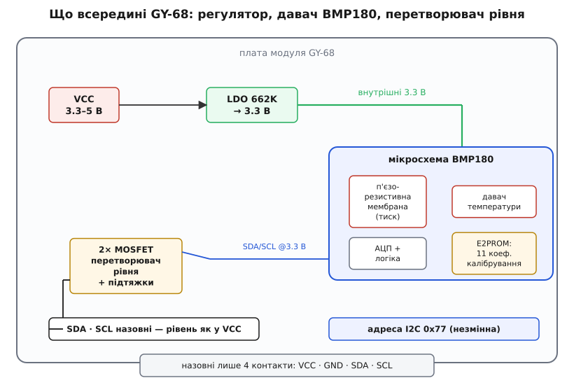
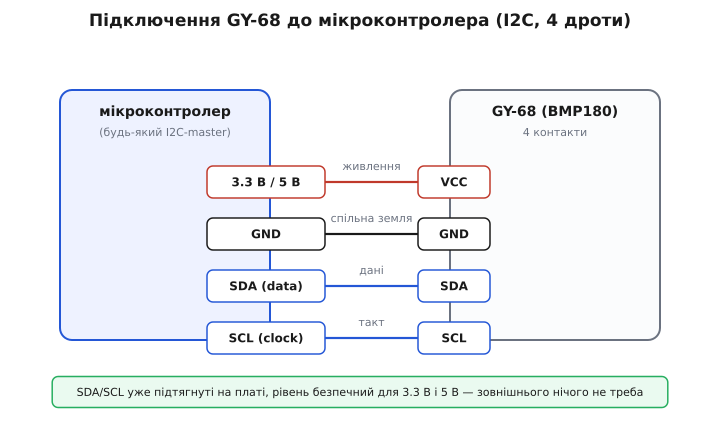
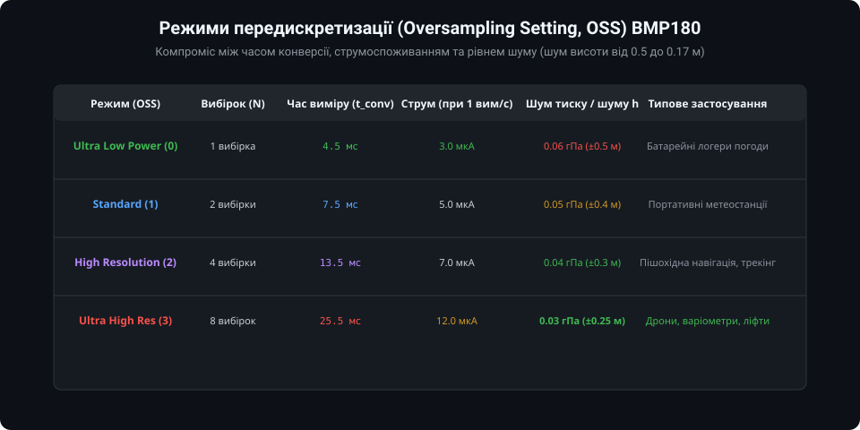
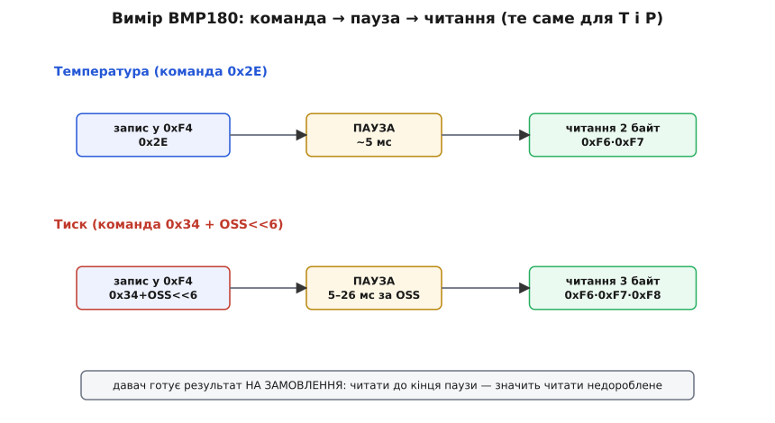
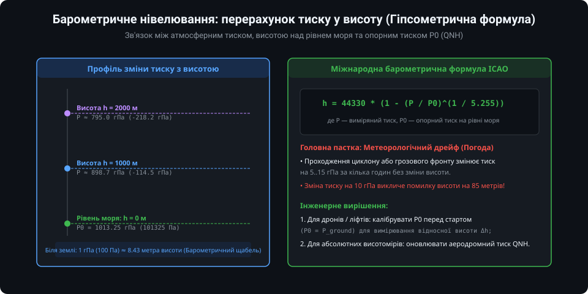

# GY-68 / BMP180 — барометр (тиск, висота)

Модуль **GY-68** на основі цифрового сенсора **Bosch Sensortec BMP180** є класичним барометричним давачем абсолютного тиску та температури навколишнього середовища. Завдяки високій чутливості сенсор здатний фіксувати зміни тиску менше ніж на 0.03 гПа (3 Па), що відповідає зміні висоти всього на 25–30 сантиметрів. Це робить його незамінним для портативних метеостанцій, альтиметрів, розумного годинника, варіометрів парапланів та систем утримання висоти безпілотних літальних апаратів (квадрокоптерів).

---

### 1. Будова та схемотехніка модуля GY-68

Сенсор BMP180 виготовлений за передовою мікроелектромеханічною технологією (MEMS) і розміщений у герметичному металевому корпусі з мікроскопічним отвором для доступу атмосферного повітря.



- **П'єзорезистивна мембрана:** Під впливом зовнішнього атмосферного тиску кремнієва мембрана деформується. Інтегровані в неї п'єзорезистори змінюють свій опір, який перетворюється вбудованим АЦП на цифровий код.
- **Діапазон вимірювання тиску:** від 300 до 1100 гПа (гектопаскалів), що відповідає діапазону висот від -500 метрів нижче рівня моря до +9000 метрів над рівнем моря.
- **Модуль GY-68:** Сам чіп BMP180 живиться напругою 1.8..3.6 В. Плата модуля GY-68 оснащена лінійним LDO-стабілізатором на 3.3 В (зазвичай 662K) та транзисторними перетворювачами логічних рівнів I2C, що дозволяє безпечно живити модуль як від 3.3 В, так і від 5 В (Arduino Uno/Mega).



Підключення до мікроконтролера вимагає лише 4 ліній:
- **VCC:** живлення 3.3 В або 5 В;
- **GND:** спільний провідник;
- **SCL:** тактова лінія шини I2C;
- **SDA:** лінія даних шини I2C (фіксована адреса пристрою на шині — `0x77`).

---

### 2. Режими передискретизації (Oversampling, OSS)

BMP180 дозволяє програмно обирати один із чотирьох режимів роботи (параметр OSS у регістрі керування), знаходячи оптимальний баланс між швидкістю вимірювання, рівнем випадкового шуму та енергоспоживанням:



1. **Ultra Low Power (OSS = 0):** 1 внутрішня вибірка. Час перетворення тиску становить лише 4.5 мс при споживанні 3 мкА (при 1 вимірі/с). Шумова похибка висоти становить близько ±0.5 м. Ідеально для автономних батарейних метеостанцій.
2. **Standard (OSS = 1):** 2 усереднені вибірки, час перетворення 7.5 мс.
3. **High Resolution (OSS = 2):** 4 усереднені вибірки, час перетворення 13.5 мс.
4. **Ultra High Resolution (OSS = 3):** 8 апаратних вибірок, час конверсії 25.5 мс. Струм споживання зростає до 12 мкА, але шум тиску падає до 0.03 гПа (шумова невизначеність висоти менше ±0.25 м). Рекомендовано для дронів та навігації всередині будівель (розпізнавання поверхів).

---

### 3. Двоетапний протокол вимірювання

BMP180 не є сенсором прямого безперервного потоку. Отримання даних вимагає суворого дотримання послідовності команд:



1. **Читання некомпенсованої температури (UT):**
   - Записати команду `0x2E` у контрольний регістр `0xF4`;
   - Витримати паузу щонайменше 4.5 мс;
   - Зчитати 2 байти сирої температури (регістри `0xF6`, `0xF7`).
2. **Читання некомпенсованого тиску (UP):**
   - Записати команду запуску виміру тиску `0x34 + (oss << 6)` у регістр `0xF4`;
   - Витримати паузу, відповідну обраному режиму OSS (від 4.5 до 25.5 мс);
   - Зчитати 3 байти результату (регістри `0xF6` MSB, `0xF7` LSB, `0xF8` XLSB).
3. **Обчислення компенсації:** Отримані сирі значення підставляються у фірмовий цілочисельний алгоритм Bosch разом із 11 калібрувальними коефіцієнтами, зчитаними з EEPROM давача під час ініціалізації.

---

### 4. Розрахунок висоти та барометричне нівелювання

Атмосферний тиск зменшується зі збільшенням висоти відповідно до барометричного закону. Для перерахунку тиску у метри висоти використовується стандартна гіпсометрична формула ICAO:



`h = 44330 * (1 - (P / P0)^(1 / 5.255))`

де:
- `P` — виміряний атмосферний тиск у Паскалях;
- `P0` — тиск на рівні моря (за стандартною атмосферою становить 101325 Па, або 1013.25 гПа).

**Метеорологічний дрейф:**
Слід пам'ятати, що атмосферний тиск у будь-якій точці планети постійно коливається через рух циклонів та антициклонів. Зміна погоди може викликати зміну тиску на 10 гПа за добу, що за формулою відповідає уявній зміні висоти на **85 метрів**! 

Тому для точного вимірювання відносної висоти (наприклад, підйом коптера чи пішохода на гору) перед початком руху фіксують поточний стартовий тиск землі як `P0` (`P_ground`), обчислюючи відносну висоту:
`Delta_h = 44330 * (1 - (P / P_ground)^(1 / 5.255))`

---

### 5. Приклад базового опитування мовою C++ (Arduino)

Для повсякденних проектів найзручніше використовувати готові перевірені бібліотеки (наприклад, `Adafruit_BMP085` або `Adafruit_BMP180`):

```cpp
#include <Wire.h>
#include <Adafruit_BMP085.h>

Adafruit_BMP085 bmp;

void setup() {
  Serial.begin(115200);
  Wire.begin();

  // Ініціалізація датчика з перевіркою ідентифікатора чіпа
  if (!bmp.begin()) {
    Serial.println("Помилка: сенсор BMP180 не знайдено на шині I2C!");
    while (1) { delay(100); }
  }
  Serial.println("BMP180 успішно ініціалізовано.");
}

void loop() {
  // Зчитування температури в градусах Цельсія
  float temperature = bmp.readTemperature();

  // Зчитування абсолютного тиску в Паскалях
  int32_t pressure = bmp.readPressure();

  // Обчислення висоти з урахуванням стандартного тиску 1013.25 гПа
  float altitude = bmp.readAltitude(101325);

  Serial.print("Температура: ");
  Serial.print(temperature, 1);
  Serial.print(" °C | Тиск: ");
  Serial.print(pressure / 100.0f, 2);
  Serial.print(" гПа | Висота: ");
  Serial.print(altitude, 2);
  Serial.println(" м");

  delay(1000);
}
```

---

### Підсумки та висновки

1. BMP180 є надійним бюджетним барометром, що забезпечує точність тиску до 0.03 гПа та шум висоти близько 25 см у режимі Ultra High Resolution.
2. Протокол вимагає обов'язкового вимірювання температури перед тиском для точної внутрішньої термокомпенсації п'єзорезисторів.
3. При барометричному нівелюванні слід розрізняти абсолютну висоту відносно рівня моря (потребує оновлення тиску QNH) та відносну висоту польоту (калібрується тиском землі на старті).
