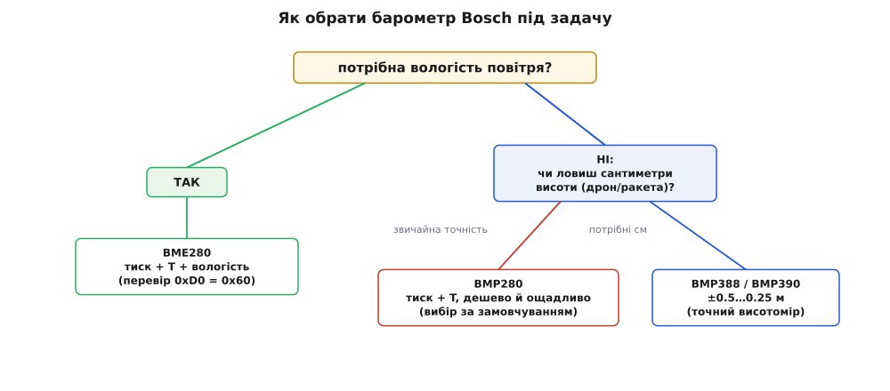
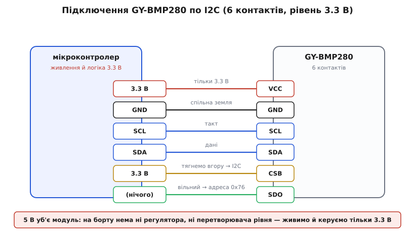
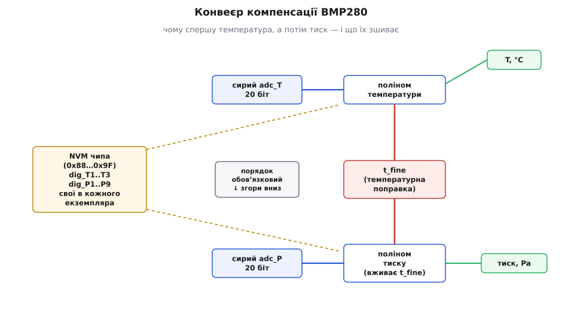
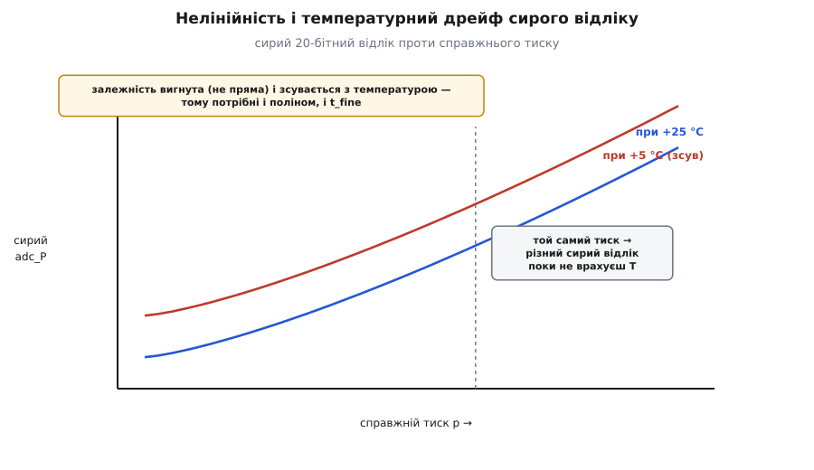

# GY-BMP280 — барометр/висотомір (BMP280)

Сенсор **Bosch Sensortec BMP280** є другим поколінням популярної родини цифрових атмосферних барометрів, що прийшов на заміну застарілому BMP180. Завдяки суттєвій модернізації внутрішнього АЦП, оптимізації кристала та впровадженню апаратного IIR-фільтра, сенсор забезпечує вшестеро вищу роздільну здатність вимірювання тиску при вчетверо меншому споживанні енергії.

Модуль **GY-BMP280** є базовою платою для швидкого макетування на базі мікроконтролерів Arduino, ESP32, STM32 та одноплатних комп'ютерів Raspberry Pi.

---

### 1. Особливості та відмінності BMP280 від BMP180 і BME280

При виборі датчика важливо чітко розрізняти моделі в лінійці Bosch Sensortec:



- **BMP180 проти BMP280:** BMP180 підтримував лише фіксовану I2C-адресу 0x77 і вимагав постійного надсилання команд запуску для кожного виміру. BMP280 підтримує як безперервний автономний режим (Normal mode), так і два інтерфейси зв'язку (I2C та SPI), споживаючи всього 2.7 мкА при частоті опитування 1 Гц.
- **BMP280 проти BME280:** Літера "E" в назві позначає Environmental. Давач BME280 містить третій первинний сенсор — відносної вологості повітря. Модель BMP280 вимірює **лише атмосферний тиск і температуру**. Спроби прочитати вологість із BMP280 повертають нуль або помилку.
- **Ідентифікатор чіпа (Chip ID):** Регістр `0xD0` сенсора повертає значення `0x58` для BMP280 (тоді як BME280 повертає `0x60`). Це головний спосіб програмної ідентифікації давача під час старту прошивки.

---

### 2. Схемотехніка модуля GY-BMP280 та правила живлення

Головна пастка типових китайських модулів GY-BMP280 (найчастіше на фіолетовій або синій платі розміром 10x15 мм) полягає у системі живлення:



- **Напруга живлення (VDD):** Чіп BMP280 розрахований на робочу напругу від **1.71 В до 3.6 В**. Більшість плат GY-BMP280 **не мають вбудованого 5 В стабілізатора** та перетворювачів логічних рівнів.
- **Підключення до 5 В мікроконтролерів (Arduino Uno):** Подача 5 В на контакт VCC або пряме підключення ліній I2C з підтяжкою до 5 В призводить до теплового пробою вхідних каскадів чіпа. Для 5 В систем обов'язково живіть модуль від піна `3V3` і використовуйте двонаправлений перетворювач рівнів (Level Shifter).
- **Адресація на шині I2C:** Залежно від підключення виводу `SDO`:
  - `SDO` підтягнутий до GND: адреса I2C — **`0x76`** (найпоширеніший стан на платах GY-BMP280);
  - `SDO` підтягнутий до VDD (3.3 В): адреса I2C — **`0x77`**.

---

### 3. Вбудований апаратний конвеєр та IIR-фільтр

У сенсорі BMP280 реалізовано повністю автономний вимірювальний конвеєр, що знижує навантаження на головний процесор:



1. **Режими роботи:**
   - **Sleep mode:** Сенсор вимкнений, споживання струму становить лише 0.1 мкА.
   - **Forced mode:** Одиничний вимір за командою хоста з наступним автоматичним поверненням у сон.
   - **Normal mode:** Постійні циклічні вимірювання з автоматичним періодом очікування (t_standby від 0.5 мс до 1000 мс).
2. **Апаратний IIR-фільтр (Infinite Impulse Response):**
   При використанні барометра в рухомих пристроях (дрони, робототехніка) різкі потоки повітря від пропелерів або протяги викликають короткочасні викиди тиску. Вбудований цифровий фільтр згладжує ці флуктуації за формулою:
   `P_filtered = (P_prev * (filter_coef - 1) + P_raw) / filter_coef`
   де коефіцієнт обирається з ряду: 2, 4, 8, 16. Завдяки фільтрації випадковий шум тиску знижується до 0.2 Па, забезпечуючи стабільність визначення висоти до **±10 см**!

---

### 4. Нелінійність та заводська термокомпенсація

Чутливий елемент тиску є кремнієвою п'єзорезистивною мембраною. Її пружні властивості та опір суттєво залежать від температури навколишнього середовища:



- Сирий 20-бітний код АЦП не є тиском у Паскалях. Це нелінійне значення, яке сильно "пливе" при нагріванні датчика.
- Для отримання фізичного значення кожен кристал BMP280 індивідуально калібрується на заводі Bosch, а 24 байти унікальних коефіцієнтів записуються в енергонезалежну пам'ять (регістри `0x88..0xA1`):
  - Температурні коефіцієнти: `dig_T1` (uint16), `dig_T2` (int16), `dig_T3` (int16);
  - Барометричні коефіцієнти: `dig_P1` (uint16), `dig_P2..dig_P9` (int16).
- **Суворе правило алгоритму Bosch:** Спершу завжди обчислюється компенсована температура, яка формує глобальну змінну `t_fine`. Лише після цього змінна `t_fine` підставляється в поліном 2-го порядку для термокомпенсації тиску.

---

### 5. Приклад підключення мовою C++ (Arduino)

Для роботи з датчиком у середовищі Arduino використовується популярна бібліотека `Adafruit_BMP280`:

```cpp
#include <Wire.h>
#include <Adafruit_BMP280.h>

Adafruit_BMP280 bmp; // Інтерфейс I2C

void setup() {
  Serial.begin(115200);
  Wire.begin();

  // Ініціалізація датчика з адресою 0x76 (SDO до землі)
  if (!bmp.begin(0x76)) {
    Serial.println("Помилка: BMP280 не виявлено! Перевірте живлення (3.3V) та адресу (0x76 або 0x77).");
    while (1) { delay(100); }
  }

  // Конфігурація: нормальний режим, 16x оверсемплінг тиску, 2x температури, IIR-фільтр = 16
  bmp.setSampling(Adafruit_BMP280::MODE_NORMAL,     // Режим роботи
                  Adafruit_BMP280::SAMPLING_X2,     // Температура
                  Adafruit_BMP280::SAMPLING_X16,    // Тиск
                  Adafruit_BMP280::FILTER_X16,      // Апаратний IIR фільтр
                  Adafruit_BMP280::STANDBY_MS_63);  // Пауза між вимірами
  Serial.println("BMP280 успішно налаштовано.");
}

void loop() {
  float temp = bmp.readTemperature();
  float press_pa = bmp.readPressure();
  // Розрахунок висоти при стандартному тиску рівня моря 1013.25 гПа
  float altitude = bmp.readAltitude(1013.25);

  Serial.print("T: ");
  Serial.print(temp, 2);
  Serial.print(" °C | P: ");
  Serial.print(press_pa / 100.0f, 2);
  Serial.print(" гПа | Висота: ");
  Serial.print(altitude, 2);
  Serial.println(" м");

  delay(500);
}
```

---

### Підсумки та висновки

1. BMP280 є високоефективним наступником BMP180, що поєднує низьке енергоспоживання (2.7 мкА) та високу роздільну здатність.
2. Підключати модуль GY-BMP280 слід суворо до шини живлення 3.3 В через відсутність вбудованого стабілізатора на більшості плат.
3. Вбудований апаратний IIR-фільтр повністю усуває шум від протягів та рухів повітря, забезпечуючи точність утримання висоти до 10 см.
