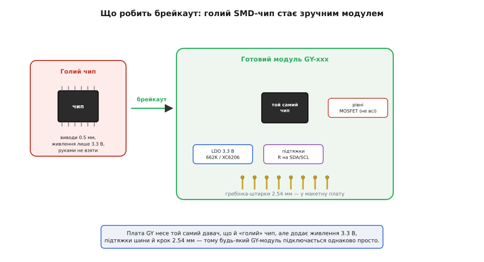
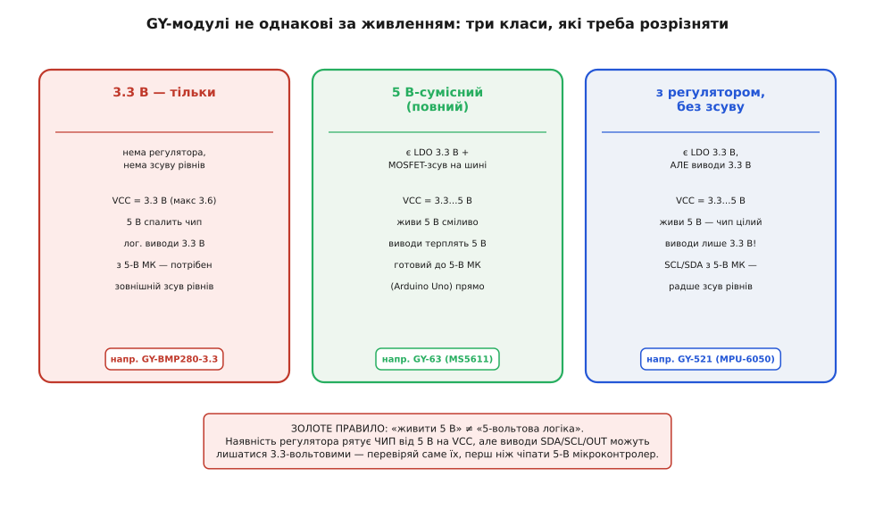
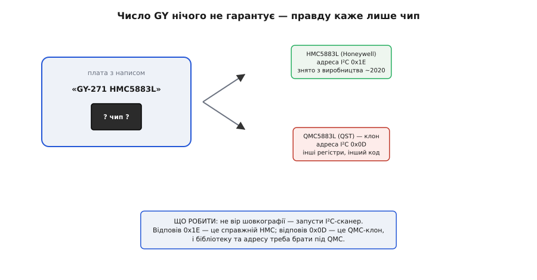

# GY-серія (брейкаут-модулі)

<preknowlist>
- [KY-серія (Keyes 37-в-1)](root:cat-hw-sensors/ky-series) — концепція побудови плат-носіїв для давачів та відмінність простої трьохпінової комутації від цифрових I²C-брейкаут-модулів
</preknowlist>

## Анатомія брейкаутів та походження GY

Сучасні напівпровідникові давачі виготовляють у вигляді мініатюрних SMD-чипів із виводами кроком пів міліметра, які неможливо вручну запаяти на ззвичайну макетну плату. Для розв'язання цієї проблеми шеньчженські складальні майстерні створили @@en|GY-серію@@ @@en|брейкаут-модулів@@ (від англ. @@en|breakout board@@ — плата виведення): чип запаюють на заводі, а його контакти розводять на зручну гребінку з кроком `2.54` мм (нуль цілих і одна десята дюйма). Маркування `GY` є лише шеньчженським неформальним маркуванням плат, а не назвою фірми чи конкретного пристрою.

*Будова GY-модуля: SMD-чип з обв'язкою з регулятора напруги та підтягувальних резисторів виведено на штиркову гребінку.*

На друкованій платі модулів родини GY навколо давача майже завжди розташована мінімальна апаратна обв'язка: резистори підтяжки ліній зв'язку та @@en|LDO-стабілізатор@@ (від англ. @@en|low-dropout regulator@@). На відміну від простих триконтактних плат, які описує [KY-серія](root:cat-hw-sensors/ky-series), модулі GY орієнтовані на цифрову передачу даних. Тому шукати технічну документацію та бібліотеки слід не за назвою плати, а за маркуванням самого давача.

## Три класи за живленням та логікою

Головна небезпека при роботі з GY-модулями полягає у плутанині між напругою живлення та логічними рівнями сигнальних ліній. Більшість первинних чипів розраховано суворо на живлення `3.3` В, тоді як класичні мікроконтролери дають на виводах `5` В. Наявність на платі лінійного стабілізатора `3.3` В (зазвичай мікросхема `XC6206` з маркуванням `662K`) дозволяє живити модуль від `5` В, проте не захищає сигнальні лінії від @@en|перенапруги логічних рівнів@@ (від англ. @@en|logic level overvoltage@@).

*Три класи модулів GY: строго 3.3-вольтові, повністю 5-вольто-сумісні та комбіновані з 3.3-вольтовою логікою.*

За цією ознакою родину GY поділяють на три класи:
- **Клас 1 (суворо `3.3` В):** не має стабілізатора й зсуву рівнів; подача `5` В миттєво виводить чип із ладу.
- **Клас 2 (повністю `5`-вольто-сумісний):** містить стабілізатор `3.3` В та транзисторні MOSFET-ключі @@en|зсуву логічних рівнів@@ (від англ. @@en|level shifter@@).
- **Клас 3 (комбінований):** має стабілізатор живлення, але позбавлений зсуву рівнів на лініях `SDA` та `SCL`. Подача `5`-вольтових сигналів на лінії даних класу 3 спричиняє деградацію напівпровідника, тому для них обов'язково застосовують зовнішній перетворювач рівнів.

## Ідентифікація чипа та I²C-сканування

Написи на шовкографії друкованої плати GY нерідко відрізняються від реальної начинки через зміну компонентів виробником. Наприклад, плати `GY-271` традиційно маркували під магнітометр `HMC5883L`, але на новіших ревізіях встановлюють клон `QMC5883L`. Ці мікросхеми мають різні регістри та адреси шини, тому бібліотека для одного чипа не працюватиме з іншим. Джерелом правди є лазерне маркування на самому чипі та перевірка шини.

*Сканування I²C-шини: сканер опитує адреси пристроїв та дає змогу відрізнити оригінальний чип від апаратного клону.*

Для точної ідентифікації пристрою використовують @@en|I²C-сканер@@ (від англ. @@en|I²C bus scanner@@) — коротку програму, яка послідовно опитує всі адреси шини та фіксує відповіді. Коли пристрій відповідає на адресу `0x1E`, на платі встановлено оригінальний `HMC5883L`, а відповідь на `0x0D` свідчить про наявність `QMC5883L`. Так само сканер дозволяє перевірити працездатність інших пристроїв, як-от [модуль цифрового монітора живлення INA226](root:cat-hw-sensors/ina226-power-monitor-module).

## Огляд різновидів та правила підключення

Родина GY охоплює широкий спектр пристроїв: від однопараметричних барометрів (`GY-BMP280`) та акселерометрів (`GY-61`) до складних інерційних модулів `IMU` (від англ. @@en|inertial measurement unit@@), таких як `GY-521` на чипі `MPU-6050` чи комбінований `GY-91`. Для безпечної інтеграції будь-якого модуля дотримуються чотирьох послідовних кроків:
1. Читають маркування корпусу чипа для визначення його специфікації.
2. Перевіряють наявність стабілізатора та зсуву рівнів для вибору напруги `3.3` В або `5` В.
3. Запускають I²C-сканер для підтвердження шинної адреси.
4. Підключають бібліотеку драйвера саме під ідентифіковану мікросхему.

У разі сумнівів щодо сумісності логіки модуль завжди живлять напругою `3.3` В та підключають до `3.3`-вольтового мікроконтролера (`ESP32` або `STM32`), що виключає ризик термічного пошкодження давача.
