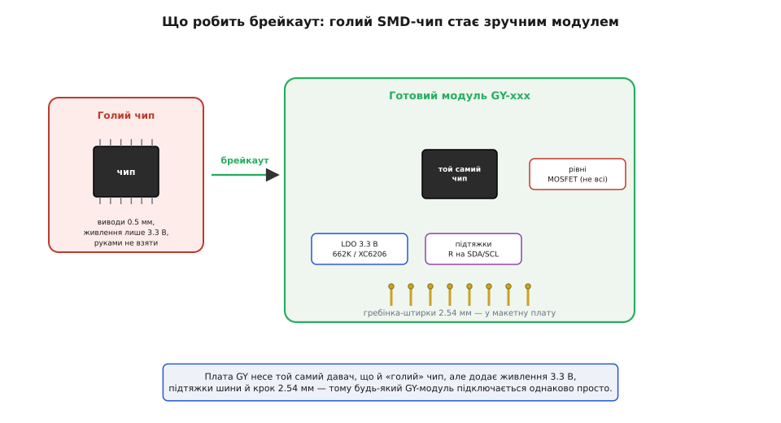
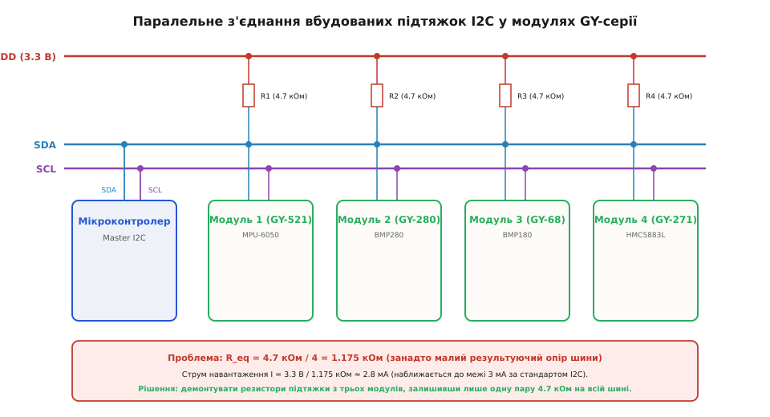

# GY-серія (брейкаут-модулі)

<preknowlist>
- [KY-серія (Keyes 37-в-1)](root:cat-hw-sensors/ky-series) — Принципи організації простих 3-пінових модулів для макетування та їхні відмінності від вимірювальних платок.
- [Модуль цифрового монітора живлення INA226 (I2C/SMBus)](root:cat-hw-sensors/ina226-power-monitor-module) — Принципи побудови цифрових модулів вимірювання та використання шини I2C для передачі даних.
</preknowlist>

## Криза прототипування та перехід на SMD

Наприкінці 2000-х років розробники електронних пристроїв зіткнулися з гострою технологічною суперечністю. Апаратні макетні платформи на кшталт перших плат Arduino будувалися навколо мікроконтролерів у вивідних корпусах DIP (англ. @@en|Dual In-line Package@@), які легко вставлялися в отвори безпайкових макетних плат (англ. @@en|solderless breadboard@@, від @@en|breadboard@@ — дошка для нарізання хліба). Водночас провідні виробники напівпровідників масово переводили випускальні серії цифрових сенсорів, акселерометрів та барометрів на нове покоління поверхневого монтажу (англ. @@en|surface-mount technology@@, SMD).

Нові інтегральні елементи випускалися у безвивідних мікроскопічних корпусах QFN (англ. @@en|Quad Flat No-leads@@), LGA (англ. @@en|Land Grid Array@@) та DFN (англ. @@en|Dual Flat No-leads@@) із кроком контакту 0.5 мм і менше. Виводи таких мікросхем заховані безпосередньо під животом корпусу у вигляді плоских контактів, а в корпусах QFN у центрі додатково міститься великий металевий майданчик заземлення та відведення тепла (англ. @@en|exposed pad@@). Така геометрія повністю унеможливила використання стандартних дротів чи безпайкових макетних плат. У промисловому виробництві монтаж таких корпусів здійснюється паянням оплавленням (англ. @@en|reflow soldering@@) із застосуванням дозованої паяльної пасти (англ. @@en|solder paste@@) та дотриманням чіткого термопрофілю (англ. @@en|thermal profile@@). Цей процес вимагає контрольованої фази попереднього підігріву для запобігання термічному шоку (англ. @@en|thermal shock@@) кристала, короткого пікового нагріву до 240–250 °C та використання поверхневого натягу (англ. @@en|surface tension@@) рідкого припою для точного автосуміщення мікросхеми на платі. Натомість спроби підпаяти тонкі провідники чи сам корпус безпосередньо за допомогою паяльника призводили до катастрофічних наслідків. Точковий контакт жала з температурою понад 300 °C створював руйнівний температурний перепад у товщі компонента, що викликав термічне деформування кремнієвого кристала, відрив металізації контактних майданчиків або утворення міжконтактних спайок і короткого замикання (англ. @@en|solder bridge@@) сусідніх виводів.

Прототипування новітніх давачів перетворилося на важку інженерну перепону. Щоб просто перевірити працездатність нового сенсора, інженер мусив проектувати повноцінну двошарову друковану плату, замовляти її виготовлення на фабриці та здійснювати паяння гарячим повітрям. Це руйнувало швидкий цикл розробки та створювало високий поріг входження для навчальних проєктів, де застосовувалися простіші [навчальні плати KY-серії](root:cat-hw-sensors/ky-series). Постала гостра потреба у проміжному конструктивному переході, який би адаптував промислові SMD-кристали до стандартизованого макетного кроку.

## Поява уніфікованого стандарту плат GY

Відповіддю на кризу прототипування став прорив відкритого ринку електроніки Шеньчженя у 2010–2012 роках. Китайські розробники та невеликі фабрики стандартизували уніфіковане сімейство платок-носіїв, які отримали відкритий торговельно-технічний префікс «GY-» (наприклад, GY-521, GY-271, GY-68).

Модуль брейкаут-плат (англ. @@en|breakout board@@, від @@en|break out@@ — виводити назовні) став не просто механічним перехідником, а й самодостатнім схемотехнічним вузлом. Конструкція плат серії GY об'єднала на єдиній друкованій платі чотири ключові компоненти:
1. Посадкову майданчикову сітку під конкретну SMD-мікросхему із розведенням сигналів на штирові виводи з кроком 2.54 мм (100 mil).
2. Вбудований малопотужний LDO-стабілізатор (англ. @@en|low-dropout regulator@@, LDO, наприклад 662K або AMS1117-3.3), який знижує вхідну напругу живлення 5 В від макетної платформи до безпечних 3.3 В, необхідних для живлення чутливого MEMS-кристала.
3. Блокувальні керамічні конденсатори (ємністю 100 nF та 10 µF) для придушення високочастотних завад і пульсацій живлення. Їхнє розміщення на друкованій платі підпорядковане суворому правилу: керамічний конденсатор має стояти на найменшій можливій відстані до виводів живлення мікросхеми. Під час швидкого перемикання логічних вентилів усередині кристала споживання струму змінюється стрибкоподібно. Будь-яка доріжка плати має паразитну індуктивність (англ. @@en|parasitic inductance@@, від латинського *inductio* — наведення), яка чинить опір швидким змінам струму. Якщо конденсатор віддалений від ніжок чипа, ця індуктивність заважає миттєвій подачі заряду, що викликає імпульсні просідання напруги й збої в роботі сенсора. Тому високочастотний конденсатор ємністю 100 nF розміщують упритул до виводів VCC та GND з найкоротшими доріжками, а ємність 10 µF ставлять поруч для згладжування повільніших пульсацій.
4. Підтягувальні резистори (англ. @@en|pull-up resistor@@) номіналом 4.7 kΩ або 10 kΩ на сигнальних лініях SDA та SCL інтерфейсу I2C (англ. @@en|Inter-Integrated Circuit@@).

*Принципова схемотехніка брейкаут-плати GY: показано підключення SMD-давача, LDO-стабілізатора 3.3 В, керамічних конденсаторів та резисторів підтяжки I2C.*

Завдяки такій інтеграції складні вимірювальні мікросхеми перетворилися на готові модулі. Розробнику більше не потрібно було збирати зовнішню обв'язку з дискретних елементів: плата серії GY підключалася безпосередньо до системної шини мікроконтролера чотирма провідниками (VCC, GND, SDA, SCL). Це створило фундамент для швидкої інтеграції як простих сенсорів, так і складних пристроїв типу [модулів моніторингу живлення INA226](root:cat-hw-sensors/ina226-power-monitor-module).

## Підтяжки I2C та виклики паралелювання

При побудові масштабних вимірювальних систем масове використання брейкаут-модулів серії GY виявило приховану схемотехнічну пастку. Оскільки практично кожен вимірювальний модуль серії GY оснащується власними вбудованими @@en|SMD@@-резисторами підтяжки на лініях SDA та SCL, паралельне підключення кількох плат до однієї шини @@en|I2C@@ призводить до небажаного паралельного з'єднання цих опорів.

Коли інженер об'єднує на одній шині кілька модулів GY, еквівалентний опір підтяжки `R_eq` знижується пропорційно кількості плат:

        R_eq = R / N      [паралельне з'єднання N однакових резисторів R]

Якщо на кожній із 4 плат встановлено підтяжки номіналом `R = 4.7 kΩ`, то результуючий опір шини складає:

        R_eq = 4.7 / 4
             = 1.175 kΩ    [обчислення еквівалентного опору]

Специфікація шини @@en|I2C@@ обмежує максимальний струм виходу з відкритим стоком (англ. @@en|open-drain@@) величиною 3 mA при напрузі низького рівня 0.4 V. Падіння еквівалентного опору нижче граничного значення позбавляє транзистори мікроконтролера та давачів можливості притягнути лінію до чесного логічного нуля. Це спричиняє спотворення сигналів, збої шини та надмірне нагрівання виводів. Водночас надмірне збільшення опору задля уникнення перевантаження створює протилежну проблему через сумарну паразитну ємність шини `C_b` (англ. @@en|bus capacitance@@, від латинського *capacitas* — місткість), яку формують доріжки плат, з'єднувальні провідники та входи підключених модулів GY (за специфікацією не більше 400 pF). Оскільки вихід з відкритим стоком повертається у високий логічний стан пасивно через підтягувальні резистори, утворюється @@en|RC-коло@@ (англ. @@en|RC circuit@@, від латинського *resisto* — чинити опір та *capacitas* — місткість) із постійною часу `τ = R_eq · C_b`. Тривалість фронту наростання сигналу `t_r` (англ. @@en|rise time@@) розраховується як інтервал підйому напруги від рівня логічного нуля `0.3 · V_CC` до логічної одиниці `0.7 · V_CC`:

        t_r = τ · ln(0.7 / 0.3)
            = 0.8473 · R_eq · C_b                  [обчислення фронту наростання для RC-кола]

Якщо після демонтажу резисторів на шині з граничною ємністю `C_b = 400 pF` залишається єдиний модуль із занадто великим опором підтяжки `R_eq = 10 kΩ`, результуючий час наростання становить:

        t_r = 0.8473 · 10000 · 400 · 10⁻¹²
            = 3.389 · 10⁻⁶ s
            = 3389 ns                              [обчислення тривалості фронту для R_eq = 10 kΩ та C_b = 400 pF]

Отримане значення `3389 ns` більш ніж утричі перевищує максимально припустиму норму специфікації @@en|I2C@@ для стандартного режиму 100 kHz (`t_r ≤ 1000 ns`). Занадто повільний прямокутний імпульс перетворюється на завалений купоподібний сигнал, через що приймач не встигає зафіксувати логічну одиницю у визначений тактовий інтервал. Через це інженер мусить розраховувати підтяжки у вузькому вікні між нижньою межею струмового перевантаження та верхньою межею часових затримок фронтів.

*Паралельне з'єднання підтягувальних резисторів на шині I2C при підключенні кількох брейкаут-плат GY: сумарний опір знижується пропорційно кількості модулів.*

Для усунення цієї проблеми інженери змушені аналізувати схему кожної плати та демонтувати (демонтувати паяльником) надлишкові @@en|SMD@@-підтяжки, залишаючи активною лише одну пару резисторів на всій фізичній шині.

## Атрибуція префікса GY та розвінчання міфів

Широка популярність плат серії GY породила низку стійких технічних міфів, які часто призводять до помилок під час проектування пристроїв.

Перший міф стосується походження та атрибуції назви. Поширена думка, ніби «GY» — це абревіатура конкретної компанії або торговельна марка зареєстрованого бренду. Насправді префікс «GY-» виник як відкритий де-факто стандарт китайського ринку розробки плат-носіїв у Шеньчжені. Букви не позначають конкретного виробника, а є узагальненим індексом сімейства брейкаут-плат. Ті самі модулі з маркуванням GY-521 чи GY-271 випускаються десятками різних фабрик, через що плати одного індексу можуть відрізнятися кольором текстоліту, товщиною міді, номіналами підтяжок (4.7 kΩ або 10 kΩ) та якістю встановленого @@en|LDO@@-стабілізатора.

Другий небезпечний міф — переконаність у тому, що наявність регулятора живлення на брейкаут-модулі автоматично забезпечує повне узгодження рівнів сигналів (англ. @@en|level shifter@@, від @@en|level shift@@ — зсувати рівень). Більшість базових плат серії GY містять @@en|LDO@@-стабілізатор лише для кола живлення VCC (перетворення 5 V на 3.3 V), але не мають активних транзисторних конвертерів рівнів на сигнальних лініях SDA та SCL. Підтягувальні резистори на таких платах підключаються до внутрішньої лінії 3.3 V або 5 V. При прямому з'єднанні з 5-вольтовим мікроконтролером напруга високого рівня на сигнальній лінії перевищує потенціал внутрішнього живлення 3.3-вольтового чипа, через що відкриваються його захисні діоди від електростатичного розряду (англ. @@en|ESD protection diodes@@, від @@en|electrostatic discharge@@ — електростатичний розряд). Верхній клемповий діод (англ. @@en|clamp diode@@, від @@en|clamp@@ — затискати), увімкнений між виводом I/O та внутрішньою шиною VCC, починає проводити струм, щойно напруга на виводі перевищує 3.3 V на величину прямого падіння на p-n-переході (близько 0.3–0.7 V). У результаті паразитний струм витікання безперервно вливається з 5-вольтової сигнальної лінії безпосередньо у внутрішнє коло живлення сенсора. Це спричиняє фантомне живлення кристала, зміщує опорні напруги вимірювального тракту, спричиняє локальний перегрів та створює загрозу тиристорного защіпання (англ. @@en|latch-up@@) чи деградації напівпровідникових структур, не призначених для постійного струмового навантаження.

На відміну від простих [модулів KY-серії](root:cat-hw-sensors/ky-series), які містять лише дискретні елементи, брейкаут-модулі серії GY вимагають ретельного вивчення принципової схеми перед підключенням. Тільки розуміння реальної розводки живлення та сигнальних кіл дозволяє безпечно інтегрувати їх у відповідальні вимірювальні вузли на кшталт [модулів моніторингу живлення INA226](root:cat-hw-sensors/ina226-power-monitor-module).
