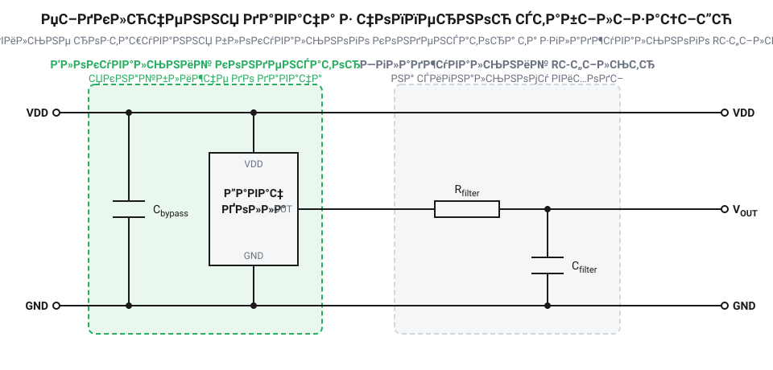

# Апаратний інтерфейс та електричні параметри давачів Холла з чопперною стабілізацією

<preknowlist>
- [Цифрові давачі Холла: однополярні, біполярні та омніполярні](root:cat-hw-sensors/hall-effect-digital-sensors-family) — базовий принцип роботи цифрового давача Холла та його реакція на магнітне поле.
</preknowlist>

## Проблема зміщення та шумів

Некомпенсований елемент Холла завжди має власне зміщення — напругу на виході, яка виникає навіть за відсутності магнітного поля через недосконалість кристала. До того ж ця напруга суттєво пливе зі зміною температури. Щоб відрізнити справжній слабкий магнітний сигнал від похибки, застосовують метод @@en|чопперної стабілізації@@ (chopper — переривник). У таких мікросхемах напрямок струму через чутливий елемент безперервно перемикається, а отримані сигнали усереднюються, що дозволяє практично повністю скасувати зміщення та температурний дрейф. Завдяки цьому сенсор працює стабільно в усьому діапазоні температур. 

Проте цей механізм не безкоштовний. Постійна комутація внутрішніх ланцюгів, що зазвичай відбувається на частотах від сотень кілогерц до кількох мегагерц, під час кожного перемикання створює різкі короткочасні сплески струму споживання і генерує відповідний високочастотний шум на сигнальному виході. Тому @@en|чопперна@@ мікросхема, на відміну від простих аналогових давачів, вимагає ретельної електричної обв'язки. Якщо не забезпечити стабільне живлення та правильну фільтрацію, власні шуми давача можуть спричинити хибні перемикання або спотворити вимірювання.

## Підключення живлення та розв'язка

Внутрішній генератор та комутатори @@en|чоппера@@ працюють безперервно, періодично перемикаючи напрямок струму через чутливий елемент на частотах від десятків до сотень кілогерців. Кожне таке перемикання фази супроводжується коротким, але інтенсивним сплеском споживання струму з боку мікросхеми. Цей процес перетворює споживання давача з постійного на серію високочастотних імпульсних навантажень.

Якщо джерело живлення підключене до давача через довгі провідники або тонкі доріжки на платі, така лінія набуває відчутної власної індуктивності. Згідно із законом електромагнітної індукції, індуктивність опирається швидким змінам струму. У момент, коли чоппер різко вимагає порцію енергії для перемикання, струм від джерела не встигає зрости миттєво. Через це напруга безпосередньо на виводах давача Холла різко просідає. Ці мікросекундні просадки порушують роботу внутрішніх підсилювачів і компараторів, зміщуючи їхні опорні рівні, що призводить до хибних спрацювань та значного збільшення шуму на виході.

Щоб запобігти просадкам, живлення мікросхеми обов'язково шунтують розв'язувальним конденсатором — зазвичай ємністю `0.1 мкФ` або `1 мкФ`, залежно від вимог конкретної моделі давача. Конденсатор бере на себе роль локального сховища енергії: він повільно заряджається від основного джерела і миттєво віддає струм у моменти перемикань чоппера, оминаючи індуктивність довгих підвідних ліній.

*Конденсатор C1 компенсує пікові навантаження живлення, а ланцюг R1-C2 фільтрує високочастотні пульсації на виході давача.*

Для ефективної роботи розв'язувального конденсатора критично важливими є два фактори: його фізичне розміщення та тип діелектрика.

Щодо розміщення, ключовим ворогом є еквівалентна послідовна індуктивність (@@en|equivalent series inductance@@, @@en|ESL@@). Кожен міліметр мідної доріжки між конденсатором і виводами давача додає паразитну індуктивність, яка затримує віддачу струму. Якщо конденсатор поставити за кілька сантиметрів від мікросхеми, його наявність втратить сенс: імпульс струму просто не встигне дійти до давача в момент перемикання чоппера, і просадка напруги однаково відбудеться. Тому конденсатор встановлюють упритул до виводів живлення і землі давача.

Щодо матеріалу, не кожен конденсатор підходить для боротьби з високочастотними імпульсами. Електролітичні чи танталові конденсатори мають високу внутрішню індуктивність і занадто повільні для частот чоппера. Необхідно використовувати виключно керамічні конденсатори, оскільки вони мають мінімальний показник @@en|ESL@@. Однак і серед кераміки варто уникати дешевих діелектриків типу Y5V чи Z5U: їхня фактична ємність катастрофічно падає при зміні температури та під дією постійної напруги зміщення. Для надійної роботи, особливо поблизу двигунів, які нагріваються і створюють вібрації, слід обирати конденсатори з температурно-стабільним діелектриком X7R або X5R.

Коли давач розміщений віддалено і з'єднаний з основною платою довгим кабелем, індуктивність лінії стає настільки великою, що одного конденсатора може бути недостатньо: під час перехідних процесів на лінії можуть виникати паразитні резонансні коливання. У таких випадках розв'язку посилюють, додаючи невеликий резистор (наприклад, від `10 Ом` до `50 Ом`) або феритову намистину послідовно з лінією живлення перед конденсатором. Це утворює повноцінний низькочастотний RC-фільтр або LC-фільтр, який ізолює давач від зовнішніх завад із кабелю і водночас не пускає високочастотний шум від чоппера назад у загальну мережу живлення.

Розкрито причину виникнення просадок напруги через струмові імпульси чоппера. Введено поняття паразитної індуктивності доріжок (@@en|ESL@@) та обґрунтовано вимоги до керамічного діелектрика (X7R/X5R) розв'язувальних конденсаторів.

## Фільтрація вихідного сигналу

Напруга на виході давача з @@en|чопперною стабілізацією@@ містить не лише корисний сигнал, а й залишки напруги комутації — пульсації на частоті роботи внутрішнього генератора. Для [цифрових давачів](root:cat-hw-sensors/hall-effect-digital-sensors-family), що мають вбудований тригер Шмітта, це рідко стає проблемою, якщо пульсації не перевищують гістерезис. Але [аналогові давачі](root:cat-hw-sensors/linear-hall-effect-sensors) вимагають очищення сигналу перед подачею на вхід мікроконтролера.

Для придушення цього шуму використовують згладжувальний RC-ланцюг, розміщений на виході сенсора. Резистор обмежує струм, а конденсатор згладжує різкі імпульси. Підбираючи параметри фільтра, треба знайти баланс: надто велика ємність повністю прибере шум, але водночас «розмиє» корисний сигнал, уповільнивши реакцію на зміну магнітного поля. Зазвичай достатньо невеликого фільтра з частотою зрізу, що в кілька разів перевищує максимальну частоту корисного сигналу, але лежить нижче частоти комутації.

## Часові затримки та швидкодія

Оскільки @@en|чопперна@@ мікросхема безперервно збирає та усереднює результати вимірювань із різних фаз комутації, сигнал на її виході з'являється не миттєво. Внутрішня математика вимагає часу. Це створює затримку між реальною зміною магнітного поля та відповідною реакцією на виводі сенсора — зазвичай від десятків до сотень мікросекунд, залежно від моделі. Цю затримку необхідно враховувати в системах, де важлива точність позиціювання на високих швидкостях, наприклад, при вимірюванні обертів двигуна.

Окрема проблема — час виходу на робочий режим під час подачі живлення. Перш ніж давач почне видавати достовірні дані, внутрішні схеми мають запуститися, а конденсатори фільтрів — зарядитися. Цей перехідний процес може тривати кілька мілісекунд, під час яких вихідний стан сенсора є невизначеним. Система керування має ігнорувати сигнали від давача впродовж цього інтервалу, щоб уникнути хибних дій під час старту.