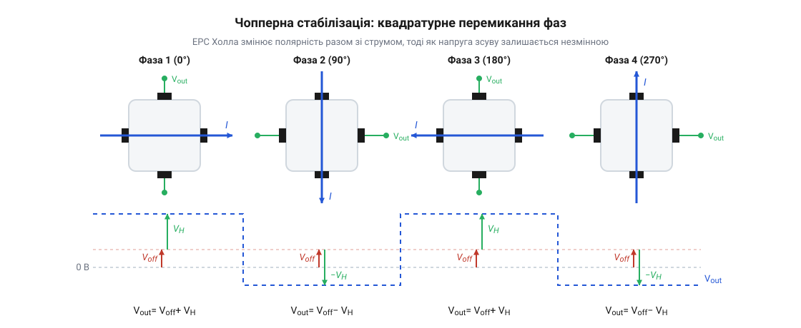
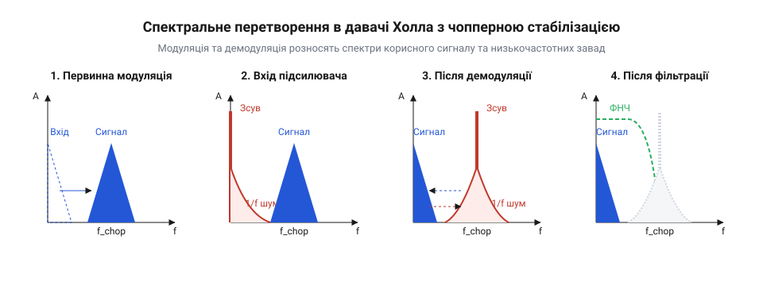
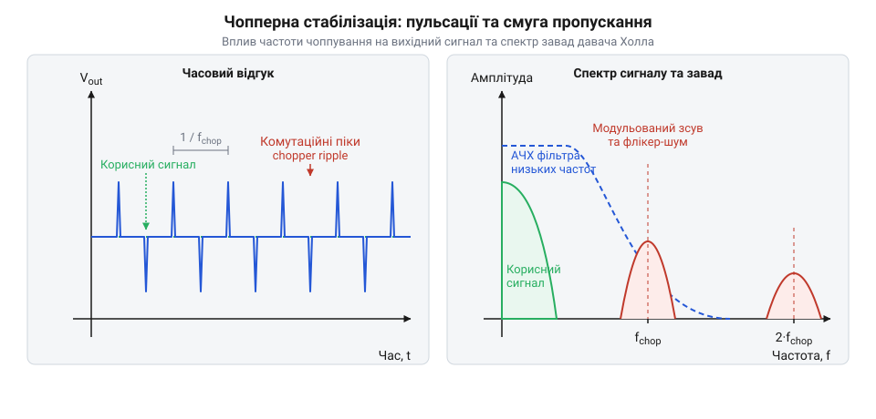
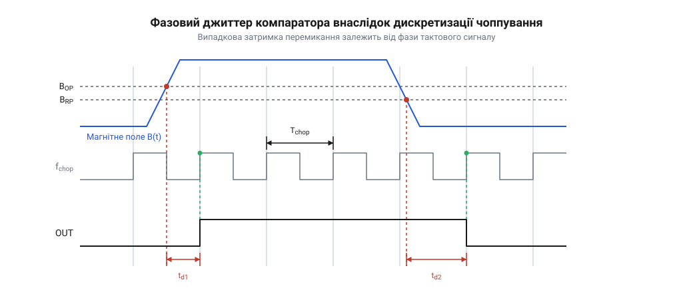
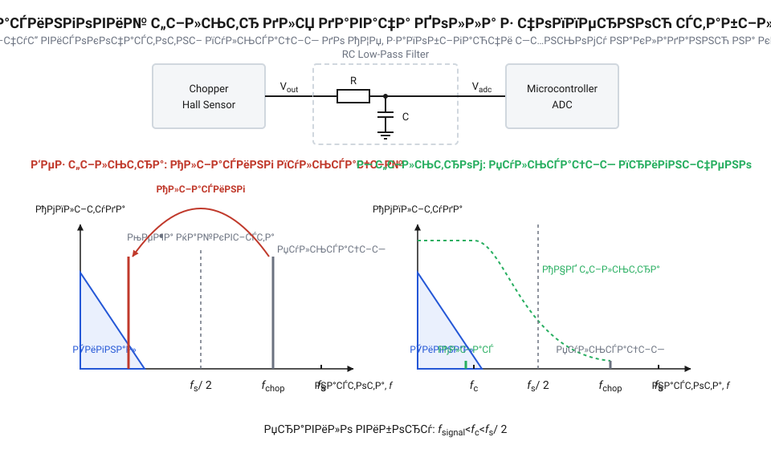

# Чопперна стабілізація в давачах Холла

<preknowlist>
- [Аналогові та лінійні давачі Холла](root:cat-hw-sensors/linear-hall-effect-sensors) — фізичний принцип виникнення ЕРС Холла в напівпровіднику та пропорційність вихідної напруги величині індукції магнітного поля
- [Цифрові давачі Холла: однополярні, біполярні та омніполярні](root:cat-hw-sensors/hall-effect-digital-sensors-family) — базову схему зчитування магнітного поля компаратором з тригером Шмітта та принципи формування цифрового вихідного сигналу
- [Модуль давача струму Холла ACS712 (GY-712)](root:cat-hw-sensors/acs712-current-sensor-module) — архітектуру вимірювального тракту первинного струму через вбудований елемент Холла та чутливість аналогового виходу до зовнішніх завад
</preknowlist>

## Чому покази давача Холла дрейфують

Уявіть практичну задачу змикання контрольного контуру: вам необхідно з високою точністю виміряти постійний струм у силовій шині або зареєструвати мікроскопічне зміщення магнітного ротора. Ви підключаєте прецизійний [лінійний давач Холла](root:cat-hw-sensors/linear-hall-effect-sensors), подаєте стабілізоване живлення і розраховуєте отримати пропорційну вихідну напругу. За відсутності зовнішнього магнітного поля (`B = 0`) вихідний сигнал давача мав би залишатися строго нульовим або дорівнювати половині напруги живлення (`V_CC / 2`) у випадку однополярного тракту. Проте на екрані осцилографа чи в регістрі аналогово-цифрового перетворювача ви бачите невтішну картину: покази пристрою повільно, але неухильно «пливуть». Достатньо лише торкнутися корпусу давача пальцем або злегка вигнути друковану плату, як вихідна напруга зміщується на величину, що еквівалентна появі реального магнітного поля в сотні gauss. Це явище описується як напруга зсуву (від англійського @@en|offset voltage@@, де *offset* — зміщення, зсув нуля). Паразитний зсув створює принципову невизначеність: вимірювальна система не здатна відрізнити корисну зміну магнітної індукції від внутрішнього дрейфу напівпровідникового кристала.

Фізична природа виникнення напруги зсуву криється у фундаментальних особливостях виготовлення кремнієвих елементів Холла. Типовий чутливий елемент являє собою тонку напівпровідникову пластину n-типу із чотирма бічними контактами: два з них слугують для пропускання струму живлення `I_bias`, а два протилежні — для знімання ЕРС Холла `V_H`. Коли заряджені носії рухаються крізь пластину у перпендикулярному магнітному полі, сила Лоренца (від англійського @@en|Lorentz force@@, названа на честь фізика Гендріка Лоренца) відхиляє їх до бічних граней, створюючи різницю потенціалів. Проте у реальному напівпровіднику потенціал виникає навіть за повної відсутності магнітного поля. Головними чинниками цього є такі фізичні ефекти:

1. Технологічна несиметрія та геометричний розбаланс. Під час фотолітографії та травлення напівпровідникової пластини вихідні контакти неможливо розмістити з абсолютною атомною симетрією. Геометричне зміщення контактів на часточки мікрона перетворює пластину на еквівалентний міст Уїтстона (від англійського @@en|Wheatstone bridge@@, названий на честь Чарльза Уїтстона) із чотирьох неоднакових внутрішніх опорів (`R₁ ≠ R₂ ≠ R₃ ≠ R₄`). Навіть при `B = 0` проходження струму живлення `I_bias` через незбалансовані плечі моста викликає падіння напруги між вихідними контактами, формуючи постійну компоненту геометричного зсуву `V_os,geo`.

2. П'єзорезистивний ефект (від грецького *piezo* — тиснути та латинського *resisto* — опиратися, англійською @@en|piezo-resistive effect@@). Монокристалічний кремній має високу чутливість внутрішнього питомого опору до механічних деформацій. Під час розварювання кристала, герметизації корпусу пластиковим компаундом та наступного запаювання давача на друковану плату виникають сильні термомеханічні напруження. Через анізотропію кристалічної ґратки ці напруження стискають і розтягують плечі еквівалентного моста неоднаково, змінюючи їхні опори й генеруючи значний механічний зсув `V_os,mech`.

3. Термоелектричні градієнти та термоелектрорушійні сили. Неоднорідне розсіювання потужності на кристалі та локальні температурні градієнти викликають виникнення термоелектричної ЕРС Зеєбека на межах з'єднання кремнію з металевими провідниками. Це створює додаткову температурно-залежну складову зсуву `V_os,temp`.

Окрім постійного та повільно дрейфуючого зсуву `V_os`, вимірювальний тракт напівпровідника страждає від низькочастотного флікер-шуму (від англійського @@en|1/f noise@@ або @@en|flicker noise@@, де *to flicker* — миготіти, мерехтіти). Фізично цей шум породжується хаотичним захопленням та вивільненням носіїв заряду на пасткавих енергетичних рівнях межі розподілу кремній-діоксид кремнію (Si-SiO₂). Спектральна густина потужності флікер-шуму обернено пропорційна частоті:

```
S_f(f) = C_n / f^γ
```

де `C_n` — конструктивний коефіцієнт шуму матеріалу, а показник ступеня `γ ≈ 1`. На низьких частотах — від 0 Гц до кількох кілогерц, де якраз і лежить більшість повільних магнітних сигналів (наприклад, реєстрація кута повороту валу у [дискретному давачі SS41F](root:cat-hw-sensors/ss41f-hall)) — рівень флікер-шуму лавиноподібно зростає. Він повністю маскує корисну ЕРС Холла, амплітуда якої у слабких полях не перевищує часток мілівольта.

На перший погляд здається, що напругу зсуву можна усунути простим статичним калібруванням — наприклад, виміряти вихідний зсув `V_os` при виготовленні давача і віднімати це значення в мікроконтролері або скоригувати його за допомогою лазерного підрізання внутрішніх резисторів. Однак статичне калібрування виявляється абсолютно безпорадною процедурою з трьох причин:
- Температурний дрейф нелінійний. При зміні температури довкілля від -40°C до +125°C питомий опір кремнію та механічний тиск пластикового корпусу змінюються динамічно, тому статичний коефіцієнт зсуву втрачає актуальність. - Механічний тиск змінюється під час експлуатації. Згинання плати при монтажі або термічне розширення конструкції створюють нові п'єзорезистивні деформації, які неможливо передбачити на заводі. - Флікер-шум є стохастичним низькочастотним процесом, який принципово не компенсується статичним відніманням постійного числа.

Спроба застосувати звичайне підсилення аналоговим підсилювачем постійного струму лише погіршує ситуацію: високопрецизійний каскад підсилює як корисну ЕРС Холла, так і внутрішній зсув пластини разом із флікер-шумом, миттєво заганяючи вихід операційного підсилювача у насичення. Інженер опиняється перед тупиком: власні похибки кристала значно перевищують корисний сигнал, а статичні методи їх нейтралізації не працюють. Для подолання цього бар'єра необхідний перехід від статичних вимірювань до динамічного розділення сигналу й завади.

Концепція чопперної стабілізації (від англійського @@en|chopper stabilization@@, де *to chop* — рубати, переривати) бере свій початок із 1949 року, коли Едвін Гольдберг винайшов метод модульованого підсилення для усунення дрейфу нуля у вакуумних та перших транзисторних операційних підсилювачах. Проте справжній прорив у галузі магнітних вимірювань відбувся у 1980-х роках, коли дослідники адаптували цю ідею до напівпровідникових давачів Холла, створивши метод динамічного перемикання фаз живлення (від англійського @@en|switched-Hall technique@@). Замість переривання зовнішнього аналогового сигналу, інженери запропонували комутувати безпосередньо напрямок струму всередині кремнієвої пластини Холла. Це дозволило безпосередньо на фізичному рівні кристала відокремити корисну ЕРС Холла від власної напруги зсуву (@@en|offset voltage@@), викликаної анізотропією та п'єзорезистивним ефектом від механічних напружень корпусу. З ростом технологій інтеграції напівпровідників цей підхід еволюціонував від складних дискретних схем на польових транзисторах до повністю монолітних CMOS-структур із вбудованими каскадами обробки сигналів на перемикуваних конденсаторах (@@en|switched-capacitor@@).

## Квадратурна комутація для розділення сигналу й зсуву

Щоб вирватися з пастки дрейфу нуля та низькочастотного шуму, у сучасних напівпровідникових пристроях застосовують метод динамічного обертання струму, відомий як квадратурна комутація або чопперне перемикання фаз (від англійського @@en|switched-Hall technique@@, де *switched* — комутований, перемикуваний). Ідея полягає у використанні симетрії кремнієвого кристала: якщо перемикати напрямок струму живлення під різними кутами, то напрямок відхилення носіїв заряду під дією магнітного поля змінюватиметься, тоді як внутрішні геометричні та п'єзорезистивні несиметрії кристала залишатимуться незмінними відносно його точок підключення.

Елемент Холла виготовляють у формі квазіквадратного або хрестоподібного чотириполюсника з контактами A, B, C, D. Навколо елемента формують транзисторний міст із CMOS-ключів, який за сигналами внутрішнього тактового генератора здійснює послідовну зміну фаз комутації струму `I_bias` та знімання напруги:

1. Фаза 0° (перша фаза): Струм живлення `I_bias` подається від контакту A до контакту C. Вимірювальний підсилювач підключається до ортогональних контактів B та D. У цьому стані вихідна напруга дорівнює сумі корисної ЕРС Холла та початкового зсуву:
```
V_out(0°) = V_H + V_os
```

2. Фаза 90° (друга фаза): Струм живлення `I_bias` повертається на 90 градусів і подається від контакту B до контакту D. Вимірювальні входи підсилювача підключаються до контактів C та A. Оскільки вектор напрямку руху носіїв заряду повернувся на 90 градусів, сила Лоренца відхиляє носії до тих самих бічних граней, але відносно нових вимірювальних контактів полярність корисної ЕРС Холла інвертується! При цьому внутрішній геометричний та п'єзорезистивний розбаланс моста опірності зберігає свою полярність:
```
V_out(90°) = -V_H + V_os
```

3. Фаза 180° (третя фаза): Струм подається від C до A, знімання напруги — з контактів D та B. Вихідний сигнал повторює першу фазу за полярністю ЕРС Холла:
```
V_out(180°) = V_H + V_os
```

4. Фаза 270° (четверта фаза): Струм подається від D до B, знімання напруги — з контактів A та C. Полярність ЕРС Холла знову інвертується:
```
V_out(270°) = -V_H + V_os
```


*Схема квадратурної комутації елемента Холла у чотирьох фазах для розділення ЕРС Холла та напруги зсуву.*

Квадратурна комутація перетворює постійну або повільно змінювану ЕРС Холла `V_H` на змінну напругу з прямокутною формою хвилі (меандр), амплітуда якої дорівнює корисній магнітній індукції. З точки зору спектрального аналізу, процес перемикання фаз з частотою тактування `f_chop` еквівалентний амплітудній модуляції корисної напруги `V_H(t)` прямокутним меандром `m(t)` із значеннями +1 та -1:

```
V_mod(t) = V_H(t) · m(t) + V_os(t)
```

Подивіться, що відбулося у частотній області в результаті цього кроку:
- Корисний магнітний сигнал `V_H(t)`, який початково знаходився у низькочастотній області (від 0 Гц до `f_sig`), **перенісся на високі частоти** — на носійну частоту чоппування `f_chop` та її непарні гармоніки (`3f_chop`, `5f_chop`). - Паразитний зсув кристала `V_os(t)` та низькочастотний флікер-шум `1/f` **не зазнали модуляції** напрямком струму (або змістилися мінімально) і залишилися у низькочастотній зоні біля постійного струму (DC, 0 Гц).

Детальний математичний апарат матричних перетворень опірностей кристала та спектрального розкладу 4-фазної комутації описує [математична модель модуляції](root:cat-hw-sensors/hall-effect-chopper-stabilization/math-chopper-quadrature-modulation.md).

Після первинного квадратурного перемикання сумарний сигнал подається на широкосмуговий аналоговий підсилювач змінного струму. Оскільки корисний сигнал у цій точці тракту є змінною напругою з частотою `f_chop`, підсилювач підсилює його без загрози насичення постійною складовою зсуву.

Наступним вирішальним етапом є синхронна демодуляція (від англійського @@en|demodulator@@, де префікс *de-* означає скасування, зворотну дію). Демодулятор є аналоговим перемикачем, який множить підсилений сигнал на той самий прямокутний меандр `m(t)`, що керує квадратурною комутацією кристала:

```
V_demod(t) = V_mod(t) · m(t)
           = [V_H(t) · m(t) + V_os(t)] · m(t)
           = V_H(t) · m²(t) + V_os(t) · m(t)
           = V_H(t) + V_os(t) · m(t)             [оскільки m²(t) = 1]
```

Це формульне перетворення демонструє магію чопперної стабілізації:
1. Корисний магнітний сигнал `V_H(t)` після повторного множення на `m(t)` **повертається у початковий низькочастотний спектр** (від 0 Гц до `f_sig`). 2. Власний зсув кристала `V_os(t)` та низькочастотний флікер-шум `1/f`, які до демодулятора були постійним струмом, після множення на `m(t)` **переносяться на високу частоту чоппування `f_chop`** та її гармоніки!


*Спектральне перетворення корисного сигналу та похибок на етапах модуляції, синхронної демодуляції та низькочастотної фільтрації.*

За демодулятором встановлюють аналоговий фільтр низьких частот (ФНЧ) або вбудовану систему на перемикуваних конденсаторах (від англійського @@en|switched-capacitor@@). Фільтр із частотою зрізу `f_cutoff`, вибраною вище за максимум корисного магнітного спектра `f_sig`, але значно нижче за частоту чоппування `f_chop`, безперешкодно пропускає корисну ЕРС Холла `V_H(t)`. Водночас він повністю відфільтровує паразитний зсув `V_os` та 1/f шум, які тепер знаходяться на високій частоті `f_chop`.

Втім, принципова схема чоппування породжує власну специфічну похибку — високочастотні чопперні пульсації (від англійського @@en|chopper ripple@@, де *ripple* — пульсація, зморшка). Пульсації виникають через інжекцію паразитного заряду затворів CMOS-ключів (@@en|charge injection@@) під час моментів перемикання фаз, а також через невелику залишкову різницю зсувів між фазами 0° та 90°. На виході демодулятора ці комутаційні піки формують вузькі сплески на частоті `f_chop`.

Для придушення чопперних пульсацій у сучасних мікросхемах (таких як [модулі давача струму](root:cat-hw-sensors/acs712-current-sensor-module) чи інтегровані [цифрові давачі Холла](root:cat-hw-sensors/hall-effect-digital-sensors-family)) застосовують каскади вибірки-зберігання (від англійського @@en|sample-and-hold@@), режекторні фільтри (@@en|notch filter@@) або автонульові підсилювачі (@@en|auto-zeroing amplifier@@). Повний спектральний аналіз пульсацій та вибір параметрів згладжувальних ланцюгів наведено у матеріалі [розрахунок чопперних пульсацій](root:cat-hw-sensors/hall-effect-chopper-stabilization/math-chopper-ripple-and-filtering.md).

Застосування чопперної стабілізації кардинально змінює підсумкові характеристики давачів:
- Температурний дрейф нуля знижується у 100–1000 разів порівняно з неоптимізованими пластинами Холла (до рівнів 0.01–0.05 microvolt per degree Celsius). - Повністю усувається вплив механічних напружень корпуса та вигину друкованої плати, забезпечуючи високу повторюваність параметрів при масовому виробництві. - Вихідний сигнал давача стає лінійним і стабільним у широкому діапазоні температур від -40°C до +150°C.

Однак чопперне перемикання накладає чіткі фізичні обмеження на вимірювальний тракт:
- **Обмеження смуги пропускання:** За теоремою Найквіста-Котельникова, частота вимірюваного магнітного поля `f_sig` не може перевищувати половини частоти чоппування (`f_sig < f_chop / 2`). На практиці, щоб забезпечити глибоке придушення пульсацій `chopper ripple`, смугу пропускання аналогового тракту обмежують значенням `f_chop / 10`. Наприклад, при частоті чоппування 100 кГц максимальна частота магнітного поля становить близько 10 кГц. - **Вимоги до фільтрації при підключенні до МК:** Під час підключення аналогового чопперного давача до аналогово-цифрового перетворювача (АЦП) мікроконтролера необхідно встановлювати зовнішній RC-фільтр низьких частот (@@en|anti-aliasing filter@@). Якщо частота дискретизації АЦП `f_ADC` виявиться кратною частоті чоппування `f_chop`, високочастотні пульсації `chopper ripple` перенесуться в полосу корисного сигналу внаслідок ефекту аліасингу (накладення спектрів), викликаючи хибні коливання цифрових відліків.

Особливості проектування апаратних кіл підключення та електричні стандарти висвітлює [апаратний інтерфейс давачів](root:cat-hw-sensors/hall-effect-chopper-stabilization/api-chopper-hall-hardware-interface.md). Практичні приклади софтверної цифрової фільтрації на STM32/ESP32 та побудови силових аналогових трактів ви знайдете у розробках [цифрового фільтра](root:cat-hw-sensors/hall-effect-chopper-stabilization/proj-hall-chopper-dsp-filter.md) та [тракту вимірювання струму](root:cat-hw-sensors/hall-effect-chopper-stabilization/proj-chopper-hall-current-sensing.md).

## Демодуляція та пригнічення низькочастотних завад

Коли в напівпровідниковій пластині Холла відбувається динамічне перемикання напрямку струму живлення та виходів знімання ЕРС, вихідна напруга перетворюється на змінний прямокутний сигнал, амплітуда якого пропорційна зовнішньому магнітному полю. Проте будь-яка аналогова або цифрова система обробки потребує постійної напруги, яка чітко відображає величину вимірюваної магнітної індукції. Ззвичайне усереднення або пряме підсилення не розв'язує проблеми, адже разом із вимірюваним сигналом у тракті присутні постійна напруга зсуву (@@en|offset voltage@@) та низькочастотний флікер-шум (від англійського *flicker* — миготіння, завада з частотою `1/f`, @@en|1/f noise@@). Для відокремлення корисного сигналу від власних паразитичних параметрів кристал використовує схемотехнічний каскад синхронної демодуляції (від латинського *de-* — відбудова та *modulatio* — розміреність, @@en|synchronous demodulation@@).

Синхронний демодулятор є матрицею аналогових ключових транзисторів, які працюють синхронно з частотою тактування чоппера `f_clk`. Його функція полягає в перемноженні вхідного модульованого сигналу на опорну прямокутну функцію `S_clk(t)`, що змінює свій знак між `+1` та `-1` кожну півфазу тактового імпульсу. Математична та фізична сутність цього перетворення полягає в тому, що корисний магнітний сигнал, який перед цим було перенесено з області низьких частот на частоту модуляції `f_clk`, під час демодуляції множиться на `f_clk` вдруге. У результаті корисний сигнал повертається назад у базовий діапазон частот — від постійного струму `0` до верхньої робочої частоти вимірюваного магнітного поля `f_sig`.

Паразитна напруга зсуву кремнієвого кристала та флікер-шум виникають безпосередньо в пластині й до демодулятора не проходили первинного перемикання фаз. Потрапляючи на вхід синхронного демодулятора у вигляді низькочастотної складової, вони множаться на прямокутну опорну функцію `S_clk(t)` лише один раз. Через це зсув та флікер-шум зміщуються у спектрі (від латинського *spectrum* — видимий образ, @@en|up-mixing@@) з області постійного струму на високу частоту тактування `f_clk` та її непарні гармоніки (`3 f_clk`, `5 f_clk`, ...). Таким чином, синхронний демодулятор дзеркально міняє місцями частотні діапазони: корисний магнітний сигнал стає постійною або повільно змінною напругою, а паразитна напруга зсуву перетворюється на високочастотну змінну напругу.

Математично процес синхронного демодулювання описується послідовним множенням складових сигналу на прямокутну тактову функцію `S_clk(t)`:

```
V_demod(t) = V_in(t) · S_clk(t)
= [V_hall · S_clk(t) + V_offset] · S_clk(t)
= V_hall · [S_clk(t)]² + V_offset · S_clk(t)
= V_hall + V_offset · S_clk(t)              [оскільки (S_clk)² = 1]
```

У наведеному виразі `V_hall` — це ЕРС Холла, `V_offset` — власний зсув кристала, а `S_clk(t)` — прямокутний опорний сигнал із значеннями `±1`. Оскільки квадрат прямокутного сигналу `[S_clk(t)]²` тотожно дорівнює одиниці, складова `V_hall` втрачає частотну модуляцію та перетворюється на постійний потенціал. Складова `V_offset` отримує множник `S_clk(t)`, тобто стає змінною напругою з нульовим середнім значенням. Детальний математичний апарат із формулами квадрирування та розкладом у ряд Фур'є наведено у [математичній моделі модуляції](root:cat-hw-sensors/hall-effect-chopper-stabilization/math-chopper-quadrature-modulation.md).

Перед передачею демодульованого сигналу на аналоговий фільтр низьких частот сигнал проходить через каскад вибірки-зберігання на перемикуваних конденсаторах (від латинського *condensare* — згущувати, @@en|switched-capacitor sample-and-hold@@). Під час перемикання ключових транзисторів елемента Холла утворюється короткочасний комутаційний сплеск через перезаряджання паразитичних ємностей затворів. Каскад вибірки-зберігання тактується зі спеціальним часовим зсувом (@@en|non-overlapping clock phase@@): ключі вибірки розмикаються безпосередньо перед моментами комутації фаз і замикаються лише тоді, коли перехідні процеси у кристалі повністю згасають. Перемикуваний конденсатор фіксує та утримує рівень напруги на час переходу, усуваючи з сигналу високоамплітудні вузькі піки.

Останнім ланцюгом вимірювального тракту є аналоговий фільтр низьких частот (від пізньолатинського *filtrum* — повсть, @@en|low-pass filter@@), який часто інтегрується безпосередньо в структуру мікросхеми на базі операційного підсилювача крутизни (@@en|operational transconductance amplifier@@). Частота зрізу цього фільтра `f_c` обирається значно нижчою за частоту тактування чоппера `f_clk`. Фільтр пропускає постійну складову `V_hall` та повністю пригнічує високочастотні гармоніки `V_offset · S_clk(t)`, що розташовані біля `f_clk`. На виході формується чиста аналогова напруга, позбавлена дрейфу нуля, що дає змогу вимірювати мікротеслові магнітні поля в [лінійних давачах Холла](root:cat-hw-sensors/linear-hall-effect-sensors) та [модулях давачів струму](root:cat-hw-sensors/acs712-current-sensor-module). Схемотехнічні нюанси та розрахунок таких аналогових трактів детально розібрано в [аналоговому вимірювальному тракті](root:cat-hw-sensors/hall-effect-chopper-stabilization/proj-chopper-hall-current-sensing.md).

## Високочастотні пульсації та обмеження смуги

Чопперна стабілізація забезпечує виняткову термостабільність і пригнічує дрейф нуля, проте створює власні фізичні обмеження, які критично враховувати під час проєктування високодинамічних систем. Використання високочастотного перемикання призводить до виникнення паразитного залишкового сигналу на виході датчика — чопперних пульсацій (від латинського *pulsatio* — биття, @@en|chopper ripple@@). Чому виникають ці пульсації навіть після внутрішнього фільтрування, як вони обмежують швидкодію вимірювального тракту і як запобігти викривленню даних при підключенні датчика до мікроконтролера?

Виникнення чопперних пульсацій обумовлено декількома неідеальностями напівпровідникової структури. По-перше, під час перемикання CMOS-ключів відбувається інжекція заряду (від англійського *charge injection*, @@en|charge injection@@) із каналу транзистора в робочу обкладку конденсатора або входи підсилювача. По-друге, через паразитну ємність затвор-витік виникає безпосереднє просочування тактового сигналу (@@en|clock feedthrough@@). По-третє, через мікроскопічну анізотропію кристала чотири фази квадратурного перемикання не є ідеально симетричними, створюючи залишковий розбаланс амплітуд. У результаті на виході демодулятора виникає періодичний імпульсний шум із частотою тактування `f_clk` або подвоєною частотою `2 f_clk`.

Фізичну картину часового сигналу та його частотного спектра унаочнює наведена характеристика вихідного тракту чопперного давача:


*Часова форма вихідної напруги чопперного давача з комутаційними сплесками chopper ripple та його амплітудно-частотна характеристика зі зрізом на частоті зрізу фільтра.*

На часовій діаграмі виразно видно вузькі високоамплітудні комутаційні піки, які виникають у моменти перемикання ключових фаз, та залишковий прямокутний рівень пульсацій. На амплітудно-частотній характеристиці показано, як внутрішній фільтр низьких частот формує смугу пропускання давача, пригнічуючи спектральні піки на частотах `f_clk` та її гармоніках.

Внутрішня частота тактування чоппування `f_clk` в інтегральних сенсорах (наприклад, у [цифрових давачах Холла](root:cat-hw-sensors/hall-effect-digital-sensors-family) або [дискретному сенсорі SS41F](root:cat-hw-sensors/ss41f-hall)) зазвичай лежить у діапазоні від 20 кГц до 800 кГц. Щоб якісно пригнітити пульсації `chopper ripple` (на рівні 50–70 дБ), частота зрізу інтегрованого фільтра низьких частот `f_c` має бути встановлена суттєво нижчою за частоту тактування — зазвичай `f_c ≈ f_clk / 10` або `f_c ≈ f_clk / 20`. Це створює жорстке обмеження смуги пропускання корисного сигналу `f_BW` (від десятків герц до 20–50 кГц). Для високошвидкісних систем це означає появу затримки встановлення вихідної напруги (@@en|settling time@@), що може викликати фазовий зсув у замкнених контурах керування електродвигунами чи силовими перетворювачами.

При підключенні аналогового чопперного давача до аналогово-цифрового перетворювача (АЦП) мікроконтролера виникає ризик виникнення аліасингу (від англійського *alias* — викривлене ім'я, псевдонім, @@en|aliasing@@). Якщо частота дискретизації АЦП `f_s` є близькою до частоти чоппування `f_clk` або її кратних гармонік, високовольтні пульсації `chopper ripple` біля частоти `f_clk` дзеркально відображаються у низькочастотну робочу смугу (нижче частоти Найквіста `f_s / 2`, @@en|Nyquist frequency@@). Це утворює удавану низькочастотну заваду або биття (@@en|beat frequency@@), яке неможливо відфільтрувати класичними алгоритмами усереднення і яке сприймається цифровою системою як хибне коливання магнітного поля.

Для запобігання аліасингу між аналоговим виходом датчика та входом АЦП мікроконтролера обов'язково встановлюється зовнішній антиаліасинговий фільтр (@@en|anti-aliasing filter@@):


*Схема підключення виходу чопперного давача до АЦП мікроконтролера через зовнішній ланцюг низьких частот для пригнічення чопперних пульсацій та запобігання аліасингу.*

Зовнішній пасивний RC-ланцюг або активний фільтр розраховується так, щоб забезпечити загасання гармонік `f_clk` щонайменше на величину динамічного діапазону АЦП (наприклад, 72 дБ для 12-бітного АЦП) до моменту дискретизації. Норми проектування таких електричних кіл та параметри узгодження імпедансів розкрито у [апаратному інтерфейсі підключення](root:cat-hw-sensors/hall-effect-chopper-stabilization/api-chopper-hall-hardware-interface.md), а розрахунок зрізу й загасання фільтрів подано в [аналізі чопперних пульсацій](root:cat-hw-sensors/hall-effect-chopper-stabilization/math-chopper-ripple-and-filtering.md).

Окрім аналогової фільтрації, для повного усунення залишків пульсацій на рівні програмного забезпечення мікроконтролера застосовують цифрові алгоритми DSP. Наприклад, налаштування частоти дискретизації АЦП строго кратною частоті чоппування дозволяє використовувати режекторні рекурсивні (IIR) або ковзні усереднювальні (FIR) фільтри, що мають нулі передавальної функції на частотах `f_clk`. Практичну реалізацію таких програмних алгоритмів для контролерів STM32 та ESP32 показано у [софтверному DSP-фільтрі](root:cat-hw-sensors/hall-effect-chopper-stabilization/proj-hall-chopper-dsp-filter.md).

## 5. Застосування чоппування в інтегральних давачах

Інтеграційні процеси в мікроелектроніці дозволили розмістити кремнієву пластину Холла, комутаційні ключі, підсилювач та демодулятор на єдиному кристалі. Проте перехід від теоретичної схеми до серійного компонента вимагає схемотехнічного компромісу між точністю, швидкістю відгуку та енергоспоживанням. Залежно від призначення пристрою — від швидкого виявлення положення ротора до прецизійного вимірювання струму — виробники застосовують різні варіанти архітектури чопперної стабілізації (@@en|chopper stabilization@@).

### Цифрові давачі Холла та фазовий джиттер

У дискретних магнітних ключах та тригерах, таких як [дискретному давачі SS41F](root:cat-hw-sensors/ss41f-hall) або ширшому сімействі, де функціонують [цифрові давачі Холла](root:cat-hw-sensors/hall-effect-digital-sensors-family), аналоговий сигнал після демодуляції та каскаду вибірки-зберігання (@@en|sample-and-hold@@) подається на вхід компаратора з гістерезисом. Головне завдання чоппування тут — усунути температурний дрейф точок увімкнення та вимкнення, роблячи порогову індукцію незалежною від нагріву кристала чи механічного напруження корпусу.

Однак динамічне 4-фазне перемикання струму за методом switched-Hall (@@en|switched-Hall technique@@) вносить часову дискретизацію. Внутрішній генератор тактує чопперні ключі на фіксованій частоті комутації `f_{chop}`, яка для більшості цифрових ключів становить від `20` до `100 kHz`. Повний цикл усунення напруги зсуву (@@en|offset voltage@@) вимагає проходження всіх чотирьох фаз квадратурної комутації, тому оновлення аналогової напруги на вході компаратора відбувається з періодом `T_{cycle} = 4 / f_{chop}`.

Якщо зовнішнє магнітне поле перетинає поріг спрацьовування `B_{OP}` у середині тактового циклу, компаратор не зможе змінити свій вихідний стан миттєво. Зміна стану станеться лише після завершення поточного квадратурного вимірювання та оновлення вибірки. Утворюється часова невизначеність, відома як фазовий джиттер (англ. @@en|jitter@@ — дрижання, тремтіння), величина якого може досягати тривалості одного повного циклу чоппування:

```
Δt_{jitter} ≤ 4 / f_{chop}
```

Для порівняння: при частоті чоппування `f_{chop} = 50 kHz` період квадратурного циклу становить `80 µs`. За швидкості обертання вала електродвигуна `10000` об/хв цей затримковий проміжок спричиняє кутову похибку визначення положення ротора до `4.8°`. На відміну від чоппованих чипів, пристрої без чоппування, як-от застарілий [простий дискретний ключ](root:cat-hw-sensors/ky-003-hall) або [базовий модуль A3144](root:cat-hw-sensors/a3144-hall-module), реагують на магнітне поле без тактової затримки, але демонструють плаваючий поріг спрацьовування під час зміни температури довкілля.


*Хронограма спрацьовування компаратора цифрового давача Холла: затримка вихідного фронту відносно моменту досягнення порогу B_OP обмежена періодом квадратурного циклу чоппування.*

### Прецизійні лінійні давачі Холла

В [аналогових лінійних давачах](root:cat-hw-sensors/linear-hall-effect-sensors) вихідний сигнал має безперервно відтворювати амплітуду магнітної індукції. Тут напруга зсуву спричиняє похибку нульової точки, а флікер-шум (@@en|1/f noise@@) створює низькочастотне дрейфування вихідної напруги. Застосування чопперної стабілізації дозволяє зменшити похибку зсуву до значень менше `0.5 mV`.

Проте наявність внутрішнього каскаду на перемикуваних конденсаторах (@@en|switched-capacitor@@) формує смугу пропускання аналогового тракту. Частота зрізу внутрішнього ФНЧ у лінійних давачах свідомо обирається значно нижчою за частоту чоппування (зазвичай `f_{BW} ≈ f_{chop} / 10`), щоб відфільтрувати високочастотні пульсації (@@en|chopper ripple@@). Якщо внутрішня частота комутації становить `250 kHz`, то ефективна смуга пропускання давача обмежена значенням приблизно `20–25 kHz`. Спроба виміряти магнітні поля з вищими частотами призведе до затухання сигналу та фазового зсуву.

### Інтегровані модулі вимірювання струму

Особливе місце посідає вимірювання струму силових кіл, де використовується [модуль давача струму](root:cat-hw-sensors/acs712-current-sensor-module). У таких пристроях первинний струм протікає через вбудований мідний провідник з низьким опором, створюючи магнітне поле навколо кремнієвого елемента Холла.

Вимірювальний тракт струмових давачів працює в умовах потужних високочастотних завад від ШІМ-інверторів (з частотами `10–50 kHz`). Щоб уникнути взаємної перехресної модуляції між частотою силової ШІМ та внутрішнім чоппуванням, розробники інтегральних схем підвищують частоту тактування чоппера до `800 kHz – 1 MHz`. Це дає змогу розширити смугу пропускання аналогового виходу до `80–120 kHz`, що необхідно для швидкого захисту силових транзисторів від короткого замикання. 

Докладні специфікації електричних параметрів, рівня власних пульсацій та підключення живлення викладені в розділі про [апаратний електричний інтерфейс](root:cat-hw-sensors/hall-effect-chopper-stabilization/api-chopper-hall-hardware-interface.md). Приклади схемотехнічної побудови кіл первинного вимірювання наведені у матеріалі про [аналоговий вимірювальний тракт](root:cat-hw-sensors/hall-effect-chopper-stabilization/proj-chopper-hall-current-sensing.md).

### Критерії вибору давача за апаратною архітектурою

Під час проєктування вимірювальних систем вибір типу давача Холла визначається балансом між термостабільністю, смугою частот та допустимим рівнем шуму.

| Тип давача | Внутрішня частота чоппування | Смуга пропускання | Головні переваги | Обмеження та пастки |
| :--- | :--- | :--- | :--- | :--- |
| **Цифровий switch/latch** | `20 – 100 kHz` | Дискретний відгук (`10 – 50 µs`) | Абсолютна стабільність порогових полів `B_{OP}/B_{RP}` при `-40..+150 °C` | Наявність фазового джиттеру; обмежена гранична частота обертання |
| **Прецизійний лінійний** | `100 – 300 kHz` | `10 – 30 kHz` | Мінімальний дрейф нуля (`< 10 µV/°C`), висока лінійність | Залишковий рівень пульсацій `chopper ripple` на виході |
| **Швидкісний давач струму** | `500 – 1000 kHz` | `80 – 150 kHz` | Швидка реакція на перевантаження, мала фазова затримка | Чутливість до зовнішніх високовольтних наводок та аліасингу АЦП |
| **Без чоппування (застарілі)** | Відсутня (`0 Hz`) | Понад `100 kHz` | Нульовий джиттер, відсутність тактових пульсацій | Катастрофічний температурний дрейф нуля та флікер-шум `1/f` |

## 6. Усунення аліасингу при цифровій обробці

Вихідний аналоговий сигнал чопперного давача Холла не є абсолютно чистим постійним струмом. Схемотехнічний демодулятор та каскад вибірки-зберігання залишають у сигналі високочастотні залишки тактової частоти — пульсації чоппування (@@en|chopper ripple@@). Коли цей сигнал надходить на аналогово-цифровий перетворювач (АЦП) мікроконтролера, виникає небезпека стробоскопічного накладання спектрів (@@en|aliasing@@), яке здатне спотворити результати вимірювань.

### Спектральний склад та механізм виникнення аліасингу

Згідно з виведеннями в [квадратурній математичній моделі](root:cat-hw-sensors/hall-effect-chopper-stabilization/math-chopper-quadrature-modulation.md), спектр вихідного сигналу чопперного давача містить дві основні складові:
1. Корисний низькочастотний сигнал у смузі від `0` до `f_{BW}`. 2. Високочастотні гармоніки пульсацій на частоті чоппування `f_{chop}` та її кратних повтореннях `2 f_{chop}, 3 f_{chop}`.

Якщо АЦП здійснює дискретизацію з частотою вибірки `f_s`, за теоремою Котельникова-Найквіста найвища частота, яка може бути коректно відтворена без спотворень, дорівнює частоті Найквіста (англ. @@en|Nyquist frequency@@ — межа безспотворно відновлюваного спектра):

```
f_N = f_s / 2
```

Якщо будь-які високочастотні компоненти сигналу (зокрема пульсації на частоті `f_{chop}`) мають частоту, вищу за `f_N`, і при цьому не згашені попереднім аналоговим фільтром, вони дзеркально відображаються у робочий діапазон `0..f_N`. Хибна частота аліасингу `f_{alias}` обчислюється за формулою:

```
f_{alias} = |f_{chop} - k · f_s|
```

де `k` — ціле число, таке що `f_{alias} ≤ f_s / 2`.

Наприклад, якщо давач генерує залишок чоппування на частоті `f_{chop} = 150 kHz`, а АЦП мікроконтролера проводиться оцифрування на частоті `f_s = 100 kHz`, то розрахована межа Найквіста становить `f_N = 50 kHz`. Гармоніка `150 kHz` транспонується безпосередньо в постійний струм або низькочастотний шум:

```
f_{alias} = |150 - 1 · 100| = 50 kHz
```

Якщо ж частота дискретизації АЦП обрана рівною `f_s = 49.5 kHz`, різниця становить `|150 - 3 · 49.5| = 1.5 kHz`. У цифровій системі з'являється хибна низькочастотна синусоїда з частотою `1.5 kHz`, яку неможливо відрізнити від реального змінення магнітного поля.


*Спектральна діаграма аліасингу: високочастотні гармоніки f_chop переносяться в область низьких частот при недотриманні умов фільтрації Найквіста.*

### Проєктування зовнішнього аналогового RC-фільтра

Для запобігання аліасингу перед входом АЦП обов'язково встановлюють аналоговий антиаліасинговий фільтр низьких частот (@@en|low-pass filter@@). Найпростішим та найефективнішим рішенням є пасивне RC-коло першого порядку.

Частота зрізу `f_c` для пасивного RC-фільтра розраховується за формулою:

```
f_c = 1 / (2 · π · R · C)
```

При виборі номіналів елементів необхідно враховувати два протилежні фактори:
- Опір резистора `R` не повинен навантажувати вихідний підсилювач давача (рекомендоване значення `R ≥ 1 kΩ`), але й не повинен бути занадто великим, щоб не створювати похибку при заряджанні внутрішнього конденсатора вибірки-зберігання АЦП. - Ємність конденсатора `C` обирається з ряду стандартних значень (наприклад, `10 nF – 100 nF`).

**Приклад розрахунку:** Необхідно відфільтрувати вихідний сигнал давача з частотою чоппування `f_{chop} = 200 kHz`, якщо АЦП працює на частоті `f_s = 20 kHz` (частота Найквіста `f_N = 10 kHz`). Обираємо частоту зрізу фільтра `f_c = 1.5 kHz`, щоб забезпечити достатнє згасання на частоті `200 kHz`.

```
f_c = 1 / (2 · π · R · C)
    = 1 / (2 · 3.14159 · 1000 · 100 × 10⁻⁹)   [підстановка R = 1 kΩ, C = 100 nF]
    = 1591.5 Hz                               [розрахована частота зрізу]
```

Оцінимо коефіцієнт послаблення (згасання) фільтра першого порядку на частоті чоппування `f_{chop} = 200 kHz`:

```
K(f) = 1 / √(1 + (f / f_c)²)
K(200000) = 1 / √(1 + (200000 / 1591.5)²)
          ≈ 1 / √(1 + 15785)
          ≈ 0.00795                           [згасання в 125 разів або -42 dB]
```

Отримане згасання в `-42 dB` зменшує пульсації чоппування з `10 mV` до менше ніж `0.08 mV`, що нижче за роздільну здатність 12-розрядного АЦП. Детальні виведення для фільтрів вищих порядків описані у матеріалі про [розрахунок високочастотних пульсацій](root:cat-hw-sensors/hall-effect-chopper-stabilization/math-chopper-ripple-and-filtering.md).

### Цифрова фільтрація на мікроконтролері

Аналоговий RC-фільтр подавляє компоненти вище частоти Найквіста, але для остаточного очищення сигналу в цифровому домені застосовують програмну фільтрацію цифровим процесором сигналів (@@en|digital signal processor@@).

Найбільш ефективним з точки зору використання ресурсів мікроконтролера є рекурсивний експоненційний релаксаційний фільтр IIR першого порядку (англ. @@en|infinite impulse response filter@@ — фільтр з нескінченною імпульсною характеристикою). Математичний дискретний алгоритм описується рівнянням:

```
y[n] = α · x[n] + (1 - α) · y[n - 1]
```

де `x[n]` — поточне значення вибірки АЦП, `y[n]` — відфільтроване вихідне значення, `y[n-1]` — попереднє значення фільтра, а `α` — коефіцієнт згладжування (`0 < α ≤ 1`), пов'язаний з цифровою частотою зрізу `f_{c,dig}` та періодом дискретизації `T_s = 1 / f_s`:

```
α = 2 · π · f_{c,dig} · T_s / (1 + 2 · π · f_{c,dig} · T_s)
```

Нижче наведено практичну реалізацію цифрового ФНЧ для мікроконтролерів у вимірювальному тракті.

:::tabs
@tab C (ESP-IDF)
:::code hall-effect-chopper-stabilization-d/c/esp-idf/lpf-iir-init.c
@tab C++ (Arduino)
:::code hall-effect-chopper-stabilization-d/cpp/arduino/digitallowpassfilter.cpp
:::

Використання комбінації аналогового RC-фільтра та програмного цифрового ФНЧ повністю усуває залишкові пульсації чоппування й аліасингу. Повноцінна практична розробка прошивки з прикладами обробки переривань АЦП викладена у матеріалі про [софтверну цифрову обробку](root:cat-hw-sensors/hall-effect-chopper-stabilization/proj-hall-chopper-dsp-filter.md).