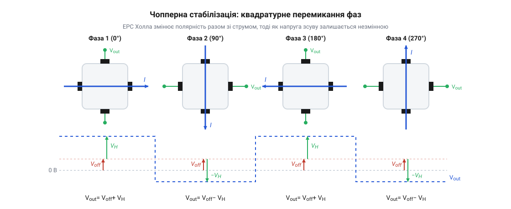
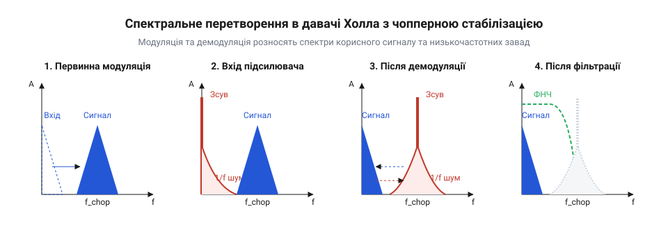
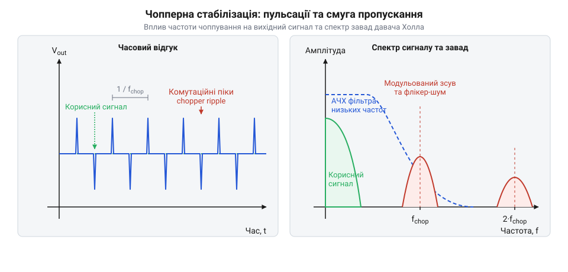

# Чопперна стабілізація в давачах Холла

<preknowlist>
- [Аналогові та лінійні давачі Холла](root:cat-hw-sensors/linear-hall-effect-sensors) — фізичний принцип виникнення ЕРС Холла в напівпровіднику та пропорційність вихідної напруги величині індукції магнітного поля
</preknowlist>

## Чому покази давача Холла дрейфують
Звичайний напівпровідниковий кристал, що працює як давач Холла, має суттєву ваду: його покази змінюються, навіть коли магнітного поля немає. Якщо вимірювати дуже слабке поле, корисний сигнал виявляється співмірним із внутрішніми похибками самого кристала, тому розрізнити їх стає неможливо. Головною причиною є напруга зсуву — мілівольтовий потенціал на вимірювальних виводах за нульової магнітної індукції. Вона виникає через невелику геометричну асиметрію під час виготовлення кристала, нерівномірність легування та п'єзорезистивний ефект, коли механічні напруги від корпусу змінюють опір напівпровідника.

Крім того, напруга зсуву сильно залежить від температури, тому вона постійно дрейфує під час роботи пристрою. Статично скомпенсувати її на етапі калібрування на заводі не виходить: зміна температури чи старіння матеріалів призведуть до того, що заводське налаштування перестане працювати. Свій внесок робить і низькочастотний @@en|flicker noise@@ (флікер-шум), рівень якого зростає з наближенням до нульової частоти. Усе це разом маскує слабкий постійний магнітний сигнал, і для розв'язання проблеми потрібно динамічно відділяти корисну напругу від апаратних завад просто під час вимірювання.

## Квадратурна комутація відділяє корисний сигнал
Щоб відділити корисний магнітний сигнал від похибок самого кристала, розробники використали динамічне перемикання напрямку струму — @@en|chopper stabilization@@ (чопперну стабілізацію). Ідея полягає в тому, щоб почергово подавати живлення на різні пари виводів симетричного кристала. Під час першої фази струм тече у прямому напрямку, і напруга Холла має одну полярність, а напруга зсуву, зумовлена асиметрією, додається до неї. У другій фазі напрямок струму розвертають на 90 градусів. Тепер корисна напруга Холла змінює свій знак, тоді як напруга зсуву, прив'язана до фізичної структури кристала, залишається незмінною.

*Схема квадратурної комутації показує, як зміна напрямку струму модулює полярність напруги Холла, залишаючи похибку кристала постійною.*

Завдяки такому циклічному перемиканню з високою частотою, корисний сигнал перетворюється на високочастотну змінну напругу. Водночас напруга зсуву і низькочастотний флікер-шум залишаються там, де і були — в області низьких частот. Отже, квадратурна комутація успішно розділяє магнітний сигнал та паразитні ефекти за частотним спектром, готуючи їх до подальшого очищення.

## Демодуляція та фільтрація очищують сигнал
Після квадратурної комутації сигнал потрапляє до синхронного демодулятора, який працює в такт із перемикачами струму. Демодулятор просто інвертує напругу під час тих фаз, коли корисний сигнал був перевернутий. У результаті цього множення корисна напруга Холла повертається до свого початкового стану — стає повільно змінним сигналом на низьких частотах, який точно відображає індукцію магнітного поля. Натомість напруга зсуву та флікер-шум, які до демодуляції були низькочастотними, тепер інвертуються синхронно з частотою комутації і перетворюються на високочастотний спектр.

*Після демодуляції магнітний сигнал зміщується в низькі частоти, а напруга зсуву та флікер-шум — у високі, що дозволяє легко їх відфільтрувати.*

Тепер корисний сигнал і паразитна похибка помінялися місцями в частотній області. Щоб отримати чистий результат без дрейфу нуля, залишається лише пропустити сигнал через низькочастотний фільтр. Цей фільтр повністю відтинає високочастотну заваду, залишаючи виключно чисту напругу, пропорційну до магнітного поля. Завдяки цьому давач набуває визначної термостабільності та точності.

## Високочастотні пульсації обмежують смугу пропускання
Хоча чопперна стабілізація відмінно усуває дрейф нуля, за це доводиться платити. Безперервна робота внутрішніх ключів під час комутації породжує власні комутаційні завади — високочастотні пульсації на виході давача. Вони виглядають як короткі сплески або постійний шум на частоті чоппування. Щоб їх позбутися, розробники змушені звужувати смугу пропускання вбудованого низькочастотного фільтра, що робить давач повільнішим і вносить часову затримку (фазовий джиттер) між реальною зміною магнітного поля та відповіддю на виході.

*Високочастотні пульсації від комутації згладжуються зовнішнім RC-фільтром, який звужує смугу пропускання та додає затримку.*

Коли мікроконтролер оцифровує сигнал із такого давача за допомогою АЦП, ці пульсації можуть викликати накладання спектрів (аліасинг). Тому на практиці завжди рекомендується ставити зовнішній антиаліасинговий RC-фільтр між давачем і мікроконтролером. Це слід враховувати, коли ви обираєте давач для швидких процесів, наприклад, для вимірювання струму інвертора двигуна: якщо потрібна миттєва реакція, доведеться шукати компроміс між відсутністю дрейфу нуля та швидкістю оцифрування.