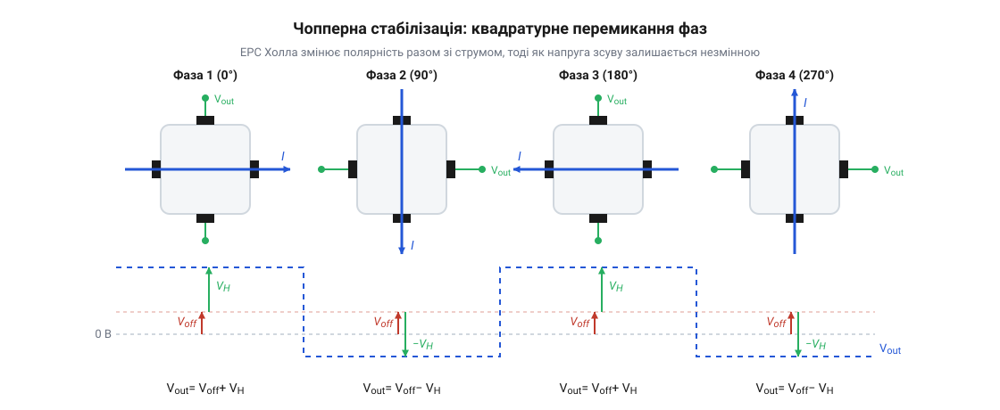
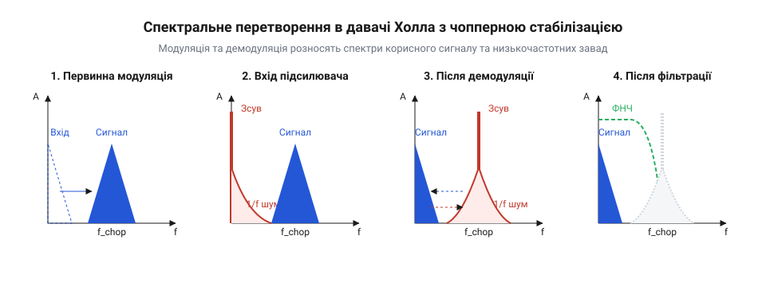

# Математична модель 4-фазної квадратурної модуляції та усунення зсуву в елементах Холла

<preknowlist>
- [Аналогові та лінійні давачі Холла](root:cat-hw-sensors/linear-hall-effect-sensors) — Фізичне походження паразитної напруги зсуву на контактах і принцип лінійної залежності напруги від магнітного поля
</preknowlist>

## Проблема нероздільності сигналу та зсуву

Коли магнітне поле діє на напівпровідникову пластину, крізь яку тече струм, на її поперечних контактах виникає різниця потенціалів — корисна напруга Холла `V_H`. Уявімо ідеальну пластину з бездоганно симетричними контактами: за відсутності магнітного поля струм тече суворо прямо, еквіпотенціальні лінії паралельні краям пластини, і напруга між поперечними контактами дорівнює нулю. 

Проте в реальному фізичному кристалі така ідеальна симетрія недосяжна. Під час виробництва контакти формуються з мікроскопічними геометричними похибками: один контакт завжди виявляється зміщеним уздовж осі струму відносно іншого. Електрично таку пластину з чотирма контактами моделюють як еквівалентний міст Уїтстона, де кожне плече моста — це опір частини напівпровідника між сусідніми контактами. В ідеальній пластині всі чотири опори рівні, міст збалансований, і напруга в його діагоналі нульова. У реальній пластині через зміщення контактів опори плечей стають різними. Міст виявляється розбалансованим від самої природи, і через його поперечну діагональ виникає різниця потенціалів навіть без магнітного поля.

Крім геометричних похибок, електричну асиметрію моста Уїтстона постійно змінює сама фізика напівпровідника через п'єзорезистивний ефект — зміну питомого опору матеріалу під дією механічної напруги. Напівпровідниковий кристал не висить у вакуумі: він приклеєний до металевої рамки і залитий твердим пластиковим корпусом. Усі ці матеріали мають різні коефіцієнти теплового розширення. Під час охолодження корпусу на заводі, або під час нагрівання мікросхеми в роботі, пластик і метал стискають кристал нерівномірно. Ця механічна деформація робить опір пластини анізотропним — він стає різним у різних напрямках. Опори плечей еквівалентного моста непрогнозовано дрейфують, і еквіпотенціальні лінії струму викривляються ще сильніше.

Разом геометрична асиметрія та п'єзорезистивний ефект породжують паразитну напругу зсуву `V_off` (від @@en|offset@@). На вихідних контактах давача ми завжди вимірюємо загальну напругу `V_out`, яка є алгебричною сумою обох компонентів:

        V_out
        = V_H + V_off      [пряме додавання напруг на контактах]

У статичному режимі відрізнити корисну напругу Холла від напруги зсуву неможливо. Якщо ми покладемо давач у магнітне поле й отримаємо на виході 5 мілівольт, ми не знатимемо, скільки з них належить корисному сигналу, а скільки — внутрішній асиметрії кристала. Обидві величини є постійними напругами і не мають жодних унікальних маркерів, за якими їх можна було б розпізнати.

Найпростіший розв'язок — виміряти зсув `V_off` на заводі без магнітного поля, зберегти це значення і просто віднімати його від вимірів під час роботи. Але цей спосіб ламається при зіткненні з реальністю, бо п'єзорезистивний зсув не є сталою величиною. Температура навколишнього середовища змінюється, і тиск на кристал дрейфує. Звичайне припаювання мікросхеми на плату вигинає її ніжки, передаючи нові деформації всередину корпусу. Навіть вологість повітря змушує пластик міняти об'єм. Заводське калібрування стає марним у ту саму мить, коли користувач починає монтувати давач на плату. 

Оскільки розділити дві постійні напруги в статиці неможливо, а відкалібрувати дрейф назавжди не вдається, виникає неминуча потреба в динамічному підході. Щоб відокремити корисний сигнал від паразитного зсуву математично, нам необхідно змусити їх поводитися по-різному в часі безпосередньо всередині кристала, ще до того, як вони зіллються в спільний сигнал.

Теза: Розділ пояснює фізичну природу напруги зсуву (геометричні похибки та п'єзорезистивний ефект) через модель розбалансованого моста Уїтстона і доводить неможливість її усунення статичним калібруванням через температурний та механічний дрейф, що створює потребу в динамічному розділенні. Введено термін `V_off` та поняття п'єзорезистивного ефекту.

## Рівняння напруги для чотирьох фаз

Щоб розділити сигнал і зсув, використовують метод ортогонального перемикання струму. Квадратний елемент Холла має чотири симетричні контакти. Замість того, щоб подавати струм завжди на одну пару контактів і знімати напругу з іншої, напрямок струму послідовно обертають на 90 градусів за допомогою електронних ключів. 

*Контакти живлення та вимірювання послідовно зміщуються по колу, створюючи чотири різні конфігурації протікання струму.*

Поведінка напруги Холла `V_H` та напруги зсуву `V_off` під час такого обертання докорінно відрізняється через їхню різну фізичну природу. Корисний сигнал залежить від векторного добутку струму та магнітного поля: коли ми міняємо місцями контакти живлення та вимірювання, повертаючи струм на 90 градусів, сила Лоренца відхиляє заряди так, що на новій парі контактів напруга Холла набуває протилежної полярності (ефект Холла є антисиметричним). Натомість напруга зсуву виникає через еквівалентний резистивний міст кристала, у якому один із кутових опорів трохи відрізняється через недосконалість геометрії. Пасивний резистивний міст має властивість електричної взаємності: якщо поміняти місцями діагональ живлення та діагональ вимірювання, дефектний опір однаково зміщуватиме баланс, підтягуючи вимірювальний контакт у той самий бік. Саме тому паразитна напруга зсуву незмінно зберігає свою полярність відносно вимірювальних контактів, тоді як корисний сигнал слухняно обертається з кожною фазою.

Математично система рівнянь для чотирьох фаз тактування має такий вигляд.

    V_1
    = V_H + V_off      [напруга у фазі 0°]

    V_2
    = -V_H + V_off     [напруга у фазі 90°]

    V_3
    = V_H + V_off      [напруга у фазі 180°]

    V_4
    = -V_H + V_off     [напруга у фазі 270°]

Завдяки цьому ортогональному перемиканню корисний сигнал набуває форми прямокутної хвилі, почергово змінюючи знак. Паразитна напруга зсуву при цьому залишається постійною складовою в кожній фазі.

## Спектральний перенос на частоту чоппування

З погляду обробки сигналів, процес послідовного перемикання фаз діє як квадратурна модуляція. Математично це еквівалентно множенню корисного постійного сигналу `V_H` на знаковласний меандр `m(t)`, який набуває значень +1 та -1 із частотою перемикання `f_chop` (частотою чоппування).

*Спектр показує, як корисний сигнал зміщується в область високих частот, залишаючи зсув і низькочастотні шуми біля нуля.*

У частотній області множення на меандр призводить до спектрального переносу. Корисний сигнал `V_H`, який спочатку перебував у низькочастотній смузі, переноситься на частоту чоппування `f_chop` та її непарні гармоніки. 

    V_mod(t)
    = V_H · m(t) + V_off      [результат модуляції у часі]

Оскільки напруга зсуву `V_off` та низькочастотний флікер-шум кристала не піддаються обертанню полярності, вони не множаться на меандр. Тому вони залишаються у своїй базовій смузі поблизу 0 Гц. Таким чином, перемикання струму розносить корисний сигнал і паразитний зсув по різних ділянках спектра, дозволяючи легко розділити їх за допомогою подальшої синхронної демодуляції та фільтрації.

## Демодуляція та повне анулювання зсуву

Після того, як корисний сигнал `V_H` перенесено на частоту чоппування `f_chop`, а паразитна напруга зсуву `V_off` залишилася в низькочастотній смузі, система має виконати зворотне перетворення — демодуляцію. Демодуляція полягає у повторному множенні сумарного сигналу на той самий меандр `m(t)`. Ця операція повертає сигнал Холла на нульову частоту, тоді як низькочастотний зсув переноситься на високу частоту. 

Математично процес демодуляції можна записати так, розглядаючи вихідну напругу `V_out` як добуток виміряної напруги на меандр:

        V_out(t) = (V_H · m(t) + V_off) · m(t)
        = V_H · m(t)² + V_off · m(t)      [розкриття дужок]
        = V_H + V_off · m(t)              [оскільки m(t) = ±1, то m(t)² = 1]

Як видно з цього виразу, демодуляція відновила корисний сигнал `V_H` у постійному вигляді, позбавивши його залежності від зміни фаз. Натомість напруга зсуву `V_off` тепер модульована і змінює знак із частотою `f_chop`.

Щоб отримати чисте значення `V_H`, потрібно позбутися високочастотного компонента `V_off · m(t)`. На практиці це реалізують шляхом інтегрування або усереднення (низькочастотної фільтрації) сигналу за повний цикл тактування `T_chop`, що складається з чотирьох фаз. Оскільки напруга зсуву має однакову величину в кожній із фаз, але її знак у результаті демодуляції чергується, алгебраїчна сума напруг зсуву за чотири фази дорівнюватиме нулю:

        ∑ V_off_phase = V_off_1 - V_off_2 + V_off_3 - V_off_4
        = V_off - V_off + V_off - V_off   [значення V_off у кожній фазі однакове]
        = 0                               [повне скасування геометричного і п'єзорезистивного зсуву]

Отже, після підсумовування або фільтрації сигнал містить виключно корисну складову `V_H`. Математичне доведення показує, що метод чоппування повністю анулює статичні компоненти напруги зсуву, дозволяючи з високою точністю вимірювати магнітне поле навіть за наявності значних внутрішніх асиметрій елемента Холла.

## Залишковий зсув і придушення флікер-шуму

Хоча ідеальна математична модель гарантує повне скасування зсуву, у реальних системах виникає явище залишкового зсуву `V_res`. Це відбувається через неідеальність перемикачів — інжекцію заряду з транзисторних ключів та ємнісне проходження сигналів керування на чутливі вузли. Кожне перемикання додає до сигналу короткий імпульс завади. Якщо ці імпульси не симетричні для різних фаз або процес установлення напруги не завершується до моменту вибірки, після демодуляції та усереднення залишається постійна складова.

Величина залишкового зсуву прямо пропорційна кількості перемикань за одиницю часу, тобто частоті чоппування `f_chop`:

        V_res ≈ Q_inj · f_chop · R_out    [закон Ома для усередненого струму інжекції]

де `Q_inj` — різниця інжектованого заряду між фазами, `R_out` — вихідний опір елемента Холла. З цієї формули видно, що для мінімізації залишкового зсуву частоту `f_chop` варто обирати якомога нижчою.

Однак на вибір частоти чоппування також впливає потреба придушення флікер-шуму (шуму 1/f). Спектральна щільність флікер-шуму зростає при наближенні до нульової частоти. Якщо перенести корисний сигнал на частоту `f_chop`, що перевищує частоту зрізу 1/f шуму `f_corner`, сигнал Холла опиниться в області, де домінує рівномірний тепловий білий шум, який значно менший. 

Після демодуляції спектр флікер-шуму з базової смуги переноситься на частоту `f_chop` і відфільтровується, подібно до того, як відфільтровується постійний зсув `V_off`. Але оскільки флікер-шум — це випадковий процес, який змінюється в часі, він не скасовується повністю: зміна миттєвого значення шуму за час одного циклу чоппування `T_chop` = 1/`f_chop` не дозволяє ідеально відняти два сусідні відліки. 

Дисперсія залишкового флікер-шуму зменшується зі зростанням `f_chop`. Таким чином, вибір частоти перемикання є компромісом: вища частота краще придушує 1/f шум і розширює смугу пропускання сенсора, але водночас збільшує залишковий зсув через інжекцію заряду від ключів.