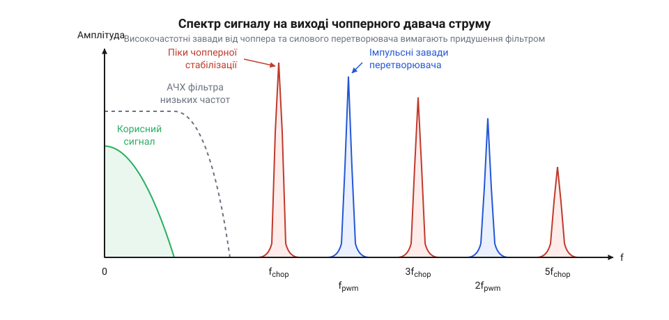
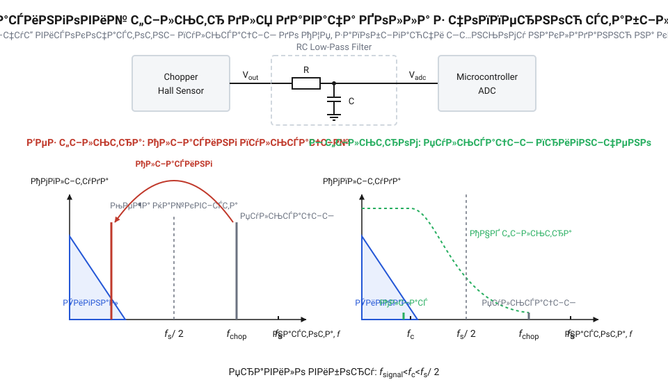

# Математичний розрахунок чопперних пульсацій, аліасингу та параметрів фільтрації

<preknowlist>
- [Аналогові та лінійні давачі Холла](root:cat-hw-sensors/linear-hall-effect-sensors) — Базове уявлення про аналоговий вихідний сигнал давача Голла та його паразитне зміщення нуля (дрейф), яке потрібно компенсувати.
</preknowlist>

## Природа високочастотних чопперних пульсацій

Будь-який [аналоговий давач Холла](root:cat-hw-sensors/linear-hall-effect-sensors) має суттєву проблему: паразитне зміщення нуля, або дрейф. Напруга на його виході відрізняється від нуля навіть тоді, коли магнітного поля немає взагалі. Це зміщення не є сталою величиною: воно повільно плаває від зміни температури та механічних напружень у кристалі. Оскільки корисний сигнал від постійного магніту теж є постійним або змінюється дуже повільно, мікроконтролер чи підсилювач не здатен відрізнити, де справжнє магнітне поле, а де похибка самого давача. Щоб виміряти справжнє поле, від цього повільного дрейфу потрібно позбутися. Для цього застосовують метод чопперної стабілізації.

Ідея методу полягає в тому, щоб рознести корисний сигнал та паразитний дрейф по різних діапазонах частот, аби потім їх розділити. Для цього на етапі вимірювання контакти живлення та зняття сигналу з елемента Холла періодично міняють місцями за допомогою вбудованих електронних ключів. Математично це еквівалентно множенню корисного магнітного сигналу на знакову послідовність, що складається з почергових +1 та -1, із частотою комутації `f_{chop}`. Унаслідок такого множення повільнозмінний корисний сигнал переноситься на високу частоту `f_{chop}`. Натомість паразитне зміщення нуля, яке виникає всередині кристала та у вхідних каскадах підсилювача вже після першого комутатора, не зазнає цього множення і залишається у вигляді постійної напруги.

Після підсилення цю суміш високочастотного корисного сигналу та постійного дрейфу подають на другий комутатор — демодулятор. Він знову множить увесь сигнал на ту саму послідовність +1 та -1, працюючи строго синхронно з першим комутатором. 

Для корисного магнітного сигналу це друге множення скасовує дію першого: два послідовні множення на -1 дають +1. Демодуляція повертає корисний сигнал назад у базову смугу частот, тобто він знову стає неперервним і точно відповідає вимірюваному магнітному полю. 

Проте паразитний дрейф, який до демодулятора залишався постійною напругою, множиться на цю знакову послідовність уперше. У результаті постійне зміщення перетворюється на змінний сигнал у формі меандру — прямокутних імпульсів, що безперервно стрибають від додатного до від'ємного значення амплітуди дрейфу. Цей прямокутний сигнал коливається з частотою комутації `f_{chop}`. Хоча середнє значення такого меандру за один повний період дорівнює нулю, у будь-який конкретний момент часу напруга містить суттєву похибку від дрейфу.

Так виникають високочастотні чопперні пульсації (@@en|chopper ripple@@). Через свою прямокутну форму ці пульсації містять у спектрі не лише саму частоту `f_{chop}`, а й нескінченний ряд її непарних гармонік. Якщо їх не відфільтрувати, загальна напруга на виході давача міститиме постійні стрибки амплітуди, які накладатимуться на корисний сигнал і заважатимуть зчитати справжнє значення магнітного поля.

Розкрито природу чопперних пульсацій через модулювання та демодулювання сигналу й дрейфу, а також показано, що пульсації мають форму меандру. Введено термін чопперні пульсації.

## Розрахунок амплітуди та її гармонік

Щоб зрозуміти, з яким саме завадовим сигналом ми маємо справу, опишемо його математично. Демодуляція еквівалентна множенню постійного зміщення `V_{off}` на симетричний прямокутний сигнал `m(t)`, який набуває значень +1 та -1 з періодом `T = 1 / f_{chop}`.

Прямокутний сигнал `m(t)` можна розкласти в ряд Фур'є. Оскільки він непарний, ряд міститиме лише непарні гармоніки:

    m(t)
    = \frac{4}{\pi} \sum_{k=1, 3, 5, \dots}^{\infty} \frac{1}{k} \sin(2\pi k f_{chop} t)    [розклад прямокутного імпульсу в ряд Фур'є]

Помноживши це на напругу зміщення `V_{off}`, отримаємо математичну модель чопперних пульсацій на виході демодулятора:

    V_{ripple}(t)
    = V_{off} \cdot m(t)                                                                    [множення на прямокутний імпульс]
    = \frac{4 V_{off}}{\pi} \left( \sin(2\pi f_{chop} t) + \frac{1}{3} \sin(6\pi f_{chop} t) + \dots \right) [розкриття суми для перших гармонік]

Із цього рівняння видно дві важливі речі. По-перше, найбільша амплітуда завади лежить на основній частоті чоппування `f_{chop}` і дорівнює `\frac{4}{\pi} V_{off}` (приблизно 1.27 від початкового зміщення). По-друге, спектр містить безліч вищих непарних гармонік: 3-тю, 5-ту тощо, амплітуда яких спадає обернено пропорційно їхньому номеру.


*Спектр сигналу після демодуляції: низькочастотний корисний сигнал відокремлено від високочастотних пульсацій зміщення.*

Це кількісно показує, що чопперні пульсації не є білим шумом. Це детермінований набір піків у частотній області, і для їх усунення потрібен фільтр, який подавить саме ці частоти.

## Аналогова фільтрація та частота зрізу

Оскільки корисний сигнал лежить біля нульової частоти, а пульсації — на `f_{chop}` та вище, для виділення чистого сигналу застосовують фільтр низьких частот (ФНЧ). 

Найпростіший аналоговий RC-фільтр першого порядку має таку амплітудно-частотну характеристику (АЧХ):

    |H(f)|
    = \frac{1}{\sqrt{1 + \left(\frac{f}{f_c}\right)^2}}                                     [АЧХ фільтра першого порядку]

де `f_c` — частота зрізу фільтра. На цій частоті сигнал послаблюється в `\sqrt{2}` разів. Щоб дізнатися необхідну частоту зрізу, треба задати бажаний рівень придушення пульсацій. Наприклад, якщо ми хочемо зменшити основну гармоніку `f_{chop}` у 10 разів, то `|H(f_{chop})| \approx 0.1`. Підставивши це в рівняння, матимемо:

    0.1
    = \frac{1}{\sqrt{1 + \left(\frac{f_{chop}}{f_c}\right)^2}}                              [підстановка бажаного послаблення]

Якщо припустити, що `f_{chop} \gg f_c`, то одиницею в знаменнику можна знехтувати:

    0.1
    \approx \frac{f_c}{f_{chop}}                                                            [наближення для далеких частот]

    f_c
    \approx 0.1 \cdot f_{chop}                                                              [обчислення частоти зрізу]

Отже, для 10-кратного придушення RC-фільтром першого порядку, частота зрізу має бути в 10 разів нижчою за частоту чоппування. Що сильніше потрібне придушення, то нижчою доведеться робити `f_c`, що неминуче сповільнить реакцію давача на швидкі зміни магнітного поля.


*Аліасинг через недостатню фільтрацію: якщо перед оцифруванням не подавити високочастотні складові належним чином, вони «загорнуться» в базову смугу й безповоротно зіпсують сигнал.*

Крім того, аналоговий фільтр обов'язковий перед оцифруванням сигналу за допомогою АЦП мікроконтролера. За критерієм Найквіста-Шеннона, частота дискретизації `f_{sample}` має бути принаймні вдвічі вищою за максимальну частоту в сигналі. Якщо чопперні пульсації не придушити достатньо сильно до АЦП, вони можуть спричинити аліасинг (@@en|aliasing@@): через стробоскопічний ефект їхні частоти змістяться вниз і накладуться на корисний сигнал. У цифровому вигляді відрізнити їх від справжнього магнітного поля буде неможливо.

## Оцифрування та уникнення аліасингу

Сигнал після демодулятора має корисну низькочастотну складову магнітного поля та високочастотні чопперні пульсації. Щоб обробляти ці дані в мікроконтролері, ми пропускаємо сигнал через аналогово-цифровий перетворювач. Але якщо просто зчитувати напругу з певною частотою, високочастотні пульсації не зникнуть. Гірше того, вони можуть перетворитися на низькочастотний шум, який неможливо відрізнити від справжніх змін магнітного поля. Цей ефект називають підміною частот (@@en|aliasing@@).

Математична причина криється в самому процесі дискретизації. Зчитуючи сигнал із частотою `f_s`, ми фіксуємо його значення лише в певні моменти часу. Критерій Найквіста-Шеннона каже: щоб точно відтворити частоту, ми маємо зчитувати її принаймні двічі за один її період. Якщо частота чоппування `f_chop` перевищує половину частоти дискретизації, АЦП просто не встигає відстежити її коливання.

Замість високочастотного сигналу в цифрових даних з'являється уявна низька частота `f_alias`. Вона обчислюється як різниця між частотою пульсацій та найближчою гармонікою частоти дискретизації:

        f_alias
        = |f_chop - N · f_s|     [де N — таке ціле число, що зводить різницю до мінімуму]

Якщо ця уявна частота `f_alias` потрапить у корисну смугу нашого давача, цифровий фільтр її вже не виріже, бо вона матиме вигляд повільної зміни самого магнітного поля. Тому ми мусимо забезпечити, щоб пульсації ніколи не загорнулися в корисну смугу. 

Є два шляхи. Перший — поставити перед АЦП аналоговий фільтр низьких частот, який придушить `f_chop` до безпечного рівня ще до оцифрування. Другий — зробити частоту дискретизації `f_s` настільки високою, щоб вона була більше ніж удвічі вищою за `f_chop`. Тоді пульсації залишаться високочастотними й у цифровому вигляді, і ми зможемо подавити їх програмно.

## Розрахунок цифрових FIR та IIR фільтрів

Коли ми зберегли пульсації у високочастотній зоні цифрового спектра, їх потрібно відфільтрувати математично. Кожен відлік АЦП містить як корисний сигнал, так і відхилення через залишок пульсацій. Найпростіший спосіб позбутися цього відхилення — усереднити кілька послідовних вимірювань.

Цифровий фільтр зі скінченною імпульсною характеристикою (@@en|FIR, Finite Impulse Response@@) працює як вікно, що ковзає по потоку даних. Найпростіший його вид — це ковзне середнє. Він бере `N` останніх відліків, додає їх і ділить на `N`. Якщо підібрати `N` так, щоб вікно охоплювало рівно один або кілька повних періодів пульсації, позитивні й негативні відхилення в сумі дадуть нуль.

Різницеве рівняння ковзного середнього виглядає так:

        y[n]
        = (x[n] + x[n-1] + ... + x[n-N+1]) ÷ N     [де x[n] — поточний відлік АЦП, y[n] — відфільтроване значення]

Цей фільтр ідеально вирізає конкретну частоту, але він має ціну: вікно з `N` відліків вносить затримку. Реакція на різку зміну магнітного поля розтягнеться в часі. Це класичний компроміс між чистотою сигналу та швидкістю реакції давача.

Якщо нам потрібна плавніша частотна характеристика і ми хочемо зекономити пам'ять мікроконтролера, ми використовуємо фільтр із нескінченною імпульсною характеристикою (@@en|IIR, Infinite Impulse Response@@). Цифровим аналогом простого RC-фільтра є експоненційне ковзне середнє. Воно не зберігає історію з `N` відліків, а оновлює єдине накопичене значення:

        y[n]
        = α · x[n] + (1 - α) · y[n-1]     [де α — коефіцієнт згладжування від 0 до 1]

Чим менший коефіцієнт `α`, тим менше впливає новий відлік `x[n]` і тим сильніше згладжується сигнал. Смуга пропускання такого фільтра напряму залежить від `α` та періоду дискретизації `T_s`. Ми можемо розрахувати коефіцієнт `α` для бажаної сталої часу `τ` (яка визначає частоту зрізу так само, як у RC-ланцюжку):

        α
        ≈ T_s ÷ (T_s + τ)     [формула переходу від безперервного до дискретного часу]

:::tabs
```c
float filter_iir(float current_sample, float previous_output, float alpha) {
    return alpha * current_sample + (1.0f - alpha) * previous_output;
}
```
```cpp
class ExponentialFilter {
private:
    float alpha;
    float current_value;
public:
    ExponentialFilter(float alpha_coeff, float initial_value = 0.0f) 
        : alpha(alpha_coeff), current_value(initial_value) {}

    float update(float sample) {
        current_value = alpha * sample + (1.0f - alpha) * current_value;
        return current_value;
    }
};
```
:::

Використовуючи ці рівняння, ми підбираємо параметри так, щоб частота зрізу була нижчою за частоту чоппування, але достатньо високою, щоб давач встигав реагувати на механічні зміни системи.