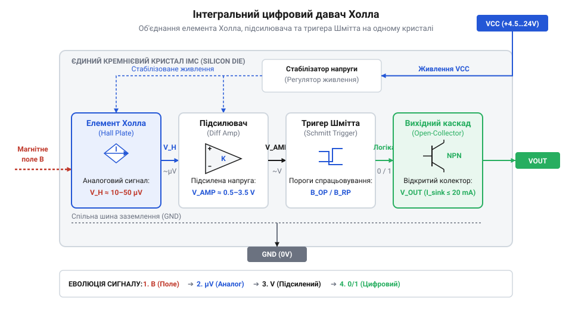
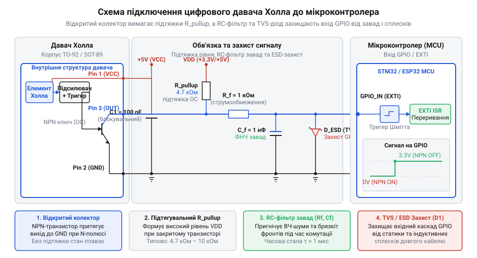
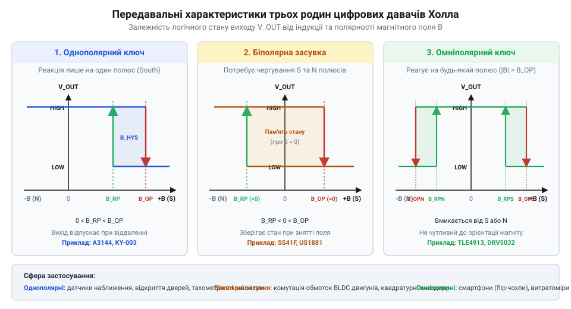

# Цифрові давачі Холла: однополярні, біполярні та омніполярні

<preknowlist>
- [Аналогові та лінійні давачі Холла](root:cat-hw-sensors/linear-hall-effect-sensors) — Фізичний ефект Холла, формування носіями заряду поперечної різниці потенціалів та відсутність внутрішньої порогової обробки сигналу.
- [Чопперна стабілізація в давачах Холла](root:cat-hw-sensors/hall-effect-chopper-stabilization) — Механізм періодичної модуляції та комутації чутливого елемента для усунення внутрішнього зсуву напруги.
- [KY-021 — міні герконовий давач](root:cat-hw-sensors/ky-021-reed) — Принцип роботи контактних магнітоуправлюваних вимикачів та обмеження їх механічної надійності.
</preknowlist>

## Проблема безконтактного виявлення та дребезгу

Будь-яка автоматизована система — від ЧПК-верстатів та промислових конвеєрів до приводів робототехніки й підрахунку обертів вала — потребує надійного способу фіксації механічного переміщення або крайнього положення деталей. Історично для цього застосовували електромеханічні кінцеві вимикачі або магнітокеровані геркони (геркон — скорочення від герметизований контакт). Проте в умовах високих швидкостей, інтенсивної вібрації, запиленості або підвищеної вологості прямому контактуванню металевих пластин притаманні неборні фізичні обмеження.

Головна проблема будь-яких механічних контактів — це дребезг контактів (@@en|contact bounce@@). Під час фізичного змикання двох пружних металевих пластин виникає серія мікроскопічних соударінь та відскоків. Замість одного чистого стрибка напруги електросхема реєструє пачку вихідних імпульсів, яка триває від десятків мікросекунд до кількох мілісекунд. Якщо вихідний сигнал підключено до входу мікроконтролера, який обробляє апаратні переривання (@@en|hardware interrupts@@), кожен такий відскок сприймається як окрема хибна подія. Для пригнічення дребезгу доводиться вводити програмні затримки або зовнішні RC-фільтри, що неминуче сповільнює реакцію системи та ускладнює схемотехніку.

Окрім дребезгу, механічні вимикачі зазнають незворотного деградаційного зносу. Електрична дуга, що виникає при розмиканні індуктивного навантаження, окислює контактні поверхні, а постійне механічне напруження спричиняє втому металу. Навіть герметичні вимикачі, такі як [герконових контактних давачів](root:cat-hw-sensors/ky-021-reed) або традиційні [герконів у колбі](root:cat-hw-sensors/ky-025-reed), хоч і захищені скляним балоном від пилу й вологи, мають обмежений ресурс спрацьовувань через механічне стомлення пружних феромагнітних пелюсток.

Твердотільне безконтактне зчитування позбавлене цих недоліків. Застосування кремнієвих чутливих елементів дозволяє фіксувати наближення постійного магніту крізь герметичні неферромагнітні стінки з пластику, алюмінію чи нержавіючої сталі без жодного механічного тертя та зносу.

Однак перехід до магнітного поля створює новий виклик: магнітна індукція наближуваного магніту змінюється не стрибкоподібно, а безперервно й плавно. Якщо подати такий аналоговий сигнал на простий пороговий компаратор без гістерезису, то в точці перемикання будь-який високочастотний шум живлення, наводки або мікроскопічна вібрація магніту викликатимуть хаотичне перемикання виходу між логічним нулем та одиницею. Це явище є магнітним аналогом механічного дребезгу.

Щоб забезпечити однозначне й чітке цифрове перемикання, напівпровідникові давачі Холла (@@en|Hall-effect digital switches@@) оснащують вбудованим магнітним гістерезисом (гістерезис, від грец. `ὑστέρησις` — запізнення; @@en|magnetic hysteresis@@). Завдяки поділу порогової індукції на дві окремі точки — точку включення та точку виключення — створюється інтервал стабільності, який повністю блокує хибні спрацьовування від шуму й вібрацій. Детальніше про те, як фізичні відкриття трансформувалися у високоінтегровані цифрові ключі, ви можете прочитати в матеріалі про [історію розвитку давачів](root:cat-hw-sensors/hall-effect-digital-sensors-family/hist-hall-effect-switches-evolution.md).

## Внутрішня структура цифрового давача Холла

Сучасний цифровий давач Холла є монолітною інтегральною мікросхемою, яка поєднує на одному напівпровідниковому кристалі первинний фізичний перетворювач та повний тракт аналогово-цифрової обробки сигналу.

Основою пристрою є первинний напівпровідниковий елемент Холла (@@en|Hall plate@@) — тонка пластина з кремнію чи арсеніду галію. Коли крізь пластину пропускається фіксований струм керування, а перпендикулярно до її поверхні прикладається зовнішнє магнітне поле з індукцією `B`, сила Лоренца відхиляє носії заряду до бічних граней пластини. Це створює поперечну різницю потенціалів — напругу Холла `V_H` (@@en|Hall voltage@@). Значення цієї напруги прямо пропорційне індукції магнітного поля:

```
V_H = (R_H / d) × I_bias × B
```

Тут `R_H` — коефіцієнт Холла для матеріалу напівпровідника, `d` — товщина чутливої пластини, `I_bias` — струм зміщення, а `B` — перпендикулярна складова магнітної індукції.

Оскільки первинна напруга `V_H` вимірюється мікровольтами, її неможливо подати безпосередньо на цифрові входи. Внутрішня структура давача складається з п'яти послідовних функціональних блоків:

1. Внутрішній регулятор напруги (@@en|voltage regulator@@): забезпечує стабільне живлення аналогових кіл та фіксований струм `I_bias` незалежно від коливань зовнішньої напруги живлення `VCC` (яка зазвичай становить від 3.0 В до 24 В). 2. Малошумний диференціальний підсилювач (@@en|differential amplifier@@): підсилює первинну мікровольтну напругу `V_H` до рівнів у сотні мілівольт. Для усунення власного температурного дрейфу та зміщення нуля в багатьох давачах застосовують механізм [чопперної стабілізації нуля](root:cat-hw-sensors/hall-effect-chopper-stabilization) (чоппер, від англ. `chop` — рубати, періодично комутувати). 3. Компаратор із тригером Шмітта (тригер, від англ. `trigger` — курок; @@en|Schmitt trigger@@): аналізує підсилений аналоговий сигнал і порівнює його з двома точними магнітними порогами. 4. Схема формування гістерезису: задає пороги `B_OP` (@@en|operating point@@) та `B_RP` (@@en|release point@@). 5. Вихідний транзисторний каскад: вихідний ключ із відкритим колектором або відкритим стоком (@@en|open-drain@@).


*Схематична внутрішня блок-схема цифрового давача Холла з послідовною обробкою магнітного сигналу.*

Робота компаратора з тригером Шмітта базується на чіткому поділі порогових індукцій. Коли зовнішнє магнітне поле зростає й досягає величини точки спрацьовування `B_OP`, компаратор змінює свій стан, і вихідний MOSFET-транзистор відкривається, замикаючи вихідний вивід на землю (`GND`). Вихідний сигнал переходить у стан логічного нуля (LOW).

Якщо після цього магнітне поле починає зменшуватися, давач не змінює стан при проходженні точки `B_OP`. Вихідний транзистор залишається відкритим доти, доки магнітна індукція не знизиться до точки відпускання `B_RP`. Лише після падіння поля нижче `B_RP` тригер Шмітта повертається у вихідний стан, вихідний транзистор закривається, і вихід давача переходить у високоімпедансний стан (Hi-Z).

Ширина магнітного гістерезису `B_HYST` визначається різницею цих порогових значень:

```
B_HYST = B_OP - B_RP
```

Будь-які коливання магнітного поля або електричні перешкоди, амплітуда яких менша за `B_HYST`, нездатні викликати хибне перемикання виходу. На відміну від [лінійних аналогових давачів](root:cat-hw-sensors/linear-hall-effect-sensors), чия вихідна напруга пропорційна полю, цифровий давач Холла формує виключно два дискретні логічні рівні.

Каскад із відкритим стоком потребує обов'язкового підключення зовнішнього підтягувального резистора (@@en|pull-up resistor@@) `R_PU` між виходом давача та лінією живлення мікроконтролера. Використання відкритого стоку забезпечує повну електричну сумісність: давач може живитися напругою 12 В, а його вихід через підтяжку буде безпечно комутувати логічний рівень 3.3 В або 5 В цифрового входу мікроконтролера.


*Типова схема підключення цифрового давача Холла з відкритим стоком до цифрового входу мікроконтролера.*

Для надійної роботи в колах живлення безпосередньо біля виводів давача встановлюють шунтувальний керамічний конденсатор `C_DEC` ємністю 0.1 мкФ (100 нФ). Він компенсує імпульсні падіння напруги під час перемикання струму чоппера й захищає внутрішній підсилювач від високочастотних завад.

Глибокий математичний апарат розрахунку магнітної індукції постійних магнітів та точних порогових точок викладено у статті про [моделювання магнітного гістерезису](root:cat-hw-sensors/hall-effect-digital-sensors-family/math-hall-magnetic-thresholds-and-field-calculation.md). Детальні обчислення вибору опору підтяжки, часових затримок фронтів та періодичного мікропотужного споживання (@@en|micropower duty-cycling@@) доступні у матеріалі про [розрахунку часових параметрів](root:cat-hw-sensors/hall-effect-digital-sensors-family/math-hall-electrical-timing-and-power-calculations.md). Специфікації геометричних корпусів TO-92 та SOT-23 наведено в довіднику [електричних специфікацій корпусів](root:cat-hw-sensors/hall-effect-digital-sensors-family/api-digital-hall-switch-hardware-specifications.md), а правила конфігурування входів мікроконтролера розкрито в довіднику [підключення апаратних переривань](root:cat-hw-sensors/hall-effect-digital-sensors-family/api-digital-hall-mcu-gpio-interrupt-interface.md).

## Класифікація цифрових перемикачів: полярність і пам'ять

Залежно від конфігурації внутрішнього тригера Шмітта та орієнтації чутливості до магнітних полюсів, цифрові давачі Холла поділяють на три основні родинні класи: однополярні, біполярні засувки та омніполярні.

1. Однополярний перемикач (@@en|unipolar switch@@):
Реагує виключно на один визначений магнітний полюс — зазвичай на південний полюс (`S`). Коли південний полюс наближається до маркованого боку корпусу давача і магнітна індукція перевищує додатній поріг `B_OP > 0`, вихідний транзистор відкривається (рівень LOW). При віддаленні магніту, коли індукція падає нижче додатного порогу відпускання `B_RP > 0` (при чому `0 < B_RP < B_OP`), вихід закривається (рівень HIGH). На північний полюс (`B < 0`) однополярний давач взагалі не реагує, залишаючись у стані Hi-Z. Однополярні ключі застосовують у простих давачах близькості, відкривання дверей та підрахунку обертів з одним магнітом. Типовим представником цього класу є опис у [простому модулі A3144](root:cat-hw-sensors/a3144-hall-module).

2. Біполярна засувка (@@en|bipolar latch switch@@):
Потребує почергової зміни магнітної полярності для перемикання і працює як магнітний тригер із пам'яттю. Для включення виходу (переходу в LOW) необхідне прикладання південного полюса з індукцією `B > B_OP > 0`. Після видалення магніту (`B = 0`) засувка **зберігає свій стан LOW**, утримуючи вихідний транзистор відкритим. Щоб повернути вихід у стан HIGH, необхідно прикласти протилежний, північний магнітний полюс з від'ємною індукцією `B < B_RP < 0`. Отже, поріг `B_OP` є додатним, а `B_RP` — від'ємним. Біполярні засувки є незамінними для визначення положення ротора в безколекторних двигунах (BLDC) та в двоканальних квадратурних енкодерах (@@en|quadrature encoder@@), де вздовж давача почергово проходять північні й південні полюси багатополюсного магнітного кільця. Класичним прикладом такого пристрою є опис у [двополярному давачі SS41F](root:cat-hw-sensors/ss41f-hall).

3. Омніполярний перемикач (@@en|omnipolar switch@@):
Спрацьовує від наближення будь-якого магнітного полюса — як південного, так і північного. Давач має дві симетричні пари порогів: `B_OP_S > 0` для південного полюса та `B_OP_N < 0` для північного полюса. При наближенні південного полюса (`B > B_OP_S`) або північного полюса (`B < B_OP_N`) вихід давача відкривається (LOW). При віддаленні магніту (коли модуль індукції падає нижче `B_RP_S` або зростає вище `B_RP_N`) вихід повертається у стан HIGH. Омніполярні давачі є ідеальним вибором для масового виробництва, оскільки вони усувають ризик помилок при монтажі постійних магнітів (немає потреби контролювати орієнтацію полюсів). Вони є повноцінною твердотільною заміною герконів у споживчій електроніці.


*Передавальні характеристики цифрових перемикачів Холла залежно від полярності та величини магнітної індукції.*

Для розробки трифазного детектора положення ротора BLDC-двигунів та квадратурного енкодера на біполярних засувках зверніться до проєктного керівництва про [детектора ротора BLDC](root:cat-hw-sensors/hall-effect-digital-sensors-family/proj-bldc-hall-latch-quadrature-encoder.md). Інженерні рішення щодо побудови завадозахищених кінцевих вимикачів на модульній базі висвітлено у практиці про [безконтактного магнітного вимикача](root:cat-hw-sensors/hall-effect-digital-sensors-family/proj-hall-omnipolar-proximity-module-integration.md). Готові плати з цифровими ключниками описано в [модулях серії KY-003](root:cat-hw-sensors/ky-003-hall), а силові вимірювання струму на базі аналогових елементів Холла — у [перетворювачах струму ACS712](root:cat-hw-sensors/acs712-current-sensor-module).

## Електричне підключення та часові затримки

У практичних схемах вихід цифрового давача Холла не видає напругу живлення напряму, а побудований на основі каскаду з відкритим стоком (@@en|open-drain@@). Таке рішення обумовлене необхідністю гальванічного узгодження між робочою напругою давача та логічними рівнями процесорного ядра. Внутрішній N-канальний MOSFET-транзистор виходу працює як електронний ключ: коли магнітне поле перевищує поріг спрацьовування, транзистор відкривається та з'єднує вихідний вивід із загальною шиною (`GND`), формуючи логічний нуль (LOW). Якщо ж магнітне поле падає нижче порогу відпускання, транзистор закривається, переводячи вихід у високоімпедансний стан.

Щоб сформувати високий логічний рівень (HIGH) за відсутності магнітного поля, вихід давача обов'язково підключають до шини живлення мікроконтролера через зовнішній резистор підтяжки (@@en|pull-up resistor@@). Вибір опору цього резистора `R_PU` є компромісом між швидкодією, енергоспоживанням та завадостійкістю. Мінімально допустимий опір обмежується максимально допустимим струмом стоку внутрішнього транзистора `I_SINK,max` (зазвичай до 20 мА), щоб запобігти його перегріву та пробою:

```
R_PU,min = (VCC_MCU - V_DS(SAT)) / I_SINK,max
```

Тут `VCC_MCU` — напруга живлення цифрового входу мікроконтролера, а `V_DS(SAT)` — напруга насичення відкритого стоку (зазвичай від 0.1 В до 0.4 В). Верхня межа опору `R_PU,max` обмежується паразитною ємністю сигнальної лінії `C_L` (що складається з ємності монтажних провідників та вхідної ємності виводу мікроконтролера):

```
t_rise ≈ 2.2 × R_PU × C_L
```

Якщо обрати занадто великий опір (наприклад, понад 50 кОм), постійна часу `RC` призведе до затягування переднього фронту імпульсу (@@en|rise time@@), що унеможливить високовольтний підрахунок обертів та підвищить чутливість до наводок. Для високошвидкісних застосувань рекомендується обирати `R_PU` в діапазоні від 1 кОм до 2.2 кОм, а для типових низькочастотних схем — від 4.7 кОм до 10 кОм.

Незважаючи на високу швидкість електронних процесів у напівпровідниках, цифровий давач Холла не є миттєвим перемикачем. Сигнал на виході змінюється із затримкою відгуку (@@en|response time@@) `t_response` відносно моменту, коли магнітна індукція реального поля перетинає порогові значення. Основний внесок у цю затримку робить внутрішня схема модуляції. Для пригнічення зсуву напруги та температурного дрейфу первинного напівпровідникового елемента в більшості сучасних мікросхем реалізовано механізм [чопперної стабілізації нуля](root:cat-hw-sensors/hall-effect-chopper-stabilization).

Внутрішній чоппер комутує чутливу пластину з частотою тактування `f_chop` (зазвичай від 100 кГц до 800 кГц). Оскільки дискретизація магнітного поля відбувається періодично на кожному такті чоппера, час між фізичним досягненням індукції `B_OP` і спрацьовуванням вихідного тригера Шмітта залежить від фази внутрішнього генератора. Це створює фазове тремтіння фронту — джитер відгуку (джитер, від англ. `jitter` — тремтіння; @@en|output jitter@@), значення якого не перевищує період чоппера `T_chop = 1 / f_chop`. Внаслідок цього загальна затримка відгуку `t_response` становить від 10 мкс до 50 мкс, що обмежує максимальну частоту перемикання давача `f_max` рівнем 10–50 кГц.

У пристроях із батарейним живленням — таких як бездротові давачі зачинення вікон або розумні лічильники води — постійний струм споживання аналогової схеми давача (3–10 мА) є неприпустимим. Для таких завдань застосовують спеціалізовані мікропотужні давачі з внутрішнім стробуванням живлення (@@en|micropower duty-cycling@@). Внутрішній таймер періодично подає живлення на чутливий елемент і підсилювач лише на короткий проміжок часу `t_awake` (близько 50 мкс), вимірює магнітне поле, фіксує стан у вихідному тригері-засувці та переводить схему в режим глибокого сну `t_sleep` (наприклад, на 50 мс).

Середнє струмоспоживання `I_avg` розраховується за формулою балансу енергії:

```
I_avg = (I_active × t_awake + I_sleep × t_sleep) / (t_awake + t_sleep)
```

Завдяки великій скважності (`t_sleep >> t_awake`) середній струм зменшується до 5–15 мкА. Проте платою за економію енергії є суттєве збільшення часу відгуку до величини інтервалу сну `t_sleep`, що робить такі давачі придатними лише для повільних механічних процесів із частотою подій не більше 10–20 Гц.

Для запобігання хибним спрацьовуванням компаратора від пульсацій струму під час перемикання чоппера обов'язково встановлюють керамічний конденсатор ємністю 0.1 мкФ безпосередньо біля виводів живлення `VCC` та `GND`. Детальні виведення формул постійної часу фронтів та математичне моделювання енергоспоживання при duty-cycling розкрито у матеріалі про [розрахунку часових параметрів](root:cat-hw-sensors/hall-effect-digital-sensors-family/math-hall-electrical-timing-and-power-calculations.md). Конструктивне виконання давачів у різних корпусах та їх граничні електричні характеристики ви знайдете в довіднику [електричних специфікацій корпусів](root:cat-hw-sensors/hall-effect-digital-sensors-family/api-digital-hall-switch-hardware-specifications.md).

## Практичний вибір давача та діагностика

Правильний вибір типу цифрового давача Холла визначається кінематикою механічної системи та конфігурацією магнітів. Залежно від характеру руху та необхідної функції застосовують один із трьох типів перемикачів:

1. Детектори ротора BLDC та квадратурні енкодери:
Для комутації обмоток безколекторних двигунів та побудови двохканальних енкодерів зчитування швидкості й напрямку обертання застосовують виключно біполярні засувки, такі як [двополярному давачі SS41F](root:cat-hw-sensors/ss41f-hall). Завдяки пам'яті стану засувка зберігає активний рівень при проходженні південного полюса і перемикається лише тоді, коли підходить північний полюс. При використанні багатополюсного магнітного диска це забезпечує симетричний вихідний меандр зі скважністю 50%, що є критичним для точного обчислення фазового зсуву. Детальний приклад побудови такої системи наведено у практиці про [детектора ротора BLDC](root:cat-hw-sensors/hall-effect-digital-sensors-family/proj-bldc-hall-latch-quadrature-encoder.md).

2. Підрахунок обертів вала та однополярні кінцеві вимикачі:
Коли на рухомому елементі або шківі закріплено лише один постійний магніт, застосовують однополярні давачі, як у [простих модулів A3144](root:cat-hw-sensors/a3144-hall-module). Давач спрацьовує під час наближення обраного полюса магніту й самостійно повертається у вихідний стан при його віддаленні.

3. Безконтактне виявлення положення без контролю орієнтації:
У пристроях масового збирання, де важко забезпечити суворий контроль полярності магніту при монтажі, використовують омніполярні давачі. Вони усувають ризик браку через перевернутий магніт і слугують надійною твердотільною заміною застарілих [герконових магнітних перемикачів](root:cat-hw-sensors/ky-021-reed). Інженерне проєктування завадозахищених вузлів кінцевого вимикача викладено у посібнику про [безконтактного магнітного вимикача](root:cat-hw-sensors/hall-effect-digital-sensors-family/proj-hall-omnipolar-proximity-module-integration.md).

Для надійної роботи вузла необхідно розрахувати робочу магнітну індукцію в залежності від повітряного зазору (@@en|air gap@@) `z` між поверхнею давача та постійним магнітом (неодимовим `NdFeB` або феритовим). Напруженість магнітного поля спадає нелінійно зі збільшенням відстані. Для забезпечення стабільного перемикання в усьому діапазоні робочих температур діє правило інженерного запасу: реальна індукція `B_actual(z_max)` на максимальній робочій відстані `z_max` повинна перевищувати верхню межу порогового значення спрацьовування `B_OP,max` щонайменше в 1.5 раза:

```
B_actual(z_max) ≥ 1.5 × B_OP,max
```

Запас у 50% компенсує температурний дрейф магнітної індукції постійного магніту (неодимові магніти втрачають близько 0.12% індукції на кожен градус Цельсія підвищення температури), виготовлювальні допуски порогів давача та механічні люфти конструкції. Докладні формули розрахунку спадання поля для магнітів різної форми та математична модель гістерезисних точок представлені в матеріалі про [моделювання магнітного гістерезису](root:cat-hw-sensors/hall-effect-digital-sensors-family/math-hall-magnetic-thresholds-and-field-calculation.md).

Підключення давача до мікроконтролера здійснюється через цифровий mas-вхід із підтримкою апаратних переривань (@@en|hardware interrupts@@). Використання внутрішніх підтягувальних резисторів мікроконтролера (опір яких становить від 20 кОм до 50 кОм) небажане при довжині лінії понад 10–20 см, оскільки високий опір збільшує сприйнятливість до электромагнітних завад. Надійні інженерні рішення вимагають встановлення зовнішнього резистора `R_PU` з опором 2.2–4.7 кОм безпосередньо біля входу мікроконтролера.

Для обробки сигналів високошвидкісних давачів у мікроконтролері налаштовують переривання по спадаючому фронту (`FALLING`) для реакції на наближення магніту або по зміні стану (`CHANGE`) для біполярних засувок. Це звільняє процесор від постійного опитування входу (polling) та забезпечує миттєву реакцію на події. Повний довідник із налаштування вхідних портів та реєстрів переривань наведено у матеріалі про [підключення апаратних переривань](root:cat-hw-sensors/hall-effect-digital-sensors-family/api-digital-hall-mcu-gpio-interrupt-interface.md).

Нижче наведено ідіоматичні приклади конфігурації апаратного переривання для зчитування імпульсів давача Холла на мовах C (з використанням бібліотеки STM32 HAL) та C++ (під платформу Arduino).

:::code hall-effect-digital-sensors-family-d/c/stm32-hal/snippet-1.c

:::code hall-effect-digital-sensors-family-d/cpp/arduino/hallisr.cpp

При практичній налагодженні вузлів із давачами Холла інженери найчастіше стикаються з трьома типами несправностей:

1. Хибні спрацьовування та спотворення кількості імпульсів:
Причина полягає у відсутності фільтрувального конденсатора `C_DEC` біля давача, занадто великому опорі `R_PU` або наведенні імпульсних завад від силових кіл двигунів на сигнальний кабель. Решення: встановити конденсатор 0.1 мкФ безпосередньо між `VCC` та `GND` давача, зменшити опір `R_PU` до 1 кОм, задіяти виту пару для сигнальних ліній або додати вхідний RC-фільтр (100 Ом + 1 нФ) біля виводу мікроконтролера.

2. Зависання виходу біполярної засувки (Latch lockup):
Давач переключається у стан LOW при наближенні південного полюса, але не повертається у стан HIGH після його віддалення. Причина: індукція північного полюса зворотного боку магніту не досягає від'ємного порогу відпускання `B_RP` через занадто великий повітряний зазор `z` або слабкий магніт. Решення: зменшити зазор `z`, установити потужніший неодимовий магніт або замінити засувку на однополярний давач.

3. Вплив зовнішніх паразитних магнітних полів:
Сильнострумові шини живлення або магнітні осердя трансформаторів створюють наводки, що призводять до спотворення порогових точок. Решення: орієнтувати площину чутливості давача перпендикулярно до векторів паразитних полів та застосовувати екранувальні пластини з м'якого заліза чи пермалою.