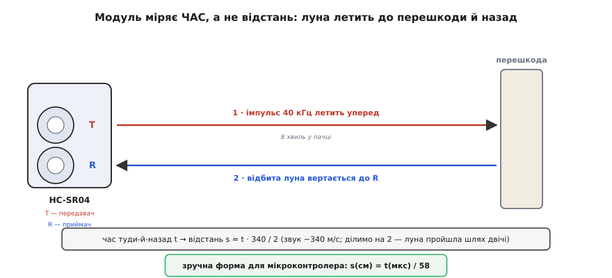
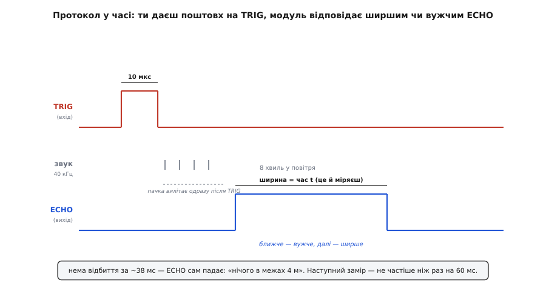
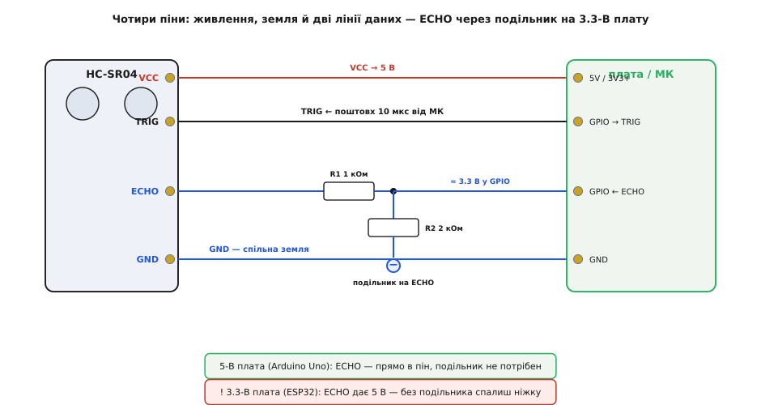

# HC-SR04 — ультразвуковий далекомір

Ультразвуковий модуль HC-SR04 — найвідоміший та найпоширеніший безконтактний сенсор відстані у навчальній та аматорській робототехніці. Завдяки використанню ультразвукових хвиль частотою 40 кГц модуль визначає відстань до перешкоди в діапазоні від 2 см до 400 см з точністю близько 3 мм, вимагаючи для взаємодії лише дві цифрові лінії мікроконтролера.

## 1. Будова та призначення ультразвукового далекоміра

Модуль легко впізнати за двома характерними металевими циліндрами на лицьовому боці плати:
- **Ультразвуковий випромінювач (Трансмітер, позначений буквою T):** п'єзоелектричний перетворювач, що генерує механічні пружні коливання повітря ультразвукової частоти при подачі електричного сигналу.
- **Ультразвуковий приймач (Ресивер, позначений буквою R):** аналогічний п'єзоелемент, на мембрані якого виникає електрична напруга при поверненні відбитої хвилі.



Сенсор знаходить масове застосування в системах виявлення перешкод для колісних роботів, паркувальних асистентах, вимірювачах рівня рідини у відкритих ємностях та інтерактивних безконтактних перемикачах.

## 2. Фізичний принцип вимірювання: від часу до відстані

HC-SR04 безпосередньо вимірює не саму відстань, а час поширення звукового імпульсу в повітрі туди й назад:
1. Звукова хвиля рухається в повітрі зі швидкістю близько 340 м/с (0.034 см за мікросекунду).
2. Оскільки звук проходить подвійну відстань (від сенсора до цілі й назад до приймача), розрахунок відстані виконується за базовим фізичним законом:
   ```
   відстань = (швидкість_звуку * час_польоту) / 2
   ```
3. Підставляючи швидкість звуку при кімнатній температурі, отримують класичне інженерне співвідношення:
   ```
   відстань_см = час_у_мікросекундах / 58
   ```

Якщо відлуння повертається через 580 мкс, відстань до об'єкта дорівнює точно 10 см; якщо час становить 5800 мкс — перешкода знаходиться на відстані 1 метра.

## 3. Часовий протокол сигналів TRIG та ECHO

Керування модулем здійснюється за суворим часовим алгоритмом через дві цифрові лінії:



- **Імпульс запуску (TRIG — Trigger):** мікроконтролер подає на вхід TRIG позитивний імпульс тривалістю не менше 10 мкс.
- **Генерація ультразвуку:** модуль автоматично випромінює в повітря пачку з 8 акустичних циклів на частоті 40 кГц.
- **Імпульс відповіді (ECHO):** одразу після початку випромінювання сенсор піднімає вихідний сигнал ECHO у високий логічний рівень (5 В). Як тільки приймач фіксує відбиту хвилю, лінія ECHO переходить у нуль.
- **Тайм-аут відсутності перешкоди:** якщо відлуння не повертається (перешкода відсутня або знаходиться далі 4 метрів), модуль примусово опускає ECHO в нуль через ~38 мс, що сигналізує мікроконтролеру про відсутність об'єкта в зоні досяжності.

Між послідовними вимірюваннями обов'язково витримують паузу мінімум 60 мс, щоб акустичні перевідбиття від стін кімнати встигли згаснути й не викликали хибних спрацьовувань.

## 4. Схема підключення та узгодження рівнів

Модуль HC-SR04 вимагає напруги живлення 5 В (при напрузі 3.3 В модуль або не працює зовсім, або має вкрай малу дальність).



Призначення контактів:
- **VCC:** живлення +5 В.
- **GND:** спільний провід (земля).
- **TRIG:** цифровий вхід запуску (підключається до будь-якого GPIO мікроконтролера).
- **ECHO:** цифровий вихід результату вимірювання.

**Критичне правило для 3.3-вольтових мікроконтролерів (ESP32, STM32, RP2040):**
Вихід ECHO видає сигнал з рівнем 5 В, що може спалити вхідний каскад 3.3 В процесора. Для безпечного підключення застосовують резистивний подільник напруги:
- Резистор 1 кОм між контактом ECHO та входом мікроконтролера.
- Резистор 2 кОм (або 2.2 кОм) між входом мікроконтролера та землею (GND).
Такий подільник знижує амплітуду сигналу з 5.0 В до безпечних 3.3 В.

## 5. Обмеження технології, сліпа зона та вплив температури

Для коректного використання HC-SR04 у реальних конструкціях слід враховувати фізичні обмеження ультразвуку:
- **Сліпа зона (Dead Zone):** на відстанях менше 2 см відбитий сигнал повертається до того, як закінчується випромінювання початкової пачки хвиль. У цій зоні модуль видає нуль або випадкові значення.
- **Кут конуса випромінювання (близько 15–30 градусів):** далекомір виявляє найближчу перешкоду всередині широкого конуса. Якщо ціль нахилена під кутом понад 45 градусів до осі променя, ультразвук дзеркально відбивається вбік, і сенсор не бачить об'єкта.
- **Поглинаючі поверхні:** м'які тканини, хутро, поролон або килими ефективно поглинають ультразвукові коливання 40 кГц, роблячи об'єкт «невидимим» для датчика.
- **Температурний дрейф швидкості звуку:** формула `c = 331.3 + 0.606 * T` показує, що при зміні температури від 0 °C до 40 °C швидкість звуку зростає з 331 м/с до 355 м/с. Для точних вимірювачів рівня обов'язково вводять температурну компенсацію дільника в коді.
