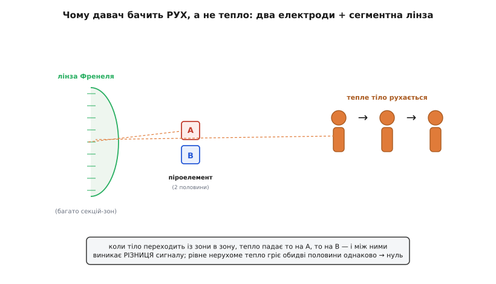
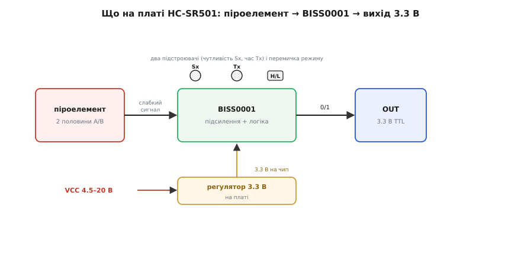
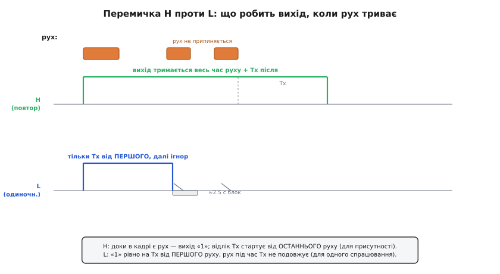
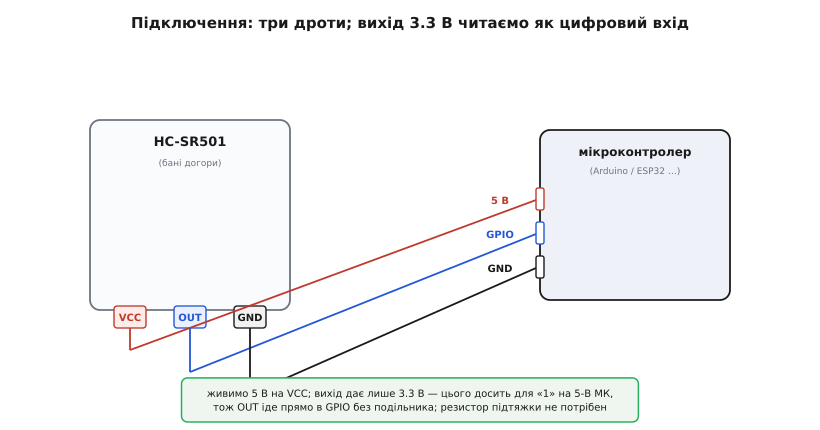

# HC-SR501 — PIR-давач руху

<preknowlist>
- [Спеціалізований PIR-контролер BISS0001](root:cat-hw-sensors/biss0001-asic) — внутрішня структура мікросхеми аналогової обробки, підсилення та таймінгу сигналу.
- [KY-010 — оптичний переривач](root:cat-hw-sensors/ky-010-interrupter) — порівняння активних оптичних датчиків із пасивними інфрачервоними сенсорами.
</preknowlist>

## Призначення та принцип пасивної детекції руху

Модуль HC-SR501 — найпопулярніший пасивний інфрачервоний датчик руху (від англ. *Passive InfraRed*, PIR). Він призначений для безконтактного виявлення переміщення людей, тварин або нагрітих об'єктів у радіусі до 7 метрів із кутом огляду близько 120 градусів. Сенсор широко застосовується в системах охоронної сигналізації, автоматичного вмикання освітлення у під'їздах і коридорах та енергозберігаючих пристроях «розумного дому».

Принцип роботи датчика є пасивним: він не випромінює жодних хвиль, а лише реєструє зміни теплового фону. Людське тіло з температурою близько 36.6 °C є джерелом інфрачервоного випромінювання з довжиною хвилі 9–10 мкм. Сенсор реагує винятково на **динамічну зміну** цього теплового потоку:

*Диференційна пара чутливих майданчиків: рух теплого об'єкта по черзі опромінює зони A та B, створюючи різницевий імпульс.*

Всередині металевого корпусу піродавача розташовано два чутливі майданчики з кристала танталату літію або титанату цирконату свинцю (PZT). Вони ввімкнені зустрічно: синфазне нагрівання корпусу сонцем або батареєю опалення генерує однакові зустрічні заряди й компенсується в нуль. Коли людина перетинає сектор огляду, її теплове поле по черзі падає на перший, а потім на другий майданчик, формуючи знакозмінний сплеск напруги в частки мілівольта.

Напівсферичний пластиковий ковпак датчика являє собою мультифокальну **лінзу Френеля**. Вона розбиває простір перед сенсором на десятки конічних секторів. Переміщуючись у приміщенні, людина перетинає межі цих секторів, створюючи на піроелементі серію теплових імпульсів.

## Апаратна структура та схемотехніка модуля

Модуль HC-SR501 об'єднує піроелектричний елемент, фокусувальну лінзу та аналогово-цифровий тракт обробки на одній друкованій платі:

*Апаратна структура модуля HC-SR501: лінійний стабілізатор 3.3 В, ASIC BISS0001, підстроювачі та джампер режимів.*

Ключові компоненти схеми:
1. **Спеціалізований контролер BISS0001:** мікросхема містить два малошумні операційні підсилювачі зі смуговим фільтром (0.1–10 Гц), віконний компаратор та генератори часових витримок.
2. **Вбудований регулятор напруги (LDO на 3.3 В):** забезпечує живлення внутрішньої мікросхеми та піродавача стабільною напругою, усуваючи вплив пульсацій шини живлення. Завдяки регулятору на плату можна подавати напругу в діапазоні від 4.5 В до 20 В (номінально 5 В).
3. **Вихідний рівень:** вихідний сигнал `OUT` завжди формується логічним рівнем 3.3 В (TTL), що робить його безпечним для прямого підключення як до 5-вольтових плат Arduino, так і до 3.3-вольтових мікроконтролерів ESP32, STM32 та Raspberry Pi.

## Налаштування чутливості, затримки та режимів роботи

На зворотній стороні плати розташовано органи ручного налаштування:

1. **Підстроювач чутливості (Sx):** регулює поріг віконного компаратора, змінюючи дальність детекції руху від 3 до 7 метрів.
2. **Підстроювач часу затримки (Tx):** задає тривалість утримання високого рівня на виході після фіксації руху (регулюється від 3 секунд до приблизно 5 хвилин).
3. **Джампер вибору режиму тригерування (H / L):**

*Режим L (одноразовий) ініціює витримку без продовження, режим H (повторний) подовжує активний рівень при безперервному русі.*

- **Режим L (Single trigger, неповторний):** при виявленні руху вихід переходить у високий стан на час Tx і повертається в низький стан, навіть якщо людина продовжує рухатися в зоні огляду. Після цього слідує фіксована пауза блокування (близько 2.5–3 с), коли сенсор не реагує на події.
- **Режим H (Repeatable trigger, повторний — рекомендований):** кожен новий рух скидає відлік таймера Tx наново. Вихідний сигнал утримується у високому рівні протягом усього часу активності людини плюс час Tx після останнього зафіксованого кроку.

## Підключення до мікроконтролера та час ініціалізації

Модуль підключається до системи трьома виводами:
- `VCC` — живлення 5 В (допустимо 4.5–20 В).
- `OUT` — цифровий вихід стану (3.3 В при фіксації руху, 0 В у спокої).
- `GND` — загальний нульовий провід.

*Підключення модуля HC-SR501 до цифрового входу мікроконтролера.*

> [!IMPORTANT]
> Після подачі живлення модулю HC-SR501 обов'язково потрібен час на термічну стабілізацію кристала та заряджання міжкаскадних конденсаторів — від **30 до 60 секунд**. Протягом цієї хвилини вихідний сигнал може хаотично перемикатися, тому в прошивці мікроконтролера передбачають початкову затримку перед запуском основного алгоритму охорони чи автоматики.
