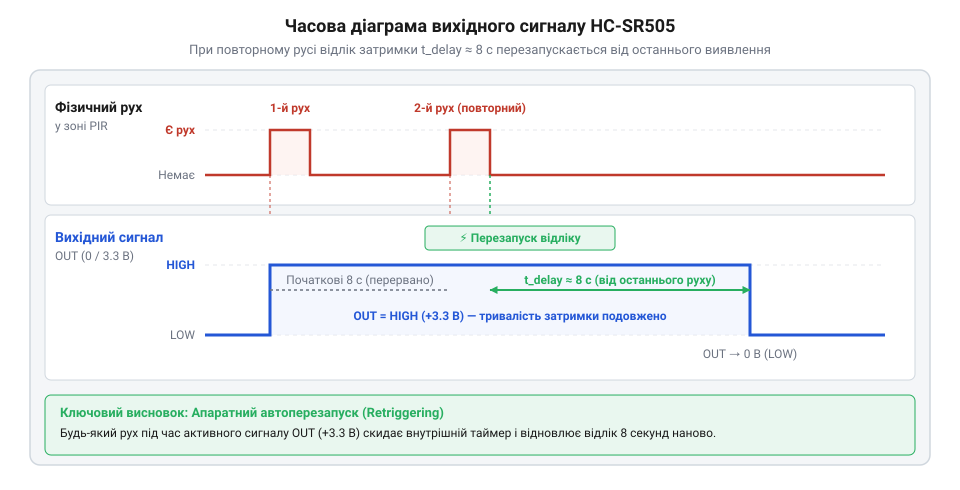
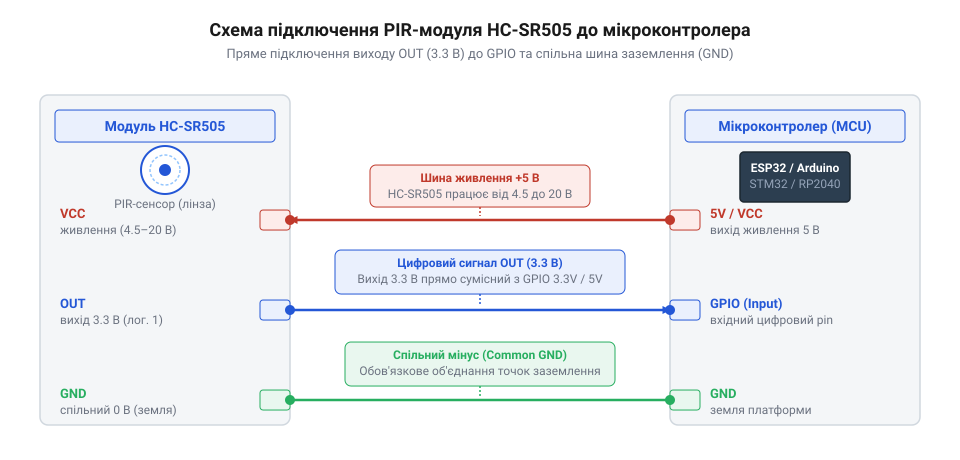

# Специфікація апаратного інтерфейсу, розводки виводів та електричних параметрів HC-SR505

<preknowlist>
- [HC-SR501 — PIR-давач руху](root:cat-hw-sensors/hc-sr501) — принципи роботи піроелектричних сенсорів та первинна обробка ІЧ-випромінювання
</preknowlist>

## Проблема автономного виявлення присутності та живлення

Розробка компактних автономних пристроїв виявлення руху — таких як портативні нічники, бездротові датчики сигналізації чи вузли @@en|розумного дому@@ (від англ. *@@en|smart home@@*) — вимагає мінімальних габаритів та низького енергоспоживання. Модуль HC-SR505 — це мініатюрний @@en|PIR-давач@@ (від англ. *@@en|passive infrared@@* — пасивний інфрачервоний сенсор), який приваблює розробників своїми надмалими розмірами (діаметр лінзи становить лише 10 мм) та простотою апаратного інтегрування. Проте спроби швидкого впровадження цього модуля у пристрої з батарейним живленням без детального аналізу специфікації часто завершуються хибними спрацьовуваннями, підвищеним розрядом батарей або повною непрацездатністю системи.

Найпоширенішою помилкою інженерів є спроба заживити модуль безпосередньо від шини живлення 3,3 В, яка є стандартною для багатьох сучасних мікроконтролерів та акумуляторних систем. Оскільки цифровий вихід модуля видає сигнал з амплітудою 3,3 В, виникає хибне припущення, що й напруга живлення `VCC` має становити 3,3 В. Насправді вбудований лінійний стабілізатор напруги модуля HC-SR505 потребує вхідної напруги `VCC` не менше ніж 4,5 В для надійної роботи внутрішніх кіл. При поданні 3,3 В внутрішній аналоговий підсилювач та компаратор втрачають стабільність, що призводить до постійних хибних генерацій високого рівня або повної відсутності реакції на рух. При виснаженні батарей, коли напруга просідає нижче 4,5 В, пристрій хаотично вмикається і вимикається.

Друга суттєва проблема полягає в неправильній інтерпретації характеристик вихідного сигналу. При підключенні модуля до джерела живлення 5 В, 9 В або 12 В початківці побоюються подавати сигнал виходу безпосередньо на входи мікроконтролерів із логікою 3,3 В, припускаючи, що вихідна напруга дорівнює вхідній напрузі живлення. Намагання додати зовнішній резистивний дільник або @@en|конвертер логічних рівнів@@ (від англ. *@@en|logic level converter@@* — пристрій узгодження напруг цифрових сигналів) непотрібно ускладнює принципову схему. Помилкове ж підтягування виходу до лінії 5 В за допомогою внутрішніх чи зовнішніх резисторів створює ризик зворотного струму та пошкодження вихідного каскаду модуля.

Нарешті, недотримання апаратних часових характеристик призводить до логічних помилок у програмному забезпеченні. Вихідний сигнал модуля утримує високий рівень протягом фіксованого проміжку часу близько 8 секунд після фіксації руху. Якщо програма мікроконтролера розрахована на миттєве скидання сигналу одразу після зупинки об'єкта, алгоритм обробки працюватиме некоректно. На відміну від більшого [давача руху HC-SR501](root:cat-hw-sensors/hc-sr501), де тривалість затримки та чутливість регулюються за допомогою підлаштовувальних резисторів, модуль HC-SR505 має повністю фіксовані апаратні параметри, які не можна змінити обертанням потенціометрів.

Для проектування надійних автономних пристроїв необхідно детально розібратися в електричних параметрах виводів, правильно підібрати джерело живлення та врахувати апаратний алгоритм формування вихідного сигналу.

## Призначення виводів та електричні параметри живлення

Апаратний інтерфейс модуля HC-SR505 виведено на трьохконтактний роз'єм із печатним кроком 2,54 мм (стандартний штирьовий з'єднувач Breakout Header). Чітке розуміння функціоналу кожного з трьох виводів є основою для безпечного та надійного підключення модуля до будь-якої мікроконтролерної системи.

Модуль має таку @@en|цокольовку@@ (від англ. *@@en|pinout@@* — схема розташування та призначення виводів):
- `VCC` — вивід живлення позитивної полярності. Приймає постійну напругу в діапазоні від 4,5 В до 20 В. - `OUT` — цифровий вихід сигналу виявлення присутності. Видає високий рівень 3,3 В при фіксації руху та низький рівень 0 В у стані спокою. - `GND` — спільний вивід заземлення (мінус живлення).

Широкий діапазон напруги живлення `VCC` (4,5–20 В) забезпечується вбудованим інтегральним лінійним стабілізатором напруги з малим падінням (LDO, типу 7133). Цей стабілізатор понижує вхідну напругу до фіксованого значення 3,3 В, від якого живляться первинний піроелектричний елемент та спеціалізована мікросхема обробки сигналів EG4001. Власний мінімальний спад напруги на LDO-стабілізаторі становить близько 1,2 В. Саме цим обумовлена нижня межа живлення: 3,3 В + 1,2 В = 4,5 В. Якщо вхідна напруга `VCC` падає нижче 4,5 В, стабілізатор виходить із режиму регулювання, а вихідна напруга живлення внутрішніх аналогових підсилювачів просідає, що призводить до хаотичних збоїв.

Важливою перевагою модуля HC-SR505 для портативної електроніки є вкрай низький @@en|струм спокою@@ (від англ. *@@en|quiescent current@@*, де *@@en|quiescent@@* означає неактивний або той, що перебуває у стані спокою). У черговому режимі, коли рух у зоні виявлення відсутній, модуль споживає струм `I_q` не більше 60 мкА (типове виміряне значення становить 40–50 мкА). Це дає змогу будувати енергоефективні автономні пристрої з тривалим терміном служби від батарей — таких як чотири елементи AA, акумулятори LiFePO4 чи Li-ion (через підвищувальний перетворювач на 5 В) або мережеві джерела живлення на 5 В, 9 В чи 12 В.

Вихідний вивід `OUT` виконано за схемою активного push-pull каскаду. При фіксації зміни інфрачервоного випромінювання внутрішня мікросхема формує на виводі `OUT` логічну одиницю з амплітудою рівно 3,3 В. Завдяки тому, що вихідний каскад живиться безпосередньо від внутрішнього стабілізованого джерела 3,3 В, вихідна напруга сигналу HIGH залишається незмінною 3,3 В незалежно від того, яка саме напруга подана на вивід `VCC` (будь то 5 В, 9 В чи 20 В).

На відміну від простих пасивних або оптичних елементів, таких як [щелиновий оптичний переривач](root:cat-hw-sensors/ky-010-interrupter) або [відбивальний сенсор TCRT5000](root:cat-hw-sensors/tcrt5000), які потребують зовнішніх підтягувальних резисторів та аналогової фільтрації, модуль HC-SR505 видає вже повністю сформований цифровий сигнал із фіксованими амплітудними характеристиками.

## Часова діаграма затримки та автоматичний перезапуск

Принцип формування вихідного сигналу модуля HC-SR505 базується на аналізі часових інтервалів змінення теплового стану в зоні охоплення. Первинне ІЧ-випромінювання фокусується на піроелектричний кристалик через сегменти, які формує пластикова @@en|лінза Френеля@@ (від прізвища французького фізика @@fr|Fresnel@@ — Огюстен Жан Френель). Лінза розділяє зону огляду на множину чутливих секторів. Коли об'єкт, що випромінює тепло, перетинає межу між секторами, створюється @@en|піроелектричний ефект@@ (від грец. *@@grc|pyr@@* — вогонь та *@@grc|elektron@@* — бурштин), який перетворюється у внутрішній різницевий електричний імпульс.

Після реєстрації первинного імпульсу внутрішній таймер мікросхеми переводить вихід `OUT` у стан логічної одиниці (3,3 В) на фіксований час затримки `T_delay`. У модулі HC-SR505 цей інтервал становить приблизно 8 секунд (із технічним розкидом від 7 до 9 секунд залежно від технологічних допусків компонентів). Регулювання цього часу за допомогою підлаштовувального резистора у модулі HC-SR505 не передбачено — тривалість затримки є жорстко зафіксованою на апаратному рівні.

Модуль HC-SR505 за замовчуванням функціонує в режимі, який називається @@en|автоперезапуск@@ (від англ. *@@en|auto-retriggering@@*, де *@@en|retrigger@@* означає повторний запуск таймера). Якщо об'єкт продовжує рухатися в зоні виявлення, кожний новий зареєстрований перетин секторів обнуляє внутрішній лічильник затримки. У результаті вихідний сигнал `OUT` залишається у високому стані (3,3 В) протягом усього часу активного руху об'єкта плюс фіксовані 8 секунд після його повного зупинення або виходу із зони огляду.

Після того як рух припинився і відлік часу `T_delay` завершився, вихід `OUT` повертається у стан логічного нуля (0 В). У цей момент активується внутрішнє апаратне блокування тривалістю `T_block` (близько 2,5 секунди). Протягом цього короткого паузового інтервалу сенсор повністю ігнорує будь-який новий рух, що необхідно для термодинамічної стабілізації піроелектричного кристала та запобігання хибним спрацьовуванням від залишкових коливань температури.

*Часова діаграма вихідного сигналу OUT модуля HC-SR505 при повторній фіксації руху в зоні охоплення.*

Розуміння часової діаграми є критичним для розробки алгоритмів мікроконтролера. Оскільки вихідний сигнал зберігає високий рівень щонайменше 8 секунд, мікроконтролеру не потрібно здійснювати високочастотне опитування виводу. Оптимальним підходом є використання переривань по наростаючому фронту (rising edge) або опитування стану виводу з періодом 1–2 секунди. Активні [інфрачервоні давачі перешкод](root:cat-hw-sensors/ir-obstacle) вимагають швидкої реакції в реальному часі, тоді як HC-SR505 бере на себе функцію розширення імпульсу та згладжування коротких пауз між рухами людини.

## Схеми підключення до мікроконтролерів і узгодження

Завдяки фіксованому вихідному рівню 3,3 В та широкому діапазону живлення (4,5–20 В) модуль HC-SR505 легко інтегрується як у системи з 3,3-вольтовою логікою, так і в класичні 5-вольтові мікроконтролерні платформи без використання складних проміжних узгоджувальних кіл.

Підключення до джерела живлення здійснюється подачею напруги від 4,5 В до 20 В на вивід `VCC` та з'єднанням виводу `GND` зі спільною шиною заземлення системи. При використанні плати з роз'ємом USB або зовнішнім живленням 5 В (наприклад, Arduino Uno, ESP32 DevKit, STM32 Nucleo) вивід `VCC` модуля зручно підключати безпосередньо до лінії 5V плати.

При підключенні сигналу до мікроконтролерів із логікою 3,3 В (ESP32, ESP8266, STM32, RP2040) вивід `OUT` з'єднується безпосередньо з будь-яким цифровим вводом-виводом @@en|GPIO@@ (від англ. *@@en|general-purpose input/output@@* — вхід/вихід загального призначення). Оскільки напруга виходу модуля дорівнює 3,3 В, вона повністю відповідає стандартним логічним рівням 3,3 В системи. Жодних додаткових компонентів узгодження не потрібно.

При підключенні сигналу до мікроконтролерів із логікою 5 В (Arduino Uno / Nano / Mega на базі ATmega328P / ATmega2560) слід враховувати характеристики вхідних каскадів. Згідно зі специфікацією мікроконтролерів ATmega при живленні 5 В, порогове значення вхідної напруги високого рівня `V_IH` обчислюється з напруги живлення `VCC`:

    V_IH = 0.6 × VCC
         = 0.6 × 5.0 V      [підстановка значення напруги живлення VCC]
         = 3.0 V            [обчислення мінімального порогу логічної одиниці]

Оскільки вихідний рівень HIGH модуля HC-SR505 становить 3,3 В, значення `3.3 V > 3.0 V` з запасом перевищує поріг розпізнавання логічної одиниці. Це означає, що вихід `OUT` модуля HC-SR505 можна підключати напряму до 5-вольтового входу @@en|GPIO@@ без залучення @@en|конвертера логічних рівнів@@ чи резистивних дільників. Важливе застереження: вхідний вивід мікроконтролера слід конфігурувати як звичайний цифровий вхід без внутрішнього підтягувального резистора до 5 В (режим `INPUT`, а не `INPUT_PULLUP`), щоб запобігти витіканню струму 5 В у вихідні кола модуля HC-SR505.

*Схема прямого підключення виводів модуля HC-SR505 до джерела живлення 5 В та цифрового входу мікроконтролера.*

Для забезпечення завадостійкості при монтажі на друкованій платі або при віддаленому розміщенні модуля (при довжині з'єднувальних дротів понад 20 см) рекомендується встановлювати керамічний шунтувальний конденсатор ємністю 100 нФ безпосередньо між виводами `VCC` та `GND` поблизу роз'єму модуля. Це компенсує імпульсні просідання напруги живлення під час спрацьовування внутрішніх кіл сенсора.