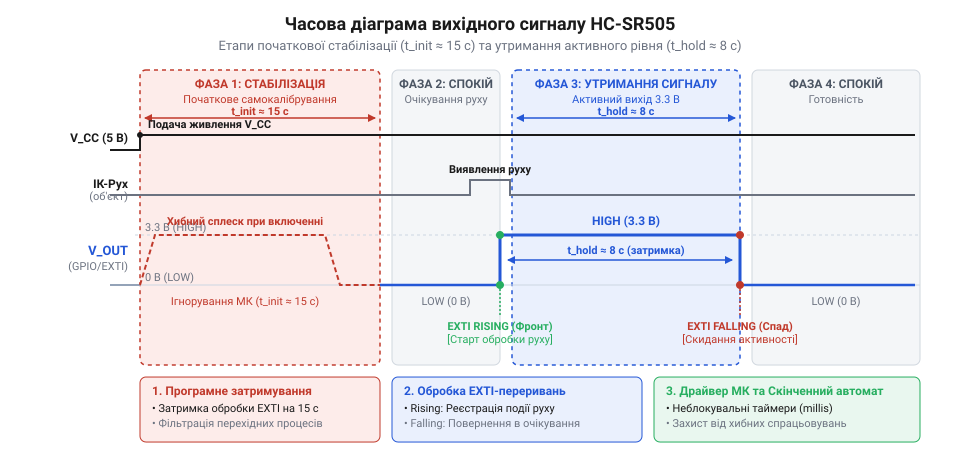
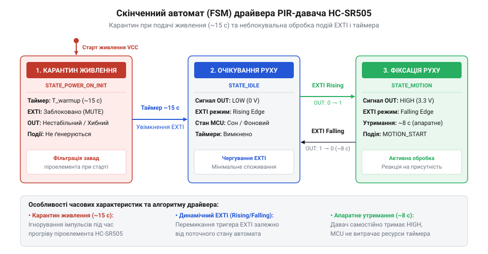

# Програмно-апаратний інтерфейс зчитування цифрового виходу та обробки подій HC-SR505

<preknowlist>
- [HC-SR501 — PIR-давач руху](root:cat-hw-sensors/hc-sr501) — принцип піроелектричного детектування ІЧ-випромінювання та загальна фізика роботи PIR-елемента
</preknowlist>

## Проблема хибних спрацьовувань та блокування

Уявіть типову розробницьку ситуацію: ви підключаєте мініатюрний @@en|PIR@@ (від англ. *Passive Infrared* — пасивний інфрачервоний) давач руху @@en|HC-SR505@@ до плати мікроконтролера, подаєте живлення і миттєво отримуєте сигнал тривоги або спрацьовування виконавчого реле в абсолютно порожній кімнаті. Додавши у програму простий цикл очікування завершення активного сигналу, ви стикаєтеся з іншою проблемою: після найменшого руху в зоні огляду головна програма повністю зупиняється на цілих 8 секунд, перестаючи реагувати на натискання кнопок, мережеві запити та опитування інших датчиків. Спроба зчитувати стан цифрового виходу давача у прямому блокувальному циклі без урахування його фізичних та часових фаз неминуче призводить до хаосу й втрати керованості всієї системи.

Головне джерело хибних тривог одразу після вмикання полягає у фізиці роботи піроелектричного кристала та аналогової схемотехніки модуля. Коли на пристрій надходить постійна напруга від 4.5 В до 20 В, каскад підсилювачів із надвисоким вхідним опором та внутрішній порівнювач спеціалізованої мікросхеми @@en|ASIC@@ (від англ. *Application-Specific Integrated Circuit* — спеціалізована інтегральна мікросхема) потребують часу для встановлення постійного зміщення й температурної рівноваги. Під час цього початкового етапу самокалібрування (@@en|power-on warm-up phase@@) вихідний вивід @@en|OUT@@ хаотично перемикається або фіксується у високому логічному стані на тривалий час. Якщо керуюча програма почне обробляти стан вхідного порту одразу після скидання мікроконтролера, вона сприйме цей технологічний перехідний процес як реальне виявлення об'єкта, що генерує хибне спрацьовування (@@en|false trigger@@).

Порівнюючи цей модуль із повнорозмірними рішеннями, розробники часто згадують [PIR-давач руху HC-SR501](root:cat-hw-sensors/hc-sr501), де присутні апаратні потенціометри для підлаштування чутливості й тривалості імпульсу. У компактному модулі @@en|HC-SR505@@ будь-які фізичні регулятори відсутні. Усі часові інтервали зафіксовані на рівні внутрішньої схемотехніки. Це означає, що розробник позбавлений можливості зменшити тривалість вихідного сигналу апаратним шляхом.

Друга критична проблема полягає у блокувальному характері простого опитування. Традиційний підхід із використанням циклових затримок вигляду `while (digitalRead(PIN) == HIGH)` зупиняє виконання процесорних інструкцій на увесь період, поки вихідний вивід перебуває під високою напругою. Оскільки давач утримує активний рівень 3.3 В приблизно 8 секунд після виявлення ІЧ-випромінювання, центральний процесор опиняється у заблокованому стані (@@en|blocking state@@). В операційних системах реального часу або при обробці швидких подій периферії така затримка є неприпустимою, оскільки вона блокує обробку черг повідомлень та спричиняє переповнення буферів.

Для усунення хибних спрацьовувань та забезпечення неблокувального виконання програмний драйвер повинен чітко розділяти стан живлення пристрою та події виявлення руху. Це досягається введенням часового карантину після подачі живлення та переходом від суцільного опитування порту до обробки зовнішніх переривань за фронтами сигналу.

## Часові параметри та фази сигналу

Вихідний вивід @@en|OUT@@ давача @@en|HC-SR505@@ є однопровідним цифровим виходом, побудованим на двотактному каскаді @@en|push-pull@@ (від англ. *push-pull* — двотактний каскад) з логічними рівнями @@en|CMOS@@ (від англ. *Complementary Metal-Oxide-Semiconductor* — комплементарна структура метал-оксид-напівпровідник) 3.3 В. Для побудови коректного алгоритму обробки необхідно розібрати повний життєвий цикл вихідного сигналу, який складається з трьох послідовних часових фаз.

Першою є **фаза стабілізації після подачі живлення** (@@en|Warm-up Phase@@). Вона розпочинається в момент подачі напруги живлення `V_CC` і триває орієнтовно 15 секунд (`T_warmup` ≈ 15 с). Протягом цього інтервалу вихідний вивід @@en|OUT@@ перебуває у високому стані (3.3 В) або випромінює серію імпульсів, поки внутрішні ємності піроелемента накопичують необхідний заряд. Програмі необхідно витримати інтервал карантину (@@en|quarantine interval@@), ігноруючи будь-які зміни рівня на вхідному виводі мікроконтролера.

Другою є **фаза спокою** (@@en|Idle State@@). Вона настає одразу після завершення 15-секундного самокалібрування. Напруга на виході @@en|OUT@@ падає до логічного нуля (0 В). Давач перебуває у режимі очікування, а його лінза @@en|Fresnel@@ (від прізвища французького фізика Огюстена Жана Френеля) фокусує інфрачервоне випромінювання навколишнього середовища на двосегментний піроелектричний кристал.

Третьою є **фаза утримання активного сигналу** (@@en|Hold Time Phase@@). Коли тепловий об'єкт перетинає зони фокусування лінзи, виникає різниця температур між сегментами піроелемента. Внутрішня мікросхема миттєво формує наростаючий вихідний фронт (@@en|Rising Edge@@), піднімаючи напругу на @@en|OUT@@ до 3.3 В. Модуль утримує цей високий рівень протягом фіксованого часу утримання `T_hold` ≈ 8 с (із технологічним розкидом від 7 до 9 секунд залежно від екземпляра кристала та температури довкілля). Після завершення цього інтервалу напруга повертається до 0 В через спадний фронт (@@en|Falling Edge@@). На відміну від швидких пристроїв, таких як [оптичний переривач KY-010](root:cat-hw-sensors/ky-010-interrupter) чи відбивальний [ІЧ-відбивальний давач TCRT5000](root:cat-hw-sensors/tcrt5000), де сигнал змінюється за мікросекунди, @@en|HC-SR505@@ генерує тривалі багатосекундні імпульси.

Після спадного фронту внутрішня схемотехніка блокує повторне тригерування на час затримки повернення (@@en|lockout period@@) тривалістю близько 2.5 секунд ($T_{\text{lockout}} \approx 2.5\text{ с}$), необхідний для відновлення розрядного балансу піроелемента.

Структуру й часову послідовність усіх трьох фаз наведено на діаграмі.


*Часова послідовність напруги на виході OUT давача HC-SR505: 15-секундна фаза стабілізації після подачі живлення та 8-секундний активний імпульс утримання при виявленні руху.*

Для розрахунку мінімального інтервалу готовності системи `T_quarantine` із урахуванням 2-секундного технологічного запасу `T_margin` застосовується формульне співвідношення:

```
T_quarantine = T_warmup + T_margin
             = 15.0 + 2.0         [підстановка фази стабілізації та часового запасу]
             = 17.0 с             [мінімальний час затримки ініціалізації]
```

Розрахунок повного часового циклу від моменту фіксації першого руху до готовності прийняти наступне спрацьовування `T_cycle_min` визначається сумою тривалості утримання та періоду блокування:

```
T_cycle_min = T_hold + T_lockout
            = 8.0 + 2.5           [підстановка активного імпульсу та періоду блокування]
            = 10.5 с              [мінімальний повний цикл повторного спрацьовування]
```

Отримані значення показують, що будь-які повторні коливання сигналу протягом 10.5 секунд від початку руху є продовженням однієї події або результатом технологічного відновлення кристала.

## Апаратне налаштування порту та переривань

Щоб позбавити центральний процесор від потреби постійного циклічного опитування (@@en|polling@@) вхідного виводу, вхідний @@en|GPIO@@-порт (від англ. *General-Purpose Input/Output* — вхід/вихід загального призначення) мікроконтролера необхідно налаштувати на роботу з апаратними зовнішніми перериваннями (@@en|EXTI@@, від англ. *External Interrupt* — зовнішнє переривання). Це дозволяє процесору виконувати основні задачі або перебувати у режимі зниженого енергоспоживання, реагуючи лише на зміну стану фізичної лінії.

При виборі електричної конфігурації вхідного порту слід враховувати, що активний вихід модуля @@en|HC-SR505@@ видає напругу 3.3 В у високому стані та 0 В у низькому. Однак під час подачі живлення або при випадковому обриві з'єднувального проводу вхідний вивід мікроконтролера може опинитися у високоімпедансному стані плавання (@@en|floating input@@). Для запобігання наведенню статичних завад на порту слід увімкнути внутрішній стягуючий резистор (@@en|pull-down resistor@@) на рівні мікроконтролера. Це гарантує чіткий логічний нуль на вході за відсутності активного сигналу від давача.

Апаратна периферія переривань @@en|EXTI@@ конфігурується залежно від завдань драйвера:
- **За вихідним фронтом** (@@en|Rising Edge Trigger@@): переривання генерується при переході сигналу з 0 В до 3.3 В. Це фіксує точний момент початку виявлення руху та ініціює реакцію системи. - **За спадним фронтом** (@@en|Falling Edge Trigger@@): переривання виникає при переході з 3.3 В до 0 В. Це сповіщає систему про завершення 8-секундного фазового імпульсу утримання. - **За обома фронтами** (@@en|Both Edges Trigger@@): дозволяє обробляти як початок, так і фінал руху в єдиному обробнику переривань.

Процедура обробки переривань (@@en|ISR@@, від англ. *Interrupt Service Routine* — процедура обробки переривання) повинна виконуватися за мінімальний час. Всередині @@en|ISR@@ заборонено викликати затримувальні функції, роздруковку у послідовний порт або важкі обчислення. Основна задача @@en|ISR@@ — зчитати поточний рівень порту, зафіксувати системний мікросекундний чи мілісекундний таймштамп і встановити атомарний прапорець події для подальшого аналізу. Подібно до того як швидкодіючий [ІЧ-давач перешкод](root:cat-hw-sensors/ir-obstacle) передає сирі події переривань вищому рівню програми, драйвер @@en|HC-SR505@@ передає зафіксовані фронти в програмний скінченний автомат.

## Скінченний автомат програмного драйвера

Для надійної обробки сигналів @@en|HC-SR505@@ без затримки основного циклу програми розробляється програмний драйвер на основі скінченного автомата (@@en|FSM@@, від англ. *Finite-State Machine* — скінченний автомат). Автомат реалізує програмний фільтр, який відсікає початковий 15-секундний сплеск стабілізації за допомогою системного таймера та генерує чисті події початку й завершення руху.

Скінченний автомат драйвера містить чотири логічні стани:
1. `HC_SR505_STATE_QUARANTINE` (Карантин живлення): активується одразу після ініціалізації драйвера. Системний таймер фіксує час запуску. Будь-які імпульси на виході давача ігноруються. Перехід до наступного стану відбувається лише після завершення 15-секундного тайм-ауту за умови, що лінія @@en|OUT@@ перебуває у низькому стані. 2. `HC_SR505_STATE_IDLE` (Очікування руху): давач повністю відкалібрований. Автомат очікує на прапорець вихідного фронту від @@en|ISR@@. При його отриманні генерується подія `ON_MOTION_START`, і автомат переходить у стан активності. 3. `HC_SR505_STATE_MOTION_ACTIVE` (Фіксація руху): система фіксує активну фазу. При отриманні прапорця спадного фронту від @@en|ISR@@ генерується подія `ON_MOTION_END`, і автомат переходить у стан технологічного блокування. 4. `HC_SR505_STATE_LOCKOUT` (Блокування повторного тригерування): витримується 2.5-секундна пауза для стабілізації піроелемента після спаду сигналу. Після її завершення автомат повертається до стану `HC_SR505_STATE_IDLE`.

Взаємодію між станами, подіями переривань @@en|EXTI@@ та таймером зображено на схемі.


*Скінченний автомат неблокувального драйвера: переходи між станами карантину живлення, очікування та фіксації руху за сигналами EXTI та системного таймера.*

Нижче наведено повну реалізацію неблокувального драйвера для двох популярних платформ розробки.

:::tabs
:::code api-hc-sr505-signal-interface/c/esp-idf/hc-sr505-isr-handler.c
:::code api-hc-sr505-signal-interface/cpp/arduino/hcsr505driver.cpp
:::

Застосування скінченного автомата з обробкою переривань гарантує повну неблокувальність виконання логіки мікроконтролера та надійне відсікання хибних спрацьовувань під час початкової стабілізації давача.