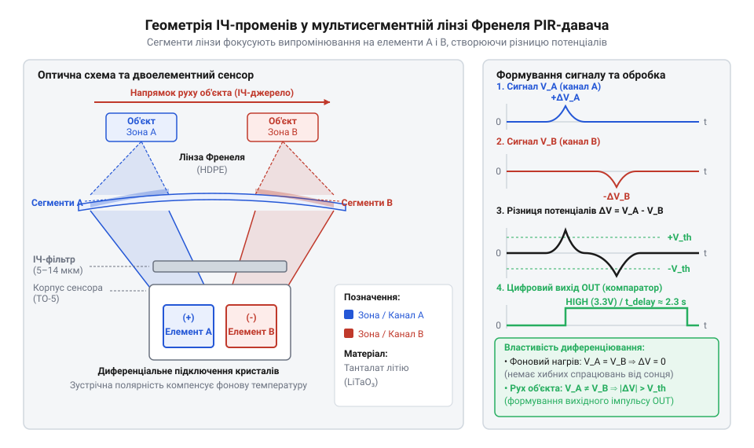
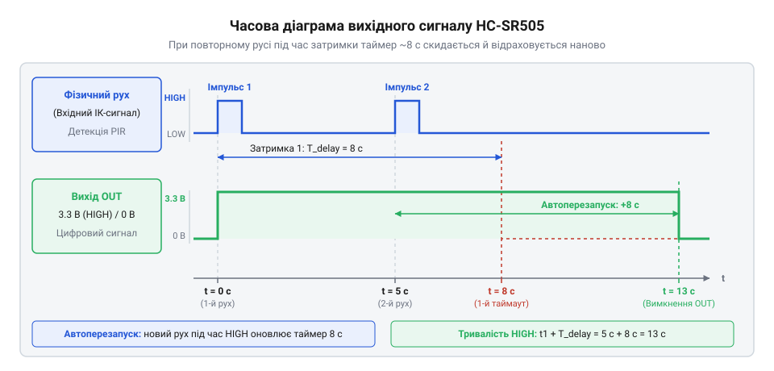
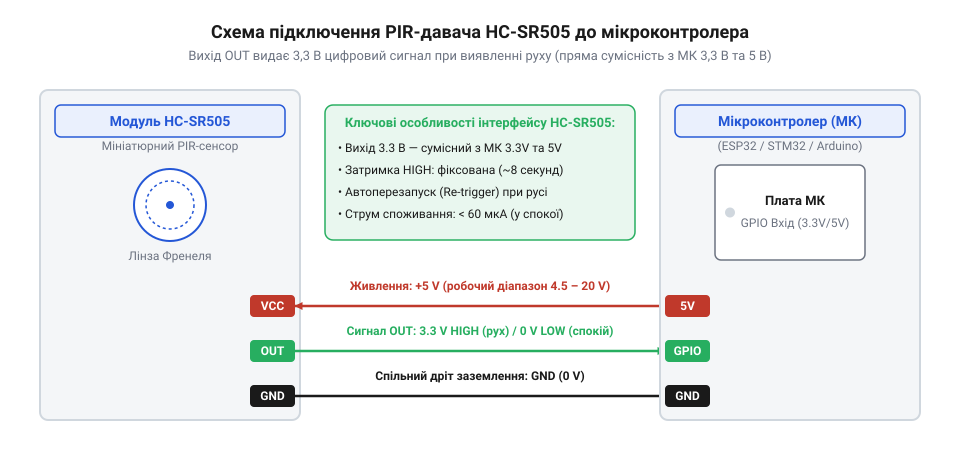
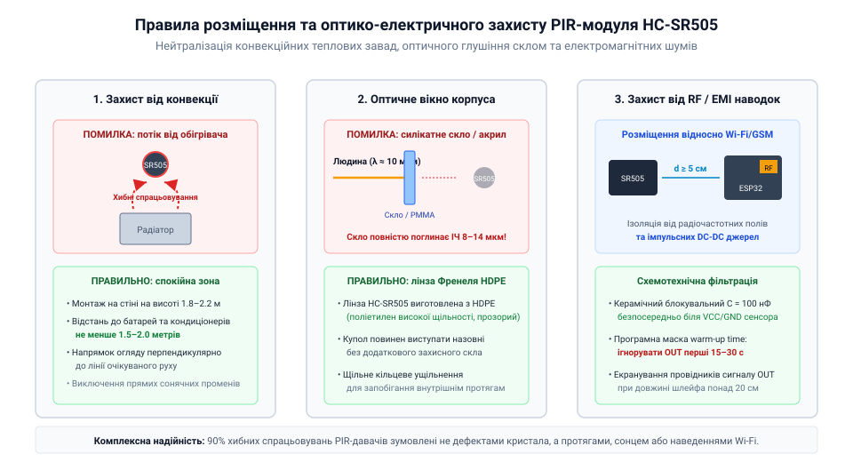

# HC-SR505 — мініатюрний PIR-давач руху

<preknowlist>
- [HC-SR501 — PIR-давач руху](root:cat-hw-sensors/hc-sr501) — базовий принцип виявлення руху двоелементним ІЧ-сенсором та порядок формування цифрового сигналу затримки
</preknowlist>

## Виявлення руху в компактних пристроях

Розробка сучасних малогабаритних пристроїв автоматизації — таких як розумні стінові вимикачі, акумуляторне нічне підсвічування, компактні датчики присутності для розумного будинку або портативні модулі сигналізації — вимагає суворого балансу між фізичними розмірами та енергоспоживанням. Коли перед інженером постає завдання реалізувати безконтактний контроль наявності людини у приміщенні, першим рішенням часто здається використання активних оптичних або акустичних сенсорів. Проте активне випромінювання світла чи ультразвуку швидко виснажує автономні джерела живлення.

Наприклад, класичний [оптичний переривач](root:cat-hw-sensors/ky-010-interrupter) вимагає наявності відкритого оптичного каналу між випромінювачем та фотоприймачем, що унеможливлює його застосування для об'ємного контролю кімнати. Своєю чергою, [ІЧ-відбивальний давач](root:cat-hw-sensors/tcrt5000) та поширені [ІЧ-давачі перешкод](root:cat-hw-sensors/ir-obstacle) змушені безперервно подавати струм на випромінювальний світлодіод, аби фіксувати відбитий від поверхні потік. У сценаріях із живленням від компактного літієвого акумулятора або дискового гальванічного елемента постійний струм споживання в десятки міліампер призводить до повного розряду акумулятора за кілька діб.

Єдиним виходом для малогабаритних пристроїв є повна відмова від генерації власного зондувального сигналу та перехід до пасивного приймання випромінювання. Будь-який фізичний об'єкт, температура якого перевищує абсолютний нуль, є джерелом природного теплового електромагнітного випромінювання. Для людського тіла з температурою шкіри близько 31–37 °C максимум спектральної щільності випромінювання припадає на середній та дальній інфрачервоний діапазон із довжиною хвилі близько 9–10 мікрометрів. Фіксація цього теплового поля не вимагає витрат енергії на випромінювання: сенсору достатньо перетворювати падаючі фотони інфрачервоного спектра на електричний заряд. Пристрої такого типу називають @@en|PIR@@-давачами (від англ. *Passive Infrared*, де латинське *passivus* — пасивний, той, що діє без власного випромінювання, а *infra* — нижче, за межами червоного спектра).

Тривалий час основним рішенням у любительських та промислових розробках залишався модуль [HC-SR501](root:cat-hw-sensors/hc-sr501). Однак при спробі інтегрувати його у мініатюрний корпус розробник зіштовхується з геометричними та експлуатаційними обмеженнями. Плата модуля має розміри 32 × 24 мм, а її оптична купольна лінза має діаметр 23 мм. Крім того, на платі розташовано два механічні підлаштовувальні резистори для змінення чутливості та часу затримки, а також переставляємий джампер вибору режимів. У компактних герметичних пристроях чи тонких світлодіодних профілях ці компоненти не лише займають дорогоцінний об'єм, а й створюють ризик механічного зсуву налаштувань від вібрацій, трясіння або температурного розширення пластику.

Для розв'язання проблеми розмірів та механічної нестабільності було розроблено мініатюрний модуль HC-SR505. Його друкована плата має розмір всього 10 × 23 мм, а діаметр напівсферичної лінзи становить близько 11.5 мм. Щоб досягти такого скорочення габаритів, розробники повністю відмовилися від механічних потенціометрів, зафіксувавши всі параметри підсилення та часові інтервали на рівні внутрішньої схемотехніки. Історію розвитку таких сенсорів висвітлює [еволюція піроелектричних давачів](root:cat-hw-sensors/hc-sr505/hist-pir-miniaturization.md), демонструючи перехід від масивних охоронних сповіщувачів 1970-х років до сучасних інтегрованих модулів. Модуль HC-SR505 забезпечує радіус виявлення руху до 3 метрів під кутом огляду близько 100 градусів, споживаючи в режимі очікування (англійською @@en|standby@@, від англ. *standby* — режим очікування) менше 50 мікроампер, що робить його оптимальним вибором для компактної автоматизації.

## Фізичний принцип та оптична модуляція

В основі функціонування модуля HC-SR505 лежить піроелектричний (від грец. *pyr* — вогонь, тепло та *elektron* — бурштин, електрика) ефект, притаманний деяким сегнетоелектричним кристалам, таким як танталат літію або кераміка цирконату-титанату свинцю. Монокристали цих речовин володіють спонтанною електричною поляризацією. Коли температура кристала змінюється, відстані між атомами в кристалічній ґратці змінюються, що викликає зсув пов'язаних електричних зарядів на протилежних гранях кристала та виникнення тимчасової різниці потенціалів. Ключова особливість піроелектрика полягає у тому, що він генерує електричний струм лише під час *динамічної зміни* температури (тобто коли швидкість зміни температури `dT/dt ≠ 0`). Якщо температура кристала залишається сталою, вільні носії заряду з навколишнього середовища нейтралізують поверхневий потенціал, і струм припиняється.

Щоб запобігти хибним спрацьовуванням від коливань загальної температури довкілля (наприклад, при сезонному прогріванні кімнати або висвітленні корпусу сонячним променем), всередині герметичного металевого корпусу TO-5 розміщено не один, а два однакових піроелектричних кристалічних елементи. Ці кристали включені послідовно-зустрічно (диференціально). Коли тепловий фон у приміщенні змінюється рівномірно, обидва кристали нагріваються з однаковою швидкістю, утворюючи однакові за величиною, але протилежні за знаком заряди, які повністю компенсують один одного (`ΔV = 0`). Детальні властивості кристалічних структур розкривають [піроелектричні матеріали та елементи](root:ph-condensed/pyroelectric-effect), де аналізуються кристалографічні осі та коефіцієнти поляризації. Саме через диференціальну будову людина, яка нерухомо стоїть у зоні огляду, випромінює сталий тепловий потік, що не викликає появу сигналу на виході сенсора.

Аби нерухомий сенсор міг виявити переміщення об'єкта у просторі, тепловий потік від рухомого тіла необхідно перетворити на серію динамічних теплових імпульсів. Цю функцію виконує купольна лінза @@en|Френеля@@ (названа на честь французького фізика Огюстена Жана Френеля, фр. *Fresnel*). Вона виготовлена з високопрозорого для інфрачервоного випромінювання поліетилену високої щільності та являє собою масив із багатьох мікролінз, розміщених на напівсферичній поверхні. Кожна мікролінза фокусує інфрачервоні промені з вузького сектора простору на поверхню двоелементного піроелемента, утворюючи просторову сітку з зон високої чутливості та сліпих проміжків між ними. Оптичні особливості таких елементів розкривають [лінзи Френеля в оптиці](root:ph-waves/fresnel-lens), висвітлюючи кроки профілювання зональних кілець.

Коли людина перетинає зони огляду давача HC-SR505, її теплове випромінювання послідовно фокусується спочатку на першому піроелектричному кристалі, потім потрапляє у сліпу зону, а далі фокусується на другому кристалі. В результаті перший кристал зазнає швидкого нагріву та охолодження (`dT₁/dt ≠ 0`), генерируючи позитивний сплеск напруги, після чого другий кристал генерирує негативний сплеск напруги. На виході диференційної пари утворюється змінний електричний сигнал низької частоти (від 0.5 до 10 Гц), амплітуда якого пропорційна швидкості переміщення та різниці температур між тілом людини й тлом.

*Геометрія фокусування інфрачервоних променів лінзою Френеля на двоелементний піроелектричний кристалічний сенсор.*

Точний математичний апарат, що описує закон випромінювання Планка, розрахунок оптичної сили зональних кілець лінзи та просторовий розподіл чутливості, винесено в окремий матеріал. Детальний розрахунок перетворення інфрачервоного потоку подають [математичні моделі піроелектричного ефекту](root:cat-hw-sensors/hc-sr505/math-pir-thermal-radiation-and-fresnel.md), де наведено диференціальні рівняння теплового балансу кристала.

## Схемотехнічна логіка та таймер затримки

Змінна напруга, яку генерирують піроелектричні кристали при виявленні руху, має надзвичайно малу амплітуду — від кількох десятків мікровольт до кількох мілівольт. Для її перетворення на впевнений цифровий сигнал на платі HC-SR505 встановлено спеціалізовану мікросхему обробки (чип у SMD-корпусі, що виконує функції аналогового переднього краю та цифрового контролера, @@en|ASIC@@ від англ. *Application-Specific Integrated Circuit* — спеціалізована інтегральна схема). Перший каскад мікросхеми являє собою високоточний операційний підсилювач із двома ступенями підсилення та активними смуговими фільтрами. Фільтри відтинають постійну складову напруги зміщення та високочастотні електромагнітні перешкоди, пропускаючи лише низькочастотні коливання в діапазоні 0.5–10 Гц, викликані рухом людини. Загальний коефіцієнт підсилення аналогового тракту досягає 60–80 дБ.

Підсилений змінний сигнал надходить на вхід віконного компаратора. Віконний компаратор має два опорні пороги: верхній поріг напруги `V_ref + ΔV` та нижній поріг `V_ref - ΔV`. Якщо підсилена хвиля сигналу через нагрів першого кристала перевищує верхній поріг або через охолодження чи перехід на другий кристал опускається нижче нижнього порогу, компаратор перемикається у стан логічної одиниці та формує внутрішній тригерний імпульс. У модулі HC-SR505 поріг `ΔV` заданий внутрішньосхемними резисторами планарного виконання, що гарантує стабільну чутливість виявлення об'єктів на відстані до 3 метрів без потреби вручну обертати потенціометри.

Після спрацьовування компаратора внутрішня цифрова логіка мікросхеми встановлює вихідний вивід `OUT` у стан високого логічного рівня (близько 3.3 В) та запускає внутрішній цифровий таймер. У модулі HC-SR505 час затримки `T_delay` зафіксований hardware-способом і становить приблизно 8 ± 2 секунд. Важливою відмінністю HC-SR505 від інших сенсорів є те, що він апаратно переведений у режим автоматичного перезапуску (англійською @@en|retrigger@@, від англ. *re-* — повторно та *trigger* — спускний гачок, запуск). Якщо під час утримування високого рівня на виході людина продовжує рухатися в зоні огляду, кожна нова пульсація від компаратора скидає відлік таймера затримки назад до нуля.

*Часова діаграма вихідного сигналу OUT модуля HC-SR505 при повторних спрацьовуваннях у режимі перезапуску.*

Завдяки цьому вихід `OUT` залишається у високому стані неперервно протягом усього часу активності людини плюс 8 секунд після останньої зафіксованої зміни положення.

Модуль HC-SR505 оснащений простим трипіновим інтерфейсом із кроком виводів 2.54 мм: `VCC` (живлення), `OUT` (цифровий вихід) та `GND` (спільна земля). Вбудований мікропотужний стабілізатор напруги зі зниженим падінням (@@en|LDO@@, від англ. *Low Dropout* — низьке падіння напруги) дозволяє живити модуль від постійної напруги у діапазоні від 4.5 В до 20 В. Внутрішня схема обробки та вихідний каскад працюють від стабілізованої напруги 3.3 В. На виході `OUT` формується логічний рівень 3.3 В у активному стані, що забезпечує повну сумісність із 3.3-вольтовими мікроконтролерами (ESP32, STM32, RP2040) без додаткових дільників напруги. При підключенні до 5-вольтових мікроконтролерів (наприклад, плат Arduino AVR) рівень 3.3 В надійно розпізнається як логічна одиниця, оскільки поріг спрацьовування становить близько 3.0 В.

*Схема електричного підключення модуля HC-SR505 до мікроконтролера з описом кіл живлення та зчитування цифрового виходу.*

Детальні значення електричних параметрів, допустимих струмів та розводку пінів містить [специфікація апаратного інтерфейсу](root:cat-hw-sensors/hc-sr505/api-hc-sr505-hardware.md), де наведено максимальні допустимі значення напруги та струму. Алгоритми обробки сигналів на боці мікроконтролера, налаштування зовнішніх переривань та обробку дребезгу висвітлює [інтерфейс обробки подій](root:cat-hw-sensors/hc-sr505/api-hc-sr505-signal-interface.md), розглядаючи роботу в режимі глибокого сну. Для практичної побудови пристроїв із живленням від акумулятора розроблено матеріал про [автономний контролер освітлення](root:cat-hw-sensors/hc-sr505/proj-hc-sr505-battery-light-controller.md), де розібрано схемотехніку керування польовим транзистором. Порівняльний аналіз HC-SR505 з іншими моделями давачів присутності наводить [огляд пасивних інфрачервоних давачів](root:cat-hw-sensors/pir-motion-sensors-overview), у якому систематизовано характеристики різних сенсорних сімейств.

## Електричне підключення та узгодження рівнів

Спроба прямого підключення периферійного давача до керуючого мікроконтролера часто опирається у розбіжність робочих напруг живлення та сигнальних рівнів. Модуль `@@en|HC-SR505@@` має вбудований лінійний стабілізатор напруги `@@en|LDO@@`, що дозволяє подавати на контакт `VCC` шину живлення в широкому діапазоні від `4.5 В` до `20 В`. Однак усе внутрішнє аналогове та цифрове ядро модуля працює від внутрішньо зафіксованої напруги `3.3 В`. Через це цифровий вихід `OUT` формує амплітуду сигналу високого рівня `HIGH` саме на позначці `3.3 В`, тоді як низький рівень `LOW` відповідає потенціалу спільної шини `0 В`. Повна апаратна розводка виводів та граничні значення струмів описані в [детальній специфікації апаратного інтерфейсу](root:cat-hw-sensors/hc-sr505/api-hc-sr505-hardware.md).

Вихідний каскад спеціалізованої мікросхеми `@@en|ASIC@@` побудований за схемою `@@en|push-pull@@` (англ. *push-pull*, двотактний вихід). Це означає, що при наявності руху давач активно підтягує вивід `OUT` до внутрішньої лінії `3.3 В`, а за його відсутності — до нуля, не потребуючи зовнішнього стягувального резистора `@@en|pull-down@@`. При підключенні до `3.3`-вольтових мікроконтролерів (зокрема `@@en|ESP32@@` чи `@@en|STM32@@`) лінію `OUT` з'єднують напряму з будь-яким цифровим входом `@@en|GPIO@@`. Якщо ж системи автоматизації будуються на `5`-вольтовій логіці (наприклад, мікроконтролерах `@@en|ATmega328P@@`), потенціал `3.3 В` перебуває на межі гарантованого порігу розпізнавання високого рівня для більшості типів входів. Для безумовного узгодження логічних рівнів застосовують резистивний дільник або підсилювальний каскад на `@@en|NPN@@`-транзисторі, який одночасно захищає `@@en|microcontroller@@` від імпульсних наводок.

*Підключення модуля HC-SR505 до мікроконтролерів із можливістю пробудження через зовнішнє переривання.*

Найбільша ефективність `@@en|HC-SR505@@` проявляється у бездротових та акумуляторних вузлах, де критично зберегти заряд батареї. Сам модуль у режимі очікування `@@en|standby@@` споживає лише близько `50 мкА`. Щоб мікроконтролер не витрачав енергію на постійне опитування стану входу у циклі, його переводять у режим глибокого сну — `@@en|deep sleep@@` (англ. *deep sleep*, режим глибокого сну), у якому споживання не перевищує `10 мкА`. Вихід `OUT` давача підключають до виводу мікроконтролера з підтримкою апаратних зовнішніх переривань. Поява позитивного фронту сигналу `@@en|rising edge@@` під час фіксації руху миттєво генерує апаратне переривання, яке розбуджує процесорне ядро для виконання обробки події. Опис програмних обробників та алгоритмів фільтрації дріботіння викладено у [програмному інтерфейсі зчитування виходу](root:cat-hw-sensors/hc-sr505/api-hc-sr505-signal-interface.md), а повноцінна практична реалізація пристрою подана у [проєкті автономного контролера освітлення](root:cat-hw-sensors/hc-sr505/proj-hc-sr505-battery-light-controller.md). Порівняно з більшими модулями, такими як [повнорозмірний давач HC-SR501](root:cat-hw-sensors/hc-sr501), компактний модуль потребує значно менше простору на друкованій платі.

Коли давач використовують у простих автономних системах без мікроконтролера — наприклад, для безпосереднього ввімкнення світлодіодної стрічки або силового реле, — вихідний струм `OUT` обмежений значенням близько `10 мА`. Напряму комутувати потужне навантаження заборонено, оскільки це спричинить перегрів та вихід з ладу внутрішнього `@@en|ASIC@@`. У таких схемах цифровий вихід `OUT` керує затвором малопотужного польового транзистора `@@en|MOSFET@@` (англ. *metal-oxide-semiconductor field-effect transistor*, польовий транзистор із ізольованим затвором) з логічним рівнем керування `@@en|logic-level MOSFET@@`. Напруги `3.3 В` цілком достатньо для повного відкриття каналу транзистора та комутації струмів у кілька амперів.

Покажемо практичну реалізацію налаштування зовнішнього переривання для виведення мікроконтролера зі стану сну при спрацьовуванні `@@en|HC-SR505@@`.

:::tabs
:::code hc-sr505-d/c/esp-idf/gpio-isr-handler.c
:::code hc-sr505-d/cpp/arduino/wakeupisr.cpp
:::

## Захист від завад та розміщення

Навіть ідеально розрахована електрична схема втрачає надійність, якщо давач руху розташований без урахування законів інфрачервоної оптики та газової динаміки. Пасивний піроелектричний елемент реагує не на присутність тепла як таку, а на часову зміну градієнта інфрачервоної освітленості між двома внутрішніми кристалами. Якщо перед сенсором формується конвекційний потік теплого повітря від радіатора опалення чи кондиціонера, переміщення нагрітих повітряних мас створює динамічну зміну ІЧ-потоку, яку `@@en|HC-SR505@@` помилково сприймає як рух людини. Фізичні основи випромінювання та модуляції світла описані в [математичній моделі ІЧ-потоку](root:cat-hw-sensors/hc-sr505/math-pir-thermal-radiation-and-fresnel.md).

Найпоширенішою помилкою при конструюванні корпуса пристрою є встановлення давача за звичайним захисним склом або прозорим акриловим вікном. Силікатне скло та більшість побутових пластиків повністю поглинають довгохвильове інфрачервоне випромінювання у діапазоні від `8 мкм` до `14 мкм`, на яке розраховані [піроелектричні матеріали ІЧ-детекторів](root:ph-condensed/pyroelectric-effect). Захисне вікно корпуса має виготовлятися виключно з тонкого поліетилену високої щільності `@@en|HDPE@@` (англ. *high-density polyethylene*, поліетилен високої щільності) або розроблятися як інтегрована [лінза Френеля в інфрачервоній оптиці](root:ph-waves/fresnel-lens). При цьому лінза повинна щільно прилягати до корпуса без зазорів, щоб запобігти потраплянню всередину бічних протягів чи пилу.

*Правильне розміщення давача HC-SR505 у корпусі для нейтралізації сонячного світла та теплових завад.*

Окремим джерелом хибних спрацьовувань є перші секунди після подачі живлення на модуль. При включенні напруги `VCC` піроелектричним кристалам та високоелементним каскадам підсилювача всередині `@@en|ASIC@@` потрібен час для встановлення стабільного робочого режиму за постійним струмом. Цей період первинної ініціалізації — `@@en|warm-up time@@` (англ. *warm up*, час прогріву та стабілізації) для `@@en|HC-SR505@@` триває від `15` до `30` секунд. Протягом цього інтервалу вихід `OUT` може довільно змінювати свій стан між `HIGH` та `LOW`. Програмне забезпечення керуючого мікроконтролера зобов'язане реалізувати часову маску — ігнорувати будь-які сигнали з контакту `OUT` протягом перших `30` секунд після подачі живлення на пристрій.

Висока чутливість аналогового підсилювача `@@en|HC-SR505@@` робить його вразливим до високочастотних радіозавад — `@@en|EMI@@` (англ. *electromagnetic interference*, електромагнітні завади) та `@@en|RF@@` завад, що випромінюються антенами модулів `@@en|Wi-Fi@@`, `@@en|GSM@@` або імпульсними перетворювачами живлення. Якщо розводка друкованої плати розміщує давач ближче ніж за кілька сантиметрів від антени `@@en|ESP32@@`, намодльовані радіочастотні наводки можуть викликати мікровольтні сплески на високоімпедансних входах підсилювача. Для нейтралізації цих факторів шину живлення `VCC` модулю шунтують керамічним конденсатором ємністю `100 нФ` у безпосередній близькості до роз'єму, а в умовах сильних завад застосовують феритовий фільтр. Порівняно з іншими варіантами побудови систем виявлення присутнього об'єкта, детальніше розберемо їх у [порівняльному аналізі пасивних ІЧ-давачів](root:cat-hw-sensors/pir-motion-sensors-overview).