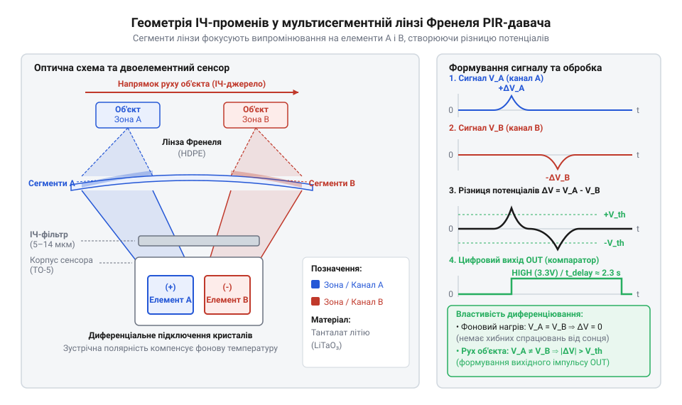
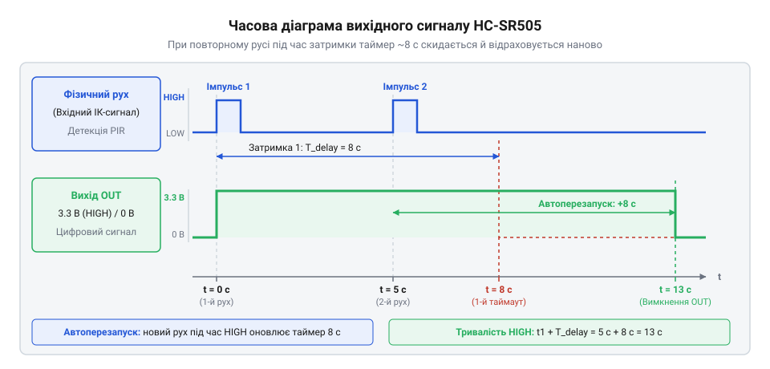

# HC-SR505 — мініатюрний PIR-давач руху

<preknowlist>
- [HC-SR501 — PIR-давач руху](root:cat-hw-sensors/hc-sr501) — базовий принцип виявлення руху двоелементним ІЧ-сенсором та порядок формування цифрового сигналу затримки
</preknowlist>

## Проблема габаритів у пасивному виявленні

Створення портативних акумуляторних пристроїв вимагає мінімізації струму споживання та розмірів корпусів. Більшість активних давачів, як-от [ІЧ-давачі перешкод](root:cat-hw-sensors/ir-obstacle) чи [відбивальні давачі TCRT5000](root:cat-hw-sensors/tcrt5000), безперервно випромінюють сигнал, споживаючи десятки міліампер. Пасивне приймання інфрачервоного випромінювання людини усуває власне випромінювання: пристрій лише приймає теплові хвилі, витрачаючи мікроампери.

Проте класичний [повнорозмірний модуль HC-SR501](root:cat-hw-sensors/hc-sr501) залишається громіздким через масивні потенціометри та перемикачі. У компактних пристроях ці механічні елементи займають критичний простір.

Модуль @@en|HC-SR505@@ усуває цю проблему відмовою від органів регулювання. Усі параметри зафіксовано схемотехнічно на платі розміром 10 × 23 мм з напівсферичною лінзою діаметром 10 мм. Це дозволяє вбудовувати @@en|PIR@@-давач (англ. *Passive Infrared* — пасивний інфрачервоний) у найменші корпуси через простий отвір.

## Диференціальний піроелемент та лінза Френеля

В основі виявлення лежить піроелектричний ефект (грец. *pyr* — вогонь): кристал генерує електричний заряд лише під час динамічної зміни температури. Статичний нагрів від довкілля не створює струму, тому нерухомі об'єкти давач не помічає.

Щоб уникнути хибних спрацьовувань від зміщення температури кімнати, всередині корпусу @@en|HC-SR505@@ розміщено два піроелементи, увімкнених послідовно-зустрічно. Рівномірне нагрівання викликає в кристалах протилежні за знаком заряди, які взаємно компенсуються. Сигнал виникає лише тоді, коли тепловий промінь послідовно проектується на один кристал, а потім на інший.

Перед кристалами встановлено купольну лінзу Френеля, масив мікролінз якої розбиває зону спостереження на окремі промені чутливості. Під час руху людини її інфрачервоне випромінювання почергово перетинає ці зони, перетворюючи постійний тепловий потік на серію імпульсів.

*Лінза Френеля розбиває зону спостереження на окремі промені й фокусує ІЧ-випромінювання на диференціальний піроелемент.*

## Апаратна обробка та автоматичний перезапуск

Слабкий мікровольтний сигнал з піроелемента надходить на спеціалізовану мікросхему @@en|ASIC@@ (англ. *Application-Specific Integrated Circuit*). Вона підсилює його, фільтрує завади та подає на віконний компаратор. Коли амплітуда перевищує поріг, внутрішній цифровий таймер формує на виході високий логічний рівень.

У модулі @@en|HC-SR505@@ тривалість цієї затримки апаратно зафіксована й становить близько 8 секунд.

Мікросхема працює у режимі автоматичного перезапуску таймера. Доки людина рухається в зоні чутливості, кожен новий імпульс від піроелемента скидає відлік 8-секундного таймера на початок. Вихідний сигнал переходить у низький стан лише через 8 секунд після повного припинення руху.

*Діаграма роботи виходу HC-SR505: кожен новий рух перезапускає відлік затримки, утримуючи високий рівень.*

## Підключення модуля та практичні обмеження

Модуль @@en|HC-SR505@@ має три контакти: живлення @@en|VCC@@, спільний провід @@en|GND@@ та цифровий вихід @@en|OUT@@. Вбудований стабілізатор дозволяє подавати на @@en|VCC@@ від 4.5 до 20 В, а вихід @@en|OUT@@ видає 3.3 В. Це робить його сумісним із входами мікроконтролерів на 3.3 В і 5 В або дозволяє керувати затвором @@en|MOSFET@@ для увімкнення реле чи LED-стрічки.

Під час подачі живлення конденсатори та піроелемент потребують часу на стабілізацію. Протягом первинних 15–30 секунд вихідний сигнал може хаотично змінювати стан, тому програма мікроконтролера повинна ігнорувати давач у цей період.

Для корпусу важливо враховувати оптичні властивості: скло, акрил чи пластик повністю блокують далеке інфрачервоне випромінювання. Прозорим для довжини хвилі 8–14 мкм є поліетилен високої щільності @@en|HD-PE@@, з якого виготовлено лінзу. Також сенсор слід ізолювати від конвекційних потоків гарячого повітря та радіозавад.