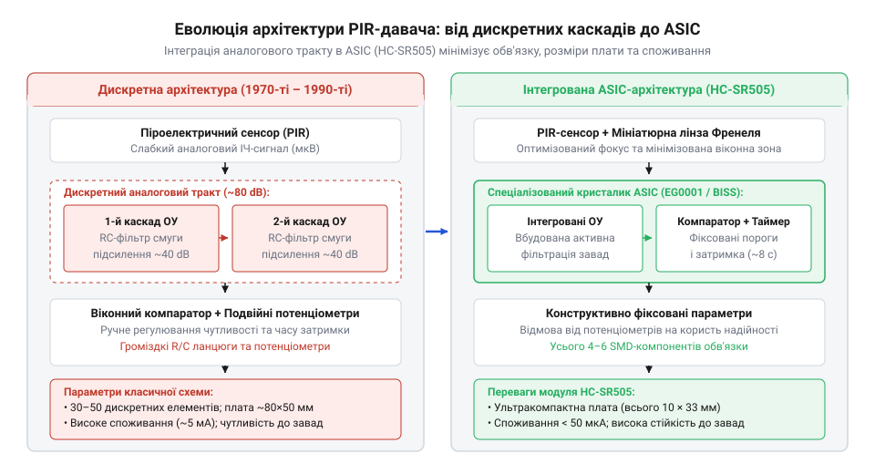
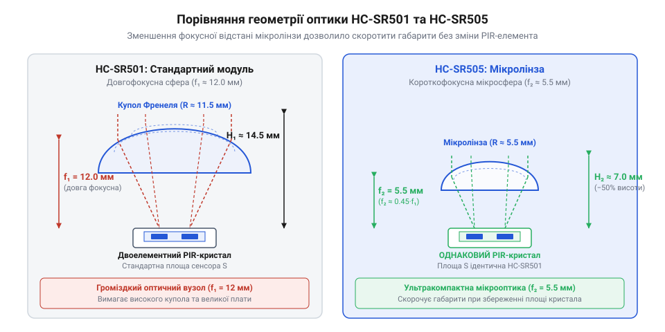

# Еволюція піроелектричних давачів руху та поява мініатюрних модулів HC-SR505

<preknowlist>
- [HC-SR501 — PIR-давач руху](root:cat-hw-sensors/hc-sr501) — принцип побудови класичного PIR-модуля на базі контролера BISS0001, двоелементного піроприймача та купольної лінзи Френеля з ручним регулюванням чутливості й затримки
</preknowlist>

## Обмеження громіздких аналогових сповіщувачів 1970-х

Перші автоматизовані системи охоронної сигналізації 1970-х років зіштовхнулися з технічним викликом: як безперервно виявляти присутність або рух людини у приміщенні без активного випромінювання світла, на відміну від того, як це роблять [оптичні переривачі](root:cat-hw-sensors/ky-010-interrupter) або [активні ІЧ-давачі перешкод](root:cat-hw-sensors/ir-obstacle). Розв'язком стало вловлювання власного теплового випромінювання людського тіла в інфрачервоному діапазоні спектра. Для цього прилади оснащували датчиками, що використовували @@grc|піроелектричний ефект@@ (від грец. *pyr* — вогонь та *elektron* — бурштин) — явище виникнення електричного заряду на поверхні певних кристалічних матеріалів у відповідь на зміну їхньої температури.

Проте перетворення теплового імпульсу на надійний електричний сигнал виявилося складним схемотехнічним завданням. Коли тіло людини перетинає зону спостереження, зміна інфрачервоного потоку створює у @@grc|піроелемент@@ (найчастіше на основі танталату літію @@en|LiTaO3@@ або п'єзокераміки @@en|PZT@@) мізерний електричний струм рівнем у кілька пікоампер або змінну напругу в одиниці мікровольт. При цьому власний внутрішній опір кріогенно не охолоджуваного піроелектричного кристала становить гігаоми, що вимагало узгодження імпедансу за допомогою винесеного польового транзистора (@@en|JFET@@).

Щоб підняти амплітуду такого слабкого низькочастотного сигналу (у діапазоні від `0.1 Гц` до `10 Гц`) до рівня спрацьовування виконавчого реле (`3–5 В`), інженерам 1970-х років доводилося будувати багатокаскадний @@en|операційний підсилювач@@ (від англ. *operational amplifier*, або @@en|op-amp@@) на дискретних компонентах — окремих транзисторах або перших аналогових мікросхемах типу LM741 та LM324. Сукупний коефіцієнт підсилення таких каскадів мав сягати `60–80 дБ` (підсилення сигналу у `1000–10000` разів).

Аналогова обробка на дискретних елементах мала чотири фундаментальні обмеження:

1. **@@en|температурний дрейф@@ та низькочастотні шуми:** Дискретні @@en|операційний підсилювач@@ того часу мали високу напругу зсуву та відчутний флікер-шум (@@en|1/f noise@@) на низьких частотах. Найменші коливання температури навколишнього повітря зміщували постійну напругу на виходах каскадів. Це призводило або до хибних спрацьовувань тривоги, або до повної втрати чутливості приладу в спекотні дні. 2. **Величезне енергоспоживання:** Схема з кількох дискретних підсилювачів, опорних джерел напруги та релейних ключів споживала постійний струм від `10 мА` до `20 мА`. Це унеможливлювало створення автономних датчиків із батарейним живленням — сповіщувачі вимагали постійного підключення до дротової електромережі. 3. **Низька завадостійкість:** Довгі провідники друкованої плати між дискретними резисторами, електролітичними конденсаторами фільтрів та підсилювачами працювали як антени, збираючи високочастотні наведення від радіоефіру та мережі `50 Гц`. 4. **Габарити та складність збирання:** Друкована плата сповіщувача мала значну площу та містила десятки ручних з'єднань і підстроювальних елементів.

Через ці бар'єри піроелектричні давачі руху протягом 1970-х років залишалися виключно стаціонарними, громіздкими пристроями в масивних корпусах розміром `10–15 см`, які монтувалися на стінах спеціалізованих охоронних об'єктів. Створення портативних, бездротових або вбудованих у побутову техніку датчиків руху на дискретній аналоговій базі було фізично й економічно неможливим.

## Інтеграція обробки сигналу в ASIC

Радикальний перелом у розвитку піроелектричних датчиків стався наприкінці 1990-х років завдяки впровадженню технології @@en|ASIC@@ (від англ. *Application-Specific Integrated Circuit* — інтегральна схема спеціального призначення). Замість громіздкого аналогового тракту на дискретних компонентах розробники створили спеціалізований кремнієвий кристал, який об'єднав усі необхідні вузли обробки сигналу на одному чіпі. Класичним прикладом такої мікросхеми став [контролер BISS0001](root:cat-hw-sensors/hc-sr505/hist-pir-miniaturization.md), який задав новий стандарт для всієї індустрії.

Інтеграція в один кристал @@en|ASIC@@ повністю змінила схемотехніку модуля:

1. **Вбудовані смугові підсилювачі:** Всередині кристала реалізовано два @@en|операційний підсилювач@@ із точними внутрішніми зворотними зв'язками. Вони формують вузьку смугу пропускання (`0.3–7 Гц`), яка ефективно пригнічує постійну складову, викликану @@en|температурний дрейф@@, а також відсікає високочастотні мережеві та радіозавади. 2. **Двопороговий @@en|віконний компаратор@@:** Оскільки двопелюстковий @@grc|піроелемент@@ ґенерує позитивний сплеск напруги під час входження теплового об'єкта в зону чутливості та негативний — під час виходу з неї, @@en|віконний компаратор@@ (від англ. *window comparator*) фіксує перевищення сигналу як вище верхньої, так і нижче нижньої порогової напруги. 3. **Цифрова логіка та таймери:** Напівпровідникове ядро містить цифрову систему управління режимами роботи (тригер тривоги) та два незалежні таймери: таймер вихідного затримування (часу утримання активного сигналу) та таймер блокування (часу «сліпоти» після спрацьовування). 4. **Мікропотужне CMOS-виконання:** Завдяки переходу на КМОН-технологію (@@en|CMOS@@) власне струмоспоживання мікросхеми у режимі очікування знизилося до `50–100 мкА`, що відкрило шлях до створення пристроїв із батарейним живленням.

*Структурний перехід від громіздкої аналогової обробки на дискретних операційних підсилювачах до компактної системи на силіконовому кристалі ASIC.*

Об'єднання @@grc|піроелемент@@ із вбудованим @@en|JFET@@-транзистором, мікросхеми @@en|ASIC@@ та зовнішньої купольної оптичної системи породило найбільш поширений масовий модуль — [PIR-давач HC-SR501](root:cat-hw-sensors/hc-sr501). Стандартизована плата розміром `32 × 24 мм` із трьохконтактним інтерфейсом живлення й виходу дозволила легко інтегрувати функцію виявлення руху в будь-які мікроконтролерні системи.

Однак ера [модуля HC-SR501](root:cat-hw-sensors/hc-sr501) швидко оголила нові межі конструктивної мініатюризації, зумовлені його фізичною компоновкою:

* **Габарити механічних підстроювальних елементів:** Для регулювання чутливості (відстані спрацьовування) та часу затримки на платі [HC-SR501](root:cat-hw-sensors/hc-sr501) встановлено два механічні змінні резистори (тримери). Вони займають до 30% площі друкованої плати, збільшують загальну висоту модуля й піддаються механічному зносу та розкалібруванню від вібрацій. * **Оптична фокусна відстань купола:** Класична купольна @@en|лінза Френеля@@ (названа на честь французького фізика @@fr|Огюстена Жана Френеля@@) потребує фокусної відстані близько `10–15 мм` від поверхні @@grc|піроелемент@@ для фокусування інфрачервоних променів із широкого сектора огляду. Це створює непереборну нижню межу товщини всього датчика. * **Футпринт друкованої плати:** Площа плати `32 × 24 мм` занадто велика для вбудовування модуля в компактні розумні вимикачі, світлодіодні лампи, бездротові датчики IoT або приховану побутову автоматику.

Саме прагнення усунути ці залишені фізичні й геометричні обмеження призвело розробників до наступного еволюційного кроку — створення ультрамініатюрних модулів із фіксованими параметрами.

## Мікрооптика Френеля та компроміси мініатюризації

Широке розповсюдження автоматизованих систем розумного будинку наприкінці 2000-х років висунуло нові вимоги до фізичних габаритів датчиків присутності. Повнорозмірні піроелектричні модулі, побудовані на базі [класичного модуля HC-SR501](root:cat-hw-sensors/hc-sr501), чудово давали собі раду в стаціонарній сигналізації, проте виявилися занадто громіздкими для вбудовування в компактні вимикачі, світлодіодні світильники та бездротові вузли @@en|IoT@@ (від англійського @@en|Internet of Things@@ — інтернет речей). Друкована плата розміром 32 × 24 мм разом із високим оптичним куполом вимагала корпусу завтовшки понад два сантиметри. Основне об'ємне обмеження створювали два конструктивні вузли: оптична система фокусування та підстроювальні елементи.

Для фокусування інфрачервоного випромінювання на піроелемент класичний купол вимагає оптичної фокусної відстані від 10 до 12 мм. Усередині корпусу PIR-детектора розташовано два прямокутних чутливих майданчики, включені зустрічно-паралельно. Коли людина рухається крізь зону спостереження, лінза почергово фокусує інфрачервоне випромінювання то на один, то на інший майданчик, створюючи різницю електричних потенціалів. Спроба просто наблизити пластикову лінзу до кристала призводить до розфокусування ІЧ-зображення: тепловий контраст об'єкта розмивається по поверхні обох чутливих елементів одночасно, скасовуючи диференційний сигнал і спричиняючи падіння чутливості.

Щоб скоротити оптичний шлях удвічі, інженери розробили щільні @@en|мікролінзи Френеля@@ (від прізвища французького фізика @@fr|Огюстена Жана Френеля@@, та латинського @@la|lens@@ — сочевиця). Зменшення фокусної відстані до 5 мм вимагало кардинального перерахунку заломлювальних концентричних фасетів. Завдяки зменшенню кроку призм та збільшенню просторової щільності мікрофасетів на одиницю площі купола діаметром усього 10 мм вдалося зберегти чітку збіжність ІЧ-променів на чутливих майданчиках навіть при короткій оптичній базі.

*Схематичне порівняння оптичної фокусної відстані купола HC-SR501 та мікролінзи Френеля HC-SR505 із розташуванням планарних елементів.*

Другим бар'єром на шляху мініатюризації були механічні @@en|потенціометри@@ (від латинського @@la|potentia@@ — сила та грецького @@el|metron@@ — міра). Підстроювальні тримери часу затримки та чутливості займали до 30% площі плати, додавали вихідний брак при автоматичному монтажі й були вразливими до окиснення контактів та механічних вібрацій. Виробники пристроїв розумного будинку зіштовхувалися з тим, що під час групового паяння хвилею або тривалої експлуатації у вологих приміщеннях механічні повзунки втрачали контакт. У модулі HC-SR505 розробники повністю відмовилися від ручних органів регулювання. Змінні резистори замінили на фіксовані планарні SMD-компоненти (від англійського @@en|SMD@@ — @@en|Surface-Mount Device@@, пристрій монтажу на поверхню), приєднані до ланцюгів таймера та порівняння напруги. Затримку вихідного сигналу жорстко зафіксували на позначці близько 8 секунд, а поріг чутливості встановили на середньому оптимальному рівні.

Таке рішення дозволило зменшити розміри друкованої плати HC-SR505 до 10 × 23 мм, однак мініатюризація вимагала компромісів. Скорочення фокусної відстані оптичної системи зменшило максимальну дальність виявлення руху з 7 до 3 метрів, а кут огляду звузився зі 120° до приблизно 100°. Тим не менш, для пристроїв ближнього радіуса дії фіксовані параметри виявилися вигідним обміном гнучкості на ультракомпактний формато-фактор.

## Міф про новий сенсор проти інтеграції

У спільнотах розробників електроніки та на торгових майданчиках поширилося хибне уявлення, ніби ультракомпактні розміри модуля HC-SR505 стали можливими завдяки застосуванню принципово нового піроелектричного кристала або інноваційного нано-матеріалу. Маркетингові описи нечітко формулювали особливості модуля, через що покупці вважали, що всередині встановлено революційний чутливий елемент з підвищеною оптичною чутливістю, який більше не потребує стандартної купольної оптичної системи.

Насправді в HC-SR505 використовується той самий класичний двоелементний @@en|піроелемент@@ на основі п'єзокераміки цирконату-титанату свинцю (@@en|PZT@@, від англійських назв елементів @@en|Lead Zirconate Titanate@@), що й у повнорозмірних давачах. Конструктори лише змінили корпус сенсора — замість масивного металевого балона TO-5 з оптичним фільтром застосували зменшений корпус TO-46 або планарні мікро-корпуси, однак фізика реєстрації інфрачервоного випромінювання та кристал залишилися незмінними. Зменшення розмірів модуля було досягнуто не зміною фізичного принципу чи матеріалу кристала, а глибокою схемотехнічною інтеграцією та переходами в пакуванні електронних компонентів.

Замість використання вивідного мікроконтролера в корпусі DIP-16 із громіздкою зовнішньою обв'язкою з аналогових фільтрів, розробники HC-SR505 застосували спеціалізовану мікросхему @@en|ASIC@@ (від англійського @@en|Application-Specific Integrated Circuit@@ — спеціалізована інтегральна схема) у компактному планарному корпусі SOP-8 або QFN. Силіконовий кристал цієї мікросхеми містить повноцінний тракт обробки сигналу:
1. Двокаскадний малошумний @@en|операційний підсилювач@@ (від латинського @@la|operatio@@ — дія) із коефіцієнтом підсилення 60–80 дБ та смуговим фільтром низьких частот (0.1–10 Гц) для приглушення постійної складової та високочастотних завад. 2. Віконний компаратор, який порівнює посилену напругу з верхнім і нижнім пороговими рівнями. 3. Цифровий одновібраторний таймер утримання та вбудований регулятор напруги @@en|LDO@@ (від англійського @@en|Low-Dropout Regulator@@ — регулятор з малою різницею напруг).

Завдяки використанню пасивних компонентів формату 0402 та двосторонньому монтажу плати весь аналогово-цифровий тракт вмістився безпосередньо під основою сенсора.

На відміну від активних оптичних систем, таких як [ІЧ-давачі перешкод](root:cat-hw-sensors/ir-obstacle) чи [відбивальні давачі TCRT5000](root:cat-hw-sensors/tcrt5000), або щілинних систем на кшталт [оптичного переривача KY-010](root:cat-hw-sensors/ky-010-interrupter), де потрібне постійне живлення випромінювального світлодіода зі струмом 10–30 мА, пасивна схема HC-SR505 реєструє лише природні коливання інфрачервоного фону. Інтеграція всіх вузлів в єдиний кремнієвий кристал ASIC дозволила зберегти мікроамперне споживання струму (до 50 мкА у режимі очікування), що робить модуль ідеальним для автономних пристроїв з батарейним живленням.

При виборі між налаштовуваним модулем HC-SR501 та мініатюрним HC-SR505 інженер має керуватися чіткими критеріями:
- **Модуль HC-SR501** обирають для великогабаритних пристроїв, де потрібне точне налаштування дальності (до 7 метрів), регулювання затримки у широкому діапазоні від 0.3 секунди до 5 хвилин, задіяння режимів повторного тригерування та охоплення широкої зони в 120°. - **Модуль HC-SR505** обирають у випадках жорстких обмежень на об'єм корпусу (вбудовування в стінові вимикачі, герметичні датчики, компактні лампи), де достатньо дальності виявлення до 3 метрів, а зафіксована затримка в 8 секунд відповідає алгоритму роботи пристрою без додаткового ручного налаштування.