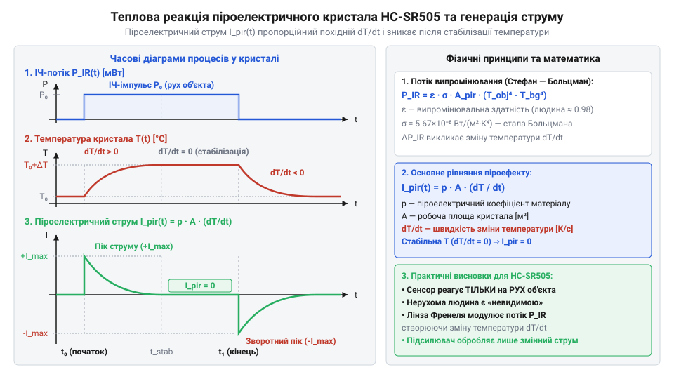
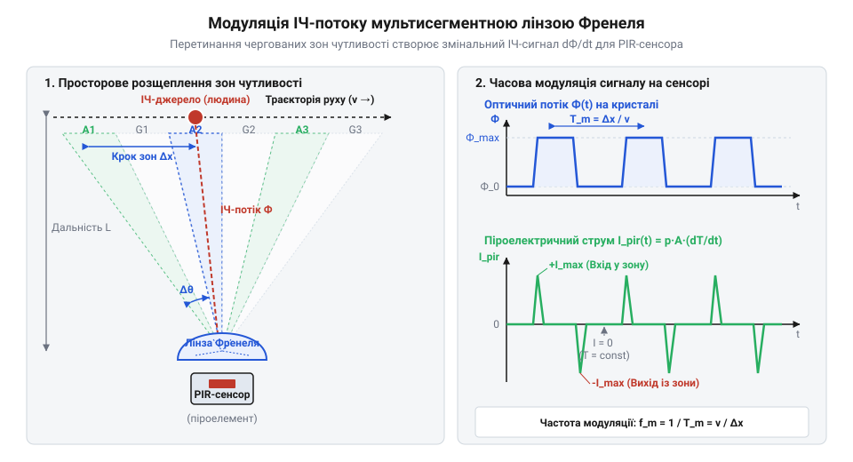

# Математичні моделі піроелектричного ефекту та модулювання ІЧ-потоку лінзою Френеля

<preknowlist>
- [HC-SR501 — PIR-давач руху](root:cat-hw-sensors/hc-sr501) — базові принципи роботи пасивних інфрачервоних сенсорів та функціональне призначення мультисегментної лінзи Френеля.
</preknowlist>

## Невидимість стаціонарного джерела інфрачервоного випромінювання

Спроба зафіксувати присутність нерухомої людини за допомогою мініатюрного давача @@en|HC-SR505@@ призводить до несподіваного результату: вихідний сигнал давача залишається в логічному нулі, незважаючи на те, що температура людського тіла становить приблизно 36.6 °C і воно безперервно випромінює потужний потік інфрачервоного світла. На відміну від пристроїв на кшталт [ІЧ-відбивальних сенсорів](root:cat-hw-sensors/tcrt5000) або [оптичних переривачів](root:cat-hw-sensors/ky-010-interrupter), які вимірюють рівень перекриття або відбиття власного активного променя, пасивні інфрачервоні сенсори реагують виключно на зовнішнє теплове поле. Якщо джерело цього поля перебуває у стані спокою відносно сенсора, створене ним опромінення поверхні кристала залишається строго постійним у часі.

Фізичною основою роботи @@en|HC-SR505@@ є @@grc|піроелектричний ефект@@ (грец. *pyr* — вогонь, *ēlektron* — бурштин, оскільки нагрівання матеріалу викликає появу електричного заряду). Чутливий елемент сенсора виготовляють із сегнетоелектричного кристала, найчастіше танталату літію або титанату цирконату свинцю. Усередині такого матеріалу існує незакомплексована @@en|спонтанна поляризація@@: елементарні електричні @@en|диполі@@ в об'ємі кристала орієнтовані в одному напрямку навіть за відсутності зовнішнього електричного поля. Ця поляризація створює на протилежних гранях кристала високу поверхневу щільність зв'язаних електричних зарядів.

Проте у стаціонарному стані, коли температура кристала не змінюється (`dT / dt = 0`), електричне поле внутрішніх диполів повністю нейтралізується. З навколишнього середовища та за рахунок власної провідності кристала на його поверхні осідає вільний @@en|екрануючий шар@@ іонів та електронів. Вільні заряди повністю компенсують дію зв'язаних зарядів поляризації. Оскільки поверхнева щільність компенсаційного заряду точно дорівнює щільності спонтанної поляризації, результуюча різниця потенціалів між електродами кристала дорівнює нулю. Нерухома людина створює постійний теплове потік, який лише підтримує кристал при певній фіксованій температурі, але не викликає жодного перерозподілу зарядів.

Отже, стаціонарне інфрачервоне випромінювання принципово не здатне згенерувати струм у зовнішньому колі, адже швидкість зміни заряду на електродах `I = dq / dt` дорівнює нулю. Щоб порушити компенсаційну рівновагу й змусити вільні заряди рухатися крізь вимірювальний ланцюг, необхідно змінити внутрішній вектор поляризації кристала, що можливо лише через зміну його температури у часі (`dT / dt ≠ 0`). Це створює потребу в побудові математичної моделі, яка описує динаміку випромінювального теплообміну між рухомим об'єктом і сенсором та дозволяє обчислити амплітуду згенерованого електричного відгуку.

## Обчислення теплового потоку інфрачервоного випромінювання

Для визначення теплового стану піроелектричного елемента в @@en|HC-SR505@@ необхідно розрахувати потужність інфрачервоного випромінювання, що передається від людини на поверхню кристала. Згідно з @@de|закон Стефана — Больцмана@@ (нім. *Stefan-Boltzmann*), інтегральна енергетична світимість абсолютно чорного тіла прямо пропорційна четвертому степеню його абсолютної температури. Реальні об'єкти випромінюють менше енергії, що враховується безрозмірним коефіцієнтом, який має назву @@en|випромінювальна здатність@@.

Людська шкіра в діапазоні довжин хвиль від 8 до 14 мкм має високу випромінювальну здатність — @@en|emissivity@@ (англ. *emissivity*, від лат. *emissio* — випускання) `ε_obj ≈ 0.98`, що робить її близькою до абсолютно чорного тіла. При температурі тіла `T_obj = 309.85 K` (36.7 °C) кожний квадратний метр шкіри випромінює теплову потужність у навколишній простір. Навколишнє середовище та сам давач при фоновій температурі `T_bg = 293.15 K` (20 °C) також випромінюють інфрачервоний потік. Загальна потужність випромінювання об'єкта, що потрапляє на лінзу давача площею `A_lens` на відстані `R`, визначається геометричним фактором тілесного кута.

Результуюча радіаційна потужність `ΔP_rad`, яка передається на піроелектричний кристал з урахуванням оптичного пропускання пластикової лінзи `τ_opt` та коефіцієнта поглинання кристала `ε_pir`, описується співвідношенням:

P_inc = (A_obj · A_lens / (π · R²)) · ε_obj · σ_SB · (T_obj⁴ - T_bg⁴)
ΔP_rad = τ_opt · ε_pir · P_inc

де `σ_SB = 5.670374 · 10⁻⁸ Вт/(м²·К⁴)` — @@de|стала Стефана — Больцмана@@, `A_obj` — проекція площі людини на площину, перпендикулярну напрямку спостереження, `A_lens` — площа вхідного отвору лінзи, `R` — відстань від людини до сенсора.

Поглинута кристалом радіаційна потужність `ΔP_rad` викликає його нагрівання. Водночас кристал втрачає тепло за рахунок теплопровідності підкладки та конвекції в навколишнє повітря з сумарною тепловою провідністю `G_th`. Динаміка теплового балансу описується диференціальним рівнянням першого порядку:

C_th · (dT_crystal / dt) + G_th · (T_crystal - T_bg) = ΔP_rad(t)

де `C_th` — теплоємність кристала, `T_crystal` — його поточна температура. У стані теплової рівноваги, коли часова похідна дорівнює нулю (`dT_crystal / dt = 0`), температура кристала стабілізується на рівні `T_eq`:

T_eq - T_bg = ΔP_rad / G_th       [рівноважний температурний напір]

**Приклад розрахунку радіаційної потужності та рівноважного перегріву кристала:**
Розглянемо випадок, коли людина з площею проекції тіла `A_obj = 0.6 м²` та температурою `T_obj = 309.85 K` наближається до давача @@en|HC-SR505@@ на відстань `R = 3 м`. Давач оснащено лінзою з площею аппертури `A_lens = 50 мм² = 5 · 10⁻⁵ м²` та пропусканням `τ_opt = 0.7`. Коефіцієнт поглинання кристала `ε_pir = 0.95`, фонова температура `T_bg = 293.15 K`, а теплова провідність конструкції кристала `G_th = 1 · 10⁻³ Вт/К`.

```
T_obj⁴ - T_bg⁴ = (309.85)⁴ - (293.15)⁴
= 9.217 · 10⁹ - 7.384 · 10⁹ К⁴          [піднесення температур до 4-го степеня]
= 1.833 · 10⁹ К⁴                       [різниця четвертих степенів]

P_inc = (0.6 × 5 · 10⁻⁵ / (π × 3²)) × 0.98 × (5.670374 · 10⁻⁸) × (1.833 · 10⁹)
= (3 · 10⁻⁵ / 28.274) × 1.018 · 10² Вт  [обчислення геометричного фактора і потоку]
= 1.061 · 10⁻⁶ × 101.8 Вт               [проміжне множення]
= 1.080 · 10⁻⁴ Вт                       [падаюча оптична потужність на лінзу]

ΔP_rad = 0.7 × 0.95 × 1.080 · 10⁻⁴ Вт
= 7.18 · 10⁻⁵ Вт                        [поглинута потужність кристалом]

T_eq - T_bg = (7.18 · 10⁻⁵ Вт) ÷ (1 · 10⁻³ Вт/К)
= 0.0718 К                              [рівноважний температурний приріст]
```

Цей розрахунок показує, що при появі людини кристал нагрівається всього лише на `≈ 0.07 K` (71.8 мК). Настільки малий приріст температури підкреслює високу чутливість, яку мусить забезпечити піроелектричний перетворювач.

## Динаміка піроелектричного струму та похідна температури

Отриманий у попередньому розділі рівноважний приріст температури кристала сам по собі не викликає електричного сигналу. Сигнал виникає лише під час самого процесу нагрівання або охолодження кристала. При зміні температури ґратки сегнетоелектрика змінюються міжатомні відстані та величина дипольних моментів, що призводить до зміни вектора спонтанної поляризації. Вільні компенсаційні заряди на поверхні кристала більше не відповідають новій величині зв'язаного заряду. Цей надлишок (або нестача) вільних зарядів починає стікати через зовнішнє коло, утворюючи піроелектричний струм `I_pir`.

Струм `I_pir`, що генерується кристалом площею `A_pir`, прямо пропорційний часовій похідній температури `dT_crystal / dt`:

I_pir(t) = p · A_pir · (dT_crystal / dt)

де `p` — @@grc|піроелектричний коефіцієнт@@ (грец. *pyr* — вогонь, *ēlektron* — бурштин + лат. *coefficiens* — той, що сприяє), який визначає зміну поляризації на одиницю температури `dP / dT`. Для кристала танталату літію `LiTaO₃` значення цього коефіцієнта становить `p ≈ 1.7 · 10⁻⁴ Кл/(м²·К)`.

Щоб знайти значення часової похідної температури `dT_crystal / dt`, розв'яжемо рівняння теплового балансу при стрибкоподібній зміні радіаційного потоку `ΔP_rad` від нуля до значення `ΔP_rad`, яка відбувається в момент часу `t = 0`. Розв'язок має вигляд:

T_crystal(t) - T_bg = (ΔP_rad / G_th) · (1 - e^(-t / τ_th))
dT_crystal / dt = (ΔP_rad / C_th) · e^(-t / τ_th)

де `τ_th = C_th / G_th` — теплова часова константа сенсора. З цього виразу випливає, що максимальне значення похідної температури досягається в найперший момент часу `t = 0⁺` одразу після зміни ІЧ-потоку:

I_pir_peak = p · A_pir · (ΔP_rad / C_th)    [піковий піроелектричний струм]


*Динаміка піроелектричного струму при стрибкоподібному нагріванні та охолодженні кристала.*

Як видно з часових діаграм, струм `I_pir` має вигляд короткого сплеску в момент початку опромінення. Після того як температура кристала досягає стаціонарного рівня `T_eq`, часова похідна спадає до нуля, і струм припиняється, незважаючи на продовження опромінення. При припиненні опромінення кристал охолоджується, його похідна температури змінює знак, що викликає виникнення струму протилежної полярності.

**Розрахунок пікового струму сенсора HC-SR505:**
Обчислимо амплітуду струмового сплеску для чутливого елемента давача @@en|HC-SR505@@ з площею `A_pir = 2 мм² = 2 · 10⁻⁶ м²`, теплоємністю `C_th = 2 · 10⁻⁴ Дж/К` та піроелектричним коефіцієнтом `p = 1.7 · 10⁻⁴ Кл/(м²·К)` при раптовій появі поглинутого теплового потоку `ΔP_rad = 7.18 · 10⁻⁵ Вт`.

```
dT_crystal / dt |_(t=0⁺) = ΔP_rad / C_th
= (7.18 · 10⁻⁵ Вт) ÷ (2 · 10⁻⁴ Дж/К)      [обчислення початкової похідної]
= 0.359 К/с                              [швидкість зміни температури]

I_pir_peak = (1.7 · 10⁻⁴ Кл/(м²·К)) × (2 · 10⁻⁶ м²) × 0.359 К/с
= 3.4 · 10⁻¹₀ × 0.359 А                   [підстановка параметрів кристала]
= 1.22 · 10⁻¹⁰ А                         [піковий струм у амперах]
= 122 пА
```

Піковий струм становить всього `122 пА`. Настільки низький рівень струму (порядку сотень пікоампер) пояснює, чому вихідний кристал піроелектрика не можна підключати безпосередньо до зовнішніх цифрових мікроконтролерів або навіть стандартних операційних підсилювачів. Всередині корпусу PIR-елемента безпосередньо поруч із кристалом монтують польовий транзистор з ізольованим затвором (або спеціалізований @@en|трансімпедансний підсилювач@@), який перетворює цей надмалий струм у вимірювану напругу. Для порівняння, активні сенсори, такі як [PIR-давач HC-SR501](root:cat-hw-sensors/hc-sr501), використовують аналогічний первинний струмовий тракт для подальшої обробки двома аналоговими компараторами.

## Просторове модулювання потоку лінзою Френеля

Якщо людина рівномірно перетинає поле зору відкритого @@en|pyroelectric crystal@@ без оптичних насадок, сумарна потужність інфрачервоного випромінювання на поверхні сенсора лишається майже незмінною. За постійного теплового потоку температура кристала досягає стану @@en|thermal equilibrium@@, через що @@en|time derivative@@ `dT/dt` прямує до нуля, а @@en|pyroelectric effect@@ припиняє генерацію струму `I_pir = 0`. Сенсор повністю втрачає здатність виявляти нерухомий або плавно рухомий об'єкт у суцільному полі зору.

Щоб перетворити просторове переміщення тіла на часово-змінну величину теплового потоку, застосовують оптичну систему просторового розбиття. У компактному давачі @@en|HC-SR505@@ цю роль виконує пластмасовий купол із @@en|Fresnel lens@@ (англ. *Fresnel lens*, від прізвища фізика Огюста Жана Френеля). Замість суцільної товстої заломлювальної лінзи вона складається з масиву концентричних або секційованих канавок мінімальної товщини, що зберігають фокусну відстань при мінімальній вазі матеріалу.

Зовнішній купол @@en|PIR sensor@@ (англ. *Passive Infrared Sensor*, пасивний інфрачервоний сенсор) розбитий на масив мікролінз — @@en|facet@@ (англ. *facet*, грань або фаска). Кожен окремий @@en|facet@@ фокусує інфрачервоні промені на поверхню кристала лише з вузького кутового сектора. Проміжки між секторами спрямовують випромінювання повз кристал або розсіюють його. У результаті оглядовий простір перед сенсором розщеплюється на черговані активні зони чутливості та пасивні сліпі зони.


*Розподіл оглядового простору на сектори чутливості за допомогою мультисегментної лінзи Френеля.*

Коли випромінювальне тіло рухається крізь цю систему секторів, потужність інфрачервоного потоку на кристалі періодично змінюється від максимального значення `P_max` усередині активної зони до фонового рівня `P_min` у пасивній зоні. Цей процес створює пульсуючий оптичний сигнал `P_ir(t)`, викликає постійну зміну температури `dT/dt ≠ 0` і змушує кристал випробовувати перепади напруги та струму. За принципом дії таке модулювання схоже на [оптичний переривач](root:cat-hw-sensors/ky-010-interrupter), де світловий промінь перетинається механічно, проте в піроелектричному давачі переривання створюється сам рух об'єкта крізь геометрію лінзи.

Геометричний крок секторів визначає просторове розділення сенсора. Якщо загальний кут огляду лінзи `Θ` розбито на `N` активних і пасивних пар, кутовий крок однієї зони становить:

`θ_z = Θ / N`

На відстані `L` від сенсора фізична ширина одного повного циклу з активної та пасивної зони `S_z` обчислюється через кутовий крок:

`S_z = 2 · L · tan(θ_z / 2)`

Для малих кутів `θ_z` тангенс наближено дорівнює самому куту в радіанах, що дає спрощений вираз для просторового кроку та відповідної просторової частоти зон `f_s`:

S_z = L · θ_z                    [просторовий крок зони на відстані L]
f_s = 1 / S_z                    [визначення просторової частоти зон]
= 1 / (L · θ_z)                  [підстановка кроку зони через відстань]

Із зростанням відстані `L` фізична ширина зон чутливості розширюється пропорційно `L`, а @@en|spatial frequency@@ `f_s` зменшується. Це означає, що на більшій відстані об'єкту потрібно подолати більший фізичний шлях для перетинання одного сектора. На відміну від більших модулів, таких як [PIR-давач руху HC-SR501](root:cat-hw-sensors/hc-sr501), купол давача @@en|HC-SR505@@ має менший діаметр і меншу кількість секторів, що формує ширші кутові зони й визначає його компактну зону виявлення. Детальніше про геометрію секцій, модулювання ІЧ-потоку та розрахунок просторової частоти зон виявлення читайте у статті про [оптичні лінзи Френеля для інфрачервоних сенсорів](root:cat-hw-sensors/fresnel-lens-pir-optics).

## Частота модуляції та смуга аналогового тракту

Маючи геометричну модель зон чутливості, можна визначити частоту оптичних пульсацій, які виникають при русі об'єкта. Якби аналоговий тракт підсилення @@en|HC-SR505@@ мав нескінченно широку смугу пропускання, сенсор реагував би на повільні теплові коливання навколишнього середовища (нагрівання від сонячного світла, протяги) та високочастотні електричні завади. Щоб забезпечити надійну роботу, підсилювальний тракт має бути налаштований чітко на діапазон частот, який створює рух людини.

Частота оптичної модуляції `f_m` залежить від лінійної швидкості руху об'єкта `v`, спрямованої перпендикулярно до осі сенсора, та відстані `L`. Час `T_m`, за який об'єкт долає один повний цикл з активної та пасивної зони `S_z`, становить `T_m = S_z / v`. Звідси отримуємо виведення частоти модуляції @@en|modulation frequency@@:

T_m = S_z / v                    [період перетинання одного сегмента]
= (L · θ_z) / v                  [заміна просторового кроку через кут і відстань]
f_m = 1 / T_m                    [визначення частоти модуляції]
= v / (L · θ_z)                  [підстановка періоду]
= ω / θ_z                        [заміна кутової швидкості ω = v / L]

Отримане співвідношення показує, що @@en|modulation frequency@@ `f_m` прямо пропорційна кутовій швидкості руху об'єкта `ω = v / L` відносно сенсора. Якщо кутова швидкість стала, частота пульсацій сигналу не залежить від відстані до об'єкта.

**Обчислення діапазону частот модуляції для руху людини**

Розглянемо типові граничні значення швидкості руху людини перед давачем @@en|HC-SR505@@ при кутовому кроці лінзи `θ_z = 0.15 rad` (~8.6°) та відстані `L = 3 m`:

- Повільна ходьба зі швидкістю `v_min = 0.3 m/s`:
  `S_z = 3 m · 0.15 rad = 0.45 m`
  `f_m,min = 0.3 m/s / 0.45 m ≈ 0.67 Hz`

- Швидкий біг або різкий рух зі швидкістю `v_max = 3.0 m/s`:
  `S_z = 3 m · 0.15 rad = 0.45 m`
  `f_m,max = 3.0 m/s / 0.45 m ≈ 6.67 Hz`

Таким чином, реальний рух людини створює піроелектричний сигнал у вузькому наднизькочастотному діапазоні приблизно від 0.5 Hz до 7 Hz.

Для виділення цього сигналу з шумів в аналоговому контролері @@en|HC-SR505@@ застосовується двокаскадний активний @@en|band-pass filter@@ (англ. *band-pass filter*, смуговий фільтр) на основі @@en|operational amplifier@@ (англ. *operational amplifier*, операційний підсилювач). На відміну від активних систем, таких як [IR-давачі перешкод](root:cat-hw-sensors/ir-obstacle) чи [ІЧ-відбивальний давач TCRT5000](root:cat-hw-sensors/tcrt5000), які працюють на високих частотах модуляції випромінювання (десятки кілогерц), пасивний сенсор змушений підсилювати мікровольтні сигнали наднизької частоти.

Нижня межа зрізу фільтра `f_L` відсікає постійну складову напруги та повільні дрейфи температури:

f_L = 1 / (2 · π · R_L · C_L)    [нижня межа зрізу RC-фільтра]

Значення `f_L` обирають у межах `0.1 Hz – 0.3 Hz` за допомогою високоомних резисторів `R_L` (порядку 1 MΩ) і конденсаторів `C_L` (близько 1 μF).

Верхня межа зрізу `f_H` пригнічує високочастотні мережеві завади 50 Hz, мерехтіння штучного освітлення та радіочастотні наводки:

f_H = 1 / (2 · π · R_H · C_H)    [верхня межа зрізу RC-фільтра]

Величина `f_H` встановлюється на рівні `7 Hz – 10 Hz`. Формована смуга пропускання `Δf = f_H - f_L` забезпечує максимальне @@en|signal-to-noise ratio@@ (англ. *signal-to-noise ratio*, співвідношення сигнал/шум) аналогового тракту, унеможливлюючи хибні спрацьовування сенсора від фонових завад і гарантуючи впевнене виявлення руху людини.