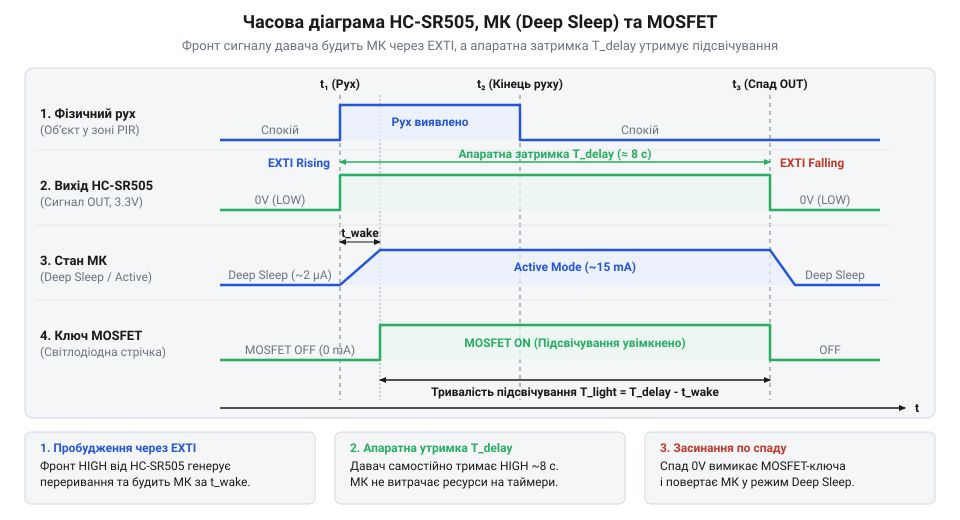
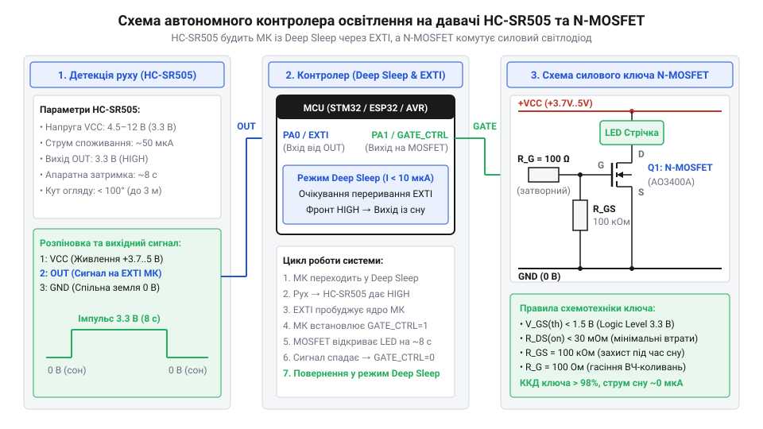

# Автономний енергоефективний контролер освітлення на базі HC-SR505

<preknowlist>
- [HC-SR501 — PIR-давач руху](root:cat-hw-sensors/hc-sr501) — принцип виявлення ІЧ-випромінювання людини піроелементом та роботу лінзи Френеля
</preknowlist>

## Швидкий розряд акумулятора в очікуванні

Коли автономний світильник живиться від літієвого акумулятора ємністю 2000 мА·год, очікується багатомісячна робота без підзаряджання. Проте типовий прототип виснажує батарею за чотири дні, навіть якщо в кімнаті ніхто не з'являвся і світло не вмикалося.

Причина полягає у безперервному опитуванні сенсора. Якщо мікроконтролер у нескінченному циклі постійно зчитує стан вхідного виводу, виникає циклічне опитування (англ. @@en|polling@@, від англ. *poll* — опитування, підрахунок голосів). У цьому стані внутрішнє тактове дерево процесора, генератори та обчислювальне ядро працюють на повній частоті. Навіть без корисного навантаження мікроконтролер споживає струм близько 20 мА.

Якщо взяти ємність акумулятора `C_batt` у міліампер-годинах та постійний робочий струм мікроконтролера `I_active` у міліамперах, час автономної роботи `T_active` у годинах визначається їхнім співвідношенням.

**Розрахунок часу автономної роботи за безперервного опитування:**
```
T_active
= C_batt / I_active
= 2000 / 20                  [підстановка значень ємності та струму]
= 100                        [обчислення тривалості в годинах]
```

Отримані 100 годин — це ледь більше 4 діб. Таке навантаження швидко виснажує запас енергії, а [хімічні характеристики літієвих елементів](root:hw-power/li-ion-battery-discharge-characteristics) призводять до деградації батареї від глибокого розряду.

Для тривалої автономності мікроконтролер необхідно вимикати, коли руху немає. Цю задачу вирішує режим глибокого сну (англ. @@en|Deep Sleep@@, від англ. *deep* — глибокий, та *sleep* — сон). У ньому зупиняються системні тактові генератори, відключається живлення ядра, а струм споживання падає до 2–5 мкА.

Однак у стані @@en|Deep Sleep@@ процесор не виконує інструкцій і не може проводити @@en|polling@@. Вивести кристал зі сну може лише зовнішнє апаратне переривання (англ. @@en|external interrupt@@, скорочено @@en|EXTI@@, від лат. *externus* — зовнішній, та *interruptus* — перерваний). Периферійний блок @@en|EXTI@@ живиться незалежно від ядра. Коли процесор виконує інструкцію очікування переривання (англ. @@en|Wait For Interrupt@@, скорочено @@en|WFI@@, від англ. *wait* — чекати, *for* — на, та *interrupt* — переривання), лічильник команд зупиняється. Щойно на призначеному виводі виникає перепад напруги, блок @@en|EXTI@@ миттєво генерує апаратний сигнал пробудження, відновлюючи тактування за лічені мікросекунди.

У режимі чергування струм споживання визначають струм сенсора `I_pir` (близько 50 мкА) та мікроконтролера в стані сну `I_sleep` (близько 5 мкА). Їхня сума `I_standby` становить 55 мкА, або 0.055 мА. Знаючи цей струм та ємність акумулятора `C_batt`, знаходимо оновлений час очікування `T_standby` у годинах.

**Розрахунок часу автономної роботи в режимі очікування з апаратним пробудженням:**
```
T_standby
= C_batt / I_standby
= 2000 / 0.055               [підстановка ємності акумулятора та струму спокою]
≈ 36363                      [обчислення тривалості в годинах]
```

Отримані 36363 години становлять понад 4 роки чергування, що перекриває природний саморозряд акумулятора. Апаратне пробудження через @@en|EXTI@@ перетворює нежиттєздатний пристрій на енергоефективну автономну систему.

Перехід ядра у стан глибокого сну реалізують конфігурацією низькорівневих регістрів контролера живлення з наступним викликом інструкції зупинки.

:::tabs
== C

:::code proj-hc-sr505-battery-light-controller/c/src/mcu_power_exti.c 64-77

== C++

:::code proj-hc-sr505-battery-light-controller/cpp/src/power_management.cpp 20-43
:::

## Сигнал та затримка давача HC-SR505

Для надійного апаратного пробудження вихідний імпульс сенсора повинен чітко узгоджуватися з цифровим входом мікроконтролера. У компактних конструкціях застосовують мініатюрний пасивний інфрачервоний давач (англ. @@en|PIR@@, passive infrared, від лат. *passivus* — пасивний, та лат. *infra* — нижче, під) моделі HC-SR505. На відміну від приладів, де працюють активні [інфрачервоні давачі прямої перешкоди](root:cat-hw-sensors/ir-obstacle), що випромінюють світло й споживають міліампери, @@en|PIR@@-елемент лише пасивно вловлює теплове випромінювання людини в діапазоні довжин хвиль від 8 до 14 мкм.

Якщо [повнорозмірний модуль HC-SR501](root:cat-hw-sensors/hc-sr501) містить підлаштовні резистори та перемички, то HC-SR505 має мініатюрну лінзу діаметром 10 мм і фіксовану апаратну обв'язку. Внутрішня мікросхема обробки сигналів, подібна до архітектури, яку має [спеціалізована мікросхема BISS0001](root:cat-hw-sensors/biss0001-asic), одразу перетворює аналоговий відгук сенсора на логічні рівні 0 та 3.3 В.

У стані очікування цифровий вихід OUT утримує напругу 0 В. Коли рухомий теплий об'єкт перетинає зони, які формує купольна лінза Френеля (лінза @@fr|Fresnel@@, від імені французького фізика Огюстена-Жана Френеля, фр. *Fresnel*), змінний тепловий потік потрапляє на піроелемент. Компаратор детектора перемикає вихід OUT у високий логічний рівень 3.3 В.

Перепад напруги утворює крутий зростаючий фронт сигналу (англ. @@en|rising edge@@, від англ. *rise* — підійматися, та *edge* — край, ребро). Саме за зростаючим фронтом конфігурують лінію @@en|EXTI@@ мікроконтролера, що гарантує пробудження ядра в перші ж мілісекунди після появи об'єкта.

Вихідний сигнал HC-SR505 має вбудований апаратний час утримання сигналу (англ. @@en|hold time@@, від англ. *hold* — утримувати, та *time* — час) тривалістю близько 8 секунд. Давач працює в режимі безперервного перезапуску: поки людина рухається в зоні огляду, внутрішній таймер оновлюється, утримуючи на виході 3.3 В. Коли рух припиняється, сенсор утримує високий рівень ще 8 секунд, після чого вихід OUT повертається до 0 В.

Одразу після спаду активного сигналу настає апаратний час блокування (англ. @@en|blocking time@@, від англ. *block* — перешкоджати) або період охолодження та стабілізації (англ. @@en|cooldown@@, від англ. *cool* — прохолодний, та *down* — униз), що триває близько 1–2 секунд. У цьому інтервалі внутрішній підсилювач десенсибілізується для відновлення електричної рівноваги піроелемента.

Якщо мікроконтролер вимкне потужне світлодіодне навантаження і миттєво дозволить переривання для повернення в @@en|Deep Sleep@@, виникає небезпека хибного спрацьовування. Вимкнення струму викликає короткочасне коливання напруги живлення, а охолодження світлодіодів створює конвекційний потік повітря біля лінзи. Нестабілізований піроелемент сприймає цей сплеск як новий рух, генеруючи повторний @@en|rising edge@@. Контролер знову вмикає світло, викликаючи безперервне миготіння та розряд батареї.

Щоб запобігти цьому замкненому колу, керуюча програма повинна витримувати програмну затримку @@en|cooldown@@ не менше 1000–1500 мс після вимкнення освітлення. Лише після стабілізації лінії OUT мікроконтролер переходить у режим сну.


*Часова діаграма демонструє перехід мікроконтролера з глибокого сну в активний стан за зростаючим фронтом HC-SR505, утримання навантаження увімкненим та очікування стабілізації перед засинанням.*

Фіксацію вхідного імпульсу та запуск таймера активності здійснює обробник апаратного переривання.

:::tabs
== C

:::code proj-hc-sr505-battery-light-controller/c/src/hc_sr505.c 37-55

== C++

:::code proj-hc-sr505-battery-light-controller/cpp/src/pir_sensor.cpp 17-35
:::

## Схемотехніка силового ключа на MOSFET

Після виявлення руху контролер повинен увімкнути світлодіодне навантаження, струм споживання якого зазвичай становить від 300 мА до 1.5 А за напруги акумулятора 3.7–4.2 В.

Пряме підключення світлодіодів до виводу мікроконтролера неможливе. Вихідний каскад цифрового порту розрахований на максимальний довготривалий струм не більше 20–25 мА. Спроба комутувати сотні міліамперів призведе до теплового пробою вихідних транзисторів кристала. Застосування електромагнітного реле також неприйнятне: його обмотка споживає 60–100 мА струму утримання, що швидко виснажує акумулятор.

Для низьковольтної автономної комутації використовують польовий транзистор із металооксидним затвором (англ. @@en|MOSFET@@, Metal-Oxide-Semiconductor Field-Effect Transistor, від лат. *metallum* — метал, грец. *oxys* — кислий, та лат. *transire* — переходити). Керування мінусовою шиною навантаження здійснює N-канальний ключ, для якого обирають прилад із низьким порогом відмикання — [логічні рівні N-канального транзистора](root:hw-components/logic-level-mosfet-switch).

@@en|MOSFET@@ керується електричним полем, а не струмом. Коли різниця потенціалів між виводами затвор транзистора (англ. @@en|gate@@, від англ. *gate* — ворота, брама) та витік транзистора (англ. @@en|source@@, від англ. *source* — першоджерело) перевищує параметр порогова напруга відкриття (англ. @@en|threshold voltage@@, `V_GS(th)`, від англ. *threshold* — поріг, та лат. *volt*), канал між виводами стік транзистора (англ. @@en|drain@@, від англ. *drain* — витікати, стікати) та @@en|source@@ відкривається. У статичному стані струм через затвор не тече, що зберігає заряд батареї. Для логіки 3.3 В обирають транзистори (наприклад, IRLML2502 або AO3400), які повністю відкриваються вже за `V_GS` = 2.5–3.0 В і мають опір відкритого каналу `R_DS(on)` менше 0.05 Ом.

Проте затвор польового транзистора еквівалентний конденсатору ємністю 300–1000 пФ. У момент перемикання виводу з нуля на 3.3 В заряджання цієї ємності створює імпульсний кидок струму (англ. @@en|inrush current@@, від англ. *inrush* — стрімкий наплив, та *current* — потік, струм), здатний пошкодити кристал мікроконтролера.

Для захисту виходу мікроконтролера послідовно із затвором встановлюють струмообмежувальний резистор `R_gate`. Знаючи робочу напругу логіки `V_DD` (3.3 В) та максимально допустимий струм виводу `I_gpio_max` (0.02 А), обчислюють мінімальний опір `R_gate` в омах за законом Ома.

**Розрахунок мінімального опору затворного резистора:**
```
R_gate
= V_DD / I_gpio_max
= 3.3 / 0.02                 [підстановка напруги логічного виходу та максимального струму]
= 165                        [обчислення мінімального опору в омах]
```

Опір 165 Ом є мінімальною межею, тому на практиці обирають стандартний номінал 220 Ом або 330 Ом. Цей резистор обмежує зарядний струм без відчутного сповільнення відкриття ключа.

Другим критичним елементом є стягувальний резистор (англ. @@en|pull-down@@, від англ. *pull* — тягнути, та *down* — донизу) номіналом 10–100 кОм між виводом @@en|gate@@ та землею. Під час перебування мікроконтролера в режимі @@en|Deep Sleep@@ або під час його скидання виводи перемикаються у високоімпедансний захисний стан (англ. @@en|high-impedance@@, від лат. *impedire* — перешкоджати).

Без резистора @@en|pull-down@@ затвор залишається електрично ізольованим. Навіть мізерний статичний заряд на ємності затвора вводить транзистор у лінійний режим напіввідкритого каналу. У цьому стані опір транзистора зростає, на ньому виділяється тепло, що веде до перегріву ключа та мимовільного світіння світлодіодів під час сну схеми. Резистор @@en|pull-down@@ надійно розряджає затворну ємність, гарантуючи нульовий потенціал і повне закриття транзистора за будь-якого стану мікроконтролера.


*Принципова електрична схема об'єднує живлення від акумулятора, вихід давача HC-SR505 на вхід EXTI мікроконтролера та захищений N-канальний MOSFET-ключ для комутації світлодіодного навантаження.*

Програмне керування затвором зводиться до подачі високого логічного рівня для ввімкнення світла та примусового переведення в низький рівень перед входом у глибокий сон.

:::tabs
== C

:::code proj-hc-sr505-battery-light-controller/c/src/hc_sr505.c 70-80

== C++

:::code proj-hc-sr505-battery-light-controller/cpp/src/lighting_controller.cpp 18-22
:::

## Налаштування переривань та режиму сну

Маючи зібрану схемотехнічну основу та розуміючи поведінку піроелектричного давача HC-SR505, переходимо до розробки прошивки для управління станами енергоспоживання. Ключовим викликом автономних пристроїв є забезпечення мінімального струму в режимі очікування (порядок мікроампер) за збереження здатності миттєво реагувати на появу людини. Досягти цього дозволяє глибокий сон мікроконтролера (Deep Sleep / STOP Mode) з апаратним пробудженням через зовнішнє переривання (EXTI).

Процес побудови низькорівневої логіки розпочинається з ініціалізації піну давача та затвора MOSFET. Як показано у модулі `mcu_power_exti.c`, вхідний пін `PA0`, до якого підключено вихід `OUT` давача HC-SR505, конфігурується з внутрішньою підтяжкою до землі (`Pull-Down`). Це виключає виникнення плаваючого стану під час перехідних процесів та гарантує нульовий потенціал, коли давач не активний. Вихідний пін `PA1` для затвора N-канального MOSFET ініціалізується як `Push-Pull` із початковим низьким рівнем, що повністю закриває транзистор при запуску.

Для миттєвої реакції на появу людини використовується апаратне зовнішнє переривання за зростаючим фронтом (`Rising Edge`). У файлі `mcu_power_exti.c` налаштовується `EXTI Line 0`, яка прив'язується до кола зворотного виклику. Коли HC-SR505 фіксує рух, його вихід переходить з `0V` у `3.3V`, генеруючи `Rising Edge`. Апаратний модуль EXTI автоматично скидає енергозберігаючий режим процесора, перемикаючи тактування ядра з низькочастотного на основний генератор, і викликає функцію `pir_exti_isr_handler()`, як реалізовано у файлі `main.c`.

Управління станами мікроконтролера та навантаження реалізовано за допомогою компактної машини станів у драйвері `hc_sr505.c`. Головний цикл програми опитує стан за допомогою функції `hc_sr505_process()`. Коли настає подія `PIR_STATE_MOTION_DETECTED`, система подає напругу `V_GS` на затвор MOSFET, переводячи його у стан `PIR_STATE_LOAD_ACTIVE`. У цьому стані система відстежує тривалість активності давача. Навіть після падіння сигналу `OUT` від HC-SR505 (через його фіксовану апаратну затримку), мікроконтролер продовжує утримувати навантаження увімкненим протягом заданого у конфігурації часу `active_hold_ms` (наприклад, 3 секунди), запобігаючи передчасному вимиканню світла під час коротких пауз у русі.

Після завершення активного утримання навантаження вимикається, і система переходить у проміжний стан стабілізації `PIR_STATE_COOLDOWN` (`cooldown_ms`). Цей таймаут необхідний для того, щоб давач HC-SR505 повністю стабілізував свої внутрішні ланцюги та уникнув хибного повторного спрацьовування від комутаційних перешкод потужного світлодіодного навантаження. Після завершення cooldown система повертається у вихідний стан `PIR_STATE_IDLE` і через функцію `mcu_power_enter_deep_sleep()` переводить мікроконтролер у режим глибокого сну (`Deep Sleep / WFI`), де споживання енергії падає до мікроамперного рівня.

Для об'єктно-орієнтованих архітектур аналогічна логіка інкапсульована в C++ модулях `lighting_controller.cpp` та `power_management.cpp`. Класи `PirSensor`, `LightingController` та `PowerManager` взаємодіють через неблокуючі інтерфейси, розділяючи відповідальність за читання апаратного стану, обробку таймаутів та управління енергоживленням без використання блокуючих затримок `delay()`, що критично важливо для збереження енергоефективності.

## Збирання контролера та перевірка автономності

Маючи готову принципову схему, силовий ключ та відлагоджену прошивку, переходимо до фізичного збирання автономного контролера освітлення та методики перевірки його енергоефективності. На цьому етапі критично важливо правильно виконати монтаж компонентів на макетній або друкованій платі, мінімізувавши довжину провідників між давачем HC-SR505, мікроконтролером та затвором MOSFET-транзистора для запобігання наведенням і електромагнітним перешкодам.

Перевірка автономності починається з точного вимірювання струму споживання пристрою у різних робочих станах за допомогою прецизійного цифрового мультиметра або лабораторного вимірювача потужності (наприклад, Joulescope). У стані глибокого сну (`PIR_STATE_IDLE`) споживання контролера разом із дежурним струмом спокою давача HC-SR505 не повинно перевищувати 15–20 мкА. Якщо виміри показують значення у сотні мікроампер або міліампери, це сигналізує про типові апаратні пастки: плаваючі входи невикористаних пінів мікроконтролера, некоректно підключений підтягувальний резистор затвора MOSFET або витоки через захисні діоди периферії.

У момент виявлення руху та увімкнення світлодіодного навантаження (стан `PIR_STATE_LOAD_ACTIVE`) струм системи зростає і визначається виключно потужністю підключеної світлодіодної стрічки або світильника (наприклад, 200–500 мА). Оскільки час активного стану становить лише невелику частку від загального часу доби (наприклад, кілька хвилин на добу), основний внесок у розряд акумулятора робить саме фоновий струм сну. Розрахунок часу автономної роботи для літій-іонного акумулятора ємністю 2000 мА·год за середнього струму споживання у сні 15 мкА та 5 спрацьовуваннях на день показує, що пристрій здатен працювати без підзарядки протягом кількох років.

Особливу увагу під час збирання приділяють стабільності живлення. Пускові струми (`inrush current`) при комутації потужних навантажень через MOSFET можуть викликати просідання напруги на акумуляторі, що призводить до перезавантаження мікроконтролера. Для усунення цього ефекту по шині живлення встановлюють фільтруючий керамічний конденсатор ємністю не менше 10 мкФ безпосередньо біля виводів живлення давача та МК. Зібраний та протестований за такою методикою контролер демонструє стабільну, надійну та повністю автономну роботу в умовах реальної експлуатації.