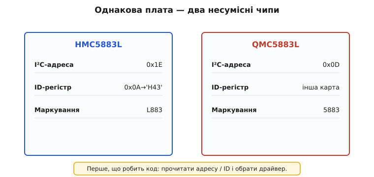
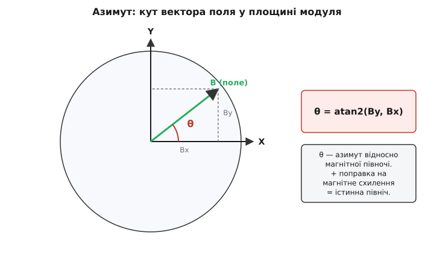

# GY-271 / HMC5883L — компас/магнетометр

## Чому пристрою потрібен електронний компас

Коли пристрій орієнтується в просторі, [популярні інерційні модулі MPU-6050](root:cat-hw-sensors/mpu6050) визначають кут нахилу за допомогою @@en|акселерометра@@ (лат. @@la|акселераціо@@ — прискорення, грец. @@el|метрон@@ — міра). Проте @@en|акселерометр@@ вимірює лише вектор гравітації та безсилий при повороті навколо вертикальної осі. @@en|Гіроскоп@@ (грец. @@el|гірос@@ — коло, @@el|скопео@@ — дивитися) відстежує кутову швидкість, але інтегрування його сигналу неминуче накопичує похибку — дрейф нуля. Через це пристрій швидко втрачає курс.

Для утримання напрямку потрібен зовнішній орієнтир. Модуль @@en|GY-271@@ містить тривісний @@en|магнетометр@@ (грец. @@el|магнітіс@@ — магніт, @@el|метрон@@ — міра), який вимірює проєкції магнітного поля Землі. Він працює як електронний компас, обчислюючи @@en|азимут@@ (араб. @@ar|ас-сумют@@ — напрямки) — кут відносно північного магнітного полюса. В автономних системах @@en|магнетометр@@ коригує дрейф @@en|гіроскопа@@, утримуючи абсолютний курс.

## Відмінність між чипами HMC5883L та QMC5883L

На однакових з вигляду платах @@en|GY-271@@ трапляються два апаратно несумісні чипи — @@en|HMC5883L@@ та @@en|QMC5883L@@. Спроба зчитати дані за кодом для одного чипа з іншого повертає помилкові значення або блокує шину @@en|I²C@@.


*Зовні однакові модулі GY-271 відрізняються маркуванням корпусу, адресою I²C та регістрами ідентифікації.*

Мікросхеми розрізняють за трьома параметрами:
1. Маркування: у @@en|HMC5883L@@ на корпусі вибито «5883» або «L883», тоді як [чип QMC5883L позначено](root:cat-hw-sensors/qmc5883l) як «DA5883» або «DB5883».
2. Адреса @@en|I²C@@: @@en|HMC5883L@@ займає адресу `0x1E`, а @@en|QMC5883L@@ — `0x0D`.
3. Регістри ідентифікації: у @@en|HMC5883L@@ регістри `0x0A`–`0x0C` повертають значення `"H43"`, а у @@en|QMC5883L@@ регістр `0x0D` містить `0xFF`.

Програмі слід сканувати шину @@en|I²C@@ та перевіряти регістри ідентифікації перед зчитуванням даних, щоб обрати відповідний драйвер.

## Перетворення проєкцій поля на істинний азимут

@@en|Магнетометр@@ вимірює горизонтальні проєкції магнітного поля `X` та `Y`. Перетворення цих координат на кут виконує математична функція @@en|atan2@@:

```
theta_mag = atan2(Y, X)
```

Ззвичайний арктангенс `atan(Y / X)` не розрізняє протилежні чверті кола й викликає ділення на нуль при `X = 0`. Функція @@en|atan2@@ враховує знаки обох аргументів і повертає кут у діапазоні від `-pi` до `pi` для всіх чотирьох чвертей.


*Проєкції магнітного поля X і Y визначають магнітний азимут, який коригується магнітним схиленням.*

Обчислений магнітний @@en|азимут@@ коригують @@en|магнітним схиленням@@ (лат. @@la|деклінаціо@@ — відхилення) `D` — кутом між магнітним і географічним північними полюсами:

```
theta_true = theta_mag + D
```

Якщо результат перевищує 360 градусів, від нього віднімають 360, отримуючи істинний @@en|азимут@@.

## Зчитування регістрів та компенсація зсуву

В @@en|HMC5883L@@ результати вимірювань зберігаються у шести регістрах послідовно: `X` (`0x03`–`0x04`), `Z` (`0x05`–`0x06`) та `Y` (`0x07`–`0x08`). Порядок `X-Z-Y` є специфікою чипа, де старший байт передує молодшому. Автоматичний інкремент покажчика дає змогу зчитати всі шість байтів за один сеанс шини @@en|I²C@@.

Намагнічені деталі та струми живлення створюють постійне магнітне поле — @@en|тверде залізо@@ (англ. @@en|hard iron@@ — постійна намагніченість деталей). Воно зсуває центр кола вимірювань від нуля на величини `X_offset` та `Y_offset`. Зсуви обчислюють за екстремумами після обертання датчика на 360 градусів:

```
X_offset = (X_max + X_min) / 2
Y_offset = (Y_max + Y_min) / 2
```

Віднімання цих зсувів відновлює симетрію даних. Головними обмеженнями модуля є чутливість до зовнішніх завад та нахилу: відхилення від горизонталі викривляє проєкції `X` і `Y`, що вимагає [компенсації кутів нахилу](root:math-geometry/tilt-compensation).
