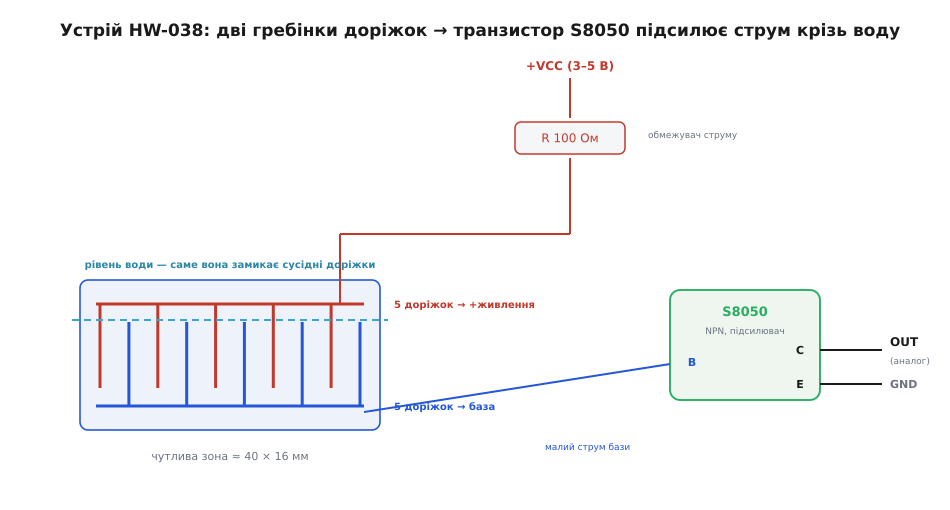
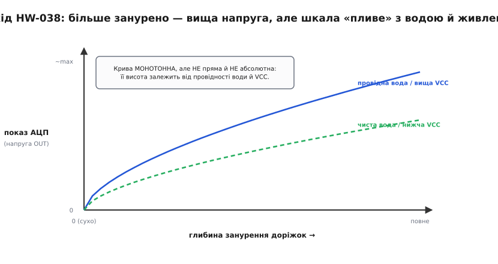
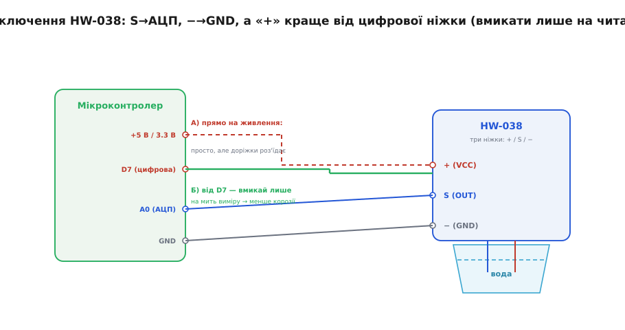
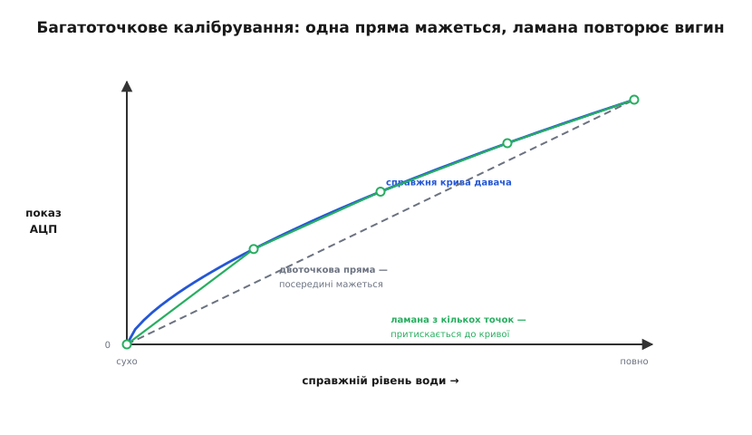
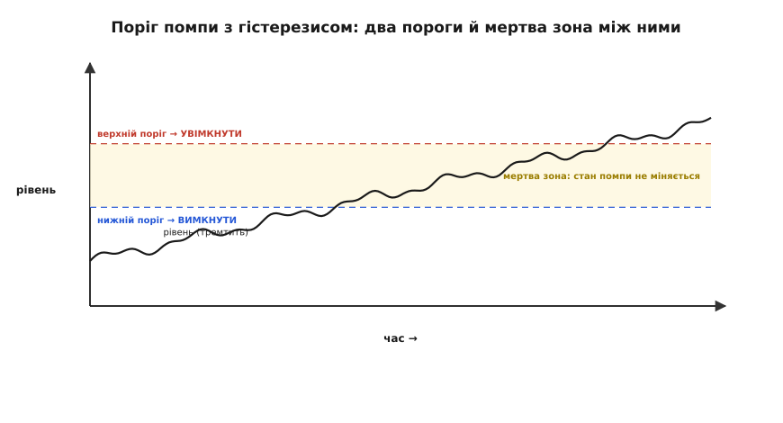

# HW-038 — резистивний давач рівня води

Модуль HW-038 (Water Level Sensor) — це популярний і доступний сенсор для виявлення присутності води та оцінки глибини занурення в аматорських і навчальних проектах. Давач часто використовується в системах захисту від протікання, контролю наповнення дренажних піддонів, акваріумів або резервуарів збору дощової води.

---

## 1. Принцип дії та внутрішня будова модуля

Конструктивно сенсор виконано у вигляді видовженої друкованої плати, розділеної на чутливу заглибну зону та верхню контактну площадку з електронними компонентами.



- **Взаємопроникна гребінка:** Чутливий кінець складається з десяти паралельних мідних смуг. П'ять смуг об'єднані в одну гребінку та підключені до шини живлення через обмежувальний резистор номіналом 100 Ом, а інші п'ять — утворюють зустрічну гребінку, підключену до бази біполярного транзистора.
- **Роль води як електроліту:** Повітряний проміжок між сусідніми доріжками є ізолятором. Коли гребінка занурюється у воду, розчинені у воді мінеральні солі створюють провідні іонні містки, замикаючи електричне коло між парами зубців.
- **Підсилювальний транзистор S8050:** Оскільки струм, що протікає крізь воду між доріжками, становить лише одиниці мікроамперів, на платі встановлено біполярний NPN-транзистор S8050. Він підсилює струм бази, формуючи на аналоговому виході `S` (OUT) напругу від 0 до 3–4.5 В, придатну для вимірювання АЦП мікроконтролера.

---

## 2. Фізика вимірювання та залежність сигналу від глибини

Головна характеристика HW-038 полягає в тому, що він є індикатором площі змочування електродів, а не абсолютним рівнеміром.



- **Паралельне підключення містків:** Що глибше плата занурена у воду, то більше паралельних ділянок доріжок контактує з електролітом. Сумарний електричний опір падає, базовий струм транзистора зростає, а вихідна напруга монотонно збільшується.
- **Вплив мінералізації та солей:** Вихідний сигнал залежить від хімічного складу води. Жорстка або солона водопровідна вода має високу провідність і дає високі значення коду АЦП, тоді як дощова або дистильована вода має набагато меншу провідність.
- **Залежність від напруги живлення:** Амплітуда сигналу прямо пропорційна напрузі `VCC`. При живленні від 5.0 В шкала ширша, ніж при живленні від 3.3 В.
- **Обмеження чутливої зони:** Довжина активної гребінки становить приблизно 40 мм. Зміна рівня вище або нижче цієї зони не фіксується.

---

## 3. Схема підключення та виводи модуля

Модуль має всього три контактні штирі, підписані на платі:



| Вивід | Маркування | Призначення | Рекомендоване підключення |
| :--- | :--- | :--- | :--- |
| **S** | OUT / Signal | Аналоговий вихід напруги (0...VCC) | До аналогового входу мікроконтролера (A0...A5 або GPIO з АЦП) |
| **+** | VCC / Power | Живлення постійного струму (3.0...5.0 В) | До цифрового виводу GPIO (для імпульсного живлення) |
| **−** | GND / Ground | Загальна земля схеми (0 В) | До спільної шини GND |

> 💡 **Рекомендація щодо живлення:** Підключайте плюсовий вивід `+` не до постійної шини живлення 5 В, а до вільного цифрового піна GPIO (наприклад, D7). Програма повинна вмикати пін лише на 10–20 мілісекунд для зняття вимірювання й одразу вимикати його. Це сповільнює електрохімічну корозію контактів у сотні разів!

---

## 4. Програмна фільтрація, калібрування та пороговий контроль

Оскільки покази АЦП містять випадковий шум від коливань поверхні рідини, у робочій прошивці обов'язково застосовують усереднення кількох замірів та гістерезис:



Гістерезис формує зону спокою між порогом вмикання помпи та порогом вимикання, що усуває неприпустиме часте клацання контактів реле при коливаннях води:



```cpp
/**
 * @file hw038_water_level_basic.ino
 * @brief Приклад роботи з давачем HW-038: імпульсне живлення та гістерезис
 */

const int PIN_POWER = 7;     // Цифровий пін для комутації живлення датчика
const int PIN_ANALOG = A0;   // Аналоговий вхід АЦП
const int PIN_ALARM = 13;    // Індикаторний світлодіод тривоги

// Експериментальні пороги (для конкретної води, АЦП 0..1023)
const int LEVEL_ALARM_HIGH = 350; // Поріг вмикання тривоги (переповнення)
const int LEVEL_ALARM_LOW  = 200; // Поріг скидання тривоги (рівень спав)

bool is_alarm_active = false;

// Зняття усередненого значення за 8 вибірок з імпульсним живленням
int readWaterLevelAveraged() {
  digitalWrite(PIN_POWER, HIGH); // Подаємо живлення на сенсор
  delay(10);                     // Очікуємо 10 мс для усталення перехідних процесів
  
  long sum = 0;
  for (int i = 0; i < 8; i++) {
    sum += analogRead(PIN_ANALOG);
    delay(2);
  }
  
  digitalWrite(PIN_POWER, LOW);  // Негайно знеструмлюємо сенсор!
  return (int)(sum / 8);
}

void setup() {
  Serial.begin(115200);
  pinMode(PIN_POWER, OUTPUT);
  digitalWrite(PIN_POWER, LOW);  // Початково вимкнено
  pinMode(PIN_ALARM, OUTPUT);
  digitalWrite(PIN_ALARM, LOW);
}

void loop() {
  int raw_level = readWaterLevelAveraged();
  
  // Логіка перемикання з гістерезисом
  if (!is_alarm_active && raw_level > LEVEL_ALARM_HIGH) {
    is_alarm_active = true;
    digitalWrite(PIN_ALARM, HIGH);
    Serial.println(F("[УВАГА] Зафіксовано високий рівень води!"));
  } else if (is_alarm_active && raw_level < LEVEL_ALARM_LOW) {
    is_alarm_active = false;
    digitalWrite(PIN_ALARM, LOW);
    Serial.println(F("[НОРМА] Рівень води знизився до безпечного."));
  }

  Serial.print(F("Відлік рівня: "));
  Serial.println(raw_level);

  delay(2000); // Опитування раз на 2 секунди
}
```

---

## 5. Боротьба з електролізом та практичні рекомендації

1. **Електрохімічна ерозія:** При постійній подачі струму через воду відбувається електроліз. Позитивні доріжки окиснюються, мідь розчиняється, і протягом кількох днів сенсор виходить з ладу. Використання живлення від піна GPIO на частки секунди подовжує термін служби модуля з днів до місяців.
2. **Не занурюйте плату вище гребінки:** Електронна частина (транзистор, SMD-резистори, штирі) розташована зверху. Якщо рівень рідини досягне компонентів, станеться коротке замикання схеми.
3. **Пам'ятайте про відносний характер:** HW-038 ідеально підходить для порогових сигналізаторів (сухо / мало / переповнення), але не здатен вимірювати точний об'єм у літрах або сантиметри без лабораторного калібрування під стабільний склад рідини.
