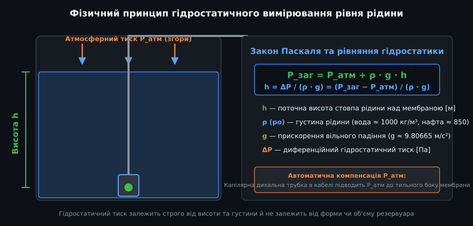
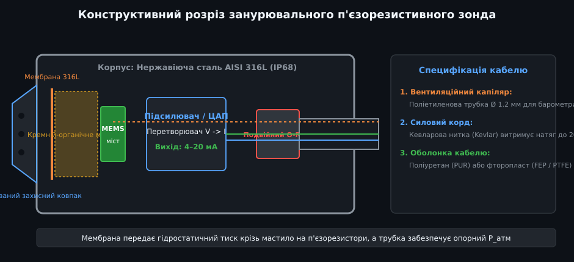
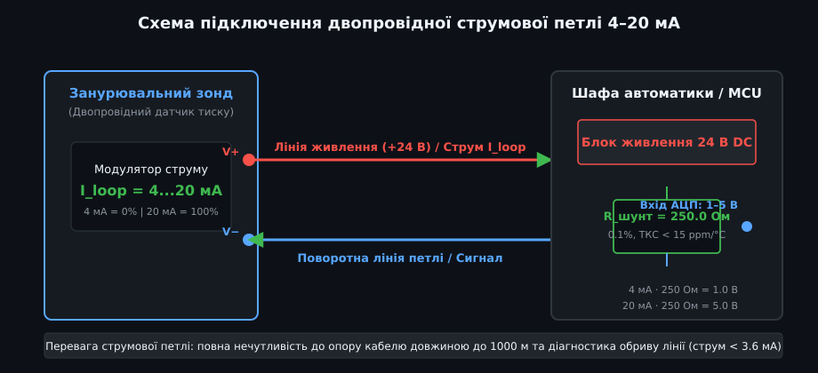
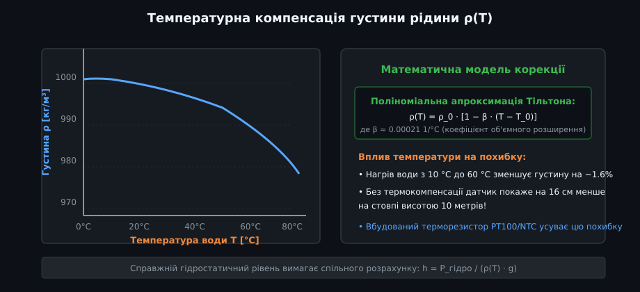
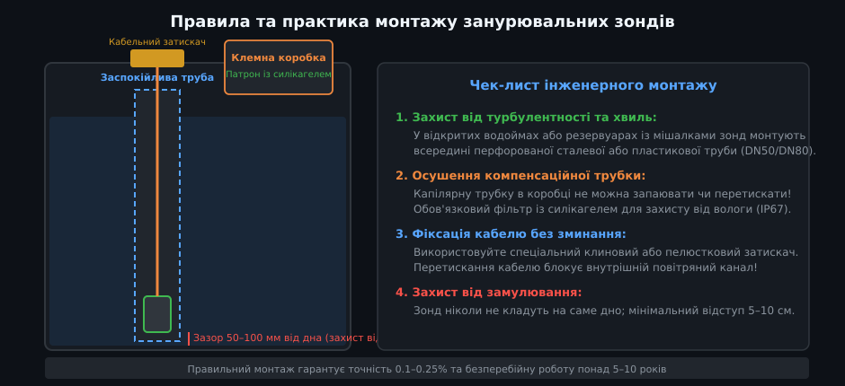

# Поглиблений аналіз гідростатичних давачів тиску та занурювальних зондів

Занурювальні гідростатичні зонди тиску становлять основу промислового обліку рідких середовищ. Вони поєднують високу точність п'єзорезистивних напівпровідникових сенсорів із міцністю важких герметичних корпусів із нержавіючої сталі або титану. У цьому посібнику розглядаються фізико-математичні основи перетворення тиску, електродинаміка струмової петлі 4–20 мА, алгоритми термодинамічної корекції густини та архітектура вбудованого програмного забезпечення мовою C++.

---

## 1. Математична та метрологічна модель гідростатичного вимірювання

Гідростатичний метод вимірювання базується на прямому зв'язку між тиском у точці занурення та висотою стовпа нестисливої рідини:



### Базове рівняння гідростатики
У полі тяжіння Землі тиск на глибині h описується інтегральним рівнянням:
  
P(h) = P_атм + ∫[0..h] ρ(z, T) · g(φ, z) dz

Для більшості інженерних застосувань у межах глибин до 100 метрів локальне гравітаційне прискорення вважається сталою величиною:
- Стандартне значення WGS-84: g = 9.80665 м/с².
- Залежність g від географічної широти φ:
  
  g(φ) ≈ 9.780327 · (1 + 0.0053024 · sin²(φ) − 0.0000058 · sin²(2φ))

Якщо рідина однорідна за складом і вертикальним градієнтом температури можна знехтувати, формула зводиться до лінійної форми:
  
ΔP = P(h) − P_атм = ρ · g · h

### Метрологічні діапазони та одиниці вимірювання
У промисловій практиці гідростатичний тиск часто виражають у метрах водяного стовпа (м вод. ст.) або барах (bar):
- 1 метр водяного стовпа (за 4 °C) = 9806.65 Па ≈ 0.09807 бара.
- Для швидких інженерних оцінок приймають: 10 метрів водяного стовпа ≈ 1.0 бар ≈ 100 кПа ≈ 1 атмосфера.
- Діапазони серійних занурювальних зондів стандартизовані: 0...1 м, 0...2.5 м, 0...5 м, 0...10 м, 0...25 м, 0...100 м, 0...250 м водяного стовпа.

---

## 2. Фізика п'єзорезистивного MEMS сенсора та розділова гідравліка

Первинним перетворювачем занурювального зонда є кремнієва монокристалічна мембрана, виготовлена за технологією мікроелектромеханічних систем (MEMS).



### Ефект п'єзоопору в кремнії
На пружну кремнієву мембрану методом дифузії або іонної імплантації наносяться чотири резистори, з'єднані за схемою повного моста Вітстона.
- При механічній деформації мембрани змінюється рухливість дірок і електронів у кристалічній решітці кремнію.
- Відносна зміна опору резисторів ΔR / R у десятки разів перевищує аналогічний ефект у металевих фольгових тензорезисторах:
  
  ΔR / R = π_l · σ_l + π_t · σ_t

  де π_l, π_t — поздовжній та поперечний п'єзорезистивні коефіцієнти, σ_l, σ_t — механічні напруження розтягу/стиску.
- Напруга діагоналі моста прямо пропорційна прикладеному тиску:
  
  V_bridge = V_supply · (ΔR / R)

### Гідравлічна ізоляція та кремній-органічне мастило
Оскільки вимірювана рідина (ґрунтова вода, стічні води, нафтопродукти) хімічно агресивна і електропровідна, кристал кремнію не може контактувати з нею безпосередньо.
- Зовнішній тиск сприймає тонка гофрована металева мембрана зі сталі марки AISI 316L, титану або сплаву Hastelloy C-276.
- Внутрішня порожнина між металевою мембраною та кремнієвим чіпом герметично вакуумується та заповнюється спеціальним дегазованим силіконовим мастилом низької в'язкості (Dow Corning або поліметилсилоксан).
- Мастило діє як абсолютно нестисливе гідравлічне середовище, передаючи тиск на чутливий чіп без спотворення фази чи амплітуди.

---

## 3. Інтерфейс струмової петлі 4–20 мА та протокол HART

У промислових АСУ ТП занурювальні зонди переважно підключаються за двопровідною схемою стандарту 4–20 мА.



### Енергетичний баланс та розрахунок допустимого опору петлі
Датчик живиться струмом самої вимірювальної петлі. Навіть при нульовому тиску схема споживає постійний базовий струм не більше 3.6–3.8 мА для роботи внутрішнього підсилювача та мікроконтролера.
- Максимальний опір навантаження (кабель + шунт контролера) лімітується напругою живлення:
  
  R_loop_max = (V_supply − V_sensor_min) / I_max

- **Числовий приклад розрахунку:**
  - Напруга блоку живлення: V_supply = 24.0 В.
  - Мінімальна робоча напруга внутрішньої схеми зонда: V_sensor_min = 10.0 В.
  - Максимальний аварійний струм за NAMUR NE 43: I_max = 21.5 мА (0.0215 А).
  - R_loop_max = (24.0 − 10.0) / 0.0215 = 651 Ом.
  - Якщо опір вимірювального шунта становить 250 Ом, то на опір жил кабелю залишається:
    R_cable_max = 651 − 250 = 401 Ом.
  - При типовому опорі мідного дроту перерізом 0.5 мм² (близько 36 Ом/км на дві жили) допустима довжина кабельної лінії перевищує 10 кілометрів!

### Діагностичні стани за стандартом NAMUR NE 43

| Діапазон струму | Стан системи та метрологічна оцінка | Реакція контролера |
| :--- | :--- | :--- |
| **I < 3.6 мА** | Обрив кабелю, відсутність живлення або аварія ASIC | Аварійна зупинка, тривога «Обрив датчика» |
| **3.6 ... 3.8 мА** | Негативний дрейф нуля (рівень нижче 0%) | Попередження про зміщення нуля |
| **3.8 ... 20.5 мА** | Нормальний робочий діапазон (0...100% шкали) | Розрахунок поточного рівня рідини |
| **20.5 ... 21.0 мА** | Переповнення резервуара (рівень > 100%) | Попередження про верхню межу |
| **I > 21.0 мА** | Коротке замикання лінії або пробій мембрани | Аварійна зупинка, тривога «КЗ датчика» |

---

## 4. Алгоритми температурно-густинної компенсації та обчислення об'єму

Оскільки густина рідини змінюється з температурою, використання фіксованого значення ρ призводить до систематичної похибки вимірювання висоти:



### Термодинамічна модель густини води
Для чистої води зміна густини залежно від температури описується рівнянням Тільтона (Tilton & Taylor) або стандартом IAPWS:
  
ρ(T) = ρ_max · [ 1 − ((T − 3.983)² · (T + 283.12)) / (508929.2 · (T + 68.1296)) ]

де T — температура у градусах Цельсія, ρ_max = 999.972 кг/м³ (максимальна густина води при 3.98 °C).

Для швидких розрахунків у мікроконтролерах використовують квадратичну апроксимацію:
  
ρ(T) ≈ 1000.0 − 0.0055 · (T − 4.0)²

### Розрахунок об'єму для резервуарів складної форми
Знаючи точну висоту рівня `h`, об'єм рідини в ємності розраховується за геометричними характеристиками:
- **Вертикальний циліндр:** V = π · R² · h.
- **Горизонтальний циліндричний резервуар з радіусом R і довжиною L:**
  
  V(h) = L · [ R² · arccos((R − h) / R) − (R − h) · √(2 · R · h − h²) ]

---

## 5. Промисловий драйвер мовою C++: діагностика NAMUR та фільтрація

Нижче наведено повний зразок промислового коду на C++ для мікроконтролера, що реалізує зчитування тиску зі струмового шунта, діагностику за стандартом NAMUR NE 43, термокомпенсацію та цифрове експоненційне згладжування.



```cpp
/**
 * @file hydrostatic_level_driver.hpp
 * @brief Промисловий клас обробки гідростатичного зонда рівня (4-20 мА)
 */

#include <stdint.h>
#include <stdbool.h>
#include <math.h>

class HydrostaticLevelSensor {
public:
    enum Status {
        STATUS_OK = 0,
        STATUS_UNDERRANGE = 1,
        STATUS_OVERRANGE = 2,
        STATUS_WIRE_BREAK = 3,
        STATUS_SHORT_CIRCUIT = 4
    };

    struct Config {
        float max_pressure_bar;   // Номінальний тиск датчика при 20 мА (напр. 1.0 бар = 10 м)
        float shunt_resistor_ohm; // Опір прецизійного шунта (напр. 250.0 Ом)
        float adc_vref_volts;     // Опорна напруга АЦП (напр. 3.3 В або 5.0 В)
        uint32_t adc_max_counts;  // Роздільна здатність АЦП (1023 для 10-біт, 4095 для 12-біт)
        float filter_alpha;       // Коефіцієнт згладжування фільтра (0.05 ... 0.2)
    };

    HydrostaticLevelSensor(const Config &cfg) 
        : config_(cfg), filtered_level_m_(0.0f), is_initialized_(false) {}

    /**
     * @brief Обробка сирого коду АЦП з температурною корекцією
     * @param raw_adc Сире число з АЦП мікроконтролера
     * @param temperature_c Поточна температура рідини у градусах Цельсія
     * @param out_level_m Розрахована фізична висота стовпа у метрах
     * @return Стан давача відповідно до діагностики NAMUR NE 43
     */
    Status processSample(uint32_t raw_adc, float temperature_c, float &out_level_m) {
        // 1. Переведення коду АЦП у напругу на шунті
        float v_shunt = ((float)raw_adc / (float)config_.adc_max_counts) * config_.adc_vref_volts;

        // 2. Розрахунок струму петлі в міліамперах
        float current_ma = (v_shunt / config_.shunt_resistor_ohm) * 1000.0f;

        // 3. Діагностика лінії за стандартом NAMUR NE 43
        if (current_ma < 3.6f) {
            return STATUS_WIRE_BREAK;      // Обрив лінії або відсутність живлення
        }
        if (current_ma > 21.0f) {
            return STATUS_SHORT_CIRCUIT;   // Коротке замикання або перевантаження
        }

        Status status = STATUS_OK;
        if (current_ma < 3.8f) {
            status = STATUS_UNDERRANGE;    // Зміщення нуля нижче шкали
            current_ma = 4.0f;             // Затискаємо для безпечного розрахунку
        } else if (current_ma > 20.5f) {
            status = STATUS_OVERRANGE;     // Переповнення вище 100%
            current_ma = 20.0f;
        }

        // 4. Лінійне обчислення диференційного тиску [Па]
        // 4 мА -> 0 бар; 20 мА -> max_pressure_bar
        float pressure_bar = ((current_ma - 4.0f) / 16.0f) * config_.max_pressure_bar;
        float pressure_pa = pressure_bar * 100000.0f;

        // 5. Розрахунок густини води за спрощеною поліноміальною моделлю
        // При 4 °C густина 1000 кг/м³, при 60 °C — близько 983 кг/м³
        float delta_t = temperature_c - 4.0f;
        float density_kg_m3 = 1000.0f - (0.0055f * delta_t * delta_t);
        if (density_kg_m3 < 800.0f) density_kg_m3 = 800.0f; // Захист меж

        // 6. Обчислення висоти стовпа h = P / (ρ · g)
        const float g = 9.80665f;
        float calculated_height_m = pressure_pa / (density_kg_m3 * g);
        if (calculated_height_m < 0.0f) calculated_height_m = 0.0f;

        // 7. Цифровий фільтр низьких частот (EMA — Exponential Moving Average)
        if (!is_initialized_) {
            filtered_level_m_ = calculated_height_m;
            is_initialized_ = true;
        } else {
            filtered_level_m_ = (config_.filter_alpha * calculated_height_m) + 
                                ((1.0f - config_.filter_alpha) * filtered_level_m_);
        }

        out_level_m = filtered_level_m_;
        return status;
    }

    void resetFilter() {
        is_initialized_ = false;
        filtered_level_m_ = 0.0f;
    }

private:
    Config config_;
    float filtered_level_m_;
    bool is_initialized_;
};
```

### Інженерні висновки для розробників систем автоматизації
1. **Вибір діапазону тиску:** Обирайте датчик із номіналом, максимально наближеним до робочої висоти ємності. Використання зонда на 10 бар (100 м) для вимірювання резервуара глибиною 2 метри призведе до втрати 80% роздільної здатності АЦП та 5-кратного збільшення похибки.
2. **Осушення капілярного каналу:** Заміна осушувального патрона з силікагелем на клемній коробці має проводитися щорічно під час планового технічного обслуговування. Посиніння або почервоніння гранул вказує на критичне насичення вологою.
3. **Гідродинамічний тиск:** При швидкому наповненні резервуара струмінь рідини, спрямований на захисний ковпачок, створює додатковий швидкісний напір (тиск Бернуллі). Заспокійлива труба є обов'язковим елементом надійної інженерної конструкції.
