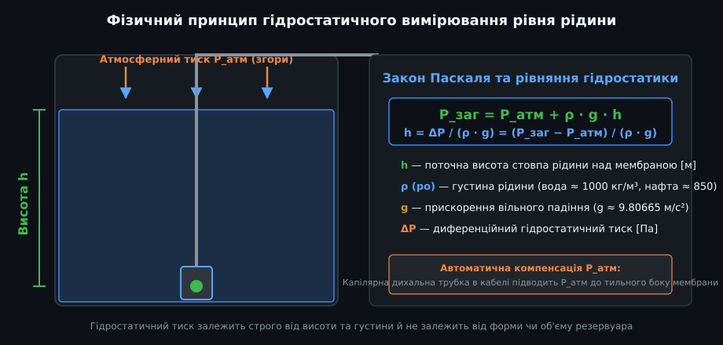
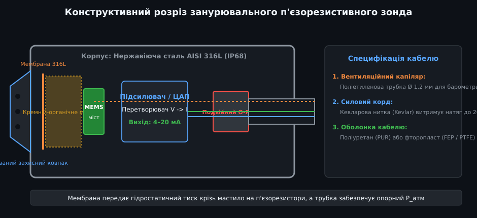
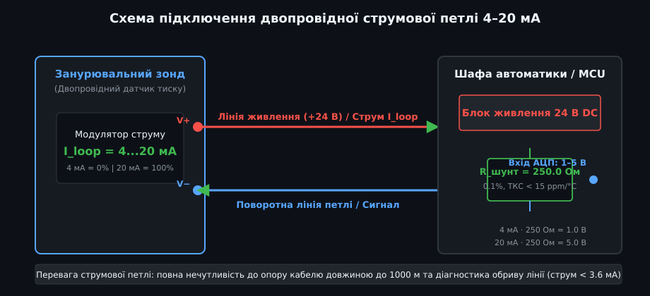
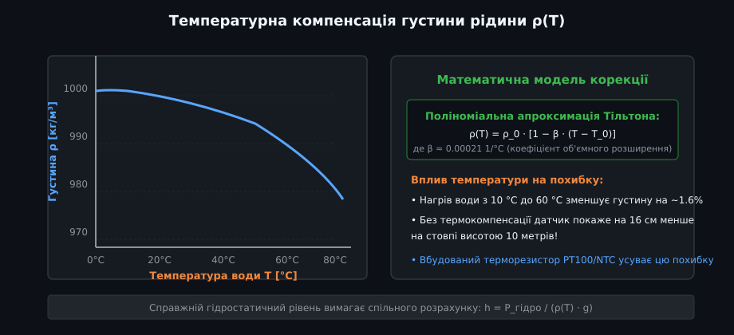
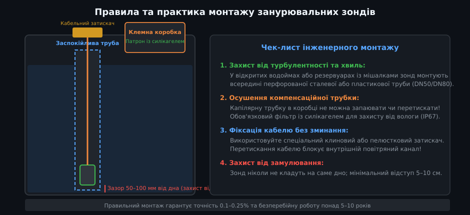

# Гідростатичні давачі тиску та занурювальні п'єзорезистивні зонди

Гідростатичні давачі рівня (занурювальні гідростатичні зонди тиску) є найбільш надійним, точним і універсальним промисловим засобом безперервного вимірювання рівня рідин у глибоких свердловинах, водонапірних вежах, відкритих водоймах, каналізаційних насосних станціях (КНС) та технологічних резервуарах. На відміну від контактних гребінчастих або поплавкових систем, занурювальний зонд не має рухомих механічних вузлів і здатний працювати роками в брудному та агресивному середовищі.

---

## 1. Фізичний принцип дії та закон Паскаля

Робота гідростатичного рівнеміра базується на фундаментальному законі гідростатики Паскаля: тиск нерухомого стовпа рідини залежить виключно від висоти цього стовпа та густини рідини:

- **Рівняння гідростатичного тиску:**
  
  P_заг = P_атм + ρ · g · h

  де:
  - `P_заг` — абсолютний тиск на глибині занурення датчика [Па];
  - `P_атм` — атмосферний тиск повітря над дзеркалом рідини [Па];
  - `ρ` (ро) — густина вимірюваного середовища [кг/м³] (для чистої води за 20 °C ρ ≈ 998.2 кг/м³);
  - `g` — прискорення вільного падіння (g ≈ 9.80665 м/с²);
  - `h` — висота стовпа рідини над площиною чутливої мембрани [м].
- **Визначення рівня рідини:**
  
  h = ΔP / (ρ · g) = (P_заг − P_атм) / (ρ · g)

- **Незалежність від геометрії:** Величина тиску рідини на дні не залежить від форми резервуара, кута нахилу стінок або загального об'єму рідини. Стовп води висотою рівно 1 метр створює тиск близько 9.81 кПа (або приблизно 0.1 бара / 0.1 атмосфери).

---

## 2. Будова занурювального зонда та барометрична компенсація

Занурювальний датчик конструктивно спроектовано для постійної роботи на дні під значним тиском (клас пиловологозахисту IP68):

1. **Захисний корпус:** Важкий циліндричний ковпак виготовлено з корозійностійкої нержавіючої сталі марки AISI 316L (або титану для морської води). Нижня частина оснащена знімним перфорованим наконечником, який пропускає воду до мембрани, але захищає її від механічних ударів об дно та каміння.
2. **Розділова металева мембрана:** Тонка гофрована мембрана зі сталі 316L або сплаву Hastelloy безпосередньо контактує з середовищем. Простір між мембраною та кремнієвим чіпом заповнено дегазованим кремній-органічним мастилом (силіконовою оливою), яке передає тиск без спотворень.
3. **П'єзорезистивний MEMS кристал:** Чотири п'єзорезистори, інтегровані в кремнієву пластину за схемою моста Вітстона, деформуються під тиском мастила. Зміна опору резисторів перетворюється прецизійним внутрішнім підсилювачем на пропорційний струм.
4. **Вентильований кабель з капіляром:** Кабель зонда містить внутрішню гнучку поліетиленову трубку (дихальний капіляр), яка виводить зворотний бік сенсорного кристала в атмосферу. Завдяки цьому атмосферний тиск `P_атм` природно віднімається механічно:
   
   ΔP = P_заг − P_атм

   Коливання погоди (циклони, антициклони) не створюють жодної похибки у визначенні висоти `h`.

---

## 3. Схема підключення двопровідної струмової петлі 4–20 мА

У промисловості переважна більшість гідростатичних зондів випускається з уніфікованим аналоговим інтерфейсом струмової петлі 4–20 мА за стандартом NAMUR NE 43:

- **Двопровідне підключення:** Ті самі два дроти одночасно передають напругу живлення до датчика (+12...30 В DC) і повертають інформаційний струм:
  - `4.0 мА` відповідає нульовому рівню рідини (0% шкали, порожній резервуар);
  - `20.0 мА` відповідає максимальній глибині занурення (100% шкали діапазону датчика).
- **Переваги струмового сигналу:**
  1. Струм не загасає вздовж довгих кабельних трас (до 1000 метрів), на відміну від напруги.
  2. Висока стійкість до промислових електромагнітних завад від насосів та частотних перетворювачів.
  3. Діагностика «живого нуля» (Live Zero): струм менше 3.6 мА сигналізує про обрив кабелю, а струм більше 21.0 мА — про коротке замикання або перевантаження мембрани.
- **Зняття сигналу контролером:** У вимірювальне коло послідовно вмикають високоточний шунтуючий резистор номіналом R = 250.0 Ом (допуск 0.1%). За законом Ома струм 4–20 мА створює на ньому спад напруги від 1.0 В до 5.0 В, який подається на звичайний аналоговий вхід АЦП мікроконтролера.

---

## 4. Температурна компенсація та залежність від густини середовища

Оскільки формульний розрахунок висоти стовпа використовує значення `ρ`, зміна температури рідини безпосередньо впливає на результат:

- **Теплове розширення води:** При нагріванні від 4 °C до 60 °C вода розширюється, а її густина падає з 1000 кг/м³ до приблизно 983 кг/м³ (похибка становить понад 1.7%).
- **Похибка рівня:** Якщо контролер використовує фіксовану константу густини ρ = 1000 кг/м³, нагріта рідина створить менший гідростатичний тиск, і прилад покаже рівень на 17 см менший реального на резервуарі глибиною 10 метрів.
- **Корекція в прошивці:** Сучасні занурювальні зонди містять вбудований датчик температури (PT100 або NTC), що дозволяє обчислювати фактичну густину рідини за поліномом:
  
  ρ(T) = ρ_0 · [1 − β · (T − T_0)]

---

## 5. Практика інженерного монтажу та правила експлуатації

1. **Заспокійлива труба (Stilling Well):** У резервуарах із потужними насосами, подачею води під напором або мішалками датчик обов'язково розміщують всередині вертикальної заспокійливої труби (діаметром DN50–DN100) з отворами в нижній частині. Це гасить гідродинамічні хвилі та захищає зонд від механічного розгойдування.
2. **Захист від замулювання:** Зонд ніколи не кладуть на саме дно колодязя. Мінімальна відстань від дна до захисного ковпачка повинна становити 50–100 мм для запобігання забиванню мембрани піском, мулом чи осадом.
3. **Осушення вентиляційної трубки:** Капілярну трубку на кінці кабелю виводять у суху герметичну клемну коробку. На кінець трубки обов'язково встановлюють змінний картридж із вологопоглинаючим силікагелем (із колірним індикатором насичення). Попадання вологи або конденсату всередину капіляра призводить до корозії внутрішнього кристала та виходу зонда з ладу.
4. **Затискач кабелю:** Кабель фіксують спеціальним клиновим або еластичним пелюстковим затискачем без перетискання оболонки, щоб не перекрити внутрішній повітряний канал.
