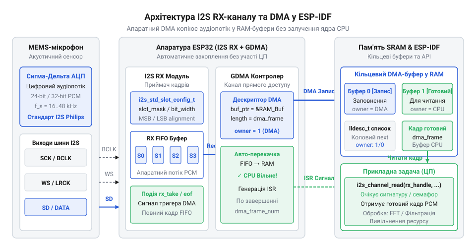
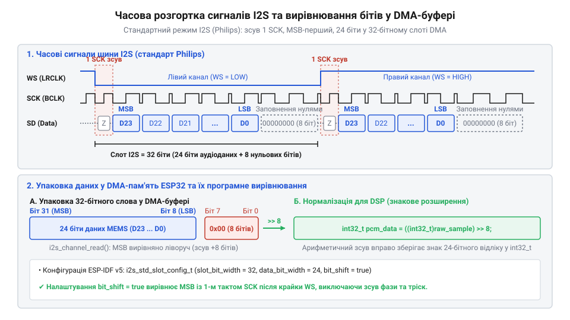

# Програмний API драйвера I2S у фреймворку ESP-IDF (v5.x) для роботи з MEMS-мікрофонами

## Проблема прямого зчитування аудіопотоку

Приймання високочастотного цифрового аудіосигналу ставить жорсткі вимоги до точності часових інтервалів. Захоплення звуку з частотою дискретизації 44.1 або 48 кілогерц вимагає зчитування тисяч дискретних відліків за секунду, де кожен відлік передається послідовно через серійну шину біт за бітом.

На відміну від повільних давачів на кшталт [фоторезистора KY-018](root:cat-hw-sensors/ky-018-photoresistor), де вимірювання відбуваються з інтервалом у сотні мілісекунд, аудіосигнал вимагає безперервної потокової обробки. Прості давачі звуку, такі як [звуковий давач з мікрофоном (LM393)](root:cat-hw-sensors/sound-lm393), оперують лише пороговим аналоговим сигналом і дають сигнал логічного рівня через вивід @@en|GPIO@@ (англ. *General-Purpose Input/Output*, виводи загального призначення). Аналогові мікрофонні модулі на кшталт [KY-038](root:cat-hw-sensors/ky-038-mic) чи [KY-037](root:cat-hw-sensors/ky-037-mic) передають змінну напругу, яку можна періодично вимірювати за допомогою аналогово-цифрового перетворювача — @@en|ADC@@ (англ. *Analog-to-Digital Converter*, аналогово-цифровий перетворювач). Проте для отримання високоякісного цифрового звуку застосовують @@en|MEMS@@-мікрофони (англ. *Micro-Electro-Mechanical Systems*, мікроелектромеханічні системи). Вони містять вбудований @@en|ADC@@ та оцифровують звукові коливання безпосередньо у кристалі, видаючи на виході точний потік @@en|PCM@@-даних (англ. *Pulse-Code Modulation*, імпульсно-кодова модуляція).

Якщо спробувати зчитати такий цифровий потік програмно — шляхом опитування стану виводів мікроконтролера в циклі — система миттєво зіштовхнеться з двома фундаментальними перешкодами:

1. **Часовий джиттер та втрата фазової синхронізації.** Тактова частота пересилання бітів для стереозвуку частотою 44.1 кГц складає близько 2.8224 мегагерца. Тривалість одного бітового імпульсу становить більше 350 наносекунд. Будь-яка переривальна подія операційної системи — обробка таймера, обмін по Wi-Fi чи перемикання контексту задач у @@en|FreeRTOS@@ — затримує виконання програмного циклу на кілька мікросекунд. У результаті ядро контролера пропускає тактові імпульси, викривляє структуру кадру та отримує спотворене значення звукового відліку.

2. **Неприпустиме навантаження на процесор.** Програмна генерація тактового сигналу та опитування виводу даних підпорядковують собі 100% ресурсів процесорного ядра. Контролер втрачає можливість виконувати паралельні завдання обробки сигналу, логіки пристрою чи мережевого обміну.

Вирішенням цієї проблеми є застосування спеціалізованої периферійної апаратної шини @@en|I2S@@ (англ. *Inter-IC Sound*, звук між інтегральними схемами) у поєднанні з контролером прямого доступу до пам'яті — @@en|DMA@@ (англ. *Direct Memory Access*, прямий доступ до пам'яті). Апаратний модуль @@en|I2S@@ бере на себе формування часових сіток та апаратний зсувний регістр, а контролер @@en|DMA@@ автоматично складає зчитані біти у слова й записує їх у буфери оперативної пам'яті (@@en|RAM@@, англ. *Random Access Memory*), взагалі не залучаючи процесорні ядра під час прийому кадру.

## Архітектура каналів та конфігурація I2S

У фреймворку @@en|ESP-IDF@@ (версії v5.x) драйвер @@en|I2S@@ побудовано на двокомпонентній канальній архітектурі. На відміну від застарілого драйвера v4.x, де контролер керувався як монолітний пристрій, оновлений API розділяє передавач (@@en|TX@@, англ. *Transmit*, передавач) та приймач (@@en|RX@@, англ. *Receive*, приймач) на незалежні об'єкти-канали. Це дозволяє гнучко виділяти лише потрібні ресурси й оптимізувати використання оперативної пам'яті, коли пристрій працює виключно на запис звуку з мікрофона.

Робота з драйвером починається зі створення та налаштування базового об'єкта каналу за допомогою структури `i2s_chan_config_t` та виклику функції `i2s_new_channel`.

Ключовими параметрами структури `i2s_chan_config_t` є:
- `id`: вибір апаратного контролера @@en|I2S@@ (`I2S_NUM_0` або `I2S_NUM_1`). - `role`: роль пристрою на шині. Для більшості мікрофонів мікроконтролер виступає ведучим пристроєм (`I2S_ROLE_MASTER`), генеруючи тактові імпульси. - `dma_desc_num`: кількість дескрипторів @@en|DMA@@ у кільцевому списку буфера. - `dma_frame_num`: кількість аудіокадрів (відліків), яку вміщує один дескриптор @@en|DMA@@. - `auto_clear`: прапор автоматичного очищення буферів при виникненні помилок потоку.

Правило розрахунку розміру буферів @@en|DMA@@ розкривається через баланс між затримкою прийому (латентністю) та надійністю безперервного зчитування. Сумарна ємність кільцевого буфера обчислюється як добуток `dma_desc_num × dma_frame_num`, а час заповнення одного дескриптора визначається співвідношенням `dma_frame_num / f_s`, де `f_s` — частота дискретизації. Параметр `dma_frame_num` визначає частоту виклику переривань: надто мале значення (наприклад, 32–64 кадри) зменшує затримку до кількох мілісекунд, але створює високе навантаження на процесор через часті переривання. Якщо задачу зчитування у @@en|FreeRTOS@@ тимчасово витісняють високопріоритетні процеси (наприклад, обробка радіопакетів @@en|Wi-Fi@@), кільцевий список дескрипторів `dma_desc_num` запобігає втраті відліків. Для стабільної роботи без переповнення значення `dma_desc_num` зазвичай обирають у межах від 6 до 8, а `dma_frame_num` налаштовують на порцію даних тривалістю 10–20 мс (наприклад, 240 кадрів при частоті 16000 Гц дають 15 мс) або узгоджують із розміром вікна подальшої цифрової обробки.

Шлях прийому аудіоданих та взаємодія між апаратурним блоком @@en|I2S@@, контролером @@en|DMA@@ та пам'яттю мікроконтролера зображені на схемі:


*Зв'язок між апаратурним блоком I2S, DMA-контролером, кільцевим буфером у RAM та дескриптором каналу ESP-IDF.*

Як видно зі схеми, прийом даних відбувається безпосередньо через апаратні канали: периферія @@en|I2S@@ приймає серійний потік з виводу даних мікрофона, зсуває біти у паралельне слово і передає контролеру @@en|DMA@@. Контролер @@en|DMA@@ заповнює поточний буфер в @@en|RAM@@ відповідно до active-дескриптора й викликає переривання лише тоді, коли цілий блок даних готовий до обробки.

Процес створення RX-каналу у коді реалізується наступним чином:

:::tabs
```c|esp-idf
#include "driver/i2s_std.h"

i2s_chan_handle_t rx_handle = NULL;

i2s_chan_config_t chan_cfg = I2S_CHAN_CONFIG_DEFAULT(I2S_NUM_0, I2S_ROLE_MASTER);
chan_cfg.dma_desc_num = 6;
chan_cfg.dma_frame_num = 240;

// Створення лише RX-каналу (покажчик на TX-канал передаємо як NULL)
esp_err_t ret = i2s_new_channel(&chan_cfg, NULL, &rx_handle);
if (ret != ESP_OK) {
    // Обробка помилки виділення ресурсів каналу
}
```
```cpp|esp-idf
#include "driver/i2s_std.h"

i2s_chan_handle_t rx_handle{nullptr};

i2s_chan_config_t chan_cfg = I2S_CHAN_CONFIG_DEFAULT(I2S_NUM_0, I2S_ROLE_MASTER);
chan_cfg.dma_desc_num = 6;
chan_cfg.dma_frame_num = 240;

// Створення лише RX-каналу у C++
esp_err_t ret = i2s_new_channel(&chan_cfg, nullptr, &rx_handle);
if (ret != ESP_OK) {
    // Обробка помилки виділення ресурсів каналу
}
```
:::

Після успішного виконання `i2s_new_channel` повертається дескриптор `rx_handle`. Об'єкт каналу перебуває в стані ініціалізації. Він має виділені ресурси пам'яті під дескриптори @@en|DMA@@, проте часові параметри шини та призначення конкретних виводів @@en|GPIO@@ ще не встановлені.

## Налаштування тактування та слотів мікрофона

Отриманий дескриптор каналу необхідно сконфігурувати відповідно до часових вимог конкретного @@en|MEMS@@-мікрофона. У стандартному режимі (@@en|Standard Mode@@) шина @@en|I2S@@ використовує три основні лінії зв'язку:
1. `SCK` (послідовний тактовий сигнал, або `BCLK`) — визначає швидкість передачі окремих бітів. 2. `WS` (выбор слова, або `LRCLK`) — визначає межі аудіокадру та поточний канал (лівий чи правий). 3. `SD` (послідовні дані, або `DIN`) — лінія передачі цифрового звуку від мікрофона.

Параметри шини в режимі @@en|Standard Mode@@ об'єднуються у структуру `i2s_std_config_t`, яка складається з конфігурації тактування (`clk_cfg`), налаштування слотів (`slot_cfg`) та призначення виводів (`gpio_cfg`).

Узгодження часових інтервалів передачі ідентифікується за часовою діаграмою:


*Часова розгортка сигналів WS, SCK та SD з вирівнюванням MSB/LSB і зсувом бітів MEMS-мікрофона відносно слота I2S.*

На діаграмі продемонстровано стандартний формат @@en|Philips I2S@@: фронт сигналу `WS` зміщується на один такт `SCK` до початку передачі старшого значущого біта — @@en|MSB@@ (англ. *Most Significant Bit*, старший значущий біт). Цифрові @@en|MEMS@@-мікрофони виводять 24 біти корисного аудіосигналу, розташовуючи їх усередині 32-бітного часового слота.

Тактування налаштовується через структуру `i2s_std_clk_config_t` за допомогою макроса `I2S_STD_CLK_DEFAULT_CONFIG(sample_rate)`:

```c
i2s_std_clk_config_t clk_cfg = I2S_STD_CLK_DEFAULT_CONFIG(44100);
clk_cfg.clk_src = I2S_CLK_SRC_DEFAULT;
```

Структура `i2s_std_slot_config_t` задає розрядність кадрів та режим слотів. Для більшості монофонічних @@en|MEMS@@-мікрофонів встановлюють 32-бітну ширину слота, оскільки 24 біти цифрового звуку розташовуються всередині 32-бітного часового інтервалу. Вибір активного слота залежить від підключення фізичного виводу `L/R` (від англ. *Left/Right*, лівий/правий) мікрофона: приєднання цього виводу до `GND` змушує пристрій передавати дані в лівому слоті сигналу `WS`, а в правому — переходити у високоімпедансний (від лат. *impedio* — перешкоджати) стан @@en|high-Z@@; з'єднання з `VCC` активує правий слот. Параметр `slot_mask` у конфігурації слота має чітко відповідати цьому апаратному монтажу — значення `I2S_STD_SLOT_LEFT` вказує контролеру @@en|DMA@@ зчитувати відліки лише під час лівого слота. Якщо ж вивід `L/R` підключено до `GND`, а в `slot_mask` помилково вказано `I2S_STD_SLOT_RIGHT`, контролер зчитуватиме відключену лінію, що призведе до появи суцільних нулів або цифрового шуму замість аудіосигналу:

```c
i2s_std_slot_config_t slot_cfg = I2S_STD_PHILIPS_SLOT_DEFAULT_CONFIG(I2S_DATA_BIT_WIDTH_32BIT, I2S_SLOT_MODE_MONO);
slot_cfg.slot_mask = I2S_STD_SLOT_LEFT;
```

Фізичні виводи підключаються через структуру `i2s_std_gpio_config_t`:

```c
i2s_std_gpio_config_t gpio_cfg = {
    .mclk = I2S_GPIO_UNUSED,
    .bclk = GPIO_NUM_4,
    .ws   = GPIO_NUM_5,
    .dout = I2S_GPIO_UNUSED,
    .din  = GPIO_NUM_18,
    .invert_flags = {
        .mclk_inv = false,
        .bclk_inv = false,
        .ws_inv   = false,
    },
};
```

Повне застосування конфігурації до RX-каналу здійснюється викликом `i2s_channel_init_std_mode`:

:::tabs
```c|esp-idf
i2s_std_config_t std_cfg = {
    .clk_cfg  = clk_cfg,
    .slot_cfg = slot_cfg,
    .gpio_cfg = gpio_cfg,
};

// Застосування конфігурації стандартного режиму до RX-каналу
esp_err_t ret = i2s_channel_init_std_mode(rx_handle, &std_cfg);
if (ret != ESP_OK) {
    // Обробка помилки ініціалізації
}
```
```cpp|esp-idf
i2s_std_config_t std_cfg = {
    .clk_cfg  = clk_cfg,
    .slot_cfg = slot_cfg,
    .gpio_cfg = gpio_cfg,
};

// Застосування конфігурації у C++
esp_err_t ret = i2s_channel_init_std_mode(rx_handle, &std_cfg);
if (ret != ESP_OK) {
    // Обробка помилки ініціалізації
}
```
:::

Після виконання функції `i2s_channel_init_std_mode` драйвер розраховує дільники апаратного тактування, зв'язує дескриптори @@en|DMA@@ з контролером і переводить канал у стан готовності. Якщо замість PCM-мікрофона використовується модель із PDM-інтерфейсом, перегляньте інструкцію про [роботу з PDM MEMS-мікрофонами у фреймворку ESP-IDF](root:sys-fw/pdm-mems-microphone).

## Прийом даних та управління циклом

Після завершення конфігурації канал перебуває в стані готовності, але генерація тактових сигналів ще не розпочалася. Для старту прийому даних необхідно перевести канал у стан виконання функцією `i2s_channel_enable`:

```c
ESP_ERROR_CHECK(i2s_channel_enable(rx_handle));
```

Зчитування накопичених @@en|PCM@@-відліків з буферів @@en|DMA@@ здійснюється за допомогою виклику `i2s_channel_read`. Ця функція блокує поточну задачу @@en|FreeRTOS@@ до моменту, поки вказаний обсяг байтів не буде скопійовано у буфер призначення:

```c
esp_err_t i2s_channel_read(i2s_chan_handle_t handle, void *dst, size_t size, size_t *bytes_read, uint32_t timeout_ms);
```

Функція приймає покажчик на буфер `dst`, розмір запитуваного блоку `size`, покажчик для збереження фактичної кількості зчитаних байтів `bytes_read` та таймаут `timeout_ms`. 

Якщо задача обробки даних не встигає викликати `i2s_channel_read`, кільцевий список дескрипторів @@en|DMA@@ переповнюється (@@en|DMA buffer overflow@@), що призводить до втрати найстаріших кадрів або виникнення помилки `ESP_ERR_TIMEOUT`.

Оскільки 24-бітне корисне значення @@en|MEMS@@-мікрофона упаковане в 32-бітний слот і вирівняне по старшому краю, отримані цілі числа необхідно зсунути праворуч для нормалізації у 16-бітний формат `int16_t`.

Нижче наведено закончений приклад задачі зчитування аудіопотоку з обробкою таймаутів та безпечним вивільненням ресурсів:

:::tabs
:::code api-esp32-i2s-idf-driver/c/esp-idf/audio-capture-task.c
:::code api-esp32-i2s-idf-driver/cpp/esp-idf/audio-capture-task.cpp
:::

У разі виходу з циклу або завершення роботи пристрою драйвер вимагає дотримання двох кроків вивільнення ресурсів:
1. `i2s_channel_disable(rx_handle)` — вимикає генерацію тактових сигналів та припиняє передачу даних через @@en|DMA@@, повертаючи канал у стан готовності. 2. `i2s_del_channel(rx_handle)` — повністю видаляє об'єкт каналу та звільняє виділену оперативну пам'яті й переривання.

Правильне управління життєвим циклом об'єкта запобігає витокам оперативної пам'яті та гарантує коректне повторне відкриття периферії @@en|I2S@@ у складних застосунках. Для подальшої математичної обробки отриманого PCM-сигналу, фільтрації та спектрального аналізу дивіться статтю про [первинну обробку цифрового звуку та FFT на ESP32](root:sys-fw/esp-dsp-library).