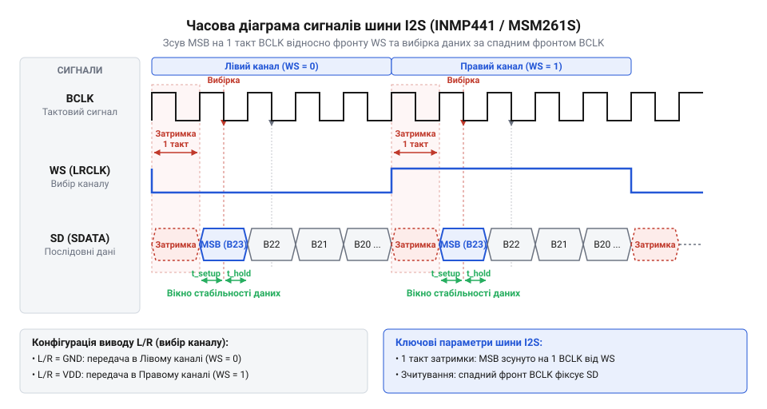
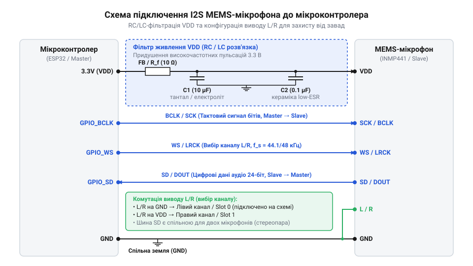

# Апаратний інтерфейс MEMS-мікрофонів I2S: цокольовка, часові діаграми та схемотехніка підключення

<preknowlist>
- [Звуковий давач з мікрофоном (LM393)](root:cat-hw-sensors/sound-lm393) — принцип роботи аналогового мікрофонного капсуля та обмеження аналогових схем підсилення акустичного сигналу
- [KY-038 — мікрофонний давач звуку](root:cat-hw-sensors/ky-038-mic) — відмінності між пороговим виявленням звукових сигналів та неперервною оцифровкою акустичної хвилі
</preknowlist>

## Завади аналогових мікрофонів у цифровій схемотехніці

Передача слабких напруг від аналогових акустичних давачів у мікроконтролерних системах наражається на суттєві електромагнітні спотворення. Коли використовують [звуковий давач з мікрофоном](root:cat-hw-sensors/sound-lm393) чи [мікрофонний давач звуку](root:cat-hw-sensors/ky-038-mic), електретний капсуль генерує аналоговий сигнал амплітудою в кілька мілівольтів. Провідники від мікрофона до підсилювача та АЦП діють як антена, що вловлює наводки від цифрових шин і широтно-імпульсної модуляції.

Додатково підсилювач спотворює сигнал через імпульсне споживання струму цифровим процесором. Паразитний опір та індуктивність доріжок плати перетворюють кидки струму на пульсації живлення та землі амплітудою до десятків мілівольтів. Підсилювач сприймає ці коливання як корисний сигнал, підмішуючи до аудіопотоку високочастотне гудіння.

Проблему вирішують цифрові мікрофони за технологією @@en|MEMS@@ (англ. *Micro-Electro-Mechanical Systems*, від грец. *mikros* — малий, *elektron* — бурштин, *mechanike* — мистецтво будувати машини, *systema* — ціле). У них кремнієва мембрана, підсилювач та @@en|Sigma-Delta АЦП@@ (грец. *sigma* — сума, *delta* — різниця) об'єднані в одному корпусі, а оцифровка відбувається в частках міліметра від мембрани.

Вихідний цифровий потік @@en|PCM@@ (англ. *Pulse-Code Modulation*, від *pulse* — імпульс, *code* — код, *modulation* — зміна) має високу завадостійкість: наводки в сотні мілівольтів не змінюють розпізнавання логічних рівнів 0 В та 3.3 В.

Однак загальні послідовні шини не підходять для аудіо: I2C створює затримки через адресацію та квитування, а SPI не має тактування стереокадрів. Тому застосовують шину @@en|I2S@@ (англ. *Inter-IC Sound*, від *inter-* — між, *IC* — інтегральна схема, *sound* — звук), яка усуває аналогові наводки, переносячи задачу в площину часової синхронізації.

## Призначення сигнальних ліній та цокольовка

Апаратний інтерфейс @@en|I2S@@ для цифрових @@en|MEMS@@-мікрофонів (зокрема @@en|INMP441@@ та @@en|MSM261S4030Z0@@) використовує синхронну послідовну передачу аудіоданих по чотирьох сигнальних лініях та провідниках живлення.

Тактовий сигнал бітів @@en|BCLK@@ (англ. *Bit Clock*, від *bit* — двійковий розряд, *clock* — годинник; також позначається як `@@en|SCK@@` — *Serial Clock*) генерує ведучий мікроконтролер або @@en|SoC@@ (англ. *System on Chip*, від *system* — система, *chip* — кристал). Кожен імпульс на лінії @@en|BCLK@@ відповідає передачі одного біта аудіоданих, а її частота визначається частотою дискретизації та розрядністю аудіослота.

Сигнал вибору слова @@en|WS@@ (англ. *Word Select*, від *word* — слово, *select* — вибір; також відомий як `@@en|LRCLK@@` — *Left/Right Clock*) визначає належність бітів до лівого чи правого каналу. Частота сигналу @@en|WS@@ точно дорівнює частоті дискретизації `f_s` (наприклад, 44.1 кГц або 48 кГц). Низький логічний рівень (`WS = 0`) вказує на передачу даних лівого каналу, а високий рівень (`WS = 1`) — правого.

Лінія послідовних даних @@en|SD@@ (англ. *Serial Data*, від *serial* — послідовний, *data* — дані; позначається як `@@en|SDOUT@@` або `@@en|SDIN@@`) передає оцифровані відліки звуку у форматі @@en|PCM@@, починаючи з найстаршого значущого біта @@en|MSB@@ (англ. *Most Significant Bit*, від *most* — найбільше, *significant* — значущий, *bit* — біт). Передача здійснюється синхронно з фронтами тактового сигналу @@en|BCLK@@.

Вхід конфігурації каналу @@en|L/R@@ (англ. *Left/Right*, від *left* — лівий, *right* — правий) визначає апаратний режим мікрофона на спільній шині:

- При `L/R = GND` мікрофон передає дані на лінію @@en|SD@@ під час низького рівня @@en|WS@@ (`WS = 0`, лівий канал). - При `L/R = VDD` мікрофон передає дані під час високого рівня @@en|WS@@ (`WS = 1`, правий канал).

У неактивному напівперіоді @@en|WS@@ вихідний буфер @@en|SD@@ переходить у високоімпедансний стан @@en|Hi-Z@@ (англ. *High Impedance*, від *high* — високий, *impedance* — опір). Це дає змогу з'єднати виходи @@en|SD@@ двох мікрофонів (з `L/R = GND` та `L/R = VDD`) паралельно на одну лінію даних мікроконтролера для формування стереопари.

Живлення модуля здійснюється через виводи `VDD` (1.8 В – 3.3 В) та `GND`. Цокольовка модулів @@en|INMP441@@ та @@en|MSM261S4030Z0@@ у корпусах для поверхневого монтажу:

| Назва контакту | Тип сигналу | Призначення та функція |
| :--- | :--- | :--- |
| `VDD` | Живлення | Позитивна напруга живлення цифрового та аналогового блоку (1.8 В – 3.3 В) |
| `GND` | Земля | Спільний провідник схеми та референсний потенціал |
| `BCLK` (`SCK`) | Вхід | Тактовий сигнал бітів від ведучого мікроконтролера |
| `WS` (`LRCLK`) | Вхід | Тактовий сигнал вибору каналу (частота дискретизації `f_s`) |
| `SD` (`SDOUT`) | Вихід | Лінія послідовних аудіоданих (тристабільна @@en|Hi-Z@@) |
| `L/R` | Вхід | Вибір каналу: `GND` — лівий канал, `VDD` — правий канал |

## Часові діаграми та фазування I2S

Для правильного зчитування кожної вибірки аудіоданих необхідна чітка синхронізація сигналів @@en|BCLK@@, @@en|WS@@ та @@en|SD@@. Особливістю протоколу @@en|I2S@@ є фазовий зсув: найстарший біт @@en|MSB@@ з'являється на лінії даних не в момент зміни рівня @@en|WS@@, а із затримкою на один такт бітового тактування @@en|BCLK@@.


*Часова діаграма передачі даних по шині I2S, яка ілюструє зсув першого біта MSB на один такт тактового сигналу BCLK після зміни стану лінії WS.*

Ця затримка дає логіці приймача час зафіксувати зміну кадру. Послідовність передачі бітів включає такі кроки:

1. Зміна стану лінії @@en|WS@@ відбувається за спадним фронтом сигналу @@en|BCLK@@. 2. Протягом першого такту @@en|BCLK@@ лінія даних @@en|SD@@ утримує попередній стан або очікує. 3. За наступним спадним фронтом @@en|BCLK@@ мікрофон виставляє найстарший біт @@en|MSB@@. 4. Приймач зчитує стан лінії @@en|SD@@ за зростаючим фронтом сигналу @@en|BCLK@@.

Частоту бітового тактування `f_BCLK` розраховують за формулою через частоту дискретизації `f_s`, довжину слота одного каналу `N_bits` та кількість каналів `N_channels`:

```
f_BCLK = f_s × N_bits × N_channels
       = 48000 × 32 × 2               [обчислення для частоти 48 кГц та 32-бітного слота]
       = 3072000 Гц                   [результат частоти бітового тактування 3.072 МГц]
```

Для 32-бітного слота (типового для апаратних модулів, навіть якщо АЦП мікрофона @@en|INMP441@@ має 24 біти) та стереопотоку 48 кГц лінія @@en|BCLK@@ повинна працювати на частоті 3.072 МГц.

Крім частоти, стабільність зчитування залежить від інтервалів встановлення `t_su` (англ. *setup time*, від *set up* — встановлювати, *time* — час) та утримання `t_h` (англ. *hold time*, від *hold* — утримувати, *time* — час). Час `t_su` визначає мінімальну тривалість стабільного сигналу до вибіркового фронту @@en|BCLK@@, а `t_h` — після нього. Для мікрофонів @@en|INMP441@@ та @@en|MSM261S4030Z0@@ ці значення становлять 0–20 нс. Якщо через паразитну ємність провідників чи джитер @@en|jitter@@ (англ. *jitter* — тремтіння, флуктуація) сигнал на лінії @@en|SD@@ не встигає встановитися до зростаючого фронту @@en|BCLK@@, виникає зсув бітів і спотворення звукового потоку.

## Схемотехніка підключення та фільтрація живлення

Цифровий вихід шини @@en|I2S@@ не захищає аналогову частину @@en|MEMS@@-мікрофона від завад на лінії живлення. Пульсації напруги модулюють сигнал перед оцифровкою, тому стійкість мікрофона до шумів визначається параметром @@en|PSRR@@ (англ. *Power Supply Rejection Ratio*, від *power supply* — живлення, *rejection* — пригнічення, *ratio* — коефіцієнт).


*Принципова електрична схема підключення MEMS-мікрофона INMP441/MSM261S4030Z0 до мікроконтролера з RC-ланцюгом розв'язки живлення VDD та комутацією режиму L/R.*

Для пригнічення високочастотних пульсацій джерела 3.3 В біля виводу `VDD` ставлять пасивний фільтр низьких частот із послідовним резистором `R_f` та двома паралельними конденсаторами: `C_f1 = 10 мкФ` для низьких частот і `C_f2 = 100 нФ` для високочастотних наводок. Частота зрізу `f_c` цього фільтра обчислюється через опір `R_f = 10 Ом` і сумарну ємність `C_f = 10 мкФ`:

```
f_c = 1 / (2 × π × R_f × C_f)
    = 1 / (2 × 3.14159 × 10 × 0.000010) [підстановка R=10 Ом та C=10 мкФ]
    = 159.15 Гц                         [частота зрізу пасивного ФНЧ]
```

Значення 159.15 Гц показує, що фільтр ефективно гасить усі пульсації живлення вище цього порогу.

Опір `R_f` обирають малим, щоб не знизити напругу живлення чипа. Для мікрофона @@en|INMP441@@ зі струмом споживання `I_DD = 1.4 мА` та резистора `R_f = 10 Ом` падіння напруги `U_drop` розраховують за законом Ома:

```
U_drop = I_DD × R_f
       = 0.0014 × 10                  [обчислення за законом Ома]
       = 0.014 В                      [падіння напруги 14 мВ]
```

Втрата 14 мВ є безпечною для робочого діапазону 3.3 В.

Сигнальні лінії мікрофонів @@en|INMP441@@ та @@en|MSM261S4030Z0@@ вимагають узгодження рівнів 3.3 В. На лініях тактування @@en|BCLK@@ та @@en|WS@@ біля мікроконтролера ставлять послідовні резистори `R_term = 22..47 Ом` для гасіння відбиттів сигналу. Лінію даних @@en|SD@@ підтягують до землі резистором `R_pull = 100 кОм`, щоб зберегти логічний нуль у стані @@en|Hi-Z@@.

## Трасування плати та діагностика рассинхронізації

Високочастотний тактовий сигнал @@en|BCLK@@ створює зворотний струм у шарі землі `GND`, який протікає строго під сигнальною трасою. Якщо шар землі під трасою розірвано вирізом або прохідними отворами, зворотний струм змушений огинати перешкоду. Утворюється велика петля струму, яка випромінює завади та збільшує індуктивність лінії. Тому суцільний шар землі безпосередньо під сигнальними трасами @@en|I2S@@ є першим правилом якісного трасування.

Другий чинник — паразитна ємність траси `C_p` та вихідний опір драйвера `R_out`, які утворюють паразиційний RC-ланцюг. Цей ланцюг завалює крутість фронтів тактування, визначаючи час наростання сигналу `t_r`:

```
t_r ≈ 2.2 × R_out × C_p
```

Коли час наростання `t_r` зростає, зменшується запас часу встановлення `t_su` (англ. *setup time*, від *set up* — встановлювати), і приймач фіксує помилкові біти. Щоб запобігти зсуву та викривленню фронтів, траси @@en|BCLK@@, @@en|WS@@ і @@en|SD@@ роблять якомога коротшими (до 50–100 мм) та однаковими за довжиною.

Для мікрофонів із нижнім акустичним отвором на платі передбачають отвір діаметром 0.5–0.8 мм із кільцевим паяльним полем навколо. Герметична пайка екрана захищає MEMS-мембрану від потрапляння припаю чи флюсу, які виводять сенсор з ладу.

Апаратні збої синхронізації виявляють осцилографом або логічним аналізатором. Типові симптоми та їхні причини зведено в таблиці:

| Симптом несправності | Можлива причина | Метод усунення |
| :--- | :--- | :--- |
| Цифровий або білий шум | Некоректна фаза тактування @@en|BCLK@@ або зсув вибірки | Змінити фазу (Clock Phase) чи полярність тактування в @@en|I2S@@-периферії |
| Заниження гучності на 6 дБ або клацання | Формат Left-Justified замість Philips @@en|I2S@@ (втрачено затримку в 1 такт) | Перевірити зсув найстаршого біта @@en|MSB@@ відносно @@en|WS@@, увімкнути Standard @@en|I2S@@ |
| Тріщання та періодичні збої | Порушення `t_su` / `t_h` через завалені фронти або джитер @@en|jitter@@ | Зменшити резистори `R_term`, скорочити траси чи знизити ємність |
| Відсутність або дублювання каналу | Помилка комутації виводу @@en|L/R@@ або відсутність підтяжки лінії @@en|SD@@ | Перевірити напругу на @@en|L/R@@ та наявність підтягувального резистора `R_pull` |

Аналіз кількості тактів @@en|BCLK@@ всередині напівкадру @@en|WS@@ дає змогу відрізнити фізичні дефекти трасування від програмних помилок конфігурації прямого доступу до пам'яті @@en|DMA@@ (англ. *Direct Memory Access*, від *direct* — прямий, *memory* — пам'ять, *access* — доступ).