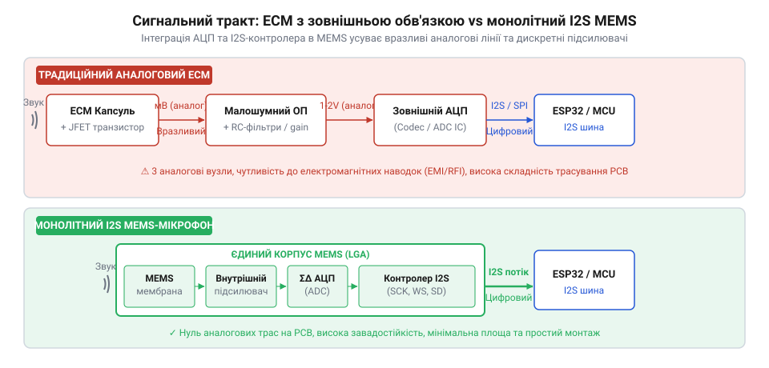
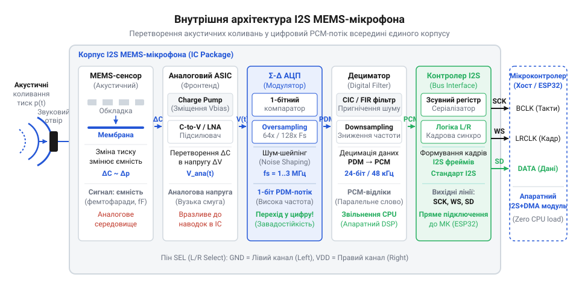

# Від аналогових капсулів до кремнієвих I2S-мікрофонів

<preknowlist>
- [Звуковий давач з мікрофоном (LM393)](root:cat-hw-sensors/sound-lm393) — принципи знімання аналогового сигналу з електретного капсуля та обмеження компараторних схем для первинного виявлення звуку
- [KY-038 — мікрофонний давач звуку](root:cat-hw-sensors/ky-038-mic) — схемотехніку аналогового мікрофонного модуля з підсилювачем та високу чутливість сигнальних провідників до завад
</preknowlist>

## Обмеження аналогових електретних мікрофонних капсулів

У схемах виявлення звуку — зокрема в [модулі звукового давача LM393](root:cat-hw-sensors/sound-lm393) та платі [мікрофонного давача KY-038](root:cat-hw-sensors/ky-038-mic) — первинним сенсором виступав аналоговий електретний мікрофонний капсуль (@@en|ECM@@, від англ. *Electret Condenser Microphone* — електретний конденсаторний мікрофон). Концепцію пристрою розробили інженери Джеймс Вест (англ. *James West*) та Ґергард Сесслер (нім. *Gerhard Sessler*) у лабораторіях @@en|Bell Labs@@ у 1962 році, усунувши потребу в зовнішній високій напрузі для поляризації мембрани.

Основою @@en|ECM@@ є полімерна плівка (найчастіше фторований етилен-пропілен @@en|FEP@@, від англ. *Fluorinated Ethylene Propylene*) із постійним електричним зарядом — електретом. Вона слугує рухомою мембраною навпроти нерухомого металевого електрода. Акустичні коливання змінюють відстань `d` між ними, що визначає міжелектродну ємність `C`:

```
C = ε · A ÷ d
```

де `ε` — діелектрична проникність середовища, `A` — площа мембрани, `d` — відстань між електродами. Оскільки заряд `Q` сталий, зміна ємності `ΔC` створює на виводах змінну напруги `ΔV = Q ÷ ΔC`.

Гігаомний внутрішній опір конденсатора унеможливлює пряме підключення підсилювача. Для узгодження імпедансу всередину металевого корпусу вмонтовують польовий транзистор із керованим p-n переходом (@@en|JFET@@, від англ. *Junction Field-Effect Transistor*) у режимі витокового повторювача, що знижує вихідний опір до кількох кілоомів.

Утім, амплітуда вихідного сигналу @@en|JFET@@ становить лише 1–10 мВ. Передача такого слабкого аналогового сигналу провідниками друкованої плати (@@en|PCB@@, від англ. *Printed Circuit Board*) до операційного підсилювача (@@en|Op-Amp@@) чи дискретного аналогово-цифрового перетворювача (@@en|ADC@@) робить трасу чутливою до завад. Вона збирає високочастотні наводки від імпульсних @@en|DC-DC@@-перетворювачів, тактових шин мікроконтролера та радіомодулів @@en|GSM/LTE@@ й @@en|Wi-Fi@@. Водночас паразитна ємність траси `C_p` разом із вихідним опором джерела `R_s` утворює фільтр нижніх частот, що зрізає верхні аудіочастоти.

Оцінимо згасання амплітуди `V_mic = 10 мВ` на частоті `f = 20 кГц` для траси з паразитною ємністю `C_p = 100 пФ` та опором `R_s = 2.2 кОм`. Вихідна напруга `V_out` становить:

```
V_out = V_mic ÷ √(1 + (2 · π · f · R_s · C_p)²)
      = 10 × 10⁻³ ÷ √(1 + (2 · 3.1416 · 20000 · 2200 · 100 × 10⁻¹²)²)  [підстановка частоти 20 кГц, опору 2.2 кОм та ємності 100 пФ]
      ≈ 10 × 10⁻³ ÷ √(1 + (2.7646)²)                                     [обчислення часової сталої та квадрата]
      ≈ 10 × 10⁻³ ÷ 2.9406                                             [добування кореня зі значення 8.643]
      ≈ 0.003401 В                                                     [значення у вольтах]
      = 3.40 мВ                                                        [переведення у мілівольти]
```

Амплітуда сигналу на 20 кГц падає з 10 мВ до 3.40 мВ (втрата понад 65%). Відновлення сигналу вимагає додаткових дискретних резисторів, конденсаторів та операційних підсилювачів, що збільшує площу плати.

Другим бар'єром стала технологічна несумісність @@en|ECM@@ з автоматичним поверхневим монтажем (@@en|SMT@@, від англ. *Surface Mount Technology*). Полімерна плівка розм'якшується й втрачає заряд уже за температури понад 100 °C. У паяльній печі безсвинцевого монтажу при 260 °C капсуль руйнується, тому пристрої з @@en|ECM@@ вимагали ручного паяння або роз'ємів, що здорожчувало виробництво.


*Порівняння сигнальних трактів ECM та MEMS: усунення довгих аналогових ліній між капсулем, підсилювачем та АЦП зменшує рівень завад і площу плати.*

## Поява кремнієвих мембран та MEMS

У 1983 році Ґергард Сесслер та Дітмар Гом (нім. *Dietmar Hohm*) у Дармштадтському технічному університеті запропонували замінити полімерну плівку кремнієвою мембраною. Проте комерціалізація мікроелектромеханічних систем (@@en|MEMS@@, від англ. *Micro-Electro-Mechanical Systems*) затягнулася на два десятиліття через механічні напруження у тонких плівках і складність глибокого об'ємного травлення.

Упродовж 2000-х років компанія @@en|Knowles Acoustics@@ під керівництвом Пітера Льопперта (англ. *Peter Loeppert*) розробила та випустила перший масовий кремнієвий мікрофон @@en|SiSonic@@™.

Кремнієвий сенсор виготовляють фотолітографією на монокристалічній пластині. Структура складається з жорсткої перфорованої пластини (@@en|backplate@@) та гнучкої мембрани товщиною ~1 мкм із резонаторною камерою (@@en|back-cavity@@) під нею. Оскільки кремній не має електретного заряду, поляризаційну напругу (10–15 В) забезпечує супутня інтегральна схема (@@en|ASIC@@, від англ. *Application-Specific Integrated Circuit*), змонтована у спільному корпусі.

Монокристалічний кремній зберігає пружність при температурах понад 1000 °C. Це дозволило пакувати @@en|MEMS@@-мікрофони в корпуси LGA або QFN для поверхневого монтажу, що витримують паяння оплавленням при 260 °C і монтуються роботами в єдиному циклі з мікроконтролерами.

Побоювання щодо крихкості кремнію виявилися безпідставними: радіус мембрани менше 0.5 мм, високий модуль Юнга (`E ≈ 130–169 ГПа`) і нанограмова маса дозволяють @@en|MEMS@@-структурі витримувати прискорення 10 000–20 000 g без деформацій, на відміну від схильних до обвисання полімерних плівок @@en|ECM@@.

Міф про перевагу [аналогових капсулів](root:cat-hw-sensors/ky-037-mic) спростували малошумні підсилювачі в @@en|ASIC@@. Сучасні @@en|MEMS@@-сенсори досягають співвідношення сигнал/шум (@@en|SNR@@, від англ. *Signal-to-Noise Ratio*) понад 65–70 дБА і коефіцієнта нелінійних спотворень (@@en|THD@@, від англ. *Total Harmonic Distortion*) <0.1% при 94 дБ SPL, а фотолітографія гарантує розкид параметрів між давачами до ±1 дБ.

## Інтеграція PDM-вихіду в мікрофон

Перше покоління @@en|MEMS@@-мікрофонів видавало аналоговий сигнал, схильний до електромагнітних завад на шляху до аудіокодека. Щоб захистити сигнал, у середині 2000-х років аналогово-цифровий перетворювач перенесли безпосередньо в кристалик @@en|ASIC@@ мікрофона.

Щоб мінімізувати площу кремнію та кількість виводів, замість багатобітних АЦП використали сигма-дельта-модулятор (@@en|Sigma-Delta Modulator@@). Він перетворює аналоговий сигнал в однобітний потік імпульсно-густинної модуляції (@@en|PDM@@) на тактовій частоті 1.0–3.28 МГц. Амплітуда звуку кодується щільністю логічних одиниць: тиша відповідає 50% одиниць, позитивна півхвиля наближає щільність до 100%, а негативна — до 0%.

Інтерфейс @@en|PDM@@ потребує лише двох ліній: тактової `CLK` та даних `DATA`. Два мікрофони можуть працювати на спільній лінії `DATA`, передаючи біти за вибором вивода `L/R` по різних фронтах тактового сигналу.

Винесення АЦП у корпус усунуло аналогові наводки, але створило обчислювальний виклик. Потік @@en|PDM@@ є не готовим @@en|PCM@@-аудіо, а високочастотною послідовністю з витиснутим шумом квантування. Щоб отримати 16-бітний аудіосигнал, хост-процесор має виконати децимацію: відфільтрувати шум КІХ-фільтром (@@en|FIR Filter@@) і зменшити частоту відліків у `M` разів (наприклад, `M = 64`).

Програмне декодування @@en|PDM@@ на мікроконтролері (@@en|MCU@@) потребує сотень тисяч операцій @@en|MAC@@ на секунду й завантажує ядро на 30–50%. Через це @@en|PDM@@-мікрофони прижилися в системах із виділеними кодеками або @@en|DSP@@, а для простих пристроїв це стимулювало інтеграцію апаратного дециматора та шини @@en|I2S@@ безпосередньо в мікрофон.

## Перехід до прямого інтерфейсу I2S

Високе обчислювальне навантаження під час децимації однобітного потоку @@en|PDM@@ вимагало мільйонів операцій множення з накопиченням (@@en|MAC@@), що змушувало додавати на друковану плату (@@en|PCB@@) окремий аудіокодек чи цифровий сигнальний процесор (@@en|DSP@@). Перенесення децимації та фільтрації безпосередньо в інтегральну схему (@@en|ASIC@@) мікрофона усунуло цей вузол.

У середині 2010-х років компанії @@en|Knowles@@ (мікрофон @@en|SPH0645LM4H@@) та @@en|InvenSense@@ (пізніше @@en|TDK@@, серія @@en|ICS-43434@@) створили цифрові @@en|MEMS@@-давачі з підтримкою шини @@en|I2S@@ (від англ. *Inter-IC Sound* — міжкристальний звук). Усередині корпусу поруч із мембраною та @@en|Sigma-Delta Modulator@@ інтегрували апаратний децимаційний фільтр (@@en|Decimation Filter@@) на основі каскадного інтегратора-гребінця (@@en|CIC@@, від англ. *Cascaded Integrator-Comb*) та контролер шини.


*Архітектура монолітного I2S MEMS-мікрофона: оцифрування, фільтрація та формування кадрів PCM здійснюються всередині корпусу давача.*

Завдяки інтеграції мікрофон самостійно перетворює потік у готові відліки імпульсно-кодової модуляції (@@en|PCM@@). Вбудована шина @@en|I2S@@ передає їх на хост-мікроконтролер (@@en|MCU@@) через три сигнальні лінії: тактову `SCK`, вибору кадру `WS` та послідовних даних `SD` (починаючи з найстаршого біта @@en|MSB@@).

Тактова частота бітів `f_SCK` визначається як добуток кількості каналів (два слоти на кадр), розрядності відліку `N_bits` та частоти дискретизації аудіо `f_s`. Обчислимо необхідну частоту `f_SCK` для передачі двох 32-бітних слотів при частоті `f_s = 48 кГц`:

```
f_SCK = 2 × N_bits × f_s
      = 2 × 32 × 48000           [підстановка 32 бітів на слот та частоти 48 кГц]
      = 3072000 Гц               [перемноження величин]
      = 3.072 МГц                [переведення у мегагерци]
```

Отримана частота 3.072 МГц дозволяє периферійному модулю @@en|I2S@@ у мікроконтролері приймати PCM-потік через прямий доступ до пам'яті (@@en|DMA@@, від англ. *Direct Memory Access*) без залучення процесорного ядра. Центральний процесор повністю звільняється від обчислювальної фільтрації й використовується лише для високорівневої обробки звуку.

## Розвінчання міфів та критерії вибору

Сприйняття шини @@en|I2S@@ як виключно «мікрофонного» інтерфейсу — поширений міф. Специфікацію @@en|I2S@@ розробила компанія @@en|Philips Semiconductors@@ у 1986 році для зв'язку аудіочипів у CD-програвачах, і лише через чверть століття розвиток мікроелектромеханіки дозволив розмістити контролер шини безпосередньо в корпусі мікрофона.

Твердження про чистіший звук аналогових електретних капсулів (@@en|ECM@@) через більшу мембрану, як у [модулях давачів звуку KY-038](root:cat-hw-sensors/ky-038-mic) чи [великих капсулях KY-037](root:cat-hw-sensors/ky-037-mic), спростовується їхньою чутливістю до завад. У @@en|I2S@@ @@en|MEMS@@-мікрофонах оцифрування відбувається за частки міліметра від мембрани, що дає співвідношення сигнал/шум (@@en|SNR@@) понад 65–74 дБА та стабільні нелінійні спотворення (@@en|THD@@).

Уявлення про крихкість кремнієвих мембран спростовує їхня мікроскопічна маса, що витримує перевантаження до `20 000 g`. Крім того, кремнієвий сенсор не втрачає поляризацію від старіння і витримує паяння оплавленням (260 °C), на відміну від полімерних електретів.

Вибір між типами мікрофонів визначається архітектурою пристрою:
1. **Аналогові мікрофони (@@en|ECM@@ або аналогові @@en|MEMS@@)** — для простих приладів із пороговим детектуванням звуку (як у [звукових давачах LM393](root:cat-hw-sensors/sound-lm393)) або систем із наявним високоякісним АЦП. 2. **Цифрові @@en|PDM@@ MEMS-мікрофони** — для багатомікрофонних масивів (систем @@en|beamforming@@) та пристроїв із виділеними аудіокодеками чи @@en|DSP@@, де важлива мінімізація сигнальних ліній на стереопару. 3. **Цифрові @@en|I2S@@ MEMS-мікрофони** — для пристроїв на 32-бітних мікроконтролерах (ESP32, STM32) без виділеного кодека; вони передають готові відліки в пам'ять через @@en|DMA@@ без навантаження ЦП.