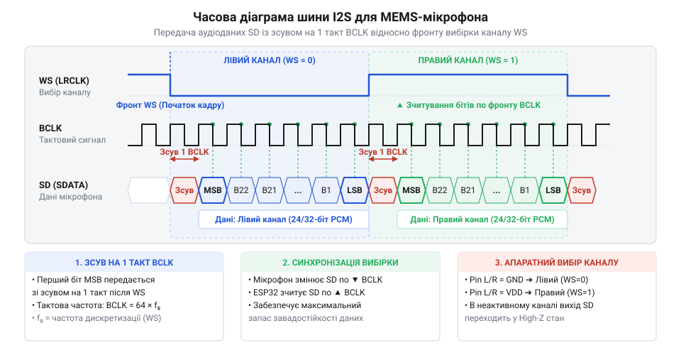
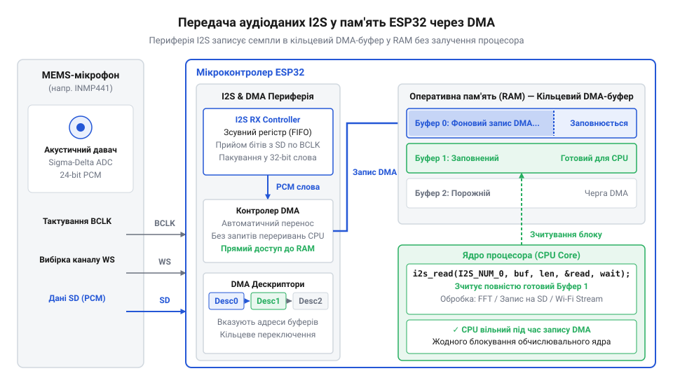
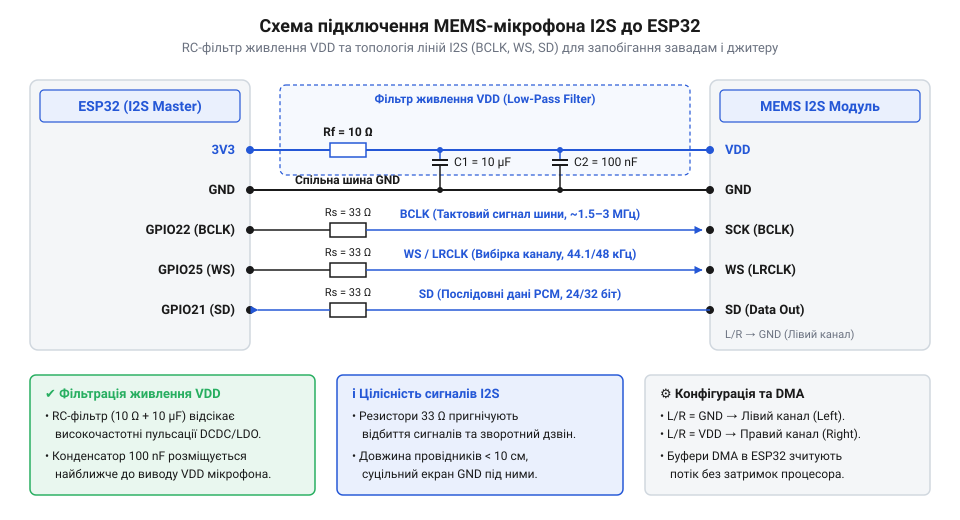

# MEMS-мікрофон I2S (для ESP32)

<preknowlist>
- [Звуковий давач з мікрофоном (LM393)](root:cat-hw-sensors/sound-lm393) — принципи виявлення порогового рівня акустичного шуму та обмеження дискретного виходу компаратора
- [KY-038 — мікрофонний давач звуку](root:cat-hw-sensors/ky-038-mic) — особливості роботи аналогового електретного капсуля та проблеми шуму й наведень при підсиленні звукового сигналу
</preknowlist>

## Проблема аналогового звуку та цифровий вихід

Аналогові акустичні модулі — як-от [звукові давачі LM393](root:cat-hw-sensors/sound-lm393) чи [мікрофонні давачі KY-038](root:cat-hw-sensors/ky-038-mic) — видають електричний сигнал мілівольтового рівня. У класичному аналоговому мікрофоні (від грец. @@grc|μικρός@@ — малий та @@grc|φωνή@@ — звук) цей слабкий сигнал потребує підсилення перед оцифруванням в аналого-цифровому перетворювачі (@@en|ADC@@ / @@en|АЦП@@, від лат. @@lat|analogus@@ — аналогічний та @@lat|digitalis@@ — цифровий).

На етапі передачі слабкого сигналу від мікрофонного капсуля (від лат. @@lat|capsula@@ — скринька) провідники діють як антени та збирають електромагнітні наведення (@@en|EMI@@) від джерел живлення, шин і модулів @@en|Wi-Fi@@ чи @@en|Bluetooth@@. Підсилювач збільшує амплітуду як звуку, так і завад, що деградує відношення сигнал/шум на вході @@en|АЦП@@.

Друга проблема — часова дискретизація (від лат. @@lat|discretus@@ — розділений). Опитування аналогового входу через переривання центрального процесора (@@en|CPU@@) на частотах 44.1–48 кГц перевантажує процесор. Затримки обробки викликають джитер дискретизації та фазові спотворення, а вбудований @@en|SAR ADC@@ у @@en|ESP32@@ додає власну нелінійність і шум.

Системним розв'язком є виключення аналогової лінії з тракту передачі; деталі описує [еволюція MEMS-мікрофонів](root:cat-hw-sensors/i2s-mems-microphone/hist-mems-i2s-evolution.md). Підсилення та оцифрування переносяться в корпус давача, який видає цифровий потік відліків (@@en|PCM@@). Для його передачі застосовують послідовний цифровий інтерфейс @@en|I2S@@.

## Фізика MEMS та шина даних I2S

Цифровий акустичний давач будується на базі мікроелектромеханічної системи (@@en|MEMS@@, від грец. @@grc|μικρός@@ — малий, @@grc|ἤλεκτρον@@ — янтар, @@grc|μηχανική@@ — машина). Усередині кремнієвого кристала витравлено рухому мембрану над нерухомим електродом. Звукова хвиля тисне на мембрану, і її зсуви пропорційно змінюють ємність `C` утвореного конденсатора.

У тому ж корпусі спеціалізована інтегральна схема (@@en|ASIC@@, від англ. @@en|Application-Specific Integrated Circuit@@) з сигма-дельта перетворювачем (ΣΔ-@@en|ADC@@) перетворює ємнісні коливання у потік плотності імпульсів (@@en|PDM@@). Після децимації формуються відліки імпульсно-кодової модуляції (@@en|PCM@@); деталі висвітлюють [PDM MEMS-мікрофони](root:cat-hw-sensors/pdm-mems-microphones).

Передачу @@en|PCM@@-потоку забезпечує синхронна шина @@en|I2S@@ (від англ. @@en|Inter-IC Sound@@) із трьома лініями:

1. **BCLK** (@@en|Bit Clock@@) — тактує кожен біт; передавач і приймач оновлюють та зчитують дані на його перепадах. 2. **WS** (@@en|Word Select@@ / @@en|LRCLK@@) — обирає активний канал із частотою дискретизації `f_s`. Низький рівень відповідає лівому каналу, високий — правому. 3. **SD** (@@en|Serial Data@@) — передає звукові біти старшими вперед (@@en|MSB@@).

Вивід адресації `L/R` визначає слот мікрофона: підключення до заземлення (@@en|GND@@) вмикає передачу під час низького рівня @@en|WS@@ (лівий канал), переводячи вихід у високоімпедансний стан (@@en|Hi-Z@@) за високого рівня. Підключення до живлення (@@en|VDD@@) активує правий канал (високий рівень @@en|WS@@). Це дозволяє паралельно приєднати два мікрофони до однієї шини для стереозапису.

У стандарті @@en|I2S@@ передача старшого біта (@@en|MSB@@) починається із запізненням на один такт @@en|BCLK@@ після фронту @@en|WS@@.

*Підпис: Часові діаграми протоколу @@en|I2S@@ із тактовим сигналом @@en|BCLK@@, перемиканням каналів @@en|WS@@ та зсувом даних @@en|SD@@ на один такт.*

Тактова частота бітів `f_BCLK` розраховується через частоту дискретизації `f_s`, кількість каналів `N_ch` та розрядність слота `N_bits`:

f_BCLK = f_s × N_ch × N_bits
= 44100 × 2 × 32
= 2822400 Hz      [розрахунок частоти BCLK для 44.1 кГц при 32 бітах на канал]

Тут `N_ch = 2` задає стереокадр, а `N_bits = 32` — стандартний слот, де 24 біти аудіо вирівняно за старшим краєм. Глибокий аналіз обчислень висвітлюють [розрахунки тактування I2S](root:cat-hw-sensors/i2s-mems-microphone/math-i2s-clocking-pcm-calculus.md), електричні рівні містить [специфікація цокольовки MEMS-мікрофонів](root:cat-hw-sensors/i2s-mems-microphone/api-mems-i2s-hardware-spec.md), а структуру шини — [протокол шини I2S](root:com-devices/i2s-bus).

## Архітектура I2S і DMA в ESP32

Прийом звукового потоку з частотою дискретизації 44.1 кГц чи 48 кГц у 32-бітних слотах створює потік понад 2.8–3.0 Мбіт/с. Опитування периферії @@en|I2S@@ у циклі або через переривання повністю заблокувало б ядро мікроконтролера @@en|ESP32@@. Для розвантаження процесора контролер @@en|I2S@@ працює через прямий доступ до пам'яті (@@en|DMA@@, від англ. @@en|Direct Memory Access@@).

Механізм @@en|DMA@@ автономний: коли приймальний буфер @@en|FIFO@@ периферії @@en|I2S@@ наповнюється зчитаними з лінії @@en|SD@@ бітами, автомат @@en|DMA@@ записує дані в оперативну пам'ять (@@en|RAM@@). Передача спирається на кільцевий список дескрипторів (@@en|descriptors@@), кожен з яких містить вказівник на виділений блок пам'яті та прапорці стану.

Дескриптори об'єднані в кільцевий буфер (@@en|ring buffer@@). Доки @@en|DMA@@ заповнює семплами буфер `N`, процесор (@@en|CPU@@) паралельно обробляє вже готовий буфер `N-1`. Після заповнення блоку @@en|DMA@@ генерує переривання, переходить до наступного дескриптора й сповіщає операційну систему. Детальніше внутрішній устрій описує [архітектура DMA в ESP32](root:hw-arch/esp32-dma-gdma-subsystem).

*Підпис: Архітектура прямого доступу до пам'яті (@@en|DMA@@) в @@en|ESP32@@ для безперервного зчитування аудіопотоку через кільцевий буфер.*

Стабільність аудіопотоку вимагає врахування апаратних та системних факторів:

1. **Пульсації живлення VDD**: Високочастотні завади (зокрема від @@en|Wi-Fi@@) спотворюють сигнал MEMS-мембрани. Для пригнічення шуму біля виводів @@en|VDD@@ та @@en|GND@@ встановлюють керамічний конденсатор 100 нФ з низьким @@en|ESR@@ і фільтрувальний ємністю 10 мкФ. 2. **Джитер BCLK**: Довгі провідники (> 10–15 см) створюють паразитну індуктивність і фазове тремтіння (@@en|jitter@@) тактового сигналу. Демпфувальні резистори 22–33 Ом на лініях @@en|BCLK@@ та @@en|WS@@ зменшують відбиття. 3. **Обмеження GPIO**: Виводи лише для входу (@@en|GPI34@@–@@en|GPI39@@) не підходять для вихідних тактових сигналів @@en|BCLK@@ і @@en|WS@@, а конфігураційні виводи (@@en|strapping pins@@: @@en|GPIO0@@, @@en|GPIO2@@, @@en|GPIO12@@, @@en|GPIO15@@) можуть порушити завантаження. 4. **Режими DMA-буферів**:
   - **Переповнення** (@@en|overflow@@): виникає, коли CPU затримується (наприклад, під час запису на @@en|SD@@-карту) і @@en|DMA@@ перезаписує ще не зчитані буфери, що спричиняє втрату кадрів та клацання. - **Опустіння** (@@en|underflow@@): стається при спробі вичитати дані швидше, ніж @@en|DMA@@ встигає їх накопичити.

*Підпис: Схема апаратного підключення @@en|MEMS@@-мікрофона до @@en|ESP32@@ із колами фільтрації живлення @@en|VDD@@.*

Для конфігурування периферії @@en|I2S@@ використовують драйвер @@en|ESP-IDF@@ або бібліотеку @@en|Arduino@@. Зчитані 32-бітні слова з @@en|INMP441@@ вирівнюють арифметично: корисні 24 біти розташовані у старших розрядах, тому для отримання PCM-значень виконують побітовий зсув вправо на 8 або 16 бітів.

:::tabs
@tab C (ESP-IDF)
:::code i2s-mems-microphone-d/c/esp-idf/init-i2s-mems-microphone.c
@tab C++ (Arduino)
:::code i2s-mems-microphone-d/cpp/arduino/setupi2smicrophone.cpp
:::

Зчитані відліки потребують цифрової обробки — видалення постійного зсуву (@@en|DC offset@@) та підсилення, про що розповідають [фільтрація постійної складової](root:cat-hw-sensors/i2s-mems-microphone/math-pcm-dc-filter-gain.md) та [цифрова обробка аудіосигналів](root:com-signal/audio-dsp-embedded-basics). Для побудови практичних пристроїв згодяться вставки [автономний WAV-диктофон](root:cat-hw-sensors/i2s-mems-microphone/proj-esp32-i2s-wav-recorder.md) і [вимірювач акустичного шуму](root:cat-hw-sensors/i2s-mems-microphone/proj-esp32-spl-meter-fft.md), а опис функцій містить [API драйвера ESP-IDF](root:cat-hw-sensors/i2s-mems-microphone/api-esp32-i2s-idf-driver.md).

## Схемотехніка підключення та фільтрація живлення

Аналогове ядро @@en|MEMS@@-капсуля містить чутливу кремнієву мембрану та первинний підсилювач із високим вхідним імпедансом. На відміну від простих [аналогових давачів LM393](root:cat-hw-sensors/sound-lm393) чи [KY-037](root:cat-hw-sensors/ky-037-mic), високочастотні пульсації лінії живлення @@en|VDD@@ (від англ. @@en|Voltage Direct Drain@@ — напруга живлення стоку) легко проникають у внутрішній тракт через обмежений коефіцієнт пригнічення нестабільності живлення (@@en|PSRR@@, від англ. @@en|Power Supply Rejection Ratio@@, від лат. @@lat|ratio@@ — співвідношення). Перехідні процеси імпульсного стабілізатора чи цифрова активність мікроконтролера @@en|ESP32@@ перетворюються на фоновий гул, тріск або високочастотний шум у підсумковому аудіопотоці.

Для забезпечення чистоти живлення безпосередньо біля виводу @@en|VDD@@ мікрофона встановлюють двоступеневе коло фільтрації. Перший ступінь — керамічний конденсатор ємністю 100 нФ із малим еквівалентним послідовним опором (@@en|ESR@@, від англ. @@en|Equivalent Series Resistance@@), розміщений за 2–3 мм від виводу капсуля. Другий ступінь — низькочастотний @@en|RC-фільтр@@ (від англ. @@en|Resistor-Capacitor@@, від лат. @@lat|resisto@@ — чинити опір та @@lat|capacitas@@ — місткість) з резистором опором `R = 10` Ом у лінії живлення та накопичувальним конденсатором ємністю `C = 10` мкФ. Граничну частоту зрізу `f_c` фільтра обчислюють з опору `R` та ємності `C`:

f_c = 1 / (2 × π × R × C)
    = 1 / (2 × 3.14159 × 10 × 10⁻⁵)         [підстановка R = 10 Ом, C = 10 мкФ]
    ≈ 1591.5 Hz                              [гранична частота зрізу RC-фільтра живлення]

Частота зрізу близько 1.6 кГц ефективно подавляє високочастотні пульсації. Якщо падіння напруги на резисторі є критичним, його замінюють феритовим елементом (@@en|ferrite bead@@) або індуктивністю 100 мкГн у @@en|LC-фільтрі@@ (від англ. @@en|Inductor-Capacitor@@, від лат. @@lat|inductio@@ — наведення). Для найвищої точності використовують окремий малошумний лінійний стабілізатор (@@en|LDO@@, від англ. @@en|Low Dropout Regulator@@, від лат. @@lat|regulo@@ — направляю, впорядковую).

Друга апаратна проблема — цілісність цифрових сигналів [протоколу шини I2S](root:com-devices/i2s-bus). На частотах 2.8–3.072 МГц лінія тактування @@en|BCLK@@ має гострі фронти наростання. Якщо довжина трас перевищує 10–15 см або відсутній суцільний шар заземлення (@@en|GND@@), провідники працюють як лінії з розподіленими параметрами. У них виникають хвильові відбиття, паразитні осциляції (@@en|ringing@@ — «дзвін») і фазовий джитер (від англ. @@en|jitter@@ — тремтіння тактових імпульсів). Джитер викликає нерівномірність зчитування бітів та фазові спотворення аудіопотоку. Для нейтралізації відбиттів безпосередньо біля виводів @@en|ESP32@@ (на лініях @@en|BCLK@@ та @@en|WS@@) послідовно вмикають демпфуючі резистори 22–47 Ом. Вони узгоджують опір драйвера з лінією та зменшують швидкість наростання фронту (@@en|slew rate@@), усуваючи електромагнітні наведення (@@en|EMI@@).

При підключенні до мікроконтролера @@en|ESP32@@ вибір виводів загального призначення (@@en|GPIO@@, від англ. @@en|General-Purpose Input/Output@@ — вивід загального призначення) підпорядкований апаратним обмеженням:

1. **Вхідні виводи**: @@en|GPIO@@ 34, 35, 36, 37, 38 та 39 у @@en|ESP32@@ є виключно вхідними (Input Only) без вихідних буферів. Вони підходять для лінії даних @@en|SD@@, але непридатні для генерації тактових сигналів @@en|BCLK@@ та @@en|WS@@. 2. **Конфігураційні виводи (strapping pins)**: @@en|GPIO@@ 0, 2, 5, 12 та 15 визначають режим завантаження під час скидання. Наприклад, високий рівень на @@en|GPIO@@ 12 під час старту перемикає стабілізатор @@en|flash@@-пам'яті на 1.8 В замість 3.3 В, викликаючи збій завантаження. 3. **Виводи флеш-пам'яті**: @@en|GPIO@@ з 6 по 11 зайняті внутрішньою шиною @@en|SPI@@ для @@en|flash@@ та @@en|PSRAM@@ — їх використання спричиняє крах системи.

Оптимальною конфігурацією master-шини @@en|I2S0@@ у @@en|ESP32@@ є призначення: @@en|BCLK@@ — @@en|GPIO@@ 14, @@en|WS@@ — @@en|GPIO@@ 25, @@en|SD@@ — @@en|GPIO@@ 33. Вибір аудіоканалу задається виводом `L/R`: підключення до @@en|GND@@ обирає лівий канал (при низькому рівні @@en|WS@@), а до @@en|VDD@@ — правий канал (при високому рівні @@en|WS@@). Електричні часові допуски сигналів описує [специфікація залізного інтерфейсу](root:cat-hw-sensors/i2s-mems-microphone/api-mems-i2s-hardware-spec.md), а обчислення параметрів тактування — [розрахунки тактування I2S](root:cat-hw-sensors/i2s-mems-microphone/math-i2s-clocking-pcm-calculus.md).

## Програмна конфігурація та обробка PCM

Для прийому аудіопотоку у фреймворку @@en|ESP-IDF@@ v5.x для @@en|ESP32@@ використовують драйвер каналів (`driver/i2s_std.h`), що підтримує стандартний режим @@en|I2S@@ та [PDM MEMS-мікрофони](root:cat-hw-sensors/pdm-mems-microphones).

Налаштування починається з ініціалізації контролера прямого доступу до пам'яті (@@en|DMA@@, від англ. @@en|Direct Memory Access@@, від лат. @@lat|directus@@ — прямий та @@lat|memoria@@ — пам'ять), описаного в [архітектурі DMA в ESP32](root:hw-arch/esp32-dma-gdma-subsystem). Драйвер виділяє кільцеві буфери в @@en|RAM@@ та дескриптори. За даної частоти дискретизації `f_s = 44100` Гц і розміру буфера `dma_frame_num = 512` семплів тривалість заповнення одного DMA-блоку `t_buf` становить:

t_buf = dma_frame_num / f_s
      = 512 / 44100                           [підстановка кількості семплів та частоти]
      ≈ 0.01161 s                             [тривалість заповнення одного буфера ~ 11.61 мс]

Затримка (@@en|latency@@) ~11.6 мс є оптимальною: малі буфери (32–64 семпли) перевантажують @@en|FreeRTOS@@ частими перериваннями (@@en|ISR@@) і викликають опустіння (@@en|underflow@@), а надто великі — витрачають пам'ять і затримують відгук.

Далі конфігурують тактування та бітову сітку. MEMS-мікрофони (@@en|INMP441@@, @@en|MSM261S4030Z0@@) видають 24-бітні відліки імпульсно-кодової модуляції (@@en|PCM@@, від англ. @@en|Pulse-Code Modulation@@, від лат. @@lat|pulsus@@ — удар та @@lat|modulatio@@ — розміреність). В апаратному 32-бітному слоті `I2S_DATA_BIT_WIDTH_32BIT` 24 біти вирівняно за старшим краєм, а 8 молодших — нулі.

Оскільки 24-бітне число лежить у старших розрядах 32-бітного слова `int32_t`, зчитаного з лінії @@en|SD@@, його зсувають вправо на 8 бітів (`raw_sample >> 8`). У мовах @@en|C@@ та @@en|C++@@ арифметичний зсув зберігає знаковий біт (@@en|MSB@@).

Зсув не усуває постійну складову (@@en|DC offset@@), викликану неідеальністю аналогового зміщення мембрани та @@en|ASIC@@. Зсув середнього рівня від нуля зменшує динамічний діапазон і створює клацання (@@en|pop noise@@).

Для її видалення застосовують цифровий рекурсивний фільтр високих частот першого порядку (@@en|IIR high-pass filter@@, від англ. @@en|Infinite Impulse Response@@, від лат. @@lat|infinitus@@ — нескінченний та @@lat|responsum@@ — відповідь):

y[n] = x[n] - x[n-1] + α × y[n-1]
     = x[n] - x[n-1] + 0.995 × y[n-1]         [цифровий ФВЧ першого порядку з коефіцієнтом alpha = 0.995]

Тут `x[n]` і `x[n-1]` — вхідні семпли, `y[n-1]` — попередній вихід, `α = 0.995` — коефіцієнт згладжування. Фільтр пригнічує постійний зсув (0 Гц), пропускаючи частоти від 20 Гц до 20 кГц.

Реалізація ініціалізації драйвера @@en|I2S@@ та обробки сигналу мовами @@en|C@@ і @@en|C++@@:

:::tabs
@tab C (ESP-IDF v5.x)
:::code i2s-mems-microphone-d/c/esp-idf/init-i2s-mems.c
@tab C++ (ESP-IDF v5.x)
:::code i2s-mems-microphone-d/cpp/esp-idf/i2smemsmicrophone.cpp
:::

Детальні виклики та коди помилок описані в [офіційному програмному API](root:cat-hw-sensors/i2s-mems-microphone/api-esp32-i2s-idf-driver.md). Математику обробки сигналу викладено у розділах [фільтрація постійної складової](root:cat-hw-sensors/i2s-mems-microphone/math-pcm-dc-filter-gain.md) та [цифрова обробка сигналів](root:com-signal/audio-dsp-embedded-basics). Очищений потік використовують для побудови [автономного звукового диктофона](root:cat-hw-sensors/i2s-mems-microphone/proj-esp32-i2s-wav-recorder.md) та [вимірювача рівнів шуму](root:cat-hw-sensors/i2s-mems-microphone/proj-esp32-spl-meter-fft.md).