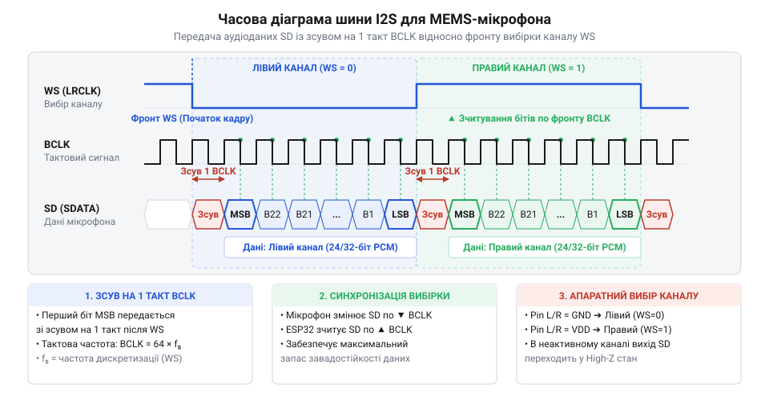
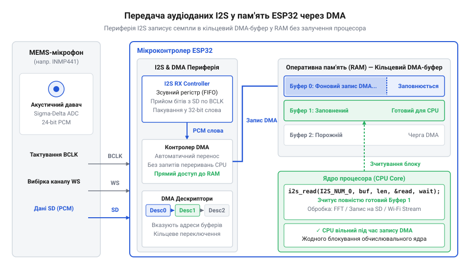
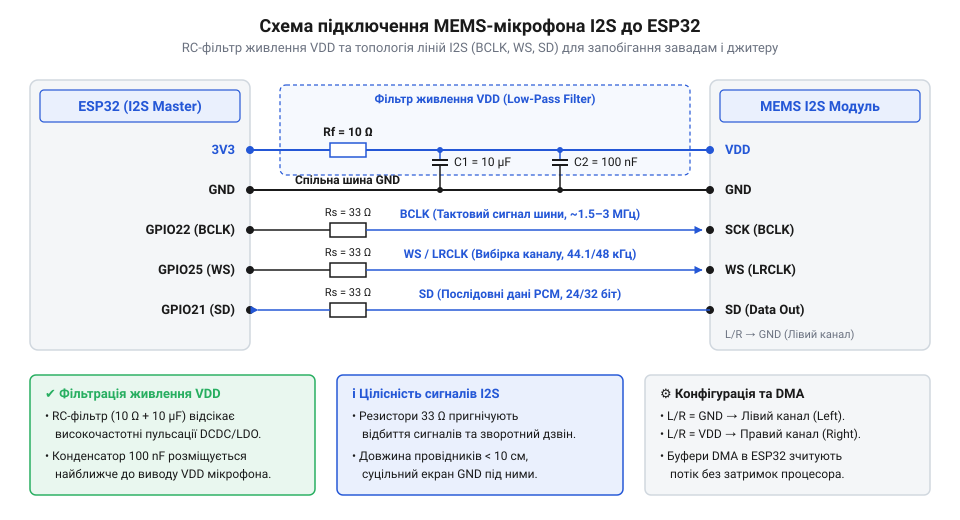

# MEMS-мікрофон I2S (для ESP32)

<preknowlist>
- [Звуковий давач з мікрофоном (LM393)](root:cat-hw-sensors/sound-lm393) — принципи виявлення порогового рівня акустичного шуму та обмеження дискретного виходу компаратора
- [KY-038 — мікрофонний давач звуку](root:cat-hw-sensors/ky-038-mic) — особливості роботи аналогового електретного капсуля та проблеми шуму й наведень при підсиленні звукового сигналу
</preknowlist>

## Проблема аналогового аудіо та цифровий вихід

Слабкий мікровольтний сигнал аналогового капсуля під час передачі провідниками вловлює електромагнітні завади. Підсилення такого сигналу в [аналогових мікрофонних модулях](root:cat-hw-sensors/ky-038-mic) або [простих звукових давачах](root:cat-hw-sensors/sound-lm393) підсилює й самі наведення.

Оцифрування вбудованим аналогово-цифровим перетворювачем (з англ. @@en|ADC@@ — @@en|Analog-to-Digital Converter@@) перевантажує процесор постійним опитуванням, а затримки викликають @@en|jitter@@ (нестабільність тактування), що додає фазові спотворення.

Перенесення @@en|ADC@@ у корпус мікрофона скорочує аналоговий тракт до мікрометрів. На виході утворюється стійкий до завад аудіопотік імпульсно-кодової модуляції (з англ. @@en|PCM@@ — @@en|Pulse-Code Modulation@@) для передачі послідовним інтерфейсом.

## Принцип MEMS та лінії шини I2S

Усередині MEMS-мікрофона (@@en|MEMS@@, від англ. @@en|Micro-Electro-Mechanical Systems@@ — мікроелектромеханічні системи) звукова хвиля змінює відстань між гнучкою кремнієвою мембраною та нерухомим електродом. Зміна ємності цього конденсатора перетворюється вбудованою мікросхемою на цифровий @@en|PCM@@-потік.

Для безперервної передачі аудіоданих використовують шину I2S (@@en|I2S@@, від англ. @@en|Inter-IC Sound@@) із трьома обов'язковими лініями: тактування бітів BCLK (@@en|BCLK@@, від англ. @@en|Bit Clock@@), вибору каналу WS (@@en|WS@@, від англ. @@en|Word Select@@ або @@en|LRCLK@@) та послідовних даних SD (@@en|SD@@, від англ. @@en|Serial Data@@). Детальніший розбір специфікації, часових діаграм та розрядності слотів кадру читайте у статті про [протокол шини I2S](root:com-devices/i2s-bus).

Вивід адресації L/R (@@en|L/R@@, від англ. @@en|Left/Right@@) задає напівперіод сигналу @@en|WS@@ (низький рівень — лівий канал, високий — правий), у якому мікрофон передає свої біти на лінію @@en|SD@@ старшими бітами вперед. Це дозволяє підключити два MEMS-мікрофони на одну шину для стереозапису.

*Часова діаграма шини I2S: тактовий сигнал BCLK передає кожен біт PCM-слова, а стан лінії WS визначає належність даних до лівого чи правого каналу.*

## Фоновий прийом через DMA в ESP32

Високошвидкісний аудіопотік генерує десятки тисяч вибірок на секунду. Обробка кожного відліку через програмні переривання повністю заблокувала б ядро мікроконтролера @@en|ESP32@@.

Прийом реалізують через контролер прямого доступу до пам'яті (@@en|DMA@@, від англ. direct — прямий, memory — пам'ять, access — доступ). Він приймає відліки з шини @@en|I2S@@ і складає їх в оперативну пам'ять без участі процесора. Драйвер організовує пам'ять у кільцевий буфер (англ. @@en|ring buffer@@): поки @@en|DMA@@ заповнює один блок, ядро обробляє попередній.

Якщо процесор не встигає зчитати блок до повернення @@en|DMA@@ по колу, виникає переповнення буфера (англ. @@en|buffer overrun@@).

*Структура кільцевого буфера DMA в ESP32: контролер DMA послідовно заповнює блоки пам'яті аудіовідліками, поки процесор обробляє вже готові блоки.*

## Схемотехніка підключення та фільтрація живлення

Підсилювач та АЦП @@en|MEMS@@-мікрофона чутливі до пульсацій живлення (@@en|VDD@@). Шум пригнічують керамічним конденсатором 0.1 мкФ біля виводу @@en|VDD@@.

Тактування @@en|I2S@@ спричиняє хвильові відбиття в лініях @@en|BCLK@@ та @@en|WS@@. Їх усувають демпфувальним резистором 33–100 Ом, впаяним послідовно біля мікроконтролера.

При підключенні до @@en|ESP32@@ враховують обмеження його виводів (@@en|GPIO@@, від англ. @@en|General-Purpose Input/Output@@):
- виводи @@en|GPI@@ 34, 35, 36, 39 є вхідними (англ. @@en|input-only@@); їх призначають для даних @@en|SD@@, але не для тактових @@en|BCLK@@ чи @@en|WS@@;
- strapping-виводи (англ. @@en|strapping pins@@: GPIO0, GPIO2, GPIO12, GPIO15) задають режим завантаження, тому певний рівень на них під час старту блокує запуск.

*Схемотехніка підключення MEMS-мікрофона: конденсатор на VDD пригнічує шум, резистор на BCLK усуває відбиття.*