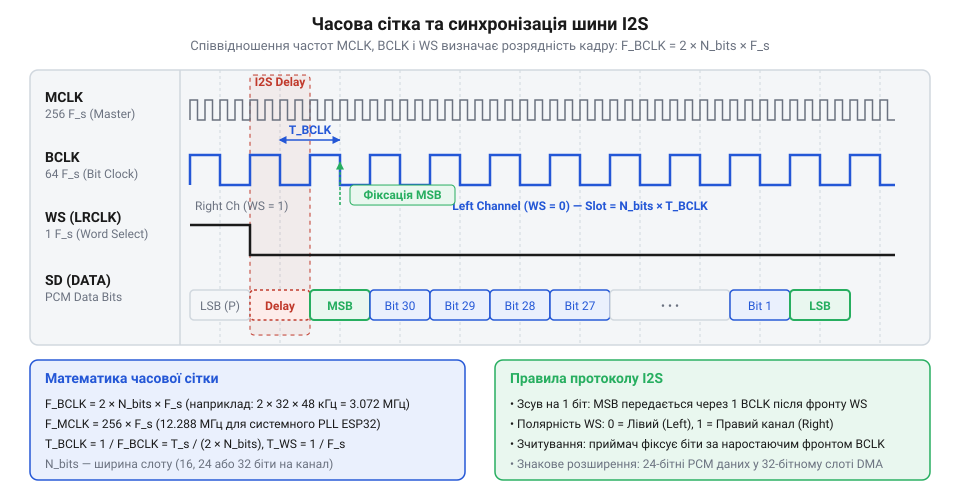
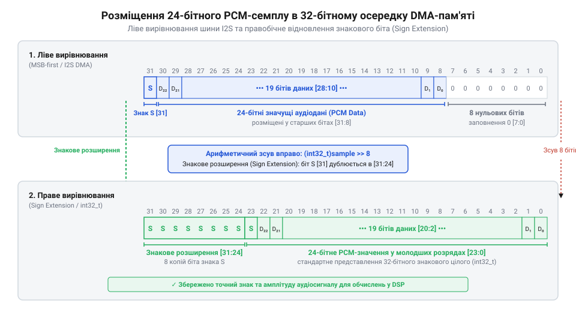
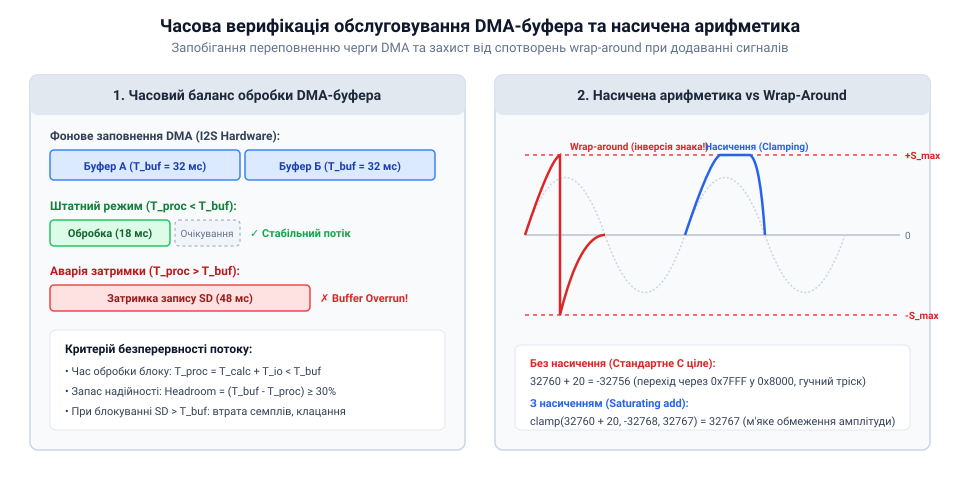

# Математичні розрахунки тактування I2S та бітового вирівнювання PCM

## Проблема часової розсинхронізації аудіопотоку

Передача безперервного цифрового звуку вимагає принципово іншого підходу до часової синхронізації, ніж передавання звичайних дискретних даних. У класичних асинхронних послідовних інтерфейсах, таких як @@en|UART@@ (від англ. @@en|Universal Asynchronous Receiver-Transmitter@@, *universal* — «універсальний», *asynchronous* — «асинхронний», *receiver* — «приймач», *transmitter* — «передавач»), передавач і приймач узгоджують лише номінальну швидкість передавання бітів. Кожна порція даних супроводжується стартовими та стоповими бітами, а внутрішній генератор приймача підганяє свій локальний такт під фазу кожного окремого байта. У системних вимірювальних колабораціях, де застосовують [прості мікрофонні давачі](root:cat-hw-sensors/sound-lm393) або [аналогові мікрофонні модулі](root:cat-hw-sensors/ky-038-mic), сигнал вимірюється з довільними інтервалами або обробляється компаратором. Проте аналогова акустична хвиля за теоремою вибірок вимагає строгой безперервності та рівновіддаленості відліків у часі.

Коли цифровий аудіопотік намагаються передавати асинхронним шляхом або через універсальні послідовні шини типу @@en|SPI@@ (від англ. @@en|Serial Peripheral Interface@@, *serial* — «послідовний», *peripheral* — «периферійний», *interface* — «інтерфейс») без фіксованого часового кадрування, виникає феномен часового дрейфу фази. Навіть найменша відносна розбіжність у частотах генераторів передавача та приймача (наприклад, 0.01%) призводить до того, що за одну секунду приймач одержує на кілька семплів більше або менше, ніж очікував цифро-аналоговий перетворювач. При виникненні такого розсинхрону внутрішній буфер приймача неминуче переповнюється або спустошується. Ситуація @@en|buffer underflow@@ (від англ. *buffer* — «буфер», *underflow* — «недоповнення») змушує відтворювач дублювати останній семпл або вставляти нульове значення, що на слух сприймається як різкий акустичний тріск та щиглики. Натомість @@en|buffer overflow@@ (від англ. *overflow* — «переповнення») викликає примусовий скид відліків, руйнуючи цілісність звукової хвилі та спотворюючи її тональність.

Друга критична проблема асинхронного передавання — відсутність апаратно гарантованого бітового кадрування. Безперервний аудіосигнал кодується у форматі @@en|PCM@@ (від англ. @@en|Pulse Code Modulation@@, *pulse* — «імпульс», *code* — «код», *modulation* — «модуляція»), де кожен відлік амплітуди описується одним, двома, трьома або чотирма байтами. Якщо в послідовному потоці даних втрачається або зсувається хоча б один біт через десинхронізацію, приймач повністю втрачає кордони між семплами. Біти старшого розряду @@en|MSB@@ (від англ. @@en|Most Significant Bit@@, *most* — «найбільш», *significant* — «значущий», *bit* — «біт») помилково інтерпретуються як молодші розряди @@en|LSB@@ (від англ. @@en|Least Significant Bit@@, *least* — «найменш», *significant* — «значущий», *bit* — «біт»), або навпаки. Це призводить до того, що амплітуда відліку миттєво змінюється на максимальну величину шкали, перетворюючи гармонійний сигнал на високоінтенсивний хаотичний шум.

Для усунення цих проблем компанією Philips було розроблено спеціалізований часовий каркас — протокол @@en|I2S@@ (від англ. @@en|Inter-IC Sound@@, *inter* — «між», *integrated circuit* — «інтегральна схема», *sound* — «звук»). Фізична основа цього рішення описана в [архітектурі шини I2S](root:com-devices/i2s-bus), де передача даних жорстко прив'язується до двох неперервних синхронних тактових ліній: бітового тактування та строба вибору каналу. Завдяки цьому кожен біт і кожен аудіокадр займають строго визначену фазову позицію в часі, унеможливлюючи накопичення часової похибки та зсув розрядів.

## Математичний розрахунок часової сітки I2S

Жорстка часова сітка шини @@en|I2S@@ опирається на три основні синхросигнали: головний системний такт @@en|MCLK@@ (від англ. @@en|Master Clock@@, *master* — «головний», *clock* — «годинник»), бітовий такт @@en|BCLK@@ (від англ. @@en|Bit Clock@@, *bit* — «біт», *clock* — «годинник») та такт вибору каналу або слова @@en|WS@@ (від англ. @@en|Word Select@@, *word* — «слово», *select* — «вибір»), який часто називають @@en|LRCLK@@ (від англ. @@en|Left Right Clock@@, *left* — «лівий», *right* — «правий», *clock* — «годинник»). Сигнал @@en|WS@@ визначає частоту дискретизації аудіопотоку та вказує, до якого каналу належить поточний семпл: низький рівень відповідає лівому каналу, а високий — правому.


*Часова діаграма сигналів I2S ілюструє формування бітового кадру та канального такту відносно системної частоти MCLK.*

Для забезпечення повної синхронізації всі частоти шини мають бути строго кратними частоті дискретизації. Позначимо основні параметри часової сітки наступними величинами:
`F_s` — частота дискретизації аудіосигналу в герцах (Гц);
`N_ch` — кількість стерео- або монокількісних каналів у кадрі (для стандартного @@en|I2S@@ значення дорівнює 2);
`N_bits` — розрядність одного канального слота в бітах (типово 16, 24 або 32 біти на слот);
`F_BCLK` — частота бітового тактування в герцах (Гц);
`M` — множник системного тактування `MCLK` відносно частоти дискретизації;
`F_MCLK` — частота головного системного генератора `MCLK` в герцах (Гц).

Частота бітового тактування `F_BCLK` визначає швидкість зчитування окремих розрядів з лінії даних. Вона обчислюється як добуток частоти дискретизації на загальну кількість бітів у повному кадрі:

```
F_BCLK = F_s × N_ch × N_bits
= 44100 × 2 × 32        [підставимо F_s = 44.1 кГц, N_ch = 2, N_bits = 32]
= 2822400               [значення в герцах, тобто 2.8224 МГц]
```

З обчислення видно, що при частоті дискретизації 44.1 кГц та розрядності канального слота 32 біти лінія бітового тактування повинна генерувати 2.8224 мільйона імпульсів за секунду. На кожен такт `BCLK` зсувний регістр приймача передає рівно один біт аудіосемплу.

Головна системна частота `F_MCLK` необхідна для роботи внутрішніх дельта-сігма модуляторів цифрових мікрофонів та цифро-аналогових перетворювачів. Зазвичай вона вибирається кратною частоті `F_s` з множником `M`, який дорівнює 256 або 384:

```
F_MCLK = F_s × M
= 44100 × 256           [підставимо F_s = 44.1 кГц та множник M = 256]
= 11289600              [значення в герцах, тобто 11.2896 МГц]
```

При розміщенні 24-бітного відліку @@en|PCM@@ у 32-бітному канальному слоті виникає потреба в бітовому вирівнюванні у пам'яті @@en|DMA@@ (від англ. @@en|Direct Memory Access@@, *direct* — «прямий», *memory* — «пам'ять», *access* — «доступ»). Якщо застосовується ліве вирівнювання, 24 біти корисного сигналу розміщуються у старших розрядах 32-бітного слова, а 8 молодших бітів заповнюються нулями. При правому вирівнюванні 24 біти займають молодші розряди слова. Щоб зберегти від'ємний знак числа у форматі з доповненням до двох, старші 8 бітів мають заповнюватися копією знакового біта — цей процес описує математичне [представлення PCM-семплів](root:com-signal/pcm-data-representation) і називається знаковим розширенням @@en|sign extension@@ (від англ. *sign* — «знак», *extension* — «розширення»).


*Схема вирівнювання PCM-даних у 32-бітному слові пам'яті для запобігання спотворення амплітуди та інверсії знака.*

У мікроконтролерах типу @@en|ESP32@@ формування цих частот виконується спеціалізованим генератором @@en|APLL@@ (від англ. @@en|Audio Phase-Locked Loop@@, *audio* — «аудіо», *phase* — «фаза», *locked* — «захоплений», *loop* — «петля»). Оскільки системний кварцовий генератор працює на частоті 40 МГц, ділення на цілі числа не дозволяє точно отримати 11.2896 МГц. Для розв'язання цієї проблеми в @@en|ESP32@@ використовується дробовий дільник опорної частоти. Обчислимо коефіцієнт ділення дільника `D_APLL` для виходу генератора з опорною частотою `F_PLL_base` = 80 МГц:

```
D_APLL = F_PLL_base ÷ F_MCLK
= 80000000 ÷ 11289600   [підставимо значення базової частоти та F_MCLK]
= 7.0861828...          [дробове значення коефіцієнта ділення]
```

Детальні налаштування регістрів цього генератора розглядає [системний блок APLL](root:hw-arch/esp32-apll-configuration). Завдяки дробовому синтезу відносна похибка частоти зменшується до величини менше 0.001%, що запобігає виникненню фазового дрейфу при тривалій роботі аудіотракту.

## Логарифмічна залежність розрядності та шуму

Бітова глибина відліку @@en|PCM@@ фундаментально визначає межу точності, з якою цифровий сигнал відтворює неперервну аналогову амплітуду. При аналогово-цифровому перетворенні нескінченна множина амплітудних значень округлюється до найближчого дискретного рівня квантування. Різниця між істинним аналоговим сигналом та його дискретним значенням утворює шум квантування.

Розглянемо математичний вивод співвідношення сигнал/шум @@en|SNR@@ (від англ. @@en|Signal-to-Noise Ratio@@, *signal* — «сигнал», *noise* — «шум», *ratio* — «відношення») для ідеального `N`-бітного квантувача. Нехай повномасштабний діапазон напруги становить `V_FS` (від англ. @@en|full scale@@, «повна шкала»). Тоді для `N` бітів кількість рівнів квантування дорівнює `2ᴺ`, а крок квантування за амплітудою `q` визначається як вираз `q = V_FS / 2ᴺ`. Помилка квантування рівномірно розподілена в інтервалі від `-q/2` до `+q/2`. Середня потужність шуму квантування `P_noise` обчислюється як дисперсія цього рівномірного розподілу:

```
P_noise = q² ÷ 12
= (V_FS ÷ 2ᴺ)² ÷ 12     [підставимо вираз кроку квантування q = V_FS / 2ᴺ]
= V_FS² ÷ (12 × 2²ᴺ)    [піднесемо до квадрата та розкриємо дужки]
```

Максимальна середня потужність `P_signal` гармонійного синусоїдального сигналу з піковою амплітудою `V_FS / 2` дорівнює квадрату його середньоквадратичного значення @@en|RMS@@ (від англ. @@en|Root Mean Square@@, *root* — «корінь», *mean* — «середнє», *square* — «квадрат»):

```
P_signal = ((V_FS ÷ 2) ÷ √2)²
= (V_FS ÷ (2 × √2))²    [спростимо внутрішній дріб]
= V_FS² ÷ 8             [піднесемо чисельник і знаменник до квадрата]
```

Тепер обчислимо співвідношення сигнал/шум `SNR_dB` у логарифмічних одиницях (децибелах), взявши відношення потужності сигналу `P_signal` до потужності шуму `P_noise`:

```
SNR_dB = 10 × log10(P_signal ÷ P_noise)
= 10 × log10((V_FS² ÷ 8) ÷ (V_FS² ÷ (12 × 2²ᴺ)))   [підставимо значення P_signal та P_noise]
= 10 × log10(1.5 × 2²ᴺ)                            [скоротиємо V_FS² та спростимо 12 / 8 = 1.5]
= 10 × log10(1.5) + 10 × log10(2²ᴺ)                [застосуємо правило логарифма добутку]
= 1.761 + 20 × N × log10(2)                        [обчислимо 10 × log10(1.5) ≈ 1.761 та винесемо 2N]
= 6.02 × N + 1.76                                  [підставимо значення 20 × log10(2) ≈ 6.0206]
```

Отримана формула доводить, що кожен доданий біт розрядності збільшує теоретичний динамічний діапазон і співвідношення сигнал/шум на 6.02 децибела. Наприклад, для 16-бітного звуку теоретичний рівень `SNR_dB` становить 98.08 дБ, а для 24-бітного — досягає 146.24 дБ.

У реальних цифрових системах теоретична межа знецінюється часовим джитером генератора тактування @@en|BCLK@@. Тремтіння моменту вибірки `σ_t` (виміряне в секундах) викликає амплітудну похибку, пропорційну швидкості зміни сигналу. Для синусоїдального сигналу з максимальною частотою `f_in` граничний рівень сигнал/шум, обумовлений джитером, обчислюється так:

```
SNR_jitter = -20 × log10(2 × π × f_in × σ_t)
= -20 × log10(2 × 3.14159 × 20000 × 10⁻⁹)   [підставимо f_in = 20 кГц та джитер σ_t = 1 нс]
= -20 × log10(0.00012566)                   [обчислимо добуток у дужках]
= 78.02                                     [значення в децибелах]
```

Для оцінки реальної здатності аналогово-цифрового перетворювача @@en|ADC@@ (від англ. @@en|Analog-to-Digital Converter@@, *analog* — «аналоговий», *digital* — «цифровий», *converter* — «перетворювач») або цифро-аналогового перетворювача @@en|DAC@@ (від англ. @@en|Digital-to-Analog Converter@@) використовують показник ефективної кількості бітів @@en|ENOB@@ (від англ. @@en|Effective Number of Bits@@, *effective* — «ефективний», *number* — «кількість», *bit* — «біт»):

```
ENOB = (SNR_measured - 1.76) ÷ 6.02
= (78.02 - 1.76) ÷ 6.02 [підставимо виміряне обмежене джитером SNR_measured = 78.02 дБ]
= 12.67                 [дробова кількість ефективних бітів]
```

Ці розрахунки показують, що навіть якщо пристрій передає 24-бітні PCM-семпли через шину @@en|I2S@@, наявність джитеру у 1 наносекунду деградує реальну роздільну здатність системи до рівня 12.67 біта. З цієї причини проектування високоякісних аудіосистем вимагає не лише нарощування розрядності, а й мінімізації фазового шуму тактових генераторів.

## Бітове вирівнювання та знакове розширення

При зчитуванні цифрового аудіопотоку з шини @@en|I2S@@ периферійний контролер мікроконтролера зазвичай записує отримані відліки в 32-бітні комірки пам'яті @@en|DMA@@-буфера. Проте більшість цифрових мікрофонів та кодеків формують звукові відліки в @@en|PCM@@-форматі з роздільною здатністю 16 або 24 біти. Якщо 24-бітний семпл розміщується всередині 32-бітного слова без належного вирівнювання, старший значущий біт (від англ. @@en|MSB@@, від @@en|most significant bit@@ — найстарший біт) опиняється на 23-й позиції замість 31-ї. Для представлення знакових звукових коливань цифрова акустика використовує доповняльний код (від англ. @@en|two's complement@@, доповнення до двійки), у якому найстарший біт визначає знак числа: нуль відповідає додатному значенню, а одиниця — від'ємному. Якщо від'ємний семпл із одиницею у 23-му біті потрапляє у 32-бітову змінну без корекції старших розрядів 24..31, процесор тлумачить його як величезне додатне число. Це спричиняє інверсію знака (від англ. @@en|sign inversion@@), зсув постійної складової (від англ. @@en|DC offset@@, від @@en|direct current offset@@ — зсув постійного струму) та катастрофічне спотворення амплітуди.

На відміну від найпростіших схем, як-от [звукового давача LM393](root:cat-hw-sensors/sound-lm393) або [давача звуку KY-038](root:cat-hw-sensors/ky-038-mic), які видають лише аналогову напругу або пороговий сигнал, шина @@en|I2S@@ вимагає чіткої бітової структури. Розміщення 24-бітного відліку в 32-бітному слові @@en|DMA@@ здійснюється одним із двох способів:
1. Вирівнювання за старшим бітом (від англ. @@en|left-aligned@@): 24 біти аудіо займають позиції від 31-ї до 8-ї, а молодші біти 7..0 заповнюються нулями. 2. Вирівнювання за молодшим бітом (від англ. @@en|right-aligned@@): 24 біти аудіо займають позиції від 23-ї до 0-ї, а старші біти 31..24 залишаються порожніми або містять довільні дані.

При вирівнюванні @@en|left-aligned@@ біт знака аудіосигналу природним чином збігається з 31-м бітом 32-бітного слова. В результаті змінна типу `int32_t` зберігає правильний знак без додаткових маніпуляцій, але амплітуда виявляється масштабованою у `2⁸ = 256` разів. Для отримання чисельного 24-бітного значення виконують арифметичний зсув бітів (від англ. @@en|bit shifting@@) вправо на 8 позицій.

При вирівнюванні @@en|right-aligned@@ біт знака знаходиться у 23-й позиції. Щоб перетворити таке число на коректне 32-бітне знакове значення `int32_t`, застосовують знакове розширення (від англ. @@en|sign extension@@, збереження знака при збільшенні розрядності). Сутність @@en|sign extension@@ полягає в дублюванні значення знакового 23-го біта в усі вищі біти від 24-го до 31-го. Якщо 23-й біт дорівнює 0, біти 24..31 заповнюються нулями; якщо 23-й біт дорівнює 1, біти 24..31 заповнюються одиницями (значенням `0xFF`).

Ми отримуємо підсумкове 32-бітне знакове число зі збереженим знаком 24-бітного семплу шляхом послідовного арифметичного зсуву вліво та вправо:

```
S_ext
= (S_raw << 8)         [лівий бітовий зсув на 8 позицій переносить MSB з 23-го в 31-й біт]
= (S_raw << 8) >> 8    [арифметичний правий зсув на 8 позицій заповнює біти 24..31 значенням біта 31]
```

У цій формулі початкове 24-бітне число `S_raw` спочатку зсувається вліво на 8 бітів, переміщуючи свій 23-й біт у найстарший 31-й біт 32-бітного слова. Далі здійснюється арифметичний правий зсув `>> 8`. Оскільки тип даних є знаковим `int32_t`, процесор під час правого зсуву копіює значення біта 31 у всі вивільнені старші біти 24..31.

**Обчислення знакового розширення для від'ємного 24-бітного семплу:**
Нехай 24-бітний давач передав від'ємне значення `-131072`, яке в 24-бітному @@en|two's complement@@ коді відповідає `0xFE0000` (біти 0..23). У 32-бітному заповненні без розширення це значення дорівнює `0x00FE0000` (+16646144), що є хибним додатним числом.

```
S_raw = 0x00FE0000                [початкове значення у 32-бітному слові DMA]
S_shift1 = S_raw << 8             [0xFE000000: біт 23 перейшов у біт 31]
S_final = S_shift1 >> 8           [0xFFFE0000: арифметичний зсув заповнив біти 31..24 одиницями]
```

Висновок: підсумкове значення `0xFFFE0000` точно відповідає десятковому `-131072` у знаковому представленні `int32_t`.


*Перетворення 24-бітного PCM-значення в 32-бітне коронне слово DMA з використанням знакового розширення.*

Для практичного розпакування буфера в мікроконтролерних системах використовують низькорівневі маніпуляції зі вказівниками та масками:

:::tabs
@tab C (ESP-IDF)
:::code math-i2s-clocking-pcm-calculus/c/esp-idf/process-i2s-24bit-dma.c
@tab C++ (Arduino)
```cpp|arduino
#include <Arduino.h>

// Клас обробки PCM-буфера для мікроконтролерів
class PcmBufferProcessor {
public:
    static void unpack24To32(const uint32_t* src, int32_t* dest, size_t count) {
        for (size_t i = 0; i < count; ++i) {
            // Використання арифметичного зсуву для знакового розширення
            int32_t val = static_cast<int32_t>(src[i] << 8);
            dest[i] = val >> 8;
        }
    }
};
```
:::

## Верифікація обчислень та запобігання спотворенням

Навіть за умови коректного бітового вирівнювання аудіотракт може зазнавати збоїв через часовий розсинхрон між швидкістю надходження даних по шині @@en|I2S@@ та швидкістю їх обробки процесором. Якщо шина @@en|I2S@@ передає відліки швидше, ніж програма встигає звільняти дескриптори, виникає переповнення буфера (від англ. @@en|buffer overflow@@). Якщо ж процесор запізнюється з підготовкою нових даних для передачі або зчитуванням отриманих, виникає спустошення буфера (від англ. @@en|buffer underflow@@). Обидва стани призводять до випадання семплів, клацання та розриву фазової неперервності звукової хвилі. Для детального розбору апаратної організації кільцевої структури та подвійного буферизування дивіться [механізм дескрипторів DMA для шини I2S](root:hw-arch/i2s-dma-descriptors).

Для запобігання часовим збоям необхідно верифікувати зв'язок між частотою дискретизації `F_s`, розміром @@en|DMA@@-буфера у відліках `B_samples` та максимально допустимою затримкою переривання процесора. Інтервал обслуговування одного буфера `T_buf` визначає часове вікно, протягом якого процесор має завершити обробку поточного блоку.

Ми обчислюємо критичний допустимий час обробки одного буфера `T_buf` з частоти дискретизації `F_s` та розміру буфера `B_samples`:

```
T_buf
= B_samples ÷ F_s    [відношення кількості семплів у буфері до частоти дискретизації]
```

У цій формулі символ `B_samples` означає кількість відліків аудіосигналу в одному @@en|DMA@@-дескрипторі, а `F_s` — частоту дискретизації в герцах. Якщо реальна затримка обробки переривання `T_proc` перевищує `T_buf`, виникає @@en|buffer underflow@@.

**Обчислення критичного часу обслуговування буфера DMA:**
Розрахуємо допустимий час обробки для системи з частотою дискретизації `F_s = 44100` Гц, бітовою глибиною `N = 24` біти, 2 каналами та розміром буфера `B_samples = 256` семплів на канал.

```
T_buf
= 256 ÷ 44100
≈ 0.005805 c         [обчислення інтервалу в секундах]
= 5.805 мс           [переведення в мілісекунди]
```

Висновок: процесор повинен повністю завершити обробку поточного буфера @@en|DMA@@ та обновити дескриптор менше ніж за `5.805` мілісекунд, інакше виникне тріск через @@en|buffer underflow@@.

Окрім часових параметрів, верифікація охоплює амплітудні межі при математичній обробці аудіосигналу (наприклад, мікшуванні чи цифровому підсиленні @@en|DSP@@). При додаванні двох 24-бітних @@en|PCM@@-відліків сумарна амплітуда може перевищити максимальне значення повної шкали (від англ. @@en|full scale@@). У стандартній арифметиці без перевірки межі виникає циклічний перехід через межу діапазону (від англ. @@en|wrap-around@@), коли позитивний пік додатної півхвилі перетворюється на негативну амплітуду. Це викликає спотворення переповнення та появу гармонійних спотворень.

Для усунення @@en|wrap-around@@ застосовують насичену арифметику (від англ. @@en|saturating arithmetic@@, обчислення з обмеженням межі). При @@en|saturating arithmetic@@ результат обчислень примусово обмежується між діапазоном `S_min` та `S_max`. Також для мікшування виділяють запас за амплітудою (від англ. @@en|headroom@@, амплітудний запас), попередньо множачи семпли на коефіцієнт згасання `α < 1.0`.

Ми обчислюємо обмежене значення семплу `S_out` для запобігання переповненню амплітуди:

```
S_out
= S_max              [якщо S_in > S_max]
= S_min              [якщо S_in < S_min]
= S_in               [якщо S_min ≤ S_in ≤ S_max]
```

У цьому виразі `S_in` — результат алгебраїчного додавання семплів, `S_max` — максимальне допустиме значення для даної бітової глибини, а `S_min` — найменше значення.


*Часова верифікація обслуговування DMA-буфера та ефект застосування насиченої арифметики для запобігання цифровому кліпінгу.*

Порівняно з простими пристроями, такими як [давач звуку KY-037](root:cat-hw-sensors/ky-037-mic), де рівень визначається аналоговим компаратором, побудова високонадійного @@en|I2S@@-аудіотракту вимагає програмної верифікації часових затримок та використання насиченої арифметики в коді:

:::tabs
@tab C (ESP-IDF)
:::code math-i2s-clocking-pcm-calculus/c/esp-idf/verify-i2s-dma-timing.c
@tab C++ (Arduino)
```cpp|arduino
#include <Arduino.h>

class AudioMixerUtils {
public:
    // Безпечне додавання двох 32-бітних PCM-семплів із насиченням
    static int32_t saturatingAdd32(int32_t a, int32_t b) {
        int64_t sum = static_cast<int64_t>(a) + static_cast<int64_t>(b);
        const int64_t max_val = 2147483647LL;
        const int64_t min_val = -2147483648LL;
        if (sum > max_val) return static_cast<int32_t>(max_val);
        if (sum < min_val) return static_cast<int32_t>(min_val);
        return static_cast<int32_t>(sum);
    }
};
```
:::